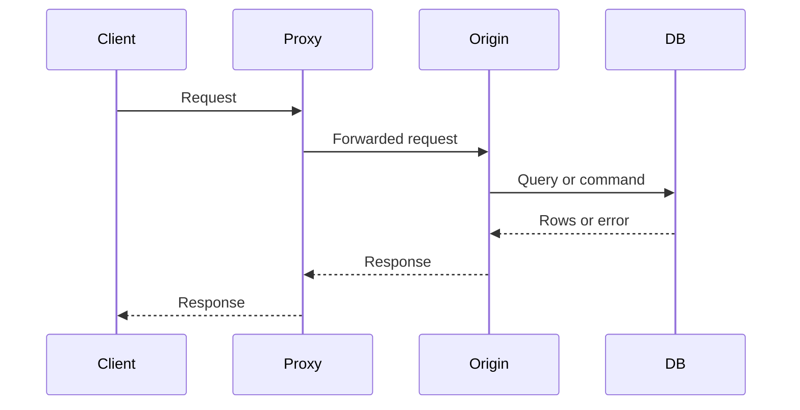
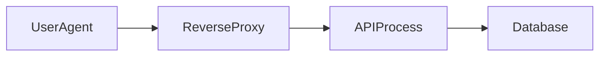

# Client-Server Architecture and the Request-Response Lifecycle

## 1. Metadata and prerequisites

- Topic IDs: D01-T01, D01-T02
- Domain: 1, HTTP and Web Fundamentals
- Difficulty: Beginner
- Prerequisites: none
- Learning objectives:
  - Define the client-server split and name which side owns user state, business rules, and data.
  - Trace one HTTP exchange from the application call through the server and back.
  - Identify where a bug lives: client, network, proxy, application, or data store.
- Related topic IDs: D01-T03, D01-T05, D01-T21, D02-T03, D12-T03
- Estimated complexity: low
- Completion status: TECHNICALLY_REVIEWED
- Verification: prose checked against RFC 9110 terminology on 2026-10-13. No executable project in this chapter. Curl illustrations are unverified in this environment.

## 2. Introduction and fundamentals

### D01-T01 Client-server architecture

**Formal definition.** Client-server architecture splits a system into a requester (the client) and a provider (the server). The client initiates communication. The server listens, applies rules, and returns a response. In HTTP, the client is the user agent or another service, and the server is an origin server, often reached through intermediaries.

**Intuition.** A browser, mobile app, or another backend does not read the database. It asks an API process to do that. The API process is replaceable as long as the contract stays stable.

**Why it exists.** Separating the interface from the data store lets many clients share one authority for rules, security, and consistency. It also lets the server change storage without shipping a new client, as long as the messages stay compatible.

**Problems it solves.**

- One place to enforce authorization and validation.
- Independent scaling of the stateless API tier and the database.
- Multiple clients (web, worker, partner) over one contract.

**Terminology.**

| Term | Meaning |
| --- | --- |
| User agent | The program that initiates the request on behalf of a user or job. |
| Origin server | The program that can produce the authoritative response for the target resource. |
| Intermediary | A proxy, gateway, or CDN that forwards or answers on behalf of the origin. |
| Resource | The thing named by the URI, not the database row itself. |

**Use cases.** A storefront web app calls an order API. A nightly worker calls the same API. A partner calls a narrower public API. All three are clients. The order service is the server even when it becomes a client of a payment provider.

**Misconceptions.**

- The server does not push arbitrary application state to a resting client unless you add a channel such as a stream, WebSocket, or webhook. The baseline model is request then response.
- "Client" is not "untrusted browser" only. A backend calling another backend is a client of that second service.
- Putting the UI and the API in one repository does not remove the boundary. The boundary is who may enforce rules.

### D01-T02 Request-response lifecycle

**Formal definition.** The request-response lifecycle is the ordered exchange in which a client sends one request message and the server returns one response message for that request. HTTP/1.1, HTTP/2, and HTTP/3 all preserve this application semantics even when the bytes on the wire are framed differently (RFC 9110).

**Intuition.** Every API call has a start, a server-side decision, and an end that the client can observe as a status code plus headers and an optional body.

**Why it exists.** A bounded exchange gives timeouts, retries, and logs a single unit of work to attach to.

## 3. Internal workings

Walk one `GET /products/42` from a laptop to a FastAPI process behind a reverse proxy.

1. The client resolves the host name to an address (DNS). Details are in D01-T21.
2. The client opens or reuses a connection. TLS runs if the scheme is `https`.
3. The client writes a request: method, target, headers, and sometimes a body.
4. Intermediaries may refuse, cache, or forward the request. A cache is allowed to answer only when the method and cache metadata say so.
5. The origin accepts the connection, reads a complete request, and routes it to application code.
6. The application authenticates, authorizes, reads or writes data, and chooses a status code and representation.
7. The server writes the response and, depending on the protocol and headers, keeps the connection open for another request.
8. The client reads the status, headers, and body, then decides whether to follow a redirect, retry, or surface an error.

The lifecycle is not "the function returned JSON." Routing, dependencies, database work, and serialization all sit inside step 6. Domain 17 traces that inner path for FastAPI.

Failure can stop the lifecycle before application code runs: DNS failure, TCP timeout, TLS error, proxy `502`/`504`, or a client that disconnects. Those are different from an application `404`.



The diagram shows a cache miss that reaches the origin. If the proxy has a fresh cached response for a cacheable method, the origin and database hops do not happen. That is still a completed request-response cycle for the client.

## 4. Architecture diagrams

The component view used for the rest of the handbook:



The user agent owns the screen and the caller's credentials. The reverse proxy terminates TLS, enforces size limits, and may load-balance. The API process owns HTTP semantics and business rules. The database owns durable state. Skipping the API and letting a client talk to the database removes a trust boundary.

## 5. Code and implementation

This chapter has no application. The following `curl` invocation is an illustration of the lifecycle, not a verified run in this workspace.

```bash
curl -sS -D - -o body.txt "https://example.com/products/42"
```

What you should see on a successful exchange:

- A status line such as `HTTP/1.1 200 OK` in the header dump.
- Response headers, then a body file.
- `curl`'s exit code `0` when the transfer completes. A completed HTTP error such as `404` can still be exit code `0` unless you pass `--fail`.

Use `--fail-with-body` when a script must treat 4xx and 5xx as failures and still keep the error body.

**Pseudocode, not executable framework code:**

```text
connection = acquire_connection(origin)
write_request(connection, request)
response = read_response(connection)
release_or_close(connection)
```

## 6. API contracts

No resource contract yet. The lifecycle still implies these rules for every later endpoint:

| Piece | Rule |
| --- | --- |
| Method | States what the client asks the server to do. |
| Target URI | Names the resource. |
| Status code | States the outcome. It is not optional metadata. |
| Body | Present only when the status and method allow it. |

## 7. Production considerations

Mandatory:

- Log the method, path template, status, and duration for every completed request. Do not log raw credentials or full payment bodies.
- Time out connects and reads. A client that never finishes sending a body occupies a worker.
- Distinguish proxy failures from application failures in dashboards.

Optional:

- Distributed tracing so the database span is a child of the request span.
- Request IDs generated at the edge and forwarded inbound. See D05-T17.

## 8. Comparison and tradeoffs

| Style | What it does | Advantage | Cost | Use when |
| --- | --- | --- | --- | --- |
| Client-server HTTP | Client pulls a response | Simple operations, caches, standard clients | Client must poll for later results | CRUD and most business APIs |
| Server push on a stream | Server writes events on an open response | Low latency updates | Harder load balancing and retries | SSE or chunked progress |
| Direct database clients | UI connects to the database | Fewer hops | Credentials and rules spread to every client | Almost never for a multi-user product |

Peer-to-peer systems remove the dedicated server. They are outside this handbook because the curriculum's APIs have an authority that enforces policy.

## 9. Debugging and troubleshooting

**Symptom:** the UI spinner never ends.  
**Likely cause:** the lifecycle never produced a response: DNS, TCP, TLS, a proxy timeout, or an application deadlock.  
**Reproduce:** call the same URL with `curl -v --max-time 10`.  
**Diagnose:** `curl` stops at "Resolving host" (DNS), "Connecting" (TCP), "TLS handshake" (certificate or protocol), or after the request is sent (server or proxy).  
**Fix:** repair the failed hop. Do not start by changing JSON schemas if the status line never arrived.  
**Prevent:** client timeouts, server access logs, and a health check that does not depend on the failing dependency.  
**Tests:** a contract test that asserts a status line exists for the happy path and for a forced `404`.

**Symptom:** the client shows HTML from a proxy while the API returns JSON locally.  
**Cause:** an intermediary generated the response.  
**Diagnose:** compare `Via`, `Server`, and the body between a direct pod port-forward and the public URL.

## 10. Interview preparation

**Beginner.** What is a client in an API system?  
**Model answer.** The component that opens the exchange by sending an HTTP request. It can be a browser, a mobile app, a test, or another service.  
**Incorrect answer.** "The frontend," which excludes service-to-service calls.

**Intermediate.** Where can a request fail before your route function runs?  
**Model answer.** DNS, TCP connect, TLS, request framing, proxy limits, authentication middleware, and routing. A stack trace in the route is evidence you got past those layers, not evidence they are healthy.  
**Follow-up.** How would you prove the proxy is the component returning `502`? Compare the `Server` header and proxy error log with the application log for the same timestamp and request ID.

**Scenario.** Users report that "the API is down," but your process is running. What do you check first?  
**Model answer.** Whether clients complete a response at all. Check edge status codes, connect errors, and only then application exceptions. A running process can still be unreachable or stuck before the handler.

## 11. Exercises and mastery assessment

1. **Conceptual.** Draw the hops for a request that is served from a CDN cache. Name which components do not run.
2. **Coding.** Write a `curl` command that saves headers and body separately and fails the shell on HTTP 4xx or 5xx while keeping the body.
3. **Debugging.** A colleague says "PostgreSQL is down" because the browser shows `504`. List three observations that would support or reject that claim.
4. **Design.** Why should a mobile client and a partner integration share the order API instead of separate databases?

**Hints.** For (2), look up `curl --fail-with-body`, `-D`, and `-o`. For (3), a `504` is a gateway timeout: the proxy did not get a timely response. The database might be slow, or the app might be deadlocked, or the proxy might be calling the wrong upstream.

**Solutions.**

1. Client to CDN. Origin and database do not run when the cached response is fresh and the request is cacheable.
2. `curl --fail-with-body -D headers.txt -o body.txt URL` (unverified illustration).
3. Supporting evidence: database error rate, connection pool timeouts, slow query logs. Rejecting evidence: the app never received the request, the proxy upstream address is wrong, or the app returns `200` on a direct call while the gateway times out.
4. One authority for price, stock, and authorization. Two databases drift and double-charge.

**Verification criteria.** You can point to the hop that creates the status code. You can explain a case with no application log line.

**Mastery checklist.**

- Define client, origin, and intermediary.
- List the lifecycle in order.
- Separate "no response" from "error response."

**Revision summary.** Client-server HTTP is a request followed by exactly one response for that request. Intermediaries are part of the lifecycle. Later chapters fill in bytes, methods, and status codes.
