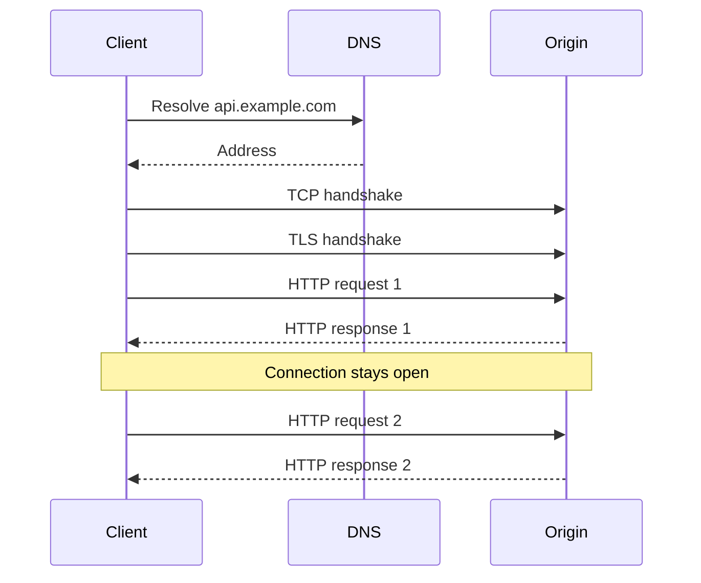
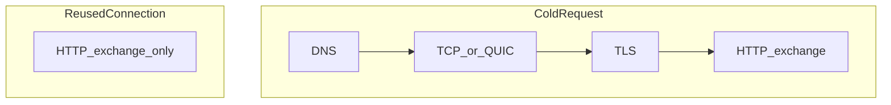

# HTTP, HTTPS, Protocol Versions, and Connection Lifecycle

## 1. Metadata and prerequisites

- Topic IDs: D01-T03, D01-T04, D01-T21, D01-T22
- Domain: 1, HTTP and Web Fundamentals
- Difficulty: Intermediate
- Prerequisites: D01-T01, D01-T02
- Learning objectives:
  - Separate HTTP semantics from the wire protocol.
  - Explain what TLS protects and what it does not.
  - Describe DNS, TCP or QUIC, and connection reuse without claiming they are the same layer.
- Related topic IDs: D01-T05, D28-T12, D30-T09
- Estimated complexity: medium
- Completion status: TECHNICALLY_REVIEWED
- Verification: RFC 9110, RFC 9112, RFC 9113, and RFC 9114 terminology reviewed 2026-10-13. Packet captures were not run here.

## 2. Introduction and fundamentals

### D01-T03 HTTP and HTTPS

HTTP is an application protocol for transferring representations of resources. HTTPS is HTTP over TLS. The method, status codes, and headers mean the same thing. TLS provides confidentiality, integrity, and server authentication on the connection (and client authentication if you configure mutual TLS).

TLS does not make an API safe. It does not stop a valid user from reading another user's order. It does not stop SQL injection. It does stop a passive network observer from reading the bearer token.

Use HTTPS for every environment that is not a closed local socket. Terminate TLS at the reverse proxy in most deployments, and still use TLS between the proxy and the origin when the network is shared.

### D01-T04 HTTP/1.1, HTTP/2, and HTTP/3

All three carry the same HTTP semantics (RFC 9110). They differ in framing and transport.

| Protocol | Spec | Transport | Framing | Practical consequence |
| --- | --- | --- | --- | --- |
| HTTP/1.1 | RFC 9112 | TCP | Text messages. One response at a time per connection unless pipelining, which clients mostly avoid. | Head-of-line blocking inside one connection. Simple to debug with `curl -v`. |
| HTTP/2 | RFC 9113 | TCP | Binary frames and many streams on one connection. | Multiplexed requests. One lost TCP packet can stall all streams on that connection. |
| HTTP/3 | RFC 9114 | QUIC over UDP | Binary frames on independent QUIC streams. | Loss on one stream does not block the others. UDP must be allowed on the path. |

**Misconception.** HTTP/2 is not "faster HTTP" for every API. A single large download may not improve. Many small concurrent requests often do, because they share one connection without waiting in line.

Servers and clients negotiate with ALPN during TLS: typically `http/1.1` or `h2`. HTTP/3 is negotiated with DNS HTTPS records or the `Alt-Svc` header, then a QUIC connection.

### D01-T21 DNS, TCP, TLS, and the connection lifecycle

Order for a cold `https://api.example.com/v1/orders`:

1. **DNS.** Resolve the name to one or more addresses. A stale or poisoned answer sends the client to the wrong host. DNS does not carry the HTTP request.
2. **Transport.** TCP three-way handshake to the chosen address, or a QUIC handshake for HTTP/3. Failure here is "connection refused" or a timeout, not an HTTP status.
3. **TLS.** Client and server agree on a version and cipher suite. The client checks the certificate name against the host it intended. Failure here is a certificate error, before any HTTP status.
4. **HTTP.** The client sends the request on the secured connection. Only now can you get `200` or `404`.

Intermediaries can split this. A CDN terminates TLS, then opens a separate connection to the origin. You then have two TLS sessions and two TCP or QUIC connections.

### D01-T22 Keep-alive and connection reuse

Opening TCP and TLS is expensive relative to a small JSON response. HTTP/1.1 keeps the connection open after a response unless `Connection: close` is set. The client may send another request on that socket. That reuse is keep-alive.

HTTP/1.0 required an explicit `Connection: keep-alive` to opt in. You will rarely speak HTTP/1.0 on purpose.

HTTP/2 and HTTP/3 reuse one connection for many streams by design. Reuse is not free of limits: proxies and servers cap concurrent streams and idle time. An idle connection that the server already closed causes the next client write to fail; good clients retry the request once on a fresh connection if the request is safe or has an idempotency key.

**Misconception.** Keep-alive does not keep a login session. It keeps a socket. Application sessions are cookies or tokens (D01-T16, Domain 7).

## 3. Internal workings



On the second request, DNS, TCP, and TLS do not repeat if the connection is still live and the request targets the same origin. A different host name is a different origin even on the same IP, because the TLS certificate and HTTP host can differ. Browsers also use connection coalescing rules; do not depend on coalescing for API correctness.

Head-of-line blocking on HTTP/1.1: request B's response waits until response A is fully sent on that connection. Browsers open several connections per origin to hide this. HTTP/2 streams remove that application-level queue but still share TCP's single loss recovery. HTTP/3 moves loss recovery down to the stream.

## 4. Architecture diagrams



Production APIs usually place a reverse proxy at the TLS boundary. The public client reuses connections to the proxy. The proxy reuses a pool of connections to Uvicorn. Those are different pools. Raising Uvicorn's worker count without raising the proxy's upstream pool, or the database pool, just moves the queue.

## 5. Code and implementation

Illustrations only. Not executed in this workspace.

Force HTTP/1.1 so the text is readable:

```bash
curl --http1.1 -v "https://example.com/"
```

Ask for HTTP/2:

```bash
curl --http2 -v "https://example.com/"
```

Show TLS without treating it as an HTTP failure:

```bash
curl -vI "https://example.com/"
```

In the verbose log, lines before `>` are connection setup. Lines starting with `>` are the request. Lines starting with `<` are the response.

A Python client reuses connections only when you reuse the client object. Creating `httpx.Client()` per call defeats keep-alive.

```python
# Unverified illustration. Requires httpx inside a project container.
import httpx

with httpx.Client(http2=False, timeout=5.0) as client:
    first = client.get("https://example.com/")
    second = client.get("https://example.com/")
```

Both calls share the client's connection pool. The timeout covers the call; set connect and read limits explicitly in production (`httpx.Timeout(connect=2.0, read=5.0, write=5.0, pool=2.0)`).

## 6. API contracts

Protocol version is not part of your resource contract. Do not branch business rules on HTTP/1.1 versus HTTP/2. Do require `https` in public contracts. Document clock limits that assume connection setup plus application time, not application time alone.

## 7. Production considerations

Mandatory:

- TLS certificates that match the public host name, with automated renewal.
- HTTP redirects to HTTPS only when you intentionally accept the first hop in cleartext. Prefer HSTS after you know HTTPS works.
- Idle timeouts on the proxy greater than the application timeout, or you will see `502`/`504` while the app is still working. The numbers must be ordered: client timeout greater than proxy timeout greater than app timeout, with a documented exception if you stream.
- Connection pools bounded on every hop.

Optional:

- HTTP/2 or HTTP/3 at the edge for browser traffic.
- TLS 1.2 minimum, TLS 1.3 preferred. Disable obsolete protocol versions.
- Mutual TLS for internal service identity when a network policy is not enough.

## 8. Comparison and tradeoffs

| Choice | Advantage | Disadvantage | Choose it when |
| --- | --- | --- | --- |
| HTTP/1.1 to the origin | Easy logs, wide support | Worse multiplexing | Internal hop behind a proxy, or simple APIs |
| HTTP/2 at the edge | Many concurrent browser requests on one connection | Binary frames, harder to read by eye | Public traffic from browsers |
| HTTP/3 | Better behavior under packet loss | Operational complexity, UDP filtering | Mobile clients on lossy networks, after measurement |
| TLS at the proxy only | Simple certificates | Cleartext on the private network | A network you actually trust and control |
| TLS end to end | Protects the private hop | More certificates | Shared or multi-tenant networks |

## 9. Debugging and troubleshooting

**Symptom:** intermittent failures that succeed on retry, with no application log.  
**Cause:** the client reused a connection the server had already closed.  
**Reproduce:** set a short server keep-alive and send a request after the idle window.  
**Diagnose:** client error "connection reset" without a status code.  
**Fix:** retry once for idempotent requests; fix idle timeout mismatch.  
**Prevent:** align proxy, server, and client idle settings.  
**Test:** an integration test cannot easily simulate reset; a chaos check or a unit test of the retry policy can.

**Symptom:** `certificate verify failed`.  
**Cause:** wrong host, expired certificate, missing intermediate, or a corporate intercepting proxy.  
**Fix:** correct the name or the trust store. Do not disable verification in production.

**Symptom:** HTTP/2 works locally and fails at the edge.  
**Cause:** a middlebox strips or mishandles HTTP/2, or ALPN is not enabled on the proxy.  
**Diagnose:** `curl -v --http2` shows the negotiated protocol in the ALPN line.

## 10. Interview preparation

**Beginner.** What does HTTPS add to HTTP?  
**Model answer.** A TLS session under HTTP so the bytes are authenticated and encrypted, and the client can check the server name. Semantics of methods and status codes do not change.  
**Incorrect answer.** "HTTPS is a different REST style" or "HTTPS encrypts the database."

**Intermediate.** Why can HTTP/2 still suffer head-of-line blocking?  
**Model answer.** Streams are independent in HTTP/2 framing, but they share one TCP connection. TCP delivers bytes in order, so a loss stalls every stream until retransmission. HTTP/3 uses QUIC streams to avoid that coupling.  
**Follow-up.** Why might you still speak HTTP/1.1 between Nginx and Uvicorn? Operational simplicity, and the public multiplexing already happened at the edge.

**Advanced.** A client pools connections. What state is safe to store on the connection?  
**Model answer.** Transport state only. Not the current user. The next request on that socket may belong to a different user. Identity belongs in each request: a cookie, a bearer token, or mTLS plus an application principal.

## 11. Exercises and mastery assessment

1. Explain why the second request in a keep-alive session can skip DNS and TLS.
2. A trace shows TLS finished and then 10 seconds of silence before `504`. Which layer is no longer the prime suspect?
3. Why is disabling TLS verification in a Python HTTP client a production defect even for "internal" URLs?
4. Compare one HTTP/1.1 connection carrying 20 sequential requests with one HTTP/2 connection carrying 20 streams.

**Solutions.**

1. The socket is already established to an IP and already has a live TLS session. A DNS change does not move an existing socket.
2. DNS, TCP, and TLS succeeded. Suspect the origin, the upstream pool, or an application that never answered.
3. Anyone who can intercept that path can present a different certificate and read tokens. Internal networks are intercepted and misrouted often enough that verification still matters.
4. HTTP/1.1 on one connection runs those requests one response at a time. HTTP/2 can interleave them. Neither fact changes status-code meaning.

**Mastery checklist.**

- State what TLS does and does not do.
- Name the transport for HTTP/1.1, HTTP/2, and HTTP/3.
- Separate connection reuse from user sessions.

**Revision summary.** HTTPS is HTTP plus TLS. Protocol versions change framing and performance, not resource design. Connections are reused; identity is per request.
