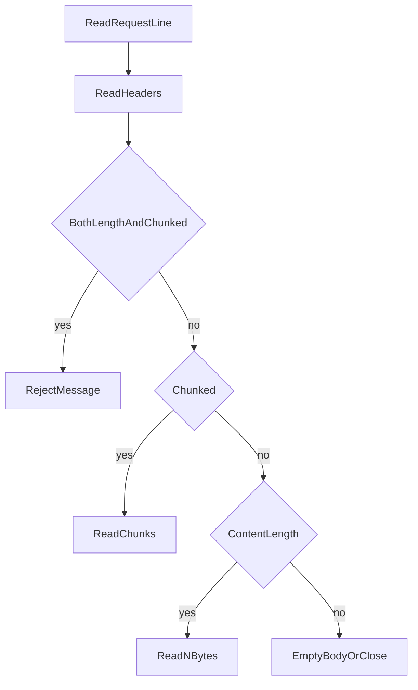

# HTTP Message Structure and Body Framing

## 1. Metadata and prerequisites

- Topic IDs: D01-T05, D01-T06, D01-T07, D01-T08, D01-T14
- Domain: 1, HTTP and Web Fundamentals
- Difficulty: Beginner
- Prerequisites: D01-T02, D01-T04
- Learning objectives:
  - Name every part of an HTTP/1.1 request and response.
  - Explain how the receiver finds the end of the body.
  - Avoid mixing `Content-Length` with chunked framing.
- Related topic IDs: D01-T12, D10-T15, D13-T01
- Estimated complexity: medium
- Completion status: TECHNICALLY_REVIEWED
- Verification: RFC 9112 framing rules reviewed 2026-10-13. Captures below are illustrative and unverified.

## 2. Introduction and fundamentals

### D01-T05 HTTP request structure

An HTTP/1.1 request is a request line, zero or more header fields, a blank line, and an optional body.

```text
POST /v1/orders HTTP/1.1
Host: api.example.com
Content-Type: application/json
Content-Length: 27

{"sku":"pen","qty":1}
```

HTTP/2 and HTTP/3 carry the same information in pseudo-headers (`:method`, `:path`, `:authority`, `:scheme`) plus ordinary headers and DATA frames. When you read application logs you still talk about method, path, headers, and body.

### D01-T06 HTTP response structure

A response is a status line, header fields, a blank line, and an optional body.

```text
HTTP/1.1 201 Created
Content-Type: application/json
Location: /v1/orders/100
Content-Length: 11

{"id":100}
```

The status line is the machine-readable outcome. The body is a representation, not a second status channel.

### D01-T07 Request line, headers, and body

The request line has three parts: method, request target, and protocol version. The target is usually an origin-form path plus query (`/v1/orders?limit=20`). `Host` is required in HTTP/1.1 and identifies the virtual host. In HTTP/2 the authority pseudo-header fills that role.

Headers are name/value pairs. Names are case-insensitive. Order of distinct headers is mostly insignificant; repeated values and hop-by-hop headers have special rules. The body is bytes whose meaning comes from `Content-Type` and the method.

### D01-T08 Response headers and body

Response headers describe the body, caching, redirects, and authentication challenges. The body is optional. `204` and `304` and successful responses to `HEAD` do not include a body. If you add a body to `204`, intermediaries and clients will mis-read the next bytes on an HTTP/1.1 connection.

### D01-T14 Content-Length and transfer encoding

The receiver must know where the body ends so it can find the next message on a reused connection.

Two framing tools in HTTP/1.1 (RFC 9112):

- `Content-Length: N` means the body is exactly N bytes.
- `Transfer-Encoding: chunked` sends the body as a series of chunks and ends with a zero-length chunk. The sender may not know N in advance.

Do not send both. RFC 9112 requires rejection of a request that has both `Transfer-Encoding` and `Content-Length`, because intermediaries have historically disagreed and attackers used that disagreement for request smuggling (D10-T15).

HTTP/2 and HTTP/3 do not use chunked transfer encoding. DATA frames already mark body length. `Content-Length` may still be present as a hint, and if it disagrees with the frame payload the message is malformed.

## 3. Internal workings

A server reading HTTP/1.1:

1. Read bytes until CRLF to get the request line. Enforce a maximum size.
2. Read header lines until an empty line. Enforce a maximum header count and total size.
3. If `Transfer-Encoding` is present, decode chunks until the terminating chunk. Trailers may follow.
4. Otherwise if `Content-Length` is present, read exactly that many bytes.
5. Otherwise if the method cannot have a body, the body is empty. Requests that might have a body but have neither header are invalid in practice; treat them as a client error rather than waiting forever.



Closing the connection to mark the end of a **response** body is legal for HTTP/1.1 when neither length nor chunked encoding is used. That prevents reuse. Request bodies should not rely on connection close; the server would not know when to start the response.

## 4. Architecture diagrams

The message is not the Python object. Frameworks parse bytes into a request object, then your code sees method, URL, headers, and a stream. Returning a dict starts the opposite path: serialization, then framing.


## 5. Code and implementation

Illustrative raw request. Unverified.

```text
GET /v1/products?limit=2 HTTP/1.1
Host: api.example.com
Accept: application/json
```

There is no body. There must be no `Content-Length` pretending otherwise.

A chunked response illustration:

```text
HTTP/1.1 200 OK
Transfer-Encoding: chunked
Content-Type: application/json

1f
{"items":[{"id":1},{"id":2}]}
0

```

`1f` is the hexadecimal chunk size (31 bytes). `0` ends the body. The blank line after the zero chunk ends the message if there are no trailers.

FastAPI and Uvicorn frame this for you. You still need to know the rules when a proxy returns "upstream sent too big header" or when a client hangs because the server never closed a body that lacked `Content-Length`.

## 6. API contracts

Document the body media type and the maximum size. The contract should say:

- Requests over the limit receive `413`.
- A missing or unknown `Content-Type` on a JSON body receives `415`.
- Clients must not send `Content-Length` that disagrees with the bytes they send. If they do, the connection is bad; do not try to "be helpful" by guessing.

## 7. Production considerations

Mandatory:

- Limit header size and body size at the proxy. Application limits are a second line, not the only line.
- Reject ambiguous framing. Do not deploy servers and proxies that disagree on `Content-Length` versus `Transfer-Encoding`.
- Log the response status and byte count, not the raw body, for ordinary traffic.

Optional:

- Trailers for checksums or gRPC-style status. Rare in JSON APIs. If you use them, confirm every proxy forwards them.

## 8. Comparison and tradeoffs

| Framing | Advantage | Disadvantage |
| --- | --- | --- |
| Content-Length | Simple, required for many retries that buffer | Sender must know the size first |
| Chunked | Can stream generated output | Harder for some caches; easy to implement incorrectly |
| HTTP/2 DATA frames | No chunked encoding | Requires an HTTP/2 stack end to end on that hop |

Buffering the whole body to compute `Content-Length` uses memory. Streaming with chunked encoding or HTTP/2 frames keeps memory flat. Streaming hurts retries: the client cannot resend a half-consumed upload unless it kept a copy.

## 9. Debugging and troubleshooting

**Symptom:** the client waits forever after the application logged "returned."  
**Cause:** the server did not frame the body and did not close the connection.  
**Diagnose:** `curl -v` shows headers and then stalls. Look for a missing `Content-Length` on an HTTP/1.1 response that stayed open.  
**Fix:** let the framework set the length, or use a streaming response that terminates the chunk stream.

**Symptom:** intermittent `400` only behind the load balancer.  
**Cause:** request smuggling from conflicting length headers.  
**Diagnose:** capture the raw request at the proxy and at the origin. If one hop sees two requests and the other sees one, you have a framing bug.  
**Fix:** one unambiguous length. Update proxy and origin. See D10-T15.

**Symptom:** `413` for a small JSON document.  
**Cause:** the limit is on headers, or a client sent a huge `Cookie` header, or the proxy limit is lower than the app limit.  
**Diagnose:** compare `Content-Length` with the configured limits at each hop.

## 10. Interview preparation

**Beginner.** What are the three parts of an HTTP/1.1 request?  
**Model answer.** Request line, headers, and optional body, with a blank line between headers and body.  
**Incorrect answer.** "URL, JSON, and status code." The status code is on the response. JSON is one possible body.

**Intermediate.** Why is `Content-Length` together with `Transfer-Encoding: chunked` dangerous?  
**Model answer.** Two hops can choose different lengths and disagree on where the next request starts. That desynchronization is request smuggling. RFC 9112 says to reject such a request.  
**Follow-up.** How does HTTP/2 avoid chunked encoding? Length is a property of DATA frames.

**Debugging.** The app sets a 20 byte body but `Content-Length: 200`. What happens?  
**Model answer.** The client waits for 180 more bytes or times out. The next response on that connection can be parsed as part of the body. Fix the length or the bytes; do not leave the client to guess.

## 11. Exercises and mastery assessment

1. Mark the request line, headers, and body in a sample `POST`.
2. Explain which header tells the client that a `201` body is JSON.
3. Why must `204` omit a body on a keep-alive connection?
4. A streaming export does not know its final size. Which HTTP/1.1 framing do you use?

**Solutions.**

1. First line is the request line. Lines until the blank line are headers. Bytes after the blank line are the body, bounded by `Content-Length` or chunks.
2. `Content-Type: application/json`. `Accept` is the client's wish, not the server's statement.
3. The next bytes the client reads would be interpreted as the body or as the next status line, depending on length headers. An accidental body corrupts the connection.
4. `Transfer-Encoding: chunked`, or HTTP/2/3 DATA frames without requiring a length up front.

**Mastery checklist.**

- Read a raw HTTP/1.1 message out loud, part by part.
- State how the body ends.
- Refuse dual framing.

**Revision summary.** Messages are a start line, headers, and an optional framed body. `Content-Length` and chunked encoding are alternative frames. Ambiguous frames are a security bug, not a style issue.
