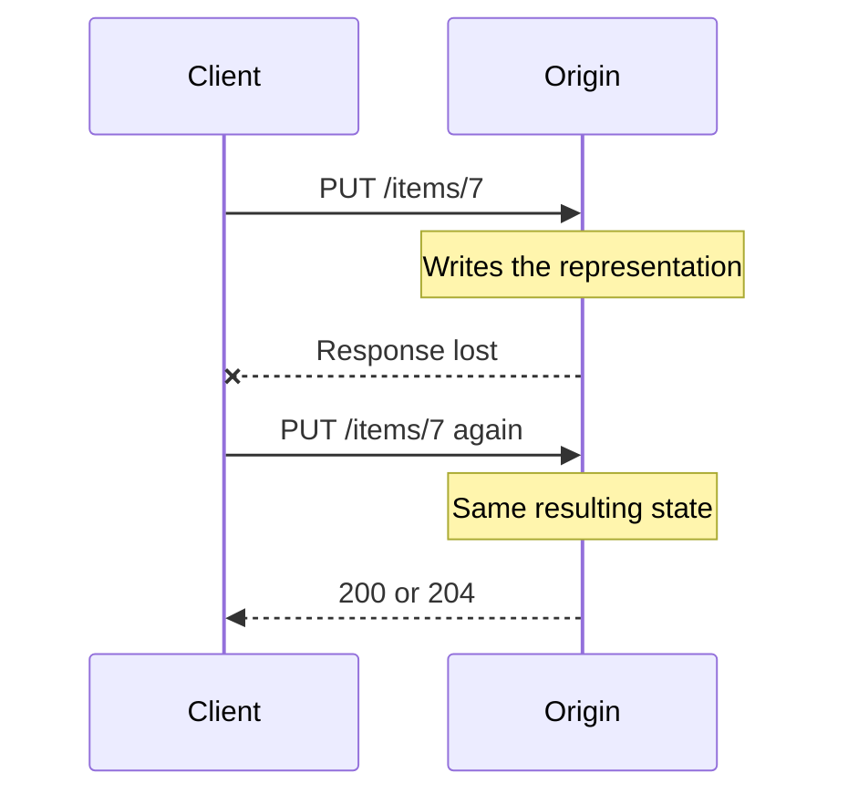
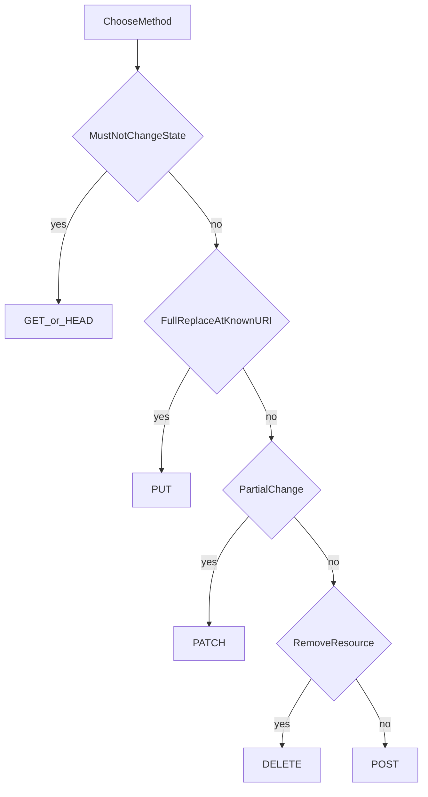

# HTTP Methods, Safety, and Idempotence

## 1. Metadata and prerequisites

- Topic IDs: D01-T09, D01-T10
- Domain: 1, HTTP and Web Fundamentals
- Difficulty: Beginner
- Prerequisites: D01-T05, D01-T07
- Learning objectives:
  - Choose a method from its semantics, not from habit.
  - Define safe and idempotent precisely, including methods that are one but not the other.
- Related topic IDs: D03-T01 through D03-T07, D08-T05
- Estimated complexity: medium
- Completion status: TECHNICALLY_REVIEWED
- Verification: RFC 9110 sections 9.2 (safe and idempotent) reviewed 2026-10-13. Examples are illustrative and unverified.

## 2. Introduction and fundamentals

### D01-T09 HTTP methods

A method is the client's requested action on the target resource. The standard methods in this curriculum are:

| Method | Primary meaning in RFC 9110 |
| --- | --- |
| GET | Transfer a current representation of the target resource. |
| HEAD | Same as GET, but the server must not send a body. Headers should match what GET would have sent. |
| POST | Process the representation according to the resource's own rules. Often creates a subordinate resource or starts an action. |
| PUT | Replace the target resource's state with the request representation. Creates it if the server allows creation at that URI. |
| PATCH | Apply a set of partial changes described in the body. The patch format is part of the contract. |
| DELETE | Remove the association between the target URI and its current functionality, or delete the resource, depending on the contract. |
| OPTIONS | Describe communication options for the target, including allowed methods. Browsers also send it as a CORS preflight. |

Other registered methods exist (`TRACE`, `CONNECT`). Do not implement `TRACE` on a public API. `CONNECT` is for tunnels, not for CRUD.

**Misconception.** POST is not "the method that uses a body." PUT and PATCH have bodies. GET can legally carry a body, but you must not do that: caches, logs, and servers may discard it. Put query data in the query string or use POST for a complex search if the query is too large or sensitive for a URL.

### D01-T10 Safe and idempotent methods

**Safe.** The client does not request a state change on the origin. GET, HEAD, and OPTIONS are safe. A safe method may still change access logs, hit counters used for operations, or prefetch caches. It must not create an order or delete a row as its purpose.

**Idempotent.** Repeating a request that has already completed has the same intended effect as one successful request. GET, HEAD, OPTIONS, PUT, and DELETE are idempotent. POST is not. PATCH is not in general, because "add 1 to quantity" applied twice is a different effect. A PATCH that sets `quantity` to 5 can be idempotent if you define it that way; the method itself does not promise that.

Safe implies idempotent. Idempotent does not imply safe. DELETE is idempotent and not safe: the first call removes the resource; later calls leave it removed.

**Why the properties exist.** Browsers may retry safe methods. Caches may store safe responses. Clients and proxies may retry idempotent methods after a lost response. They must not blindly retry POST.

## 3. Internal workings

When a retry happens, the client often does not know whether the server processed the first attempt. That uncertainty is why the property matters.



If that second call were `POST /items` that inserts a row, the client would create a duplicate. The fix is either an idempotent method (`PUT` at a client-chosen URI) or an idempotency key on POST (D08-T05).

A cache key includes the method. A POST response is not reused as a GET response. A GET that changes data will be called by prefetchers and crawlers. That is a defect in the API, not in the crawler.

## 4. Architecture diagrams



This flowchart is a design aid. Domain 3 is the full treatment of each method and of status codes.

## 5. Code and implementation

Illustrative requests. Unverified.

```bash
curl -sS "https://api.example.com/v1/orders/100"
curl -sS -I "https://api.example.com/v1/orders/100"
curl -sS -X OPTIONS "https://api.example.com/v1/orders/100"
curl -sS -X PUT "https://api.example.com/v1/orders/100" -H "Content-Type: application/json" -d "{\"status\":\"packed\"}"
curl -sS -X PATCH "https://api.example.com/v1/orders/100" -H "Content-Type: application/json" -d "{\"status\":\"packed\"}"
curl -sS -X DELETE "https://api.example.com/v1/orders/100"
curl -sS -X POST "https://api.example.com/v1/orders" -H "Content-Type: application/json" -d "{\"sku\":\"pen\"}"
```

`-X GET` is unnecessary. `-I` sends HEAD. Do not use `-X POST` with `-d` if you can use `curl -d`, which already selects POST.

There is no Python application in this chapter. Later FastAPI routes must declare the method that matches this table:

```python
# Unverified shape. Not a complete application.
@router.get("/orders/{order_id}")
def read_order(order_id: int) -> dict:
    return {"id": order_id}
```

A GET handler that inserts a row fails the safety rule even if the framework allows it.

## 6. API contracts

Document for each route:

- Method and path.
- Whether a retry can be issued by a generic client.
- For PUT, whether the body is a full replacement. Missing fields must not be treated as "leave unchanged"; that is PATCH behavior.
- For DELETE, whether a second call returns `204` or `404`. Both can be idempotent. Pick one and keep it.

## 7. Production considerations

Mandatory:

- Do not retry POST automatically in API gateways unless an idempotency key is part of the contract.
- Do not log GET query strings that contain secrets. Prefer headers for credentials.
- Return `405` with an `Allow` header when the method is wrong, so clients can see the legal set.

Optional:

- Support HEAD for expensive GET routes so monitors can check headers without the body.
- Answer OPTIONS with `Allow` even when CORS is not involved.

## 8. Comparison and tradeoffs

| Goal | Better method | Why not the other |
| --- | --- | --- |
| Read a resource | GET | POST is uncacheable and not safe |
| Create when the server assigns the ID | POST | PUT needs a URI the client already knows |
| Create when the client assigns the ID | PUT | POST retries duplicate |
| Change one field | PATCH | PUT requires the full representation and can wipe omitted fields |
| Replace every field | PUT | PATCH documents are easy to misread as merges when you meant replacement |
| Remove | DELETE | POST /delete is an RPC exception you should justify |

## 9. Debugging and troubleshooting

**Symptom:** duplicate orders after a mobile timeout.  
**Cause:** the client retried POST. The first request had succeeded and the response was lost.  
**Reproduce:** send POST, drop the response, send it again.  
**Fix:** idempotency key or a client-generated order id with PUT.  
**Prevent:** gateway retry policy that retries only idempotent methods.  
**Test:** two identical POSTs without a key create two rows; two with the same key return one row.

**Symptom:** a PUT "update" cleared fields the client did not send.  
**Cause:** the handler treated a partial JSON object as a full replacement and wrote nulls into omitted columns.  
**Fix:** require the full document for PUT, or switch the contract to PATCH and use an explicit merge.

## 10. Interview preparation

**Beginner.** Is DELETE idempotent?  
**Model answer.** Yes. After the resource is gone, repeating DELETE does not remove it again. The status code of the repeat may be `204` or `404`; the server state stays "absent."  
**Incorrect answer.** "No, because the second call returns 404," which confuses the status code with the state change.

**Intermediate.** Why is PATCH not listed as idempotent in RFC 9110?  
**Model answer.** The effect depends on the patch document. An increment operation is not idempotent. A set-field operation can be. The method does not guarantee either, so generic clients must not assume they can retry PATCH.  
**Follow-up.** How do you make a non-idempotent POST safe to retry? Store the result under an `Idempotency-Key` and return the stored response on replay.

**Design.** A button "pay invoice" is implemented as GET so it is easy to call from email. What is wrong?  
**Model answer.** GET is safe. Mail clients and prefetchers will invoke it. Payment must be POST or another unsafe method, protected by authentication and an idempotency key.

## 11. Exercises and mastery assessment

1. Classify GET, PUT, PATCH, DELETE, and POST as safe, idempotent, both, or neither.
2. Show two PATCH bodies: one idempotent, one not.
3. A proxy retries every failed request. Which routes will double-charge customers?
4. Why can HEAD exist without a second database query shape?

**Solutions.**

1. GET: both. PUT: idempotent only. PATCH: neither in general. DELETE: idempotent only. POST: neither.
2. `{"status":"packed"}` sets a field and can be idempotent. `{"op":"add","qty":1}` is not.
3. POST payment routes, and any mislabeled GET that charges.
4. HEAD should run the same authorization and metadata as GET and omit the body. You may still query, but you must not skip authorization just because there is no body.

**Mastery checklist.**

- Define safe and idempotent without using examples alone.
- Name one method that is idempotent and unsafe.
- Refuse GET with side effects.

**Revision summary.** Methods advertise retry and cache behavior. GET reads. PUT replaces. PATCH patches. DELETE removes. POST does the specific thing the resource defines. Safety and idempotence are properties clients and intermediaries rely on.
