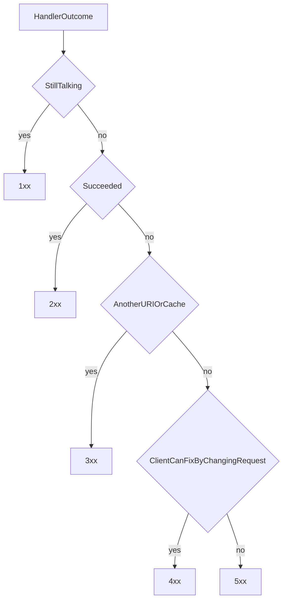
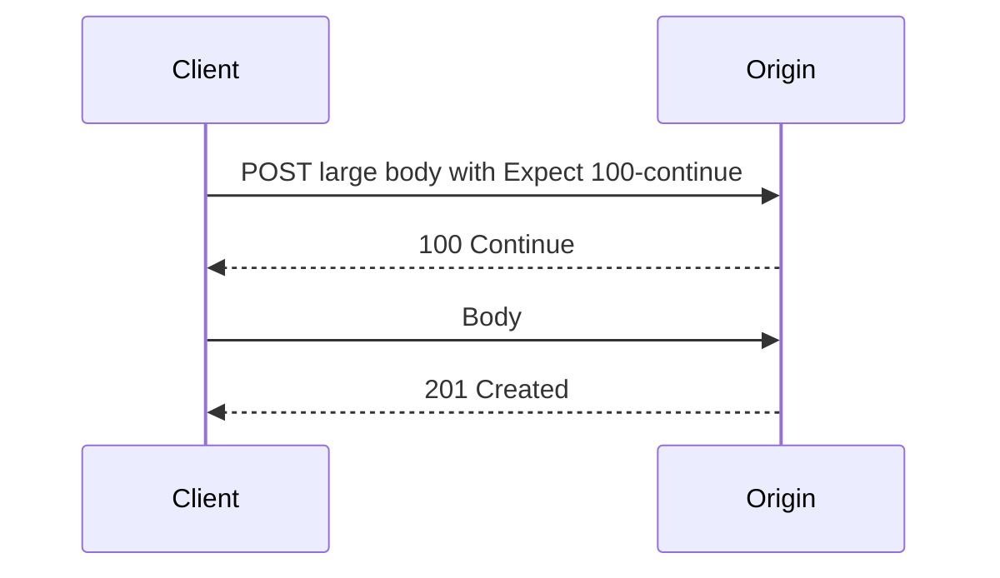

# HTTP Status Code Classes

## 1. Metadata and prerequisites

- Topic IDs: D01-T11
- Domain: 1, HTTP and Web Fundamentals
- Difficulty: Beginner
- Prerequisites: D01-T06, D01-T09
- Learning objectives:
  - Classify any status code by its first digit.
  - Explain what clients and intermediaries are allowed to do with each class.
  - Leave specific code selection to Domain 3 without teaching the wrong class.
- Related topic IDs: D03-T08 through D03-T28, D19-T10
- Estimated complexity: low
- Completion status: TECHNICALLY_REVIEWED
- Verification: RFC 9110 status class definitions reviewed 2026-10-13.

## 2. Introduction and fundamentals

### D01-T11 HTTP status codes

The status code is a three-digit integer. The first digit is the class. The reason phrase (`OK`, `Not Found`) is optional for machines. Clients must branch on the number, not the phrase. You may send an empty reason phrase.

| Class | Range | Meaning | Typical client behavior |
| --- | --- | --- | --- |
| 1xx | 100–199 | Informational. The request is still in progress. | Continue sending or wait. Not a final outcome. HTTP APIs rarely use these except `100 Continue` and, on HTTP/2, limited informational responses. |
| 2xx | 200–299 | The request succeeded, in the sense the method defines. | Read the representation if one is allowed. |
| 3xx | 300–399 | Further action is needed to complete the request, often a different URI or a cached copy. | Follow redirects when the method and the specific code allow it. `304` means "use your cache," not "go elsewhere." |
| 4xx | 400–499 | The client seems to have erred. The server should not fulfill the same request unchanged. | Do not blindly retry. Fix the request, credentials, or wait for `429` guidance. |
| 5xx | 500–599 | The server failed or cannot perform the method. | Retry only if the method is idempotent or you have an idempotency key, and only with backoff. |

**Misconceptions.**

- `200` with `{"error": true}` is a broken contract. The class already has a channel for failure.
- `500` is not a validation error. Validation is a client problem: `400` or `422`.
- `404` does not always mean "missing row." It can also hide a resource the caller must not know about. If you do that, do it consistently so existence does not leak through timing or a different code.
- A body may accompany 4xx and 5xx. It does not replace the status code.

`100 Continue` exists so a client can ask, via `Expect: 100-continue`, whether to send a large body. The server can reject first. Most JSON APIs never see this because the client sends the small body immediately.

## 3. Internal workings

The origin, or an intermediary, picks one final status code per request. Informational 1xx responses can precede that final response. Caches store some 2xx and 3xx responses and reuse them according to RFC 9111. Caches do not normally store 4xx other than specific cases such as `404` when explicitly cacheable. A `401` can be stored only under narrow rules; do not depend on that.



Frameworks pick a code if you do not. FastAPI uses `200` for a normal return, `422` for request validation errors, and `500` for an uncaught exception. Those defaults are not always the code you want. Domain 3 and Domain 19 override them on purpose.

## 4. Architecture diagrams



If you never send `Expect`, you will not see `100`. Teaching 1xx matters so you do not treat a non-final response as success or failure.

## 5. Code and implementation

Illustration of reading the class. Unverified Python, standard library only.

```python
def retryable(status: int, method_is_idempotent: bool) -> bool:
    if status < 100 or status > 599:
        raise ValueError("not an HTTP status")
    if 100 <= status <= 199:
        return False
    if 200 <= status <= 399:
        return False
    if status == 408 or status == 429:
        return True
    if 500 <= status <= 599:
        return method_is_idempotent
    return False
```

`408` is Request Timeout. `425` Too Early should not be retried blindly. The snippet is a teaching sketch, not a full retry policy. It has not been executed here.

A response sketch:

```text
HTTP/1.1 404 Not Found
Content-Type: application/problem+json
Content-Length: 78

{"type":"about:blank","title":"Not Found","status":404}
```

The integer in the body should match the status line. RFC 9457 says that if `status` is present it must match.

## 6. API contracts

Every operation in later chapters lists the status codes it can return. The class rules above are the filter:

- Success codes are 2xx, and the specific code says whether something was created, accepted, or empty.
- Redirects are explicit. JSON APIs should not redirect a POST to a GET and drop the body. Use `307` or `308` when the method must be preserved. Details are in D03-T12.
- Client bugs are 4xx even when they are "business rules," if the same bytes would fail again.
- Dependency outages are 5xx, usually `502` or `503`, not `400`.

## 7. Production considerations

Mandatory:

- Count responses by class and by exact code. A rise in `401` and a rise in `500` are different incidents.
- Never return a stack trace in a 5xx body.
- Alert on `5xx` rate and on saturation signals, not on every `404`.

Optional:

- A synthetic document that lists which 4xx your API uses, so clients can write one error parser.

## 8. Comparison and tradeoffs

| Situation | Class | Do not use |
| --- | --- | --- |
| Created a row | 2xx (`201`) | 3xx unless you are only redirecting |
| Need the client to call a different URL | 3xx | 200 with a URL buried in JSON, if a redirect is the real HTTP action |
| Bad JSON | 4xx | 500 |
| Database unreachable | 5xx | 400 |
| Still working, not done | 2xx (`202`) | 1xx as a job system |

`202` is success of *acceptance*, not a 1xx informational response. The final job outcome is a later request.

## 9. Debugging and troubleshooting

**Symptom:** clients retry all `4xx` and create an outage.  
**Cause:** their retry helper treats any non-2xx as transient.  
**Fix:** retry `408`, `429`, and selected `5xx` only, with backoff and an idempotency rule.  
**Prevent:** publish the policy next to the API.

**Symptom:** monitors page on `404` from scanners.  
**Cause:** class-level alerts that treat every 4xx as an outage.  
**Fix:** page on 5xx and on your own dependency failures. Watch 401/403/429 as security or quota signals.

**Symptom:** a proxy shows `502` and the app shows nothing.  
**Cause:** the class was generated by the intermediary because the origin was not a valid HTTP response. The origin may have crashed mid-response.

## 10. Interview preparation

**Beginner.** What does the first digit tell you?  
**Model answer.** The class: informational, success, redirection, client error, or server error. Clients can take a default action from the class even when they do not know the exact code.  
**Incorrect answer.** "4xx means the server crashed."

**Intermediate.** Why is a validation error not a 500?  
**Model answer.** The server understood the protocol and correctly refused the message. The same request will fail again until the client changes it. That is the definition of the 4xx class. 500 means the server did not perform a valid request because the server failed.  
**Follow-up.** When would the same bad-looking input be a 500? When the validation code itself throws because of a bug, or a dependency used during validation is down. Fix the bug; do not document 500 as the validation code.

**Scenario.** You shipped `200` for failures so a mobile client would not throw. What did you break?  
**Model answer.** Caches, metrics, generic retry libraries, and every future client. The status code is part of the contract. Update the mobile client to read 4xx bodies.

## 11. Exercises and mastery assessment

1. Put these codes into classes: 100, 201, 304, 401, 409, 503.
2. Should a client retry `409` automatically? Why?
3. A handler catches all exceptions and returns `200`. Name two external systems that now lie.
4. Is `304` success or a redirect to another host?

**Solutions.**

1. 1xx, 2xx, 3xx, 4xx, 4xx, 5xx.
2. No. The request conflicted with current state. Repeating the same bytes conflicts again. The client must reload and decide.
3. Your metrics (success rate looks perfect) and any cache or client that trusts 2xx. Support staff also lose the error signal.
4. Neither a host change nor a new POST. It is a redirection class response that means the stored representation is still valid.

**Mastery checklist.**

- Recite the five classes and one client action for each.
- Reject `200` error bodies.
- Know that the reason phrase is not the contract.

**Revision summary.** Status classes tell clients whether to proceed, look elsewhere, fix the request, or retry later. Exact codes are Domain 3. The class is already a decision.
