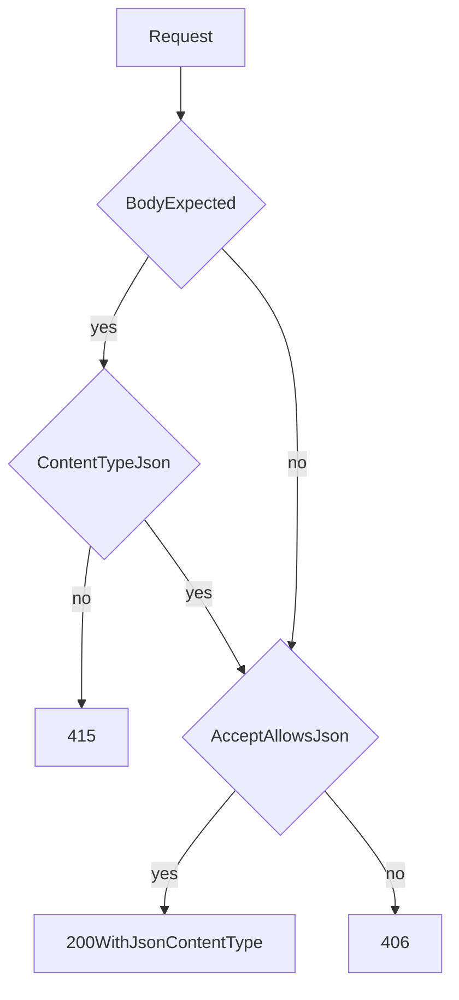
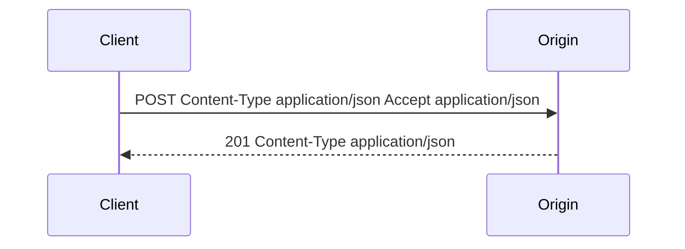

# Content-Type, Accept, and Content Negotiation

## 1. Metadata and prerequisites

- Topic IDs: D01-T12, D01-T13
- Domain: 1, HTTP and Web Fundamentals
- Difficulty: Intermediate
- Prerequisites: D01-T07, D01-T08
- Learning objectives:
  - State what `Content-Type` asserts and what `Accept` requests.
  - Perform a basic proactive negotiation decision.
  - Reject missing or wrong media types with `415`.
- Related topic IDs: D03-T22, D05-T01, D14-T02
- Estimated complexity: medium
- Completion status: TECHNICALLY_REVIEWED
- Verification: RFC 9110 content negotiation terminology reviewed 2026-10-13. Curl examples are unverified.

## 2. Introduction and fundamentals

### D01-T12 Content-Type and Accept

`Content-Type` describes the bytes in this message's body. It includes a media type and optional parameters.

```text
Content-Type: application/json; charset=utf-8
```

JSON's IANA media type is `application/json`. The JSON grammar is Unicode; `charset` is not required and is often ignored. Still send `application/json` on every JSON body.

`Accept` is the client's list of media types it can handle in the **response**, with optional quality values.

```text
Accept: application/json
Accept: application/problem+json, application/json;q=0.9
```

`Content-Type` on a request describes the request body. `Accept` describes the desired response. They are not synonyms. Sending `Accept: application/json` does not tell the server that the request body is JSON.

Related headers you will meet:

| Header | Direction of meaning |
| --- | --- |
| `Content-Type` | What these body bytes are |
| `Accept` | What response media types the client wants |
| `Content-Encoding` | A coding applied to the body, such as `gzip` |
| `Accept-Encoding` | Codings the client can decode |

Do not confuse encoding with type. `Content-Type: application/json` plus `Content-Encoding: gzip` means "gzip-compressed JSON," not "the type is gzip."

### D01-T13 Content negotiation

Content negotiation selects a representation. **Proactive** negotiation uses request headers (`Accept`, `Accept-Language`, `Accept-Encoding`) and the server picks. **Reactive** negotiation sends `300` with alternatives and lets the client pick. JSON APIs almost always use proactive negotiation and usually support one type.

Algorithm you can implement:

1. If the request has a body and the method expects JSON, require a media type that is `application/json` or a documented `+json` suffix type. Otherwise return `415 Unsupported Media Type`.
2. Parse `Accept`. If it is absent, RFC 9110 says the client accepts any type (`*/*`). Your API may still default to JSON.
3. If `application/json` is acceptable, return JSON and set `Content-Type`.
4. If JSON is explicitly excluded, return `406 Not Acceptable`.

Quality values: `Accept: application/xml, application/json;q=0.1` prefers XML. If you only speak JSON, and JSON's q is greater than 0, you may return JSON. If the header is `Accept: application/xml`, you return `406`.

**Misconceptions.**

- A file extension on the URL is not a substitute for `Accept` and `Content-Type`.
- `Content-Type: text/plain` with a JSON string in it will not select your JSON parser.
- Charset sniffing is a bug. Decode as the type says, or reject.

## 3. Internal workings



FastAPI registers JSON as the default request and response type. A route that declares a Pydantic body expects JSON unless you declare a form or file. A wrong content type fails validation before your function runs. That failure should surface as `415` when the media type is unsupported, though a framework may use `422` if it parsed something else first. Know which one your version returns and test it. This chapter does not claim a specific FastAPI status without an executed test.

Server-driven negotiation also covers compression. A proxy may compress a response and add `Content-Encoding`. Your `ETag` must change if the representation bytes change, or you must use a weak validator. Caching details are in D01-T17.

## 4. Architecture diagrams



Error responses can use a different type than success responses. RFC 9457 uses `application/problem+json`. A client that sends `Accept: application/json` can still accept problem documents if you include `application/problem+json` in your supported errors, or if the client's `Accept` includes `*/*`. Document this so generated clients do not drop error bodies.

## 5. Code and implementation

Unverified curl:

```bash
curl -sS -D - \
  -H "Accept: application/json" \
  -H "Content-Type: application/json" \
  -d "{\"sku\":\"pen\"}" \
  "https://api.example.com/v1/products"
```

Wrong type:

```bash
curl -sS -D - \
  -H "Content-Type: text/plain" \
  -d "{\"sku\":\"pen\"}" \
  "https://api.example.com/v1/products"
```

Expected class of outcome: `415` if the server checks media type before schema validation.

A minimal negotiator. Unverified teaching code.

```python
def json_acceptable(accept: str | None) -> bool:
    if accept is None or accept.strip() == "":
        return True
    for part in accept.split(","):
        piece = part.strip().split(";")[0].strip().lower()
        params = part.lower()
        if piece in {"application/json", "application/*", "*/*"} and "q=0" not in params:
            return True
    return False
```

This parser is incomplete: it does not implement full q-value ordering or wildcards correctly for every token. Use a library for production negotiation. The point is the decision, not this parser.

## 6. API contracts

| Header | Request | Response |
| --- | --- | --- |
| `Content-Type` | Required when a body is present | Required when a body is present |
| `Accept` | Optional; default JSON | Not sent by the server |
| Success body | JSON object or array as documented | `Content-Type: application/json` |
| Error body | n/a | `application/problem+json` |

Document `415` and `406` on routes that accept or produce more than one type. On JSON-only routes, still document `415` for a wrong request type.

## 7. Production considerations

Mandatory:

- Set `Content-Type` on every response that has a body, including errors.
- Do not reflect a request `Content-Type` back as HTML. That becomes content-type confusion and XSS if a browser sniffs the body.
- Cap request size before parsing JSON.

Optional:

- Support `application/merge-patch+json` for PATCH (RFC 7396) and reject other patch types with `415`.
- Negotiate `gzip` at the proxy rather than in application code.

## 8. Comparison and tradeoffs

| Approach | Advantage | Disadvantage |
| --- | --- | --- |
| JSON only | One parser, one schema | Not ideal for huge binary payloads |
| Separate endpoints per format (`/report.json`) | Obvious in logs | Duplicates resources; weaker HTTP |
| Accept-based negotiation | One URI, several representations | Caches must include `Vary: Accept` |
| Form posts | Browser-native | Awkward for nested data; different CSRF profile |

If you negotiate, add `Vary: Accept`. Otherwise a cache can serve XML to a client that asked for JSON.

## 9. Debugging and troubleshooting

**Symptom:** FastAPI returns an error before your route log line, and the body looks like JSON.  
**Cause:** the client sent `text/plain` or omitted `Content-Type`.  
**Diagnose:** log the request `Content-Type` at the edge.  
**Fix:** the client must send `application/json`.

**Symptom:** a browser downloads the response or shows it as text.  
**Cause:** missing `Content-Type`, or `text/plain`.  
**Fix:** set the media type. Do not rely on sniffing.

**Symptom:** compressed garbage in the client.  
**Cause:** `Content-Encoding: gzip` was applied twice, or the client ignored the header.  
**Fix:** one compression layer. Disable app compression if the proxy already compresses.

## 10. Interview preparation

**Beginner.** Which header describes the request body?  
**Model answer.** `Content-Type`. `Accept` describes what the client wants back.  
**Incorrect answer.** "Accept describes the body you are sending."

**Intermediate.** When do you return 415 versus 406?  
**Model answer.** `415` means the request body media type is not supported. `406` means the server cannot produce a representation matching `Accept`.  
**Follow-up.** Why does `Vary: Accept` matter? Shared caches must not reuse a representation for a different acceptable type.

**Advanced.** A client sends `Content-Type: application/json` and a body that is not JSON. Is that 415?  
**Model answer.** No. The type was supported. The bytes failed the JSON grammar or the schema. That is `400` or `422`, depending on your error policy. `415` is for the type, not the schema.

## 11. Exercises and mastery assessment

1. Name the header that must change if you switch a success body from JSON to CSV.
2. Write an `Accept` value that allows JSON and forbids everything else as much as a single header can.
3. Why is `Content-Encoding` not a media type?
4. What cache header do you add if two clients can receive different bodies for one URI based on `Accept`?

**Solutions.**

1. The response `Content-Type`.
2. `Accept: application/json` is the practical form. It does not list others, so they are not acceptable unless you also have defaults. Be explicit in the API docs that only JSON is offered.
3. It names a transformation (gzip) wrapped around the media type.
4. `Vary: Accept`.

**Mastery checklist.**

- Point to `Content-Type` and `Accept` on a sample exchange and state the direction.
- Choose `415` versus `406` versus `422`.
- Remember `Vary` when negotiating.

**Revision summary.** `Content-Type` labels bytes. `Accept` asks for a representation. Negotiation picks a type or returns `406`. A wrong request type is `415`. A wrong schema is not.
