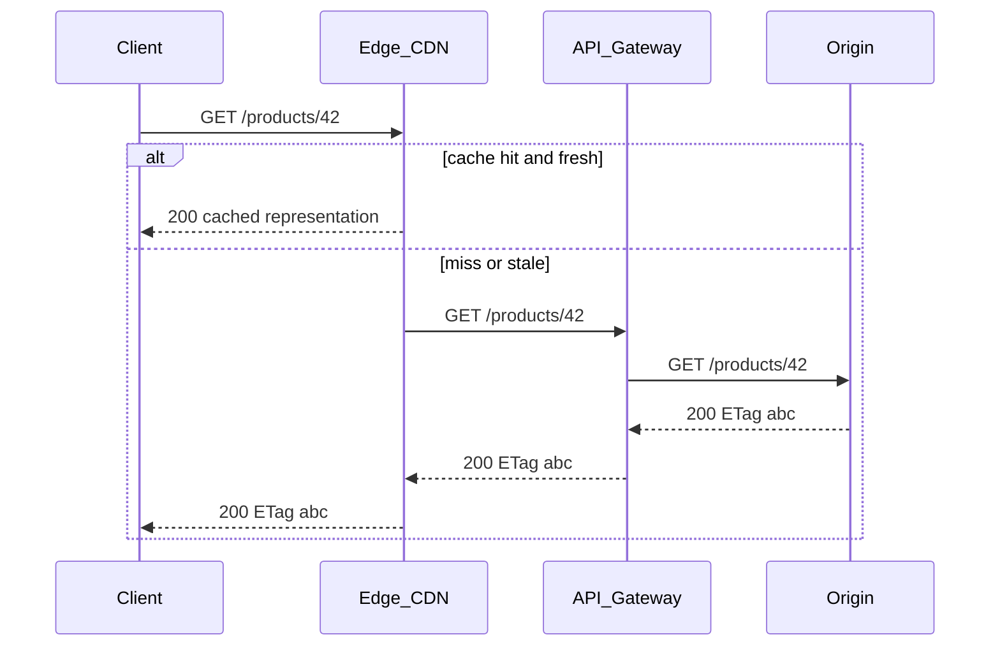
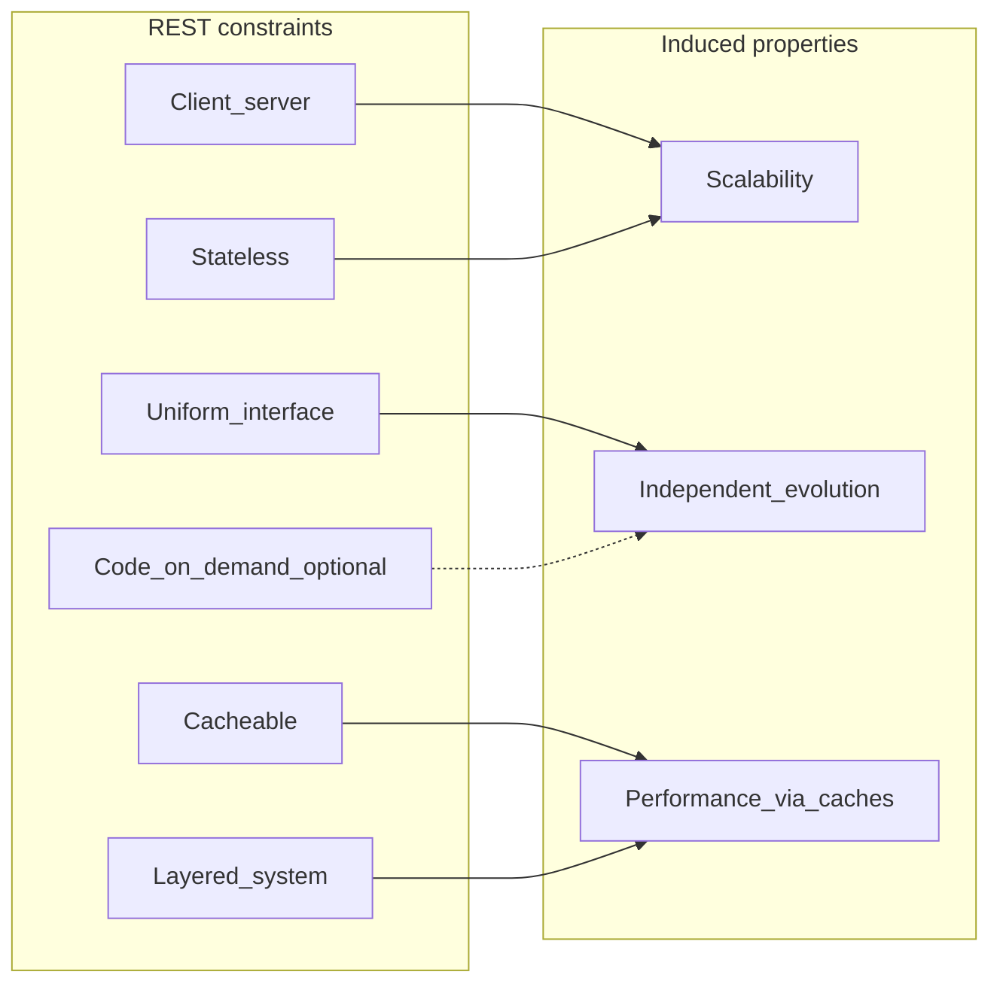

# REST, HTTP APIs, and Architectural Constraints

## 1. Metadata and prerequisites

- Topic IDs: D02-T01, D02-T02, D02-T03, D02-T04, D02-T05, D02-T06, D02-T07, D02-T08
- Domain: 2, REST Architectural Principles
- Difficulty: Beginner
- Prerequisites: D01-T01, D01-T09, D01-T11
- Learning objectives:
  - Distinguish REST as an architectural style from "any API that uses HTTP."
  - Apply each of the six REST constraints to API design decisions.
  - Recognize when cacheability and layering affect production behavior.
- Related topic IDs: D02-T09 through D02-T18, D09-T05, D09-T06
- Estimated complexity: medium
- Completion status: DRAFT
- Verification: Fielding dissertation and RFC 9110/9111 concepts reviewed 2026-10-14. Code examples are illustrative and unverified.

## 2. Introduction and fundamentals

REST (Representational State Transfer) is an architectural style for distributed hypermedia systems, not a protocol and not synonymous with JSON over HTTP. An HTTP API can be well designed without satisfying every REST constraint; conversely, a service that returns JSON from `/getUser` is still an HTTP API even if it is not RESTful in the strict sense.

### D02-T01 What REST is

**Formal definition.** REST is a coordinated set of constraints—client-server separation, statelessness, cacheability, a uniform interface, a layered system, and optionally code-on-demand—that induce properties such as scalability, independent evolution of components, and intermediaries that can improve performance without breaking semantics.

**Problem solved.** Without a shared architectural vocabulary, teams reinvent ad hoc RPC gateways, hide resources behind opaque actions, and build clients that cannot survive proxy caches or independent server upgrades.

**Mechanism.** Each constraint removes degrees of freedom in exchange for a systemic benefit. For example, statelessness pushes session data to the client or to explicit server-side stores referenced by the request, which lets any replica handle any request.

**Misconception.** "REST means CRUD with GET/POST/PUT/DELETE." CRUD mapping is one expression of a uniform interface over resources; REST also cares about identifiers, representations, and hypermedia affordances at higher maturity levels (D02-T15).

**Production rule.** Document which REST constraints your public API intentionally satisfies and which you trade away (for example, rich RPC-style actions). Do not market the API as "REST" without stating your maturity level and hypermedia policy.

### D02-T02 REST versus HTTP APIs

**Formal definition.** An HTTP API is any application interface whose messages conform to HTTP semantics (RFC 9110). A RESTful HTTP API additionally aligns resource identification, manipulation through representations, and self-descriptive messages with the REST constraints.

**Problem solved.** Teams assume interchangeability and then surprise integrators when caching, idempotency, or safe-method rules are violated.

**Mechanism.** HTTP provides methods, status codes, and header fields; REST prescribes how those are used to expose resources and drive application state through representations.

**Misconception.** "If it uses HTTPS and JSON, it is REST."

**Production rule.** In external docs, use precise terms: "HTTP JSON API," "resource-oriented HTTP API," or "REST-aligned API." Reserve "REST" for designs that can be evaluated against the constraint checklist in this chapter.

### D02-T03 Client-server constraint

**Formal definition.** Client and server are separate concerns: the client initiates requests for representations; the server manages resources and may evolve independently as long as the interface contract holds.

**Problem solved.** Monolithic coupling where UI assumptions leak into persistence schemas and prevent mobile, partner, and batch clients from sharing one backend.

**Mechanism.** The server exposes a stable interface (URIs, methods, representations). The client interprets representations and drives its own UI state. Versioning and compatibility policies (D04-T21) protect this boundary.

**Misconception.** "The API must mirror our database tables one-to-one."

**Production rule.** Design representations for client tasks, not for ORM convenience. Keep storage models internal; map to DTOs at the boundary (D05-T02).

### D02-T04 Statelessness

**Formal definition.** Each request from client to server must contain all information needed to understand and authorize the request. Server-side conversational state is not stored in the transport connection between requests except what is explicitly carried in the message (tokens, ETags, representation content).

**Problem solved.** Sticky sessions that prevent horizontal scaling and obscure failure domains when a node dies mid-conversation.

**Mechanism.** Authentication credentials or session tokens travel on every request. The server may consult external stores (session cache, database) but the *protocol* does not assume an affinity slot on a particular worker for unnamed state.

**Misconception.** "Stateless means we cannot use Redis for sessions." You may store session records; the client must present a session identifier each time. Worker processes do not share in-memory session maps across machines.

**Production rule.** Never rely on in-process globals for per-user authorization context in multi-worker deployments. Pass identity through dependencies backed by shared stores when needed (D07-T01).

### D02-T05 Cacheability

**Formal definition.** Responses must be labeled cacheable or non-cacheable (RFC 9111). Cacheable safe GET responses can be reused by clients and intermediaries subject to freshness and validation rules.

**Problem solved.** Origin overload and high latency when every client repeats identical read traffic.

**Mechanism.** `Cache-Control`, `ETag`, `Last-Modified`, and conditional requests (`If-None-Match`) let caches serve stale content safely or revalidate cheaply.

**Misconception.** "APIs should always send `Cache-Control: no-store`." That forfeits legitimate wins on public, slow-changing reads.

**Production rule.** Classify read endpoints: public catalog data may be cacheable with validators; personalized account data usually is not. Document cache behavior per resource type.

### D02-T06 Uniform interface

**Formal definition.** A small, stable set of interaction rules: resource identification through URIs, manipulation through representations, self-descriptive messages, and hypermedia as the engine of application state (HATEOAS) at the highest maturity.

**Problem solved.** Proliferation of bespoke operations (`/doRefund`, `/calculateTax`) that each need new client code instead of reusing method semantics.

**Mechanism.** Standard methods (RFC 9110) apply to resource URIs; representations carry the state to transfer; links and forms (where used) tell the client what is possible next.

**Misconception.** "Uniform interface forbids any RPC-style endpoint." Pragmatic APIs sometimes expose actions (D04-T13); the constraint is about defaulting to resources, not dogmatic purity.

**Production rule.** Default to noun-based URIs and method semantics; justify each action endpoint with lifecycle or safety arguments.

### D02-T07 Layered system

**Formal definition.** Clients cannot tell whether they are connected directly to the origin or to an intermediary (proxy, gateway, CDN, API management layer). Each layer may add policies (TLS termination, rate limits, caching).

**Problem solved.** Brittle clients that break when you insert a WAF or edge cache because they depended on hop-by-hop behavior.

**Mechanism.** Intermediaries honor end-to-end headers and HTTP semantics. Layer violations (assuming single TCP hop, trusting internal headers from clients) create security and correctness bugs.

**Misconception.** "`X-Forwarded-For` is authentication."

**Production rule.** Treat identity and authorization as application-layer concerns validated at the origin (or trusted gateway that strips spoofed headers). Design APIs so TLS, compression, and caching can move to the edge without contract changes.

### D02-T08 Code-on-demand

**Formal definition.** Optional constraint: servers may extend client functionality by sending executable code (historically JavaScript) along with representations.

**Problem solved.** Thick clients that cannot adapt to new field formats without a full app release—rare for machine JSON APIs.

**Mechanism.** Hypermedia formats embed scripts or WASM loaders. Most JSON APIs skip this constraint.

**Misconception.** "We need code-on-demand for REST Level 3." HATEOAS does not require downloadable code; it requires hypermedia controls.

**Production rule.** For typical B2B JSON APIs, explicitly mark code-on-demand as out of scope. For browser-first hypermedia apps, evaluate security implications before sending executable content.

## 3. Internal workings

A request crosses layers while the uniform interface stays stable at each hop.



Statelessness means `O` does not require that the same worker handled a prior request. Cacheability means `E` may answer without contacting `O` when validators allow. Layering means `C` cannot assume `E` is absent.

## 4. Architecture diagrams



The diagram is normative guidance, not a runtime deployment chart. Your service may implement only a subset while still benefiting from HTTP semantics.

## 5. Code and implementation

Illustrative FastAPI shape showing stateless, resource-oriented read. Unverified.

```python
from fastapi import FastAPI, Response

app = FastAPI()

@app.get("/v1/products/{product_id}")
def get_product(product_id: str, response: Response) -> dict:
    product = load_product(product_id)  # from DB, not from in-worker globals
    response.headers["ETag"] = product["etag"]
    response.headers["Cache-Control"] = "private, max-age=60"
    return {"id": product_id, "name": product["name"]}
```

Pseudocode for forbidden pattern:

```
# Anti-pattern: in-memory user session on worker A only
CURRENT_USER = None  # breaks with multiple Uvicorn workers
```

## 6. API contracts

| Concern | Contract element |
| --- | --- |
| Identification | Stable URI templates per resource type |
| Methods | Safe reads via GET; mutations documented with idempotency |
| State | Bearer token or session id on every mutating call |
| Caching | `Cache-Control` and validators on GET |
| Errors | Problem Details (RFC 9457) in later domains |

Example read contract:

- Method: `GET`
- Path: `/v1/invoices/{id}`
- Auth: required
- Success: `200` with representation; `304` when `If-None-Match` matches
- Idempotency: safe and idempotent (RFC 9110)

```bash
curl -sS -H "Authorization: Bearer change-me" \
  -H "Accept: application/json" \
  "https://api.example.com/v1/invoices/inv_01"
```

## 7. Production considerations

| Control | Mandatory | Optional enhancement |
| --- | --- | --- |
| Stateless auth on every request | Yes | Token introspection cache with TTL |
| Explicit cache policy on GET | Yes for public reads | CDN surrogate keys |
| No sticky session requirement | Yes | Geo routing |
| Document REST alignment | Yes | Internal maturity scorecard |
| Strip client-supplied hop headers | Yes at gateway | mTLS between layers |

Worker processes do not share in-memory caches, counters, sessions, or background tasks. Any constraint that assumes single-process memory is invalid in production.

## 8. Comparison and tradeoffs

| Style | Strength | Cost | When it fits |
| --- | --- | --- | --- |
| REST-aligned HTTP | Caching, standard tooling, clear verbs | Discipline on URIs and representations | Public integrators, long-lived APIs |
| Generic HTTP API | Flexibility, faster early delivery | Inconsistent semantics, cache surprises | Internal microservices with one client |
| RPC-over-HTTP | Action-oriented, familiar to developers | Weak cache story, verb proliferation | Complex workflows with few consumers |

No universal winner: partner-facing catalogs favor REST constraints; high-frequency internal commands may accept RPC patterns with eyes open (D02-T16).

## 9. Debugging and troubleshooting

**Symptom.** Users see stale product data for minutes after an admin update.

**Cause.** `Cache-Control: public, max-age=3600` on a representation that embeds inventory counts, without purge or validator discipline.

**Reproduction.** `GET` product as anonymous client through CDN; update stock at origin; repeat `GET` without `Cache-Control: no-cache`.

**Diagnosis.** Compare response headers at edge versus origin; check for missing `ETag` invalidation on write.

**Fix.** Mark personalized or inventory-sensitive reads `private, no-store` or shorten `max-age` and tie writes to surrogate key purge. Use `ETag` and conditional GET for bandwidth, not unbounded freshness.

**Prevention.** Cache classification table per resource; automated tests assert headers on golden endpoints.

**Tests.** Contract test that admin `PATCH` bumps `ETag` and that `If-None-Match` yields `304` when appropriate.

## 10. Interview preparation

**Beginner.** What is the difference between REST and HTTP?

- **Model answer.** HTTP is an application protocol with methods and status codes. REST is an architectural style that uses HTTP (among other possibilities) with constraints like statelessness and a uniform interface over resources.
- **Common incorrect answer.** "REST is HTTP with JSON."
- **Follow-up.** Which constraint helps horizontal scaling?

**Intermediate.** Why is statelessness important behind a load balancer?

- **Model answer.** Any replica can serve any request if all authorization and context arrive in the message, avoiding sticky sessions and lost state when a worker dies.
- **Common incorrect answer.** "Because REST forbids databases."
- **Follow-up.** How do sessions fit?

**Scenario.** Your team adds a CDN in front of GET `/v1/articles/{id}` and support reports "random old content." Walk through investigation.

- **Model answer.** Inspect cache headers, whether articles are public, validator behavior, and whether writes invalidate or change `ETag`. Reproduce with `curl` to edge and origin; adjust `Cache-Control` or purge policy.
- **Common incorrect answer.** "Disable CDN for APIs entirely."

## 11. Exercises and mastery assessment

**Conceptual.** List which REST constraints are weakened if the server stores per-connection server variables without client tokens.

**Coding.** Sketch response headers for a public GET that changes hourly versus a user-specific GET.

**Debugging.** Given `Vary: Authorization` missing on a shared cache, explain cross-user leakage risk.

**Design.** Propose a one-page "API architecture decision record" template covering the six constraints.

**Hints.** Re-read D02-T04 and D02-T05; consult RFC 9111 for cache freshness.

**Solutions.**

1. Statelessness and cacheability are weakened; uniform interface may be OK if URIs are still resource-based.
2. Public: `public, max-age=3600` with strong `ETag`. Private: `private, no-store` or very low `max-age` plus auth.
3. A cache might serve one user's representation to another; always `Vary` on headers that affect representation selection or do not cache authenticated responses at shared caches.
4. ADR sections: context, constraints satisfied, tradeoffs, hypermedia level, caching class, versioning.

**Verification criteria.** Peer can classify an endpoint as cacheable or not from your header table.

**Mastery checklist.**

- [ ] I can name all six REST constraints without reading notes.
- [ ] I explain why not every HTTP API is REST.
- [ ] I separate authentication from authorization when discussing statelessness.
- [ ] I specify cache headers for a new GET endpoint before launch.
- [ ] I identify layering assumptions in a deployment diagram.

**Revision summary.** REST is a constraint set inducing scalability and evolvability; HTTP APIs inherit RFC 9110 semantics whether or not they adopt every REST constraint. Production APIs should document alignment honestly and enforce stateless, cache-aware read paths.
