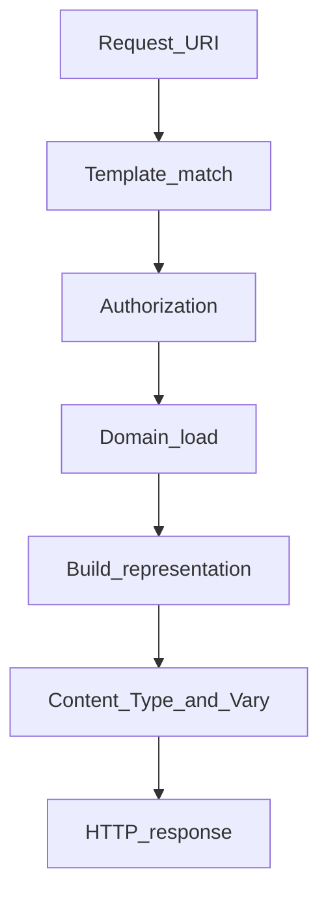
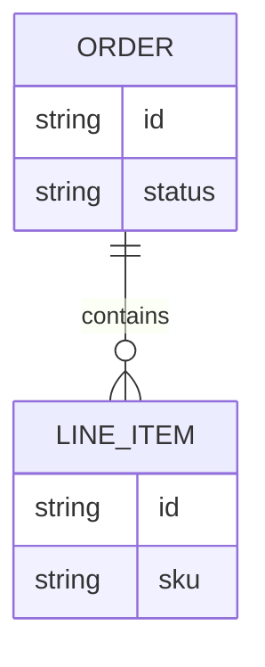

# Resources, Representations, and URI Design

## 1. Metadata and prerequisites

- Topic IDs: D02-T09, D02-T10, D02-T11, D02-T12, D02-T13
- Domain: 2, REST Architectural Principles
- Difficulty: Beginner
- Prerequisites: D02-T01, D01-T09, D04-T01
- Learning objectives:
  - Separate resources from their representations.
  - Design URIs as stable identifiers, not as RPC method names.
  - Choose collection versus member routes and nesting depth deliberately.
- Related topic IDs: D04-T01 through D04-T06, D03-T14
- Estimated complexity: medium
- Completion status: DRAFT
- Verification: RFC 9110 URI semantics; examples unverified.

## 2. Introduction and fundamentals

A resource is an abstraction identified by a URI. A representation is a byte sequence (JSON, HTML, PDF) plus metadata that conveys resource state at a point in time. Clients never manipulate resources directly—they exchange representations.

### D02-T09 Resources and resource representations

**Formal definition.** A resource is a conceptual mapping from a URI to a set of entities; a representation is an instantiation of resource state in a negotiated format.

**Problem solved.** Confusing database rows with the public contract, so schema refactors break every client.

**Mechanism.** The server maps internal models to representations on read and applies representations to domain operations on write. Multiple representations (`Accept: application/json` vs `text/csv`) may exist for one resource.

**Misconception.** "The JSON body is the resource." The body is one representation; the resource persists across format changes.

**Production rule.** Version representation schemas (D04-T21); keep internal IDs separate from opaque public identifiers when needed.

### D02-T10 Resource identifiers and URIs

**Formal definition.** A URI identifies a resource for the purpose of HTTP interaction. The path is hierarchical; the query component filters or parametrizes without changing the resource identity when designed correctly.

**Problem solved.** Clients bookmarking URLs that encode transient server state or non-stable surrogate keys.

**Mechanism.** Cool URIs use stable paths (`/v1/customers/cus_abc`) rather than implementation details (`/v1/getCustomerByInternalSeq/42`).

**Misconception.** "URIs must be guessable." They must be stable and meaningful to operators; opaque IDs are fine if documented.

**Production rule.** Publish URI templates in OpenAPI; never recycle a URI to mean a different resource type.

### D02-T11 Nouns versus verbs in endpoint design

**Formal definition.** Resource-oriented designs name paths with nouns (collections and members); verbs belong in HTTP methods, not path segments.

**Problem solved.** Explosion of `/createOrder`, `/cancelOrder`, `/refundOrder` endpoints that bypass method semantics and caching rules.

**Mechanism.** `POST /orders` creates; `DELETE /orders/{id}` removes; state transitions may be `PATCH` or sub-resource posts when modeled carefully (D04-T20).

**Misconception.** "REST forbids verbs anywhere." Subresources like `/searches` or documented actions (D04-T13) exist in mature APIs—default to nouns first.

**Production rule.** Code review rejects new path verbs unless recorded in the API style guide with an exception rationale.

### D02-T12 Resource relationships and nested resources

**Formal definition.** Related resources may be linked by URI hierarchy (`/orders/{id}/line-items`) or by hypermedia links inside representations.

**Problem solved.** Clients guessing relationship URLs or N+1 fetching without link guidance.

**Mechanism.** Nesting expresses containment when the child cannot exist without the parent context; links express loose coupling.

**Misconception.** "Nest every foreign key." Deep trees become brittle (D04-T05).

**Production rule.** Prefer links in the representation for optional relationships; nest only for strong ownership and authorization boundaries.

### D02-T13 Collection versus individual resource endpoints

**Formal definition.** A collection endpoint (`/invoices`) addresses zero or more members; a member endpoint (`/invoices/{id}`) addresses one identified resource.

**Problem solved.** Using `GET /invoices?id=5` for a single item, breaking cache keys and HTTP semantics clarity.

**Mechanism.** Collections support `GET` (query), `POST` (create). Members support `GET`, `PUT`, `PATCH`, `DELETE` as appropriate.

**Misconception.** "POST to a collection always returns 201." It should when a resource is created, with `Location` (RFC 9110); some `POST` actions return 200 with a body.

**Production rule.** Document pagination on collections (D06-T01); never overload one URL for both collection and singleton without clear method matrix.

## 3. Internal workings

Resolution flow from URI to handler to representation:

1. Router matches path template and extracts identifiers.
2. Authorization checks scope for that resource type and instance.
3. Domain layer loads state; serializer builds representation.
4. Response includes `Content-Type`, validators, and optional `Link` headers.



## 4. Architecture diagrams



URIs might be `/orders/{order_id}` and `/orders/{order_id}/line-items/{line_id}`. The diagram informs naming; the HTTP interface still uses representations, not SQL joins exposed raw.

## 5. Code and implementation

Unverified FastAPI routing illustrating collection versus member:

```python
from fastapi import APIRouter, status

router = APIRouter(prefix="/v1/orders", tags=["orders"])

@router.get("")
def list_orders(limit: int = 20, offset: int = 0) -> dict:
    return {"items": [], "limit": limit, "offset": offset}

@router.post("", status_code=status.HTTP_201_CREATED)
def create_order(payload: dict) -> dict:
    order_id = "ord_new"
    return {"id": order_id, **payload}

@router.get("/{order_id}")
def get_order(order_id: str) -> dict:
    return {"id": order_id, "status": "pending"}
```

Return `Location: /v1/orders/ord_new` on 201 in production handlers.

## 6. API contracts

| Endpoint | Method | Semantics |
| --- | --- | --- |
| `/v1/orders` | GET | Safe; list with pagination query params |
| `/v1/orders` | POST | Not idempotent; creates subordinate resource |
| `/v1/orders/{id}` | GET | Safe; single representation |
| `/v1/orders/{id}` | PATCH | Partial update (D03-T03) |

```bash
curl -sS -X POST "https://api.example.com/v1/orders" \
  -H "Content-Type: application/json" \
  -d '{"sku":"widget","qty":1}'
```

Auth: bearer token on mutating calls. Errors: `404` when member missing; `415` for wrong media type.

## 7. Production considerations

| Item | Mandatory |
| --- | --- |
| Stable public IDs | Yes |
| OpenAPI path templates | Yes |
| Authorization per member | Yes |
| Limit nesting depth | Yes (style guide) |

Optional: `Link` header with `rel="next"` for pagination; JSON:API `links` object if that is your standard.

## 8. Comparison and tradeoffs

| Approach | Pros | Cons |
| --- | --- | --- |
| Flat URIs + links in body | Flexible evolution | Clients must parse JSON |
| Deep nesting | Obvious ownership | Long URLs, coupled lifecycle |
| Query-only filtering on collection | Simple | Complex queries need search resource (D04-T10) |

| Naming | Example | Note |
| --- | --- | --- |
| Plural collection | `/users` | Common convention |
| Singular singleton | `/profile` | OK for one-per-tenant resource |
| Verb path | `/users/activate` | RPC exception only |

## 9. Debugging and troubleshooting

**Symptom.** Client receives `404` for `/v1/order/5` but `/v1/orders/5` works.

**Cause.** Inconsistent pluralization or renamed collection without deprecation period.

**Reproduction.** Compare OpenAPI path list to client SDK generated paths.

**Diagnosis.** Grep gateway routes and API gateway rewrite rules.

**Fix.** Add alias route with sunset header or 301 only if method-safe and permanent (D03-T12); prefer versioned migration.

**Prevention.** Lint OpenAPI for plural rules; contract tests on golden paths.

**Tests.** Snapshot test of route table against published spec.

## 10. Interview preparation

**Beginner.** Resource vs representation?

- **Model answer.** The resource is the abstract thing identified by URI; the representation is the concrete bytes and headers exchanged.
- **Common incorrect answer.** "They are the same as the database row."

**Intermediate.** When nest line items under orders?

- **Model answer.** When line items are owned by the order, authorization is scoped to the order, and clients always access them in that context; otherwise use `/line-items?order_id=` or links.
- **Common incorrect answer.** "Always nest to show foreign keys."

**Scenario.** Marketing wants `/getPromoCode`. What do you propose?

- **Model answer.** `GET /v1/promo-codes/{code}` or `/v1/promotions/{id}` with safe GET; explain method semantics and cacheability.
- **Common incorrect answer.** "Rename is cosmetic; keep the verb."

## 11. Exercises and mastery assessment

**Conceptual.** Why is `POST /search` sometimes acceptable versus `GET /search?q=`?

**Coding.** Write OpenAPI paths for customers and nested addresses (max depth 2).

**Debugging.** Fix a spec where `DELETE /users` deletes all users.

**Design.** Choose nested vs link for `invoice` → `payment`.

**Solutions.**

1. Large or sensitive query payloads may use POST with a body; document non-cacheable semantics.
2. `/customers`, `/customers/{id}`, `/customers/{id}/addresses`, `/customers/{id}/addresses/{addr_id}`.
3. Restrict DELETE to `/users/{id}`; collection DELETE only with strong admin guard if ever allowed.
4. Payment as `/invoices/{id}/payments` if creation is always invoice-scoped; else link `payments` URL in invoice representation.

**Mastery checklist.**

- [ ] I name paths with nouns and methods with HTTP verbs.
- [ ] I can draw resource relationships without exposing SQL.
- [ ] I specify 201 + Location for collection POST creates.
- [ ] I limit nesting depth in reviews.
- [ ] I distinguish identity in path from filters in query.

**Revision summary.** URIs identify resources; representations carry state. Collections and members have distinct method sets; nesting expresses ownership but must stay shallow and intentional.
