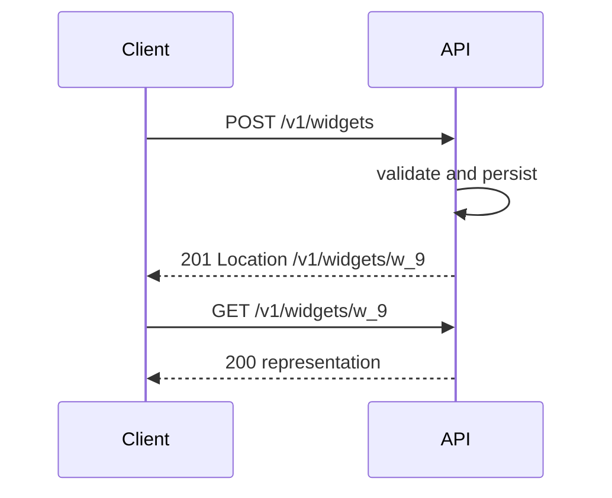
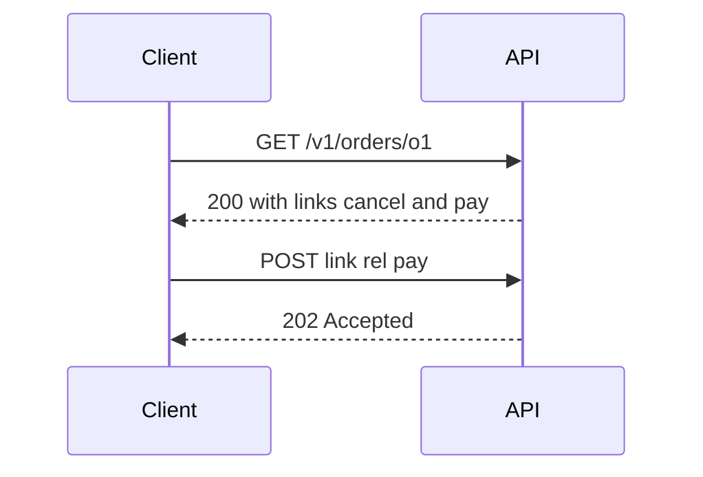
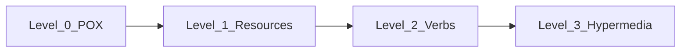

# CRUD Mapping, Maturity Model, and HATEOAS

## 1. Metadata and prerequisites

- Topic IDs: D02-T14, D02-T15
- Domain: 2, REST Architectural Principles
- Difficulty: Intermediate
- Prerequisites: D02-T09, D03-T01 through D03-T05, D01-T10
- Learning objectives:
  - Map CRUD operations to HTTP methods without violating semantics.
  - Place an API on Richardson's maturity model honestly.
  - Decide when hypermedia controls justify implementation cost.
- Related topic IDs: D04-T14, D03-T02, D03-T03
- Estimated complexity: medium-high
- Completion status: DRAFT
- Verification: RFC 9110 method semantics; examples unverified.

## 2. Introduction and fundamentals

CRUD (Create, Read, Update, Delete) describes persistence operations. HTTP methods express those operations on resources with specific safety and idempotency guarantees. The Richardson maturity model ranks how fully an HTTP API exploits those semantics and hypermedia.

### D02-T14 CRUD-to-HTTP method mapping

**Formal definition.** Create on a collection is typically `POST`. Read is `GET` (or `HEAD` for metadata). Replace is `PUT` (full representation). Partial change is `PATCH`. Delete is `DELETE`.

**Problem solved.** Using `POST` for every mutation, losing idempotent retries and clear cache rules.

**Mechanism.**

| Intent | Method | Typical URI | Notes |
| --- | --- | --- | --- |
| Create | POST | collection | Server may assign id; 201 + Location |
| Read one | GET | member | Safe |
| Read many | GET | collection + query | Safe; paginate |
| Full replace | PUT | member | Idempotent; absent fields mean removed if that is your contract |
| Partial update | PATCH | member | Not idempotent in general |
| Delete | DELETE | member | Idempotent; 204 or 404 policy |

**Misconception.** "`PUT` and `PATCH` are interchangeable." PUT is full replacement; PATCH applies a partial change (RFC 9110).

**Production rule.** Document whether PUT treats omitted JSON keys as null/delete or rejects incomplete bodies; default team-wide PATCH semantics (JSON Merge Patch vs JSON Patch).

### D02-T15 REST maturity model and HATEOAS

**Formal definition.** Level 0: single URI, one method (often POST). Level 1: multiple resources (URIs). Level 2: HTTP verbs and status codes. Level 3: hypermedia as the engine of application state (HATEOAS)—clients follow links and forms from representations.

**Problem solved.** Clients hard-code URL construction rules that break when the server adds steps or changes routing.

**Mechanism.** Representations include `links` with `rel` types (`self`, `next`, `cancel`) or use formats like HAL, JSON:API, or Siren. The client discovers transitions instead of guessing paths.

**Misconception.** "Level 3 is required for REST." Fielding's style allows lower levels; many successful APIs are Level 2 with stable documentation.

**Production rule.** Target Level 2 minimum for public APIs; add HATEOAS where client diversity or long upgrade cycles justify it—never as decoration without stable `rel` names.

## 3. Internal workings

Create flow with correct status semantics:



HATEOAS flow:



## 4. Architecture diagrams



Most production JSON APIs operate at L2; L3 adds schema for links and client parsers.

## 5. Code and implementation

Unverified FastAPI CRUD sketch:

```python
from fastapi import APIRouter, Response, status

router = APIRouter()

@router.post("/v1/widgets", status_code=status.HTTP_201_CREATED)
def create_widget(payload: dict, response: Response) -> dict:
    widget_id = "w_9"
    response.headers["Location"] = f"/v1/widgets/{widget_id}"
    return {"id": widget_id, **payload}

@router.put("/v1/widgets/{widget_id}")
def replace_widget(widget_id: str, payload: dict) -> dict:
    return {"id": widget_id, **payload}

@router.patch("/v1/widgets/{widget_id}")
def patch_widget(widget_id: str, patch: dict) -> dict:
    current = {"id": widget_id, "color": "red"}
    current.update(patch)
    return current
```

HATEOAS snippet in representation (unverified):

```json
{
  "id": "o1",
  "status": "pending",
  "links": [
    {"rel": "self", "href": "/v1/orders/o1"},
    {"rel": "cancel", "method": "POST", "href": "/v1/orders/o1/cancellations"}
  ]
}
```

## 6. API contracts

| Operation | Method | Success codes | Idempotency |
| --- | --- | --- | --- |
| Create | POST | 201 + Location | No |
| Replace | PUT | 200 or 204 | Yes |
| Partial | PATCH | 200 | Not guaranteed |
| Delete | DELETE | 204 or 404 | Yes |

```bash
curl -sS -X POST "https://api.example.com/v1/widgets" \
  -H "Content-Type: application/json" -d '{"name":"gear"}'
curl -sS -X PUT "https://api.example.com/v1/widgets/w_9" \
  -H "Content-Type: application/json" -d '{"name":"gear","qty":10}'
```

## 7. Production considerations

- Enforce method-specific handlers in routers; ban "god POST."
- 201 responses must include `Location` when a resource is created (RFC 9110).
- 204 responses have no body.
- 202 means accepted for processing, not finished (D03-T10).
- If HATEOAS: version `rel` strings; never remove without deprecation.

## 8. Comparison and tradeoffs

| Maturity | Integrator effort | Server effort | Flexibility |
| --- | --- | --- | --- |
| L1 | Medium | Low | Low verb clarity |
| L2 | Lower with good docs | Medium | Standard retries/caches |
| L3 | Lowest for generic clients | High | Server can move URLs |

| Update style | Method | Risk |
| --- | --- | --- |
| Full replace | PUT | Accidental field wipe |
| Partial | PATCH | Double-apply bugs |

## 9. Debugging and troubleshooting

**Symptom.** Duplicate widgets after network retry.

**Cause.** `POST /widgets` without idempotency keys for create.

**Reproduction.** Client times out after server committed; retries POST.

**Diagnosis.** Compare `Idempotency-Key` usage; check if PUT with client-chosen id was possible.

**Fix.** Support `PUT /widgets/{client_id}` or idempotency keys on POST (D08-T05).

**Prevention.** Document which mutations are retry-safe per RFC 9110 idempotency rules.

**Tests.** Automated retry simulation on PUT vs POST.

## 10. Interview preparation

**Beginner.** Map DELETE to CRUD and idempotency.

- **Model answer.** DELETE removes the resource mapping; repeating DELETE leaves the resource absent—idempotent but not safe.
- **Common incorrect answer.** "DELETE is not idempotent because first call changes state."

**Intermediate.** PUT vs PATCH for `{ "name": "a" }` on a resource with five fields?

- **Model answer.** PUT should define whether missing fields are cleared; PATCH updates only supplied fields per patch format contract.
- **Common incorrect answer.** "Send PUT with one field always works like PATCH."

**Scenario.** PM asks for maturity Level 3 in two weeks.

- **Model answer.** Propose L2 with OpenAPI now; plan HATEOAS for flows with many client types; define `rel` registry and compatibility policy first.
- **Common incorrect answer.** "Add random `_links` without methods."

## 11. Exercises and mastery assessment

**Conceptual.** Why is POST create not idempotent?

**Coding.** Implement router methods for a `books` resource with 201 Location.

**Debugging.** Client sends PUT but fields disappear—find contract bug.

**Design.** Pick HATEOAS vs OpenAPI-only for a mobile + web + partner ecosystem.

**Solutions.**

1. Each successful POST may create a new server-assigned resource.
2. See section 5; assert `Location` header in test.
3. PUT contract treats omitted keys as null; switch client to PATCH or send full representation.
4. Partners → strong OpenAPI; if many unknown clients → incremental HATEOAS on checkout flows only.

**Mastery checklist.**

- [ ] I map CRUD to methods without using POST for reads.
- [ ] I state our PUT null semantics in the style guide.
- [ ] I know 201 vs 202 vs 204 differences.
- [ ] I can explain maturity levels without claiming L3 is mandatory.
- [ ] I design link `rel` names as part of the contract.

**Revision summary.** CRUD over HTTP succeeds when method semantics, status codes, and optional hypermedia align with RFC 9110. Level 2 is the production baseline; HATEOAS is a deliberate investment, not a badge.
