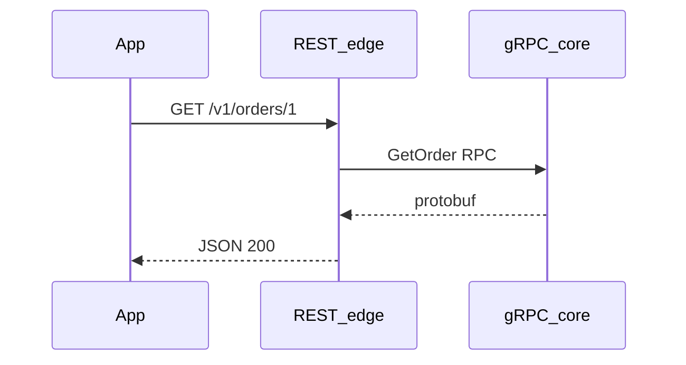

# REST versus RPC, GraphQL, and gRPC

## 1. Metadata and prerequisites

- Topic IDs: D02-T16, D02-T17, D02-T18
- Domain: 2, REST Architectural Principles
- Difficulty: Intermediate
- Prerequisites: D02-T01, D02-T14, D05-T01
- Learning objectives:
  - Compare interaction styles on coupling, caching, and tooling.
  - Choose boundaries where RPC or GraphQL inside an HTTP organization is rational.
  - Recognize gRPC strengths for service-to-service calls versus browser-facing REST.
- Related topic IDs: D04-T13, D08-T01, D31-T01
- Estimated complexity: medium-high
- Completion status: DRAFT
- Verification: Conceptual comparison; examples unverified.

## 2. Introduction and fundamentals

No single API style wins every context. REST-aligned HTTP optimizes for resource-oriented integration and cache-friendly reads. RPC names procedures. GraphQL names a typed graph query language over HTTP. gRPC uses HTTP/2 and Protocol Buffers for efficient RPC between trusted services.

### D02-T16 REST versus RPC

**Formal definition.** REST emphasizes identifiable resources and uniform methods; RPC exposes operations (`calculateShipping`, `runReport`) often as POST to verb-like paths or as dedicated procedure endpoints.

**Problem solved.** Forcing every business action into awkward pseudo-resources when clients only need one deterministic command.

**Mechanism.** RPC maps call name + arguments to a handler; caching and safe retries rarely apply. REST maps state transitions to resources and methods with known semantics.

**Misconception.** "RPC is always bad." Internal admin tools and batch jobs may favor RPC clarity.

**Production rule.** Public partner APIs default REST Level 2; isolate RPC-style actions behind documented exception endpoints with explicit idempotency and auth (D04-T13).

### D02-T17 REST versus GraphQL

**Formal definition.** GraphQL provides a single endpoint (typically POST) where clients request a shaped graph of fields, delegating resolution to server resolvers.

**Problem solved.** Over-fetching and under-fetching on mobile clients that need nested data in one round trip.

**Mechanism.** Query document selects fields; server resolves with potential N+1 database access unless batched (DataLoader patterns).

**Misconception.** "GraphQL replaces REST entirely." Caching at HTTP shared caches is harder; query cost control is mandatory.

**Production rule.** If GraphQL is exposed, enforce depth/complexity limits, persisted queries or allowlists for production, and separate auth per resolver field.

### D02-T18 REST versus gRPC

**Formal definition.** gRPC is an RPC framework using HTTP/2, binary Protobuf messages, and generated stubs; REST here means HTTP APIs with textual representations (often JSON).

**Problem solved.** High-throughput, low-latency service meshes where browsers are not the direct client.

**Mechanism.** Strong contracts via `.proto` files; streaming RPCs; load balancers must understand HTTP/2. Browser use typically requires gRPC-Web and a proxy.

**Misconception.** "Use gRPC for public mobile apps without a gateway." Mobile can, but tooling and debugging differ from curl-friendly JSON.

**Production rule.** Use gRPC east-west between services; expose north-south JSON/REST (or GraphQL) at the edge unless all clients support gRPC.

## 3. Internal workings

Typical enterprise layering:

```mermaid
flowchart TB
  mobile[Mobile_JSON_REST]
  partner[Partner_REST]
  bff[BFF_optional]
  graph[GraphQL_gateway]
  svc[Microservices_gRPC]
  mobile --> bff
  partner --> bff
  bff --> graph
  bff --> svc
  graph --> svc
```

Reads may hit cacheable REST resources; aggregations may use GraphQL; core domain services speak gRPC.

## 4. Architecture diagrams



Translation layer maps representation formats and error models.

## 5. Code and implementation

Unverified comparison stubs—not runnable as one app.

REST handler:

```python
@router.get("/v1/accounts/{account_id}")
def get_account(account_id: str) -> dict:
    return {"id": account_id, "balance": "10.00"}
```

RPC-style (exception):

```python
@router.post("/v1/accounts/{account_id}/actions/freeze")
def freeze_account(account_id: str) -> dict:
    return {"id": account_id, "status": "frozen"}
```

GraphQL is usually a separate schema (pseudocode):

```
type Query { account(id: ID!): Account }
```

gRPC proto fragment (illustrative):

```
service AccountService { rpc GetAccount(GetAccountRequest) returns (Account); }
```

## 6. API contracts

| Style | Typical transport | Cache-friendly GET | Browser curl |
| --- | --- | --- | --- |
| REST JSON | HTTP/1.1 or HTTP/2 | Yes | Yes |
| RPC HTTP | POST-heavy | Rarely | Yes |
| GraphQL | POST | Limited | With tools |
| gRPC | HTTP/2 binary | N/A | Via grpcurl |

Example REST curl:

```bash
curl -sS "https://api.example.com/v1/accounts/acct_1"
```

## 7. Production considerations

| Topic | REST | GraphQL | gRPC |
| --- | --- | --- | --- |
| Rate limiting | Per route | Per query cost | Per RPC |
| Versioning | URI or header | Schema evolution | Proto packages |
| Observability | HTTP logs | Field metrics | RPC tracing |

Worker processes do not share in-memory GraphQL DataLoader caches across hosts—use request-scoped loaders only.

## 8. Comparison and tradeoffs

| Criterion | REST (resource HTTP) | RPC-over-HTTP | GraphQL | gRPC |
| --- | --- | --- | --- | --- |
| Coupling | Medium | High to procedure names | Medium to schema | High to proto |
| Read caching | Strong | Weak | Weak | Weak |
| Payload efficiency | Text JSON | Text | Text | Binary |
| Client codegen | OpenAPI | Ad hoc | Strong | Strong |

## 9. Debugging and troubleshooting

**Symptom.** Mobile app slow after adopting GraphQL.

**Cause.** Resolver N+1 queries without batching.

**Reproduction.** Enable SQL logging per GraphQL request with a nested query.

**Diagnosis.** Trace resolver tree depth versus DB query count.

**Fix.** DataLoader batching, dataloader per request, query complexity limits.

**Prevention.** Load tests on worst-case queries before launch.

**Tests.** Contract tests on allowed queries; max depth enforcement.

## 10. Interview preparation

**Beginner.** When prefer REST over RPC for a catalog API?

- **Model answer.** Many safe GETs, cacheable representations, diverse clients—REST fits RFC 9110 semantics.
- **Common incorrect answer.** "REST is newer."

**Intermediate.** GraphQL advantage and risk?

- **Model answer.** Flexible reads in one request; risk of expensive queries without limits and weak HTTP cache reuse.
- **Common incorrect answer.** "GraphQL has no N+1 problem."

**Scenario.** Microservices already use gRPC; partners need integration.

- **Model answer.** Edge REST/JSON with translation, auth, and rate limits; keep gRPC internal; do not expose proto directly without gateway.
- **Common incorrect answer.** "Give partners proto files only."

## 11. Exercises and mastery assessment

**Conceptual.** Why is GET-based REST easier to cache than GraphQL POST?

**Coding.** Refactor `POST /doRefund` into resource-oriented design.

**Debugging.** Identify RPC endpoints in an OpenAPI spec by smell.

**Design.** Pick styles for browser app, Android app, and internal billing service.

**Solutions.**

1. GET is safe and cache keys are method+URI; GraphQL POST varies body.
2. `POST /refunds` with body `{order_id}` or `POST /orders/{id}/refunds` returning 201.
3. Paths with verbs, single `/api` POST tunnel.
4. Browser REST; Android REST or GraphQL BFF; internal gRPC.

**Mastery checklist.**

- [ ] I articulate tradeoffs without declaring REST universal.
- [ ] I know gRPC is poor as a direct browser protocol without gateway.
- [ ] I plan query cost controls for GraphQL.
- [ ] I document RPC exceptions explicitly.
- [ ] I separate north-south from east-west protocols.

**Revision summary.** REST-aligned HTTP excels at cacheable resource integration; RPC, GraphQL, and gRPC solve different shapes of coupling and performance. Production systems often combine them with a clear edge contract.
