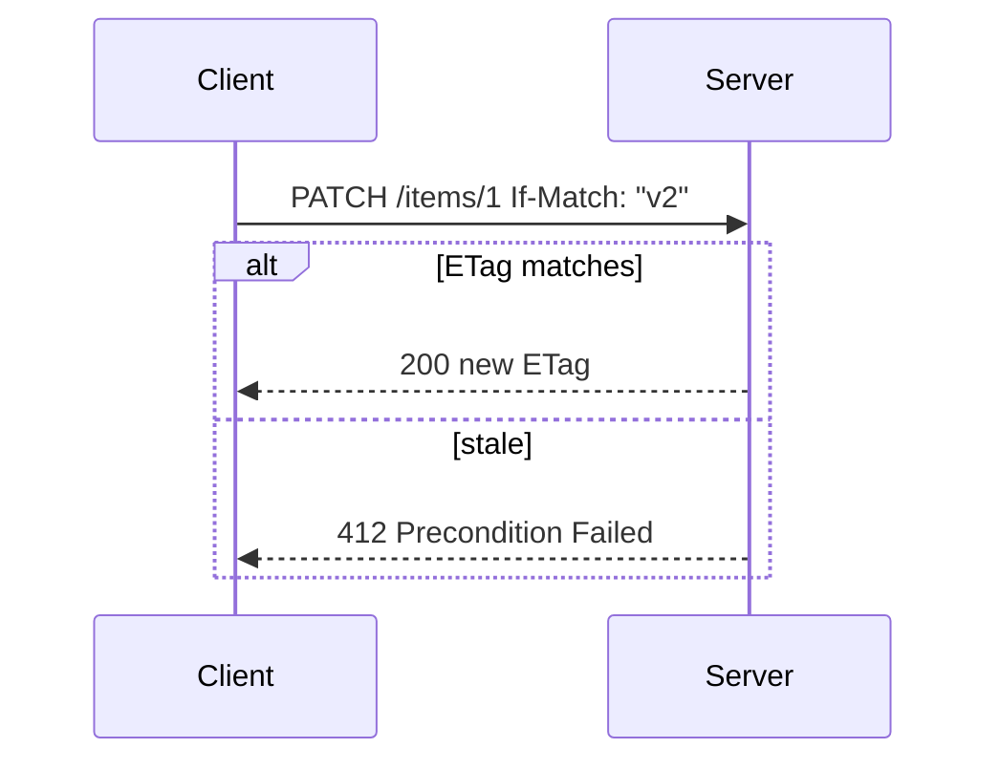
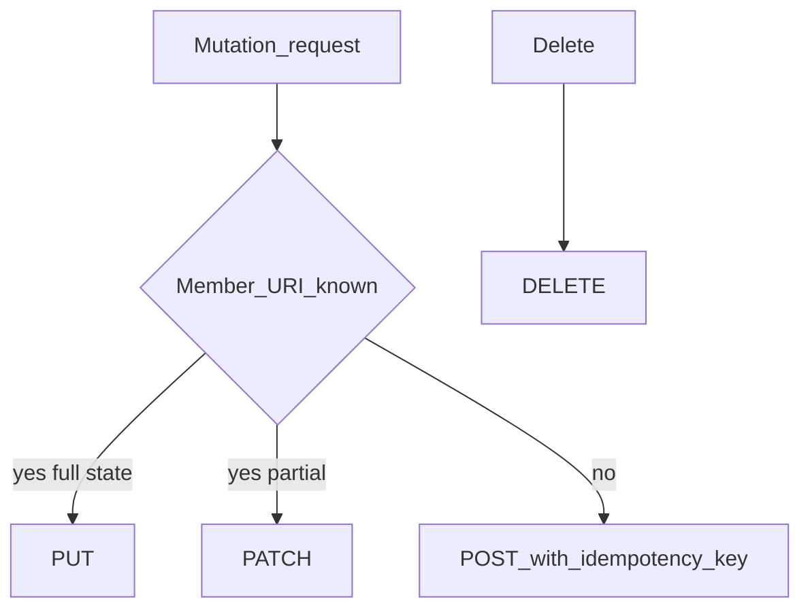

# Method Semantics and Idempotent Design

## 1. Metadata and prerequisites

- Topic IDs: D03-T01, D03-T02, D03-T03, D03-T04, D03-T05, D03-T06, D03-T07
- Domain: 3, HTTP Methods and Status Codes
- Difficulty: Intermediate
- Prerequisites: D01-T09, D01-T10, D02-T14
- Learning objectives:
  - Apply RFC 9110 semantics per method in API design and documentation.
  - Design idempotent mutations and safe retries.
  - Separate HEAD/OPTIONS uses from GET/POST habits.
- Related topic IDs: D08-T05, D04-T19
- Estimated complexity: high
- Completion status: DRAFT
- Verification: RFC 9110 §9; examples unverified.

## 2. Introduction and fundamentals

HTTP methods are part of the contract. They tell caches, clients, and intermediaries what may be retried and what must not change state. FastAPI routes must align declared methods with these semantics.

### D03-T01 GET semantics

**Formal definition.** GET requests a transfer of a current representation of the target resource; it must not be used to cause side effects beyond safe retrieval (RFC 9110).

**Problem solved.** Accidental data corruption when crawlers hit mutation URLs.

**Mechanism.** Safe and idempotent. Responses may be cached subject to RFC 9111. Conditional headers apply.

**Misconception.** "GET cannot have side effects at all." Logging and metrics are fine; business mutations are not.

**Production rule.** Never implement create/update/delete behind GET, including "hidden" query parameters.

### D03-T02 POST semantics

**Formal definition.** POST processes the enclosed representation according to the resource's own rules—often creating a subordinate resource or triggering processing.

**Problem solved.** Operations that do not fit a known member URI at request time.

**Mechanism.** Not safe; not idempotent. Retries may duplicate unless guarded. May return 201, 200, 202, or 204 depending on outcome.

**Misconception.** "POST always creates." It may validate, enqueue, or run a command.

**Production rule.** Use idempotency keys for financially significant POST (D08-T05); document response code matrix.

### D03-T03 PUT versus PATCH

**Formal definition.** PUT replaces the target resource's state with the request payload. PATCH applies partial modifications defined by the patch document and media type.

**Problem solved.** Ambiguous updates that wipe fields or double-apply increments.

**Mechanism.** PUT is idempotent. PATCH is not idempotent in general (e.g., `"op": "increment"`). JSON Merge Patch vs JSON Patch must be specified.

**Misconception.** "PATCH is just PUT with fewer fields without a format." Clients need the patch media type contract.

**Production rule.** Publish `Content-Type` for PATCH (`application/merge-patch+json` or `application/json-patch+json`); reject unknown patch types with 415.

### D03-T04 DELETE semantics

**Formal definition.** DELETE requests removal of the association between the target URI and its current functionality / resource state.

**Problem solved.** Orphan records when clients only "soft delete" via POST.

**Mechanism.** Idempotent, not safe. Second DELETE may return 204 or 404—pick one policy.

**Misconception.** "DELETE must always return 204." 404 on repeat is valid if documented.

**Production rule.** Align DELETE with authorization; return 404 vs 403 deliberately (existence leakage).

### D03-T05 HEAD and OPTIONS

**Formal definition.** HEAD is GET without a body; response headers should match GET. OPTIONS describes communication options for the target resource, including allowed methods.

**Problem solved.** Bandwidth waste checking metadata; client preflight for CORS and method discovery.

**Mechanism.** HEAD is safe and idempotent. OPTIONS is safe; for CORS preflight, browsers send OPTIONS before non-simple requests.

**Misconception.** "OPTIONS is only for CORS." API clients may probe allowed methods on a URI.

**Production rule.** Implement accurate `Allow` header on 405 responses; ensure HEAD matches GET headers.

### D03-T06 Safe methods versus idempotent methods

**Formal definition.** Safe methods do not target state change (GET, HEAD, OPTIONS). Idempotent methods have the same intended effect when applied once or multiple times (GET, HEAD, OPTIONS, PUT, DELETE).

**Problem solved.** Automated retries that duplicate orders.

**Mechanism.** Intermediaries may retry idempotent requests on ambiguous network failure; must not retry unsafe non-idempotent requests blindly.

**Misconception.** "Idempotent means no side effects." DELETE is idempotent but not safe.

**Production rule.** Document retry policy per method in client SDKs and gateway configs.

### D03-T07 Idempotent API design

**Formal definition.** API design that makes repeated client submission converge to one outcome—via method choice, stable URIs, idempotency keys, or conditional requests.

**Problem solved.** Double charges and duplicate rows after timeouts.

**Mechanism.** Prefer PUT to a client-chosen id; store idempotency keys for POST; use If-Match preconditions on updates (412 on failure).

**Misconception.** "Make POST idempotent by ignoring duplicates always." Business rules must define duplicate detection.

**Production rule.** Require `Idempotency-Key` header on payment POST; store key hash with response replay for 24 hours.

## 3. Internal workings



## 4. Architecture diagrams



## 5. Code and implementation

Unverified FastAPI:

```python
from fastapi import APIRouter, Header, HTTPException, Response, status

router = APIRouter()

@router.post("/v1/payments", status_code=status.HTTP_201_CREATED)
def create_payment(
    body: dict,
    idempotency_key: str | None = Header(default=None, alias="Idempotency-Key"),
) -> dict:
    if not idempotency_key:
        raise HTTPException(status.HTTP_400_BAD_REQUEST, "Idempotency-Key required")
    cached = replay_if_seen(idempotency_key)
    if cached:
        return cached
    result = charge(body)
    store_idempotency(idempotency_key, result)
    return result
```

## 6. API contracts

| Method | Safe | Idempotent | Body typical |
| --- | --- | --- | --- |
| GET | Yes | Yes | No |
| POST | No | No | Yes |
| PUT | No | Yes | Yes |
| PATCH | No | No* | Yes |
| DELETE | No | Yes | Rare |

\*PATCH may be designed idempotent per operation.

```bash
curl -sS -X PATCH "https://api.example.com/v1/items/1" \
  -H "Content-Type: application/merge-patch+json" \
  -H "If-Match: \"v2\"" \
  -d '{"qty":3}'
```

## 7. Production considerations

- Enforce method at gateway (block GET mutations).
- Log method + path + idempotency key (never log PAN).
- 401 unauthenticated vs 403 refused authorization—distinct checks (D03-T15).

## 8. Comparison and tradeoffs

| Update | Pros | Cons |
| --- | --- | --- |
| PUT | Retry-friendly | Requires full representation |
| PATCH | Smaller payloads | Format coupling |
| POST action | Expressive | Weak idempotency |

## 9. Debugging and troubleshooting

**Symptom.** Duplicate subscriptions after mobile retry.

**Cause.** POST without idempotency; client retries on 504.

**Diagnosis.** Correlate duplicate rows by timestamp and device id.

**Fix.** Idempotency-Key + unique index on key.

**Prevention.** Integration tests simulating timeout retry.

## 10. Interview preparation

**Beginner.** Is PATCH idempotent?

- **Model answer.** Not in general; depends on patch operations; PUT is idempotent for replacement.
- **Common incorrect answer.** "Yes, like PUT."

**Intermediate.** Why not DELETE via POST?

- **Model answer.** Loses standard idempotent DELETE semantics and cache expectations.
- **Common incorrect answer.** "POST is more secure."

**Scenario.** Client uses PUT but omits fields; data wiped.

- **Model answer.** PUT is full replacement; switch to PATCH or document required fields with 400 on incomplete PUT.
- **Common incorrect answer.** "Server should merge automatically."

## 11. Exercises and mastery assessment

**Solutions.** Design idempotent refund: `POST /refunds` with key or `PUT /refunds/{id}`; document 201 vs 200.

**Mastery checklist.**

- [ ] Safe vs idempotent table memorized.
- [ ] PATCH media type documented.
- [ ] POST retry policy defined.
- [ ] HEAD matches GET headers.
- [ ] Idempotency keys on critical POST.

**Revision summary.** RFC 9110 method semantics drive caching, retries, and API shape—PUT replaces, PATCH partializes, POST processes without idempotency unless engineered.
