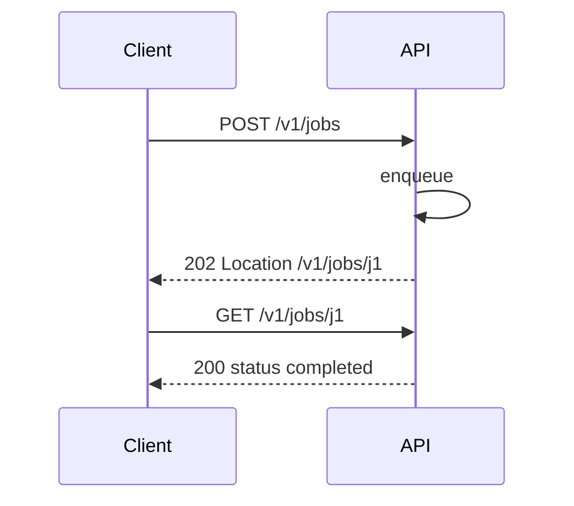
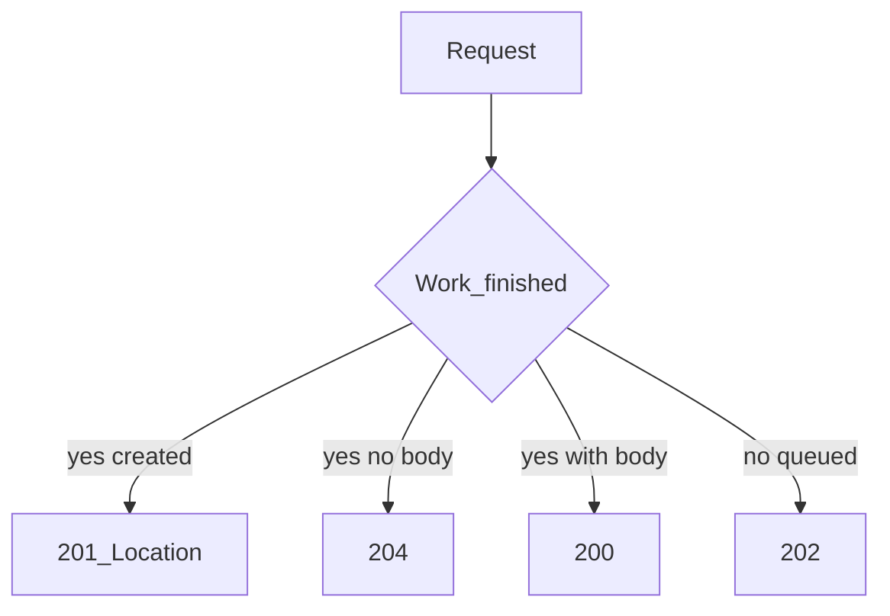

# Success Status Codes

## 1. Metadata and prerequisites

- Topic IDs: D03-T08, D03-T09, D03-T10, D03-T11
- Domain: 3, HTTP Methods and Status Codes
- Difficulty: Beginner
- Prerequisites: D01-T11, D03-T01, D03-T02
- Learning objectives:
  - Select 2xx codes that match the actual outcome of a handler.
  - Use 201 Location, empty 204, and asynchronous 202 correctly.
- Related topic IDs: D02-T14, D05-T15
- Estimated complexity: medium
- Completion status: DRAFT
- Verification: RFC 9110 §15.3; examples unverified.

## 2. Introduction and fundamentals

2xx indicates that the server accepted and successfully processed the request per method semantics. The specific code communicates whether a body is expected, whether a resource was created, and whether processing is deferred.

### D03-T08 200 OK

**Formal definition.** The request succeeded; the response typically carries a representation in the body (unless another code such as 204 is more accurate).

**Problem solved.** Clients cannot tell success from empty error bodies when everything returns 200.

**Mechanism.** GET/PUT/PATCH often return 200 with a body; DELETE may return 200 with a status object if not using 204.

**Misconception.** "Always return 200 for simplicity." Async work should be 202; create should be 201.

**Production rule.** Reserve 200 for completed synchronous success with optional representation; document when DELETE returns 200 vs 204.

### D03-T09 201 Created

**Formal definition.** The request succeeded and a new resource was created. The response should include a `Location` header field referencing the created resource (RFC 9110).

**Problem solved.** Clients cannot discover the server-assigned id after POST.

**Mechanism.** POST to collection → 201 + `Location` + often a body with the representation.

**Misconception.** "201 without Location is fine." Omitting Location breaks generic REST clients.

**Production rule.** Every resource-creating POST returns 201 with absolute or relative `Location` unless using hypermedia-only discovery—and even then prefer Location.

### D03-T10 202 Accepted

**Formal definition.** The request has been accepted for processing, but processing is not complete.

**Problem solved.** Clients time out waiting for long jobs that were enqueued successfully.

**Mechanism.** Response may include a status monitor URI or job id; no implication that the action finished.

**Misconception.** "202 means success like 200." Polling or webhooks are required to learn completion.

**Production rule.** Pair 202 with a job resource (`GET /jobs/{id}`) or callback contract; never use 202 for fast CRUD that already completed.

### D03-T11 204 No Content

**Formal definition.** Success with no content in the message body.

**Problem solved.** Clients parsing JSON on empty DELETE/PUT responses fail.

**Mechanism.** Common for DELETE and PUT/PATCH when no representation is returned.

**Misconception.** "Return 204 with `{}`." Bodies are forbidden for 204 semantics—do not send a body.

**Production rule.** FastAPI: set `status_code=204` and return `Response` without body; ensure middleware does not inject content.

## 3. Internal workings



## 4. Architecture diagrams



## 5. Code and implementation

Unverified FastAPI patterns:

```python
from fastapi import APIRouter, Response, status

router = APIRouter()

@router.post("/v1/items", status_code=status.HTTP_201_CREATED)
def create_item(response: Response) -> dict:
    item_id = "it_1"
    response.headers["Location"] = f"/v1/items/{item_id}"
    return {"id": item_id}

@router.delete("/v1/items/{item_id}", status_code=status.HTTP_204_NO_CONTENT)
def delete_item(item_id: str) -> Response:
    return Response(status_code=status.HTTP_204_NO_CONTENT)

@router.post("/v1/reports", status_code=status.HTTP_202_ACCEPTED)
def enqueue_report(response: Response) -> dict:
    job_id = "job_9"
    response.headers["Location"] = f"/v1/jobs/{job_id}"
    return {"job_id": job_id, "status": "queued"}
```

## 6. API contracts

| Situation | Code | Body | Headers |
| --- | --- | --- | --- |
| GET hit | 200 | representation | ETag optional |
| POST create | 201 | optional repr | Location required |
| Async accept | 202 | status payload | Location recommended |
| DELETE done | 204 | none | — |

```bash
curl -sS -i -X POST "https://api.example.com/v1/items" \
  -H "Content-Type: application/json" -d '{"name":"a"}'
```

## 7. Production considerations

- Do not use 200 when 201/204/202 is more precise—SDK generators rely on codes.
- Problem details for errors, not for 204 successes (D05-T18).
- Correlation id on 202 job responses for support (D05-T17).

## 8. Comparison and tradeoffs

| Code | Client handling | Misuse impact |
| --- | --- | --- |
| 200 | Parse body | Hides async/create semantics |
| 201 | Read Location | Missing id discovery |
| 202 | Poll job | Thinks work is done |
| 204 | Skip body parse | Accidental JSON parsers break |

## 9. Debugging and troubleshooting

**Symptom.** Client JSON parse error on DELETE.

**Cause.** 204 with `content-length: 2` body `{}`.

**Diagnosis.** curl -i DELETE; inspect body.

**Fix.** Remove body; status 204 only.

**Prevention.** Response class tests per route.

## 10. Interview preparation

**Beginner.** 201 vs 200 after POST?

- **Model answer.** 201 when a resource was created, with Location; 200 when POST processed without a new resource or style uses 200 with body only by contract.
- **Common incorrect answer.** "Always 200."

**Intermediate.** When 202?

- **Model answer.** Accepted for asynchronous processing; completion determined later.
- **Common incorrect answer.** "Slow requests that eventually return 200 in same connection"—that is still synchronous 200.

**Scenario.** POST returns 201 but clients lose ids.

- **Model answer.** Add Location header and body id; verify proxies forward Location.
- **Common incorrect answer.** "Clients should guess ids."

## 11. Exercises and mastery assessment

**Solutions.** Map: sync PUT → 200/204; enqueue export → 202; create user → 201.

**Mastery checklist.**

- [ ] 201 includes Location.
- [ ] 204 has no body.
- [ ] 202 not used for fast CRUD.
- [ ] 200 documents body schema.
- [ ] Tests assert status per route.

**Revision summary.** Success codes communicate completion shape: 200 with body, 201 created, 202 accepted-not-finished, 204 success without representation.
