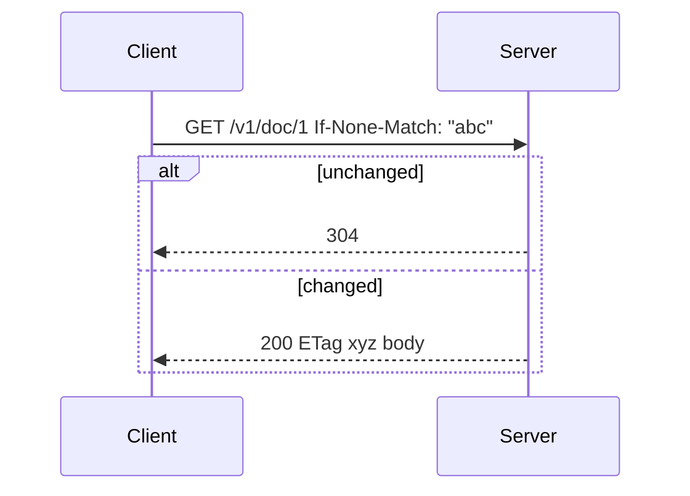
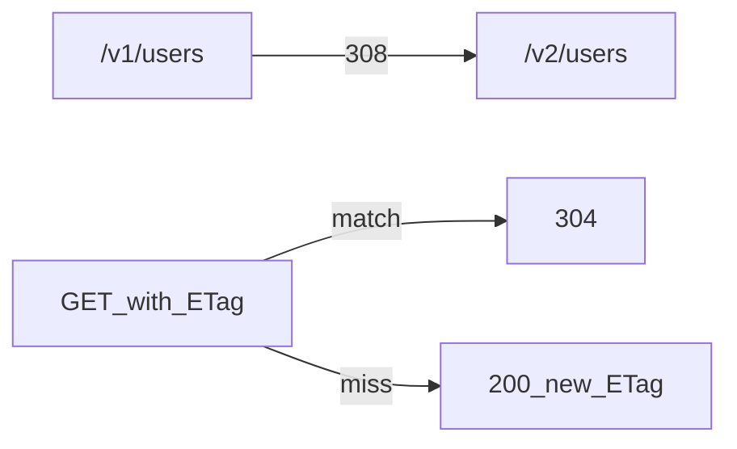

# Redirects and 304 Not Modified

## 1. Metadata and prerequisites

- Topic IDs: D03-T12, D03-T13
- Domain: 3, HTTP Methods and Status Codes
- Difficulty: Intermediate
- Prerequisites: D01-T18, D01-T17, D09-T06
- Learning objectives:
  - Choose among 301, 302, 307, and 308 for API versioning and canonical URLs.
  - Implement conditional GET with 304 per RFC 9110 and caching RFC 9111.
- Related topic IDs: D04-T21, D09-T07
- Estimated complexity: medium
- Completion status: DRAFT
- Verification: RFC 9110 §15.4 and §15.4.5; RFC 9111; examples unverified.

## 2. Introduction and fundamentals

Redirects tell the client to repeat the request at another URI. `304 Not Modified` tells the client its cached representation is still valid—no body is sent in the response.

### D03-T12 301, 302, 307, and 308

**Formal definition.**

| Code | Typical meaning | Method on follow-up (HTTP/1.1 semantics) |
| --- | --- | --- |
| 301 | Moved permanently | Historically ambiguous; prefer 308 for APIs |
| 302 | Found (temporary) | Historically ambiguous; prefer 307 for APIs |
| 307 | Temporary redirect | Must not change method |
| 308 | Permanent redirect | Must not change method |

**Problem solved.** Broken clients when POST becomes GET after redirect.

**Mechanism.** `Location` header carries the new URI. For API deprecations, 308 preserves POST/PUT method on retry.

**Misconception.** "302 is fine for all redirects." Non-GET requests may change method on some stacks with 302/301.

**Production rule.** Use 308 for permanent API path moves; 307 for temporary; document sunset headers (D04-T23). Avoid 301/302 for mutating endpoints.

### D03-T13 304 Not Modified

**Formal definition.** Indicates that a conditional GET/HEAD found the resource unchanged; the server does not send a representation body (RFC 9110). Used with validators from RFC 9111.

**Problem solved.** Bandwidth waste re-downloading unchanged large representations.

**Mechanism.** Client sends `If-None-Match` (ETag) or `If-Modified-Since`; server responds 304 when validator matches.

**Misconception.** "304 includes cached body from server." Client uses its own cache entry; response has no body.

**Production rule.** Generate strong or weak ETags consistently; change ETag when representation changes; include `Cache-Control` appropriate to data class.

## 3. Internal workings



## 4. Architecture diagrams



## 5. Code and implementation

Unverified FastAPI conditional GET sketch:

```python
from fastapi import APIRouter, Header, Response, status

router = APIRouter()

@router.get("/v1/documents/{doc_id}")
def get_document(
    doc_id: str,
    if_none_match: str | None = Header(default=None, alias="If-None-Match"),
) -> Response:
    doc = load(doc_id)
    etag = doc["etag"]
    if if_none_match and if_none_match.strip('"') == etag:
        return Response(status_code=status.HTTP_304_NOT_MODIFIED, headers={"ETag": f'"{etag}"'})
    return Response(
        status_code=status.HTTP_200_OK,
        headers={"ETag": f'"{etag}"'},
        media_type="application/json",
        content=doc["json"],
    )
```

Redirect route:

```python
from fastapi.responses import RedirectResponse

@router.get("/legacy/items/{id}")
def legacy(id: str) -> RedirectResponse:
    return RedirectResponse(url=f"/v1/items/{id}", status_code=status.HTTP_308_PERMANENT_REDIRECT)
```

## 6. API contracts

- GET + validators → 200 or 304
- Deprecation: 308 + `Sunset` + `Link` rel=successor-version
- HEAD follows same validator rules as GET without body

```bash
curl -sS -i "https://api.example.com/v1/documents/d1" -H 'If-None-Match: "abc"'
```

## 7. Production considerations

- CDNs must forward `Vary` and validator headers correctly.
- Do not redirect POST bodies blindly through chains that strip bodies.
- Weak ETags (`W/"..."`) when byte-identical not required.

## 8. Comparison and tradeoffs

| Mechanism | Saves bandwidth | Complexity |
| --- | --- | --- |
| 304 + ETag | High | Validator correctness |
| Short max-age | Medium | Staleness risk |
| 308 redirect | URL migration | Client must follow |

## 9. Debugging and troubleshooting

**Symptom.** Clients always get 200, never 304.

**Cause.** ETag changes every request (timestamp) or `If-None-Match` stripped by proxy.

**Diagnosis.** Compare ETag across identical GETs; inspect gateway header allowlist.

**Fix.** Stable ETag from content hash; allow conditional headers through CDN.

**Prevention.** Test 304 in CI with two-step GET.

## 10. Interview preparation

**Beginner.** Does 304 have a body?

- **Model answer.** No; client uses cached representation.
- **Common incorrect answer.** "Yes, empty JSON."

**Intermediate.** 307 vs 302 for API?

- **Model answer.** 307 preserves method; safer for non-GET during temporary moves.
- **Common incorrect answer.** "They are identical."

**Scenario.** Version migration from /v1 to /v2.

- **Model answer.** 308 to new paths, sunset headers, dual-run period, metrics on legacy hits.
- **Common incorrect answer.** "301 everything without client update."

## 11. Exercises and mastery assessment

**Mastery checklist.**

- [ ] Pick 308/307 over 301/302 for APIs.
- [ ] Implement stable ETags.
- [ ] Test If-None-Match path.
- [ ] Document redirect policy.
- [ ] HEAD aligns with GET validators.

**Revision summary.** Redirect codes must preserve method semantics for APIs; 304 enables efficient conditional GET when validators are stable and honored end-to-end.
