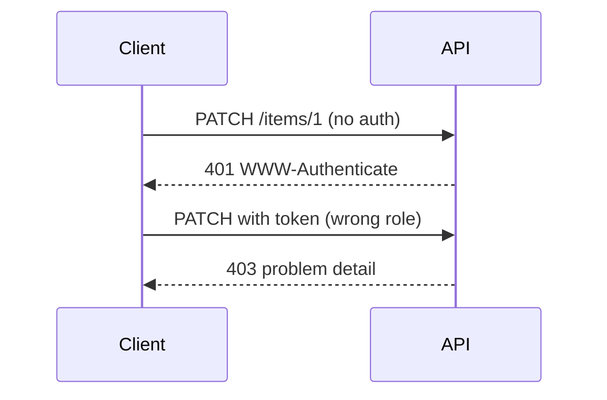
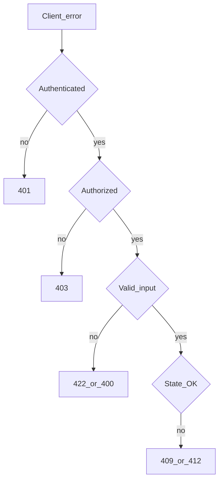

# Client Error Status Codes

## 1. Metadata and prerequisites

- Topic IDs: D03-T14, D03-T15, D03-T16, D03-T17, D03-T18, D03-T19, D03-T20, D03-T21, D03-T22, D03-T23, D03-T24
- Domain: 3, HTTP Methods and Status Codes
- Difficulty: Intermediate
- Prerequisites: D05-T18, D07-T01, D03-T01
- Learning objectives:
  - Map client faults to precise 4xx codes per RFC 9110.
  - Separate authentication (401) from authorization (403).
  - Use conflict, gone, precondition, and payload errors consistently.
- Related topic IDs: D05-T15, D08-T10
- Estimated complexity: high
- Completion status: DRAFT
- Verification: RFC 9110 §15.5; RFC 9457 for bodies; examples unverified.

## 2. Introduction and fundamentals

4xx means the client (or proxy acting for the client) sent something the server refuses to process as requested. Bodies should use Problem Details (RFC 9457) in modern APIs (D05-T18).

### D03-T14 400 Bad Request

**Formal definition.** The server cannot or will not process the request due to something perceived as a client error (malformed syntax, invalid framing).

**Problem solved.** Generic failures that force clients to guess whether to retry.

**Mechanism.** Distinguish from 422 when validation is semantic vs syntactic—many APIs use 422 for schema validation (D03-T23).

**Misconception.** "400 for any client mistake." Overloading hides retry strategy.

**Production rule.** Use 400 for malformed JSON, impossible query encodings, or missing required headers; document machine-readable `type` in problem details.

### D03-T15 401 Unauthorized versus 403 Forbidden

**Formal definition.** 401: request lacks valid authentication credentials for the target resource. 403: server understood and authenticated (if applicable) but refuses to authorize the action.

**Problem solved.** Clients prompting login when they should show "no permission," and vice versa.

**Mechanism.** 401 includes `WWW-Authenticate` when using HTTP auth schemes. 403 without revealing whether the resource exists when policy requires.

**Misconception.** "401 means not logged in; 403 means logged in." 401 is unauthenticated; 403 is refused authorization.

**Production rule.** Run authentication first, authorization second; never return 404 to hide auth failures unless threat model requires it.

### D03-T16 404 Not Found

**Formal definition.** Origin server did not find a current representation for the target URI or resource is intentionally unavailable.

**Problem solved.** Leaking existence of private resources via 403 vs 404 debates.

**Mechanism.** May mean unknown id or route. Consistent policy for cross-tenant access.

**Misconception.** "404 only for bad URLs." Unknown member ids are 404.

**Production rule.** Document whether cross-tenant id probe returns 404 or 403; apply consistently.

### D03-T17 405 Method Not Allowed

**Formal definition.** Method is not supported for the target resource; response should include `Allow` listing supported methods.

**Problem solved.** Clients POST to read-only resources without discovery.

**Mechanism.** Router mismatch vs intentional method restriction.

**Misconception.** "Return 404 to hide endpoint." Use 405 with Allow for known resources.

**Production rule.** FastAPI auto-405 for wrong method; ensure `Allow` is accurate behind reverse proxies.

### D03-T18 409 Conflict

**Formal definition.** Request conflicts with current state of the resource (version clash, duplicate unique key, state machine violation).

**Problem solved.** Silent overwrites when two writers race.

**Mechanism.** Optimistic concurrency failure, duplicate slug, illegal transition.

**Misconception.** "409 is for any error." Reserve for state conflicts, not validation typos.

**Production rule.** Pair with problem detail `type` like `conflict/etag-mismatch`; offer current ETag in response headers when safe.

### D03-T19 410 Gone

**Formal definition.** Target resource is no longer available at the origin and this condition is likely permanent.

**Problem solved.** Clients retry forever on deleted deprecated resources.

**Mechanism.** Distinct from 404 for intentionally removed public ids (API sunsetting).

**Misconception.** "410 vs 404 does not matter." Caches and clients treat gone as permanent.

**Production rule.** Use 410 with sunset documentation when permanently retiring URIs.

### D03-T20 412 Precondition Failed

**Formal definition.** One or more preconditions given in request header fields evaluated to false (e.g., `If-Match`).

**Problem solved.** Lost updates when PATCH applies to stale representation.

**Mechanism.** Tied to ETags and If-Match/If-Unmodified-Since.

**Misconception.** "412 is validation error." It is concurrency/precondition specific.

**Production rule.** Require If-Match on PATCH for contested resources; return 412 with pointer to current version.

### D03-T21 413 Content Too Large

**Formal definition.** Request representation exceeds server limit.

**Problem solved.** OOM from huge uploads.

**Mechanism.** Reverse proxy `client_max_body_size` and app-level limits must align.

**Misconception.** "Stream forever without cap." Always set limits (D08-T11).

**Production rule.** Return 413 before parsing entire body when possible; document max bytes in API guide.

### D03-T22 415 Unsupported Media Type

**Formal definition.** Content-Type not supported for the method/resource.

**Problem solved.** Servers mis-parsing XML as JSON silently.

**Mechanism.** Reject unknown `Content-Type` on POST/PUT/PATCH.

**Misconception.** "415 for wrong JSON field types." That is usually 422.

**Production rule.** Whitelist `application/json` and documented patch types only unless multipart is supported.

### D03-T23 422 Unprocessable Content

**Formal definition.** Syntax understood but semantic validation failed (Web APIs commonly use for schema/business rule violations).

**Problem solved.** Clients cannot fix 400 without field-level errors.

**Mechanism.** FastAPI returns 422 for Pydantic validation errors by default.

**Misconception.** "422 is only FastAPI." It is appropriate whenever validation is more than syntax.

**Production rule.** Normalize validation errors to RFC 9457 `invalid-params` extension or consistent JSON error envelope.

### D03-T24 429 Too Many Requests

**Formal definition.** Client sent too many requests in a given window (rate limiting).

**Problem solved.** Abuse and accidental retry storms.

**Mechanism.** `Retry-After` header when available; distinguish per-key vs per-IP.

**Misconception.** "429 is authentication." It is throttling.

**Production rule.** Document quota headers; use 429 not 503 for client over-quota (503 for server overload).

## 3. Internal workings



## 4. Architecture diagrams



## 5. Code and implementation

Unverified FastAPI exception patterns:

```python
from fastapi import HTTPException, status

raise HTTPException(status_code=status.HTTP_401_UNAUTHORIZED, detail="Authentication required")
raise HTTPException(status_code=status.HTTP_403_FORBIDDEN, detail="Insufficient scope")
```

Problem detail JSON (RFC 9457) illustrative:

```json
{
  "type": "https://api.example.com/problems/validation-error",
  "title": "Validation failed",
  "status": 422,
  "detail": "quantity must be positive",
  "instance": "/v1/orders/trace-abc"
}
```

## 6. API contracts

Document matrix per endpoint: possible 4xx codes and whether retry is safe (usually no for 4xx except 429 with backoff).

```bash
curl -sS -i "https://api.example.com/v1/admin/reports" \
  -H "Authorization: Bearer change-me"
```

## 7. Production considerations

- Do not leak stack traces in 4xx/5xx bodies.
- Align gateway and app status codes.
- Log 4xx with correlation id, not raw passwords.

## 8. Comparison and tradeoffs

| Code | Retry? | Typical fix |
| --- | --- | --- |
| 400 | No | Fix syntax |
| 401 | After auth | Add credentials |
| 403 | No | Change permissions |
| 409 | Maybe after merge | Refresh and retry |
| 412 | After refresh | GET latest ETag |
| 429 | After backoff | Slow down |

## 9. Debugging and troubleshooting

**Symptom.** Mobile shows login loop on valid token.

**Cause.** API returns 401 for expired token but client treats as 403.

**Diagnosis.** Capture status and `WWW-Authenticate`.

**Fix.** Return 401 with clear `invalid_token` problem type; client refreshes token.

**Prevention.** Auth integration tests for expired vs forbidden.

## 10. Interview preparation

**Beginner.** 401 vs 403?

- **Model answer.** 401 unauthenticated; 403 authenticated but not permitted.
- **Common incorrect answer.** "403 means forbidden password."

**Intermediate.** 409 vs 412?

- **Model answer.** 412 failed precondition headers (ETag); 409 general state conflict including uniqueness.
- **Common incorrect answer.** "Same thing."

**Scenario.** Partner gets 422 on dates.

- **Model answer.** Document ISO-8601 UTC requirement; return field paths in problem details.
- **Common incorrect answer.** "Change to 400 without details."

## 11. Exercises and mastery assessment

**Mastery checklist.**

- [ ] AuthN vs AuthZ status correct.
- [ ] 201/204 rules not mixed into 4xx chapter habits.
- [ ] Problem details for 4xx.
- [ ] 429 includes Retry-After when known.
- [ ] 410 used for permanent removal.

**Revision summary.** Precise 4xx codes communicate whether to reauth, fix input, back off, or refresh state—401 unauthenticated, 403 refused authorization, with specialized codes for conflict, preconditions, and rate limits.
