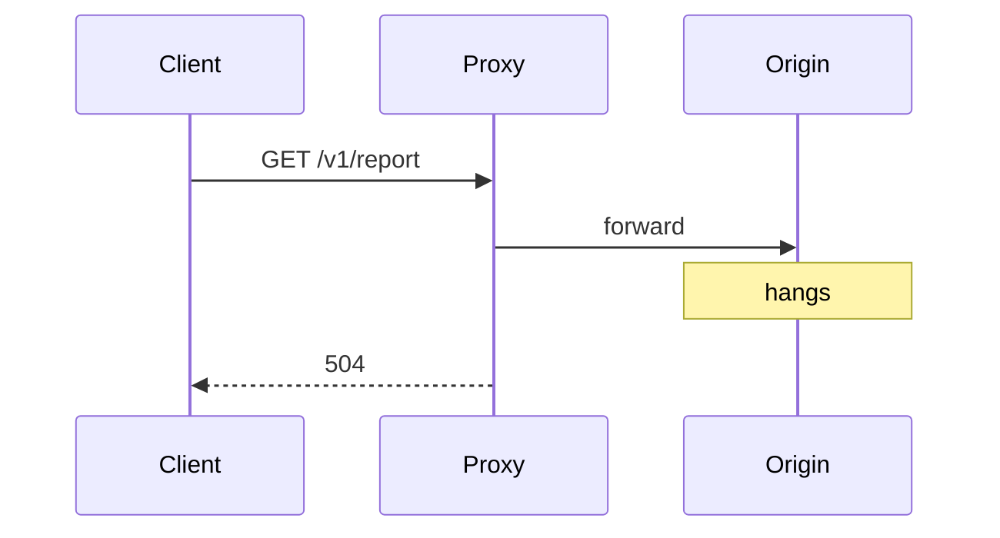
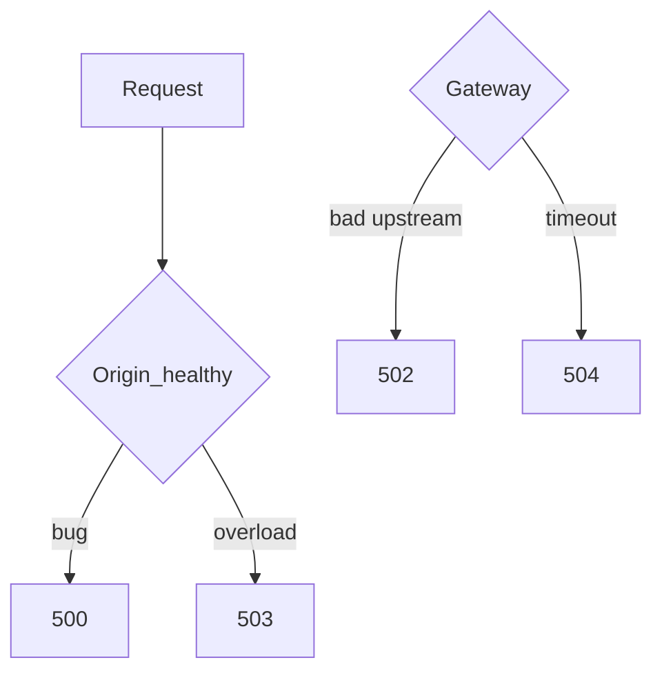

# Server Error Status Codes

## 1. Metadata and prerequisites

- Topic IDs: D03-T25, D03-T26, D03-T27, D03-T28
- Domain: 3, HTTP Methods and Status Codes
- Difficulty: Intermediate
- Prerequisites: D03-T14, D08-T01, D08-T16
- Learning objectives:
  - Distinguish origin failures from gateway and overload conditions.
  - Guide client retry behavior for 5xx responses.
  - Instrument and alert per status class without leaking internals.
- Related topic IDs: D08-T03, D29-T14
- Estimated complexity: medium
- Completion status: DRAFT
- Verification: RFC 9110 §15.6; examples unverified.

## 2. Introduction and fundamentals

5xx indicates the server failed to fulfill an apparently valid request. Clients may retry idempotent requests with backoff; they must not treat 5xx as success.

### D03-T25 500 Internal Server Error

**Formal definition.** Unexpected condition prevented fulfilling the request.

**Problem solved.** Masking bugs as 200 or generic 400 confuses monitoring.

**Mechanism.** Uncaught exceptions, invariant violations, dependency returns not handled.

**Misconception.** "500 is fine for validation bugs." Client-fixable issues belong in 4xx.

**Production rule.** Global exception handler maps unknown errors to 500 with generic problem detail; log stack trace server-side only with correlation id.

### D03-T26 502 Bad Gateway

**Formal definition.** Server acting as gateway/proxy received an invalid response from an upstream server.

**Problem solved.** Misattributing upstream crashes to client faults.

**Mechanism.** Reverse proxy cannot parse upstream response or connection reset mid-response.

**Misconception.** "502 means our Python bug." Often infrastructure or upstream microservice.

**Production rule.** Alert on 502 rate by route; include upstream health in dashboards.

### D03-T27 503 Service Unavailable

**Formal definition.** Server is temporarily unable to handle the request (overload, maintenance, dependency down).

**Problem solved.** Clients hammer a dying origin during deploys.

**Mechanism.** May include `Retry-After`. Load shedders return 503 intentionally (D08-T14).

**Misconception.** "503 same as 500." 503 signals likely transient; retry with backoff.

**Production rule.** Use 503 for graceful degradation and maintenance windows; document readiness vs liveness probes separately.

### D03-T28 504 Gateway Timeout

**Formal definition.** Gateway did not receive timely response from upstream.

**Problem solved.** Hung requests blocking client thread pools forever.

**Mechanism.** Proxy timeout shorter than app timeout causes 504 while app still runs—dangerous duplicate side effects on POST.

**Misconception.** "Increase timeout to fix 504 always." Fix slow queries or async 202 pattern.

**Production rule.** Align timeouts end-to-end; use idempotency for mutating calls that may outlive proxy timeout.

## 3. Internal workings



## 4. Architecture diagrams



## 5. Code and implementation

Unverified global handler sketch:

```python
import logging
from fastapi import FastAPI, Request
from fastapi.responses import JSONResponse

logger = logging.getLogger(__name__)
app = FastAPI()

@app.exception_handler(Exception)
async def unhandled(request: Request, exc: Exception) -> JSONResponse:
    trace_id = request.headers.get("X-Request-Id", "unknown")
    logger.exception("unhandled error trace_id=%s", trace_id)
    return JSONResponse(
        status_code=500,
        content={
            "type": "about:blank",
            "title": "Internal Server Error",
            "status": 500,
            "detail": "An unexpected error occurred.",
            "instance": str(request.url.path),
        },
    )
```

## 6. API contracts

| Code | Client retry | Idempotent GET retry |
| --- | --- | --- |
| 500 | Cautious backoff | Sometimes |
| 502 | Backoff | Sometimes |
| 503 | Retry-After | Often |
| 504 | Backoff | Risk on POST |

```bash
curl -sS -i "https://api.example.com/v1/health"
```

## 7. Production considerations

- SLOs on 5xx rate per route (D08-T20).
- Never return database connection strings in 500 bodies.
- Worker processes do not share in-memory circuit state—use distributed breakers (D08-T07).

## 8. Comparison and tradeoffs

| Code | Likely layer | Typical action |
| --- | --- | --- |
| 500 | Application | Fix bug |
| 502 | Proxy/upstream protocol | Fix upstream |
| 503 | Capacity/maintenance | Scale or wait |
| 504 | Timeout config | Optimize or async |

## 9. Debugging and troubleshooting

**Symptom.** Spikes of 504 on POST payments during peak.

**Cause.** Proxy timeout 30s; DB lock contention 45s; client retries POST.

**Diagnosis.** Trace ids across proxy and app; compare timeout settings.

**Fix.** Shorten transaction, async 202 job, idempotency keys on POST.

**Prevention.** Load test with realistic latency; monitor p95 upstream.

## 10. Interview preparation

**Beginner.** Should clients retry 500?

- **Model answer.** Idempotent requests may retry with backoff; POST needs idempotency keys or user confirmation.
- **Common incorrect answer.** "Never retry any error."

**Intermediate.** 503 vs 429?

- **Model answer.** 429 client exceeded quota; 503 server unavailable or shedding load.
- **Common incorrect answer.** "Both mean slow down" without quota distinction.

**Scenario.** Only gateway sees 502, app logs clean.

- **Model answer.** Upstream closed connection, wrong upstream port, TLS mismatch at proxy—debug proxy error log.
- **Common incorrect answer.** "Restart app only."

## 11. Exercises and mastery assessment

**Mastery checklist.**

- [ ] Map monitoring alerts per 5xx type.
- [ ] Problem details without stack traces.
- [ ] Timeout alignment documented.
- [ ] 503 with Retry-After when known.
- [ ] Idempotency story for 504 on POST.

**Revision summary.** 5xx communicates server-side failure modes—500 origin fault, 502/504 gateway/upstream issues, 503 temporary unavailability—with retry policies tied to method idempotency and idempotency keys.
