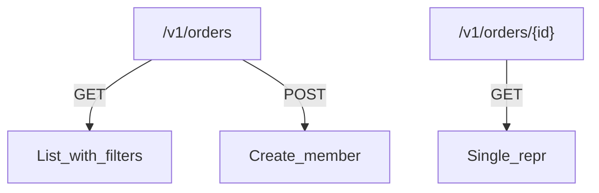
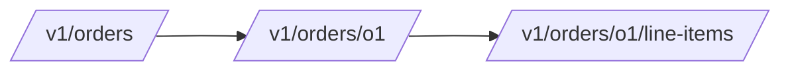

# Resource Naming, URLs, and Nesting

## 1. Metadata and prerequisites

- Topic IDs: D04-T01, D04-T02, D04-T03, D04-T04, D04-T05, D04-T06
- Domain: 4, REST API Endpoint Design
- Difficulty: Beginner
- Prerequisites: D02-T10, D02-T12
- Learning objectives:
  - Apply consistent naming, pluralization, and URI structure.
  - Design collection endpoints with clear query versus path roles.
  - Limit nesting depth while preserving authorization boundaries.
- Related topic IDs: D06-T01, D04-T07
- Estimated complexity: medium
- Completion status: DRAFT
- Verification: Examples unverified.

## 2. Introduction and fundamentals

URLs are part of the API contract. They should be stable, predictable, and aligned with HTTP method semantics—not SQL exposed verbatim.

### D04-T01 Resource naming conventions

**Formal definition.** Names identify resource types using lowercase, hyphen or underscore policy (pick one), plural collections, and domain language—not implementation jargon.

**Problem solved.** Integrators guessing `/user` vs `/users` vs `/User`.

**Mechanism.** Style guide lists allowed segments, abbreviations, and locale rules.

**Misconception.** "CamelCase paths are fine everywhere." They break consistency and some caches.

**Production rule.** Publish naming rules in OpenAPI tags and lint in CI.

### D04-T02 URI and URL design

**Formal definition.** URI identifies the resource; URL includes scheme and host. Paths are hierarchical; queries filter collections.

**Problem solved.** Encoding business logic only in query strings for singleton reads.

**Mechanism.** `/v1/invoices/{id}` for member; `/v1/invoices?status=open` for filter.

**Misconception.** "Put everything in query for flexibility." Member identity belongs in path when stable.

**Production rule.** Percent-encode safely; avoid file extensions in paths unless representing format negotiation.

### D04-T03 Singular versus plural resource names

**Formal definition.** Collections use plural nouns (`/orders`); singleton resources (`/profile`, `/settings`) may be singular when one per principal.

**Problem solved.** Awkward `/profiles/me` vs `/users/me` debates without policy.

**Mechanism.** Plural default; singular exceptions documented.

**Misconception.** "Singular is more RESTful." Consistency matters more than singular/plural theology.

**Production rule.** One rule per API surface; never mix `/user` and `/users`.

### D04-T04 Nested resource design

**Formal definition.** Child resources appear under parent path when lifecycle and authorization are parent-scoped.

**Problem solved.** Orphan endpoints that bypass parent permission checks.

**Mechanism.** `/accounts/{id}/transactions/{txn_id}` enforces account scope in routing layer.

**Misconception.** "Nest all foreign keys." Creates long URLs and coupling.

**Production rule.** Nest at most two levels below collection unless strong justification (D04-T05).

### D04-T05 Avoiding excessively nested URLs

**Formal definition.** Limit depth so clients are not required to know long parent chains; use links or top-level collections with filters.

**Problem solved.** `/a/{id}/b/{id}/c/{id}/d` brittle refactors.

**Mechanism.** Flatten with `?parent_id=` or hypermedia links.

**Misconception.** "Deep nesting shows domain model." It shows tight coupling.

**Production rule.** Max depth in style guide (e.g., 2); require design review beyond that.

### D04-T06 Collection endpoints

**Formal definition.** Endpoints addressing zero or more resources of one type, supporting safe GET list and POST create.

**Problem solved.** Using POST to list because "GET URI too long."

**Mechanism.** Pagination query params (D06-T01); optional `POST /search` for heavy queries (D04-T10).

**Misconception.** "Collections return bare arrays." Wrap with metadata for pagination and extensibility.

**Production rule.** Standard list envelope: `items`, `next`, optional `total` with count tradeoffs (D06-T08).

## 3. Internal workings



## 4. Architecture diagrams



Prefer links from `order` to `items` when clients often fetch order alone.

## 5. Code and implementation

Unverified router:

```python
from fastapi import APIRouter

router = APIRouter(prefix="/v1/projects", tags=["projects"])

@router.get("")
def list_projects(status: str | None = None) -> dict:
    return {"items": []}

@router.get("/{project_id}/tasks/{task_id}")
def get_task(project_id: str, task_id: str) -> dict:
    return {"project_id": project_id, "id": task_id}
```

## 6. API contracts

```bash
curl -sS "https://api.example.com/v1/projects?status=active"
curl -sS "https://api.example.com/v1/projects/p1/tasks/t9"
```

## 7. Production considerations

- Version prefix `/v1` strategy (D04-T21).
- Authorization at member and collection levels.
- OpenAPI `operationId` stable for codegen.

## 8. Comparison and tradeoffs

| Pattern | When | Risk |
| --- | --- | --- |
| Flat `/tasks?project_id=` | Many cross-project queries | Must enforce filter auth |
| Nested | Strong ownership | URL length |
| Singular `/me` | Current user context | Not a collection |

## 9. Debugging and troubleshooting

**Symptom.** 404 on nested route after rename.

**Cause.** Parent id valid but child moved to flat URL.

**Fix.** Temporary alias route + deprecation header.

**Prevention.** Changelog on path changes.

## 10. Interview preparation

**Beginner.** Path vs query for filtering?

- **Model answer.** Path for resource identity; query for filters and pagination on collections.
- **Common incorrect answer.** "Always query."

**Intermediate.** Max nesting?

- **Model answer.** Cap depth; flatten with filters/links; justify exceptions.
- **Common incorrect answer.** "Unlimited nesting mirrors ORM."

**Scenario.** `/users/5/orders` vs `/orders?user_id=5`.

- **Model answer.** Choose based on auth scope and client access patterns; document one canonical pattern.
- **Common incorrect answer.** "Both without guidance."

## 11. Exercises and mastery assessment

**Mastery checklist.**

- [ ] Pluralization policy documented.
- [ ] Nesting depth capped.
- [ ] Collection envelope defined.
- [ ] Path params for ids only.
- [ ] OpenAPI matches implementation.

**Revision summary.** Naming and URL structure are contracts—plural collections, shallow nesting, and clear collection versus member routes reduce integration cost.
