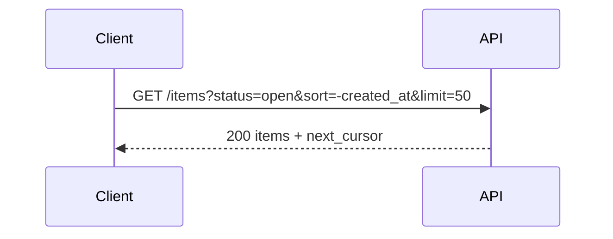

# Filtering, Sorting, Pagination, Search, Bulk, and Actions

## 1. Metadata and prerequisites

- Topic IDs: D04-T07, D04-T08, D04-T09, D04-T10, D04-T11, D04-T12, D04-T13
- Domain: 4, REST API Endpoint Design
- Difficulty: Intermediate
- Prerequisites: D04-T06, D06-T01, D03-T01
- Learning objectives:
  - Design collection query parameters with validation and security.
  - Choose pagination and search patterns appropriate to data scale.
  - Document RPC-style action exceptions deliberately.
- Related topic IDs: D06-T03, D06-T16
- Estimated complexity: high
- Completion status: DRAFT
- Verification: Examples unverified.

## 2. Introduction and fundamentals

Collections are where APIs express filtering, sorting, pagination, and search. Bulk and batch endpoints trade REST purity for operational efficiency. Action endpoints are controlled exceptions.

### D04-T07 Filtering

**Formal definition.** Narrow collection representations via query parameters (`status=open`, `created_after=...`) without changing the resource URI identity of the collection.

**Problem solved.** Clients downloading entire tables client-side.

**Mechanism.** Whitelist filter fields; map to indexed columns (D06-T14).

**Misconception.** "Accept arbitrary filter JSON in query." Opens injection and DoS.

**Production rule.** Publish allowed filters in OpenAPI; reject unknown filters with 400.

### D04-T08 Sorting

**Formal definition.** Order collection results via `sort` or `order_by` parameters with explicit field and direction.

**Problem solved.** Non-deterministic pages breaking offset pagination.

**Mechanism.** Combine with stable tie-breaker (usually id) for cursor pagination (D06-T06).

**Misconception.** "Default DB order is fine." Unstable order breaks pages under concurrency.

**Production rule.** Document default sort; require stable ordering for paginated lists.

### D04-T09 Pagination

**Formal definition.** Return subsets of large collections via offset, page number, or cursor (detailed in domain 6).

**Problem solved.** Timeouts and OOM on unbounded lists.

**Mechanism.** `limit`+`offset`, `page`+`page_size`, or `cursor` token.

**Misconception.** "Return all for admin." Even admins need limits with export jobs.

**Production rule.** Enforce max `limit`; return `next` link or cursor.

### D04-T10 Search endpoints

**Formal definition.** Full-text or multi-field search via `q` parameter on collection or dedicated `POST /search` with body for complex queries.

**Problem solved.** GET URI length limits for large search DSL.

**Mechanism.** POST search is not cache-safe; document non-idempotent analytics separately from read-only search if needed.

**Misconception.** "Search must be GET only." POST is valid for heavy search bodies with clear semantics.

**Production rule.** Rate-limit search; validate query length; use index-backed search engines for scale.

### D04-T11 Bulk operations

**Formal definition.** Apply one operation to many resources in one request (`PATCH` with array, or `POST /bulk-updates`).

**Problem solved.** N sequential calls and partial failure handling.

**Mechanism.** Return multi-status per item or 202 for async bulk jobs.

**Misconception.** "Bulk is always synchronous 200." Large bulks should be async.

**Production rule.** Cap batch size; idempotency keys for financial bulk.

### D04-T12 Batch APIs

**Formal definition.** Client sends array of sub-requests (JSON batch envelope) processed in one HTTP round trip.

**Problem solved.** Mobile latency on graph fetches.

**Mechanism.** Each sub-response carries status; failures are partial.

**Misconception.** "Batch replaces GraphQL." It is another coupling shape with ordering rules.

**Production rule.** Document atomicity: all-or-nothing vs per-item; limit concurrency inside batch processor.

### D04-T13 Action endpoints and RPC-style exceptions

**Formal definition.** Non-CRUD operations modeled as sub-resource posts (`/orders/{id}/cancellations`) or verb-like paths when state machines demand it.

**Problem solved.** Forcing every action into PATCH on a status field without audit trail.

**Mechanism.** POST to action resource; return 201 or 202 with side-effect record.

**Misconception.** "REST forbids actions." Pragmatic APIs document exceptions.

**Production rule.** Maintain an exception registry in the style guide; prefer noun action resources over bare verbs.

## 3. Internal workings



## 4. Architecture diagrams


## 5. Code and implementation

Unverified FastAPI query model:

```python
from fastapi import APIRouter, Query

router = APIRouter()

@router.get("/v1/items")
def list_items(
    status: str | None = None,
    sort: str = Query(default="-created_at,id"),
    limit: int = Query(default=20, le=100),
    cursor: str | None = None,
) -> dict:
    return {"items": [], "next_cursor": None}
```

## 6. API contracts

| Param | Purpose | Validation |
| --- | --- | --- |
| `limit` | page size | max 100 |
| `sort` | order | whitelist fields |
| `cursor` | keyset page | opaque token |

```bash
curl -sS "https://api.example.com/v1/items?status=open&limit=10"
```

## 7. Production considerations

- Filter field allowlists prevent SQL/NoSQL injection (D06-T16).
- Search and bulk endpoints need stricter rate limits.
- Cursor pagination needs stable order (D06-T06).

## 8. Comparison and tradeoffs

| Feature | Offset | Cursor |
| --- | --- | --- |
| Jump to page | Easy | Hard |
| Consistency under writes | Poor | Better |
| Total count | Optional expensive | Often omitted |

## 9. Debugging and troubleshooting

**Symptom.** Duplicate rows across pages.

**Cause.** Unstable sort; rows inserted between offset pages.

**Fix.** Add tie-breaker id; switch to cursor.

**Prevention.** Concurrency pagination tests.

## 10. Interview preparation

**Beginner.** Why max limit?

- **Model answer.** Protect DB and memory; predictable latency.
- **Common incorrect answer.** "Unlimited is user-friendly."

**Intermediate.** POST /search vs GET q?

- **Model answer.** POST when query body is large/sensitive; document non-cacheable semantics.
- **Common incorrect answer.** "POST is always wrong for reads."

**Scenario.** Bulk update 10k rows.

- **Model answer.** Async 202 job with chunks; per-batch idempotency; progress endpoint.
- **Common incorrect answer.** Single synchronous POST."

## 11. Exercises and mastery assessment

**Mastery checklist.**

- [ ] Filter whitelist enforced.
- [ ] Stable sort documented.
- [ ] Bulk caps defined.
- [ ] Action exceptions registered.
- [ ] Search rate limited.

**Revision summary.** Collection endpoints carry filtering, sorting, and pagination contracts; bulk, batch, and action routes are explicit, bounded, and documented exceptions to pure CRUD.
