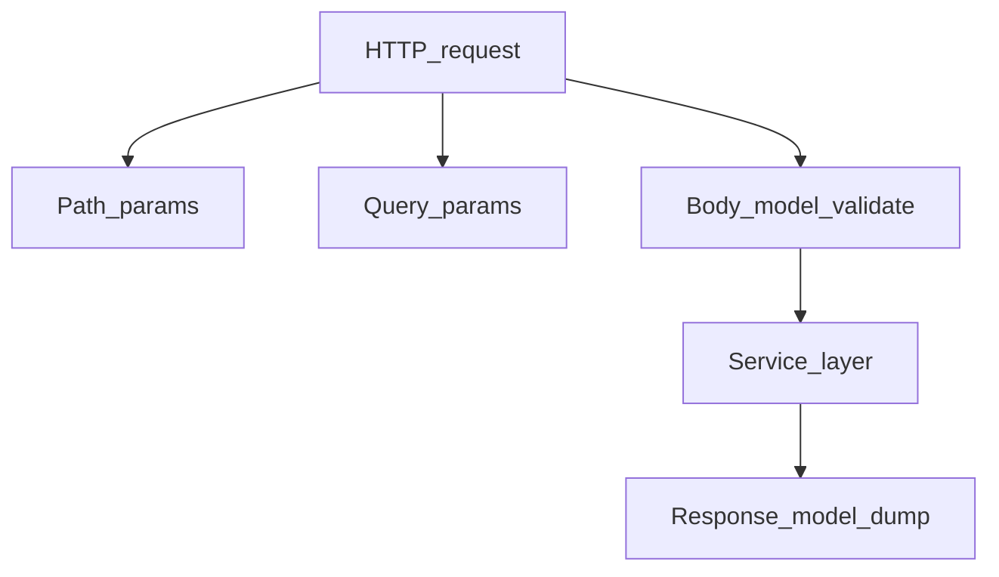
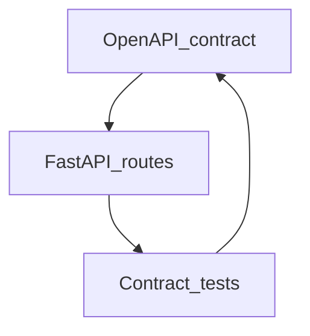

# Parameters, Bodies, Representations, and Contracts

## 1. Metadata and prerequisites

- Topic IDs: D04-T14, D04-T15, D04-T16, D04-T17, D04-T18
- Domain: 4, REST API Endpoint Design
- Difficulty: Intermediate
- Prerequisites: D05-T01, D13-T01
- Learning objectives:
  - Place data in path, query, headers, or body deliberately.
  - Design symmetric request/response schemas and naming conventions.
  - Treat OpenAPI as the integration contract.
- Related topic IDs: D11-T03, D05-T15
- Estimated complexity: medium
- Completion status: DRAFT
- Verification: Examples unverified.

## 2. Introduction and fundamentals

### D04-T14 Query parameters versus path parameters

**Formal definition.** Path parameters identify the resource; query parameters refine the request (filters, pagination, optional modifiers).

**Problem solved.** Ambiguous URLs where identity and filters collide.

**Mechanism.** `/users/{user_id}?include=profile` — id in path, expansion in query.

**Misconception.** "Put filters in path segments." Becomes false hierarchy.

**Production rule.** Path params required for route match; query params optional with defaults documented.

### D04-T15 Request body design

**Formal definition.** Bodies carry representations for POST/PUT/PATCH; schema defines fields, types, and validation rules.

**Problem solved.** Undocumented JSON keys accepted silently (mass assignment risk).

**Mechanism.** Pydantic models with `extra="forbid"` for external APIs (D14-T21).

**Misconception.** "Mirror database columns in requests." Expose task-oriented DTOs.

**Production rule.** Version breaking body changes; use optional new fields for compatibility.

### D04-T16 Response representation design

**Formal definition.** Responses project server state into client-consumable JSON with consistent field names, null semantics, and hypermedia optional.

**Problem solved.** Leaky internal fields (`password_hash`) in responses.

**Mechanism.** `response_model` filters output in FastAPI (D18-T14).

**Misconception.** "Return ORM objects directly." Couples schema to persistence.

**Production rule.** Separate read models; document nullable vs omitted fields (D05-T06).

### D04-T17 Consistent naming conventions

**Formal definition.** Single convention for JSON keys (`snake_case` vs `camelCase`) across all endpoints.

**Problem solved.** Client SDKs mapping field names per resource.

**Mechanism.** Serialization aliases if external convention differs from Python (D14-T22).

**Misconception.** "Mix conventions per team." Breaks client generators.

**Production rule.** Pick one convention in OpenAPI; enforce via lint.

### D04-T18 Consistent API contracts

**Formal definition.** Published OpenAPI (or equivalent) defines methods, schemas, errors, and examples as the authoritative integrator contract.

**Problem solved.** Production behavior diverging from docs.

**Mechanism.** Contract tests, CI OpenAPI diff, semver on breaking changes (D04-T22).

**Misconception.** "Swagger is auto-generated so always true." Hand-tuned docs and behavior need tests.

**Production rule.** Treat contract changes like database migrations—reviewed and versioned.

## 3. Internal workings



## 4. Architecture diagrams



## 5. Code and implementation

Unverified:

```python
from pydantic import BaseModel, ConfigDict, Field

class ItemCreate(BaseModel):
    model_config = ConfigDict(extra="forbid")
    name: str = Field(min_length=1)
    qty: int = Field(ge=1)

class ItemOut(BaseModel):
    id: str
    name: str
    qty: int
```

## 6. API contracts

```bash
curl -sS -X POST "https://api.example.com/v1/items" \
  -H "Content-Type: application/json" \
  -d '{"name":"bolt","qty":2}'
```

Errors: 422 validation; 415 wrong type.

## 7. Production considerations

- Auth headers separate from body secrets.
- Idempotency-Key header on creates when needed.
- Problem details for errors (RFC 9457).

## 8. Comparison and tradeoffs

| Location | Good for | Bad for |
| --- | --- | --- |
| Path | Resource id | Secrets |
| Query | Filters | Large payloads |
| Body | Representations | Cache keys |
| Header | Auth, features | Business fields |

## 9. Debugging and troubleshooting

**Symptom.** Client sends camelCase; server expects snake_case.

**Cause.** Missing alias configuration.

**Fix.** Pydantic `alias` or global alias generator; document in OpenAPI.

**Prevention.** Golden fixture tests.

## 10. Interview preparation

**Beginner.** Where put API key?

- **Model answer.** Header (`Authorization` or `X-Api-Key`), not query string (logs/referrer leakage).
- **Common incorrect answer.** "Query param is easier."

**Intermediate.** response_model purpose?

- **Model answer.** Validates/filters serialized output; prevents leaking internal fields.
- **Common incorrect answer.** "Only for docs."

**Scenario.** Undocumented field accepted then breaks clients when removed.

- **Model answer.** Forbid extras; semver; deprecation period for removals.
- **Common incorrect answer.** "Undocumented fields are private API forever."

## 11. Exercises and mastery assessment

**Mastery checklist.**

- [ ] Path vs query rules documented.
- [ ] Request/response models separate.
- [ ] OpenAPI diff in CI.
- [ ] Naming convention single.
- [ ] Extra fields forbidden on public writes.

**Revision summary.** Parameters and bodies encode identity versus attributes; consistent schemas and OpenAPI contracts keep integrators aligned with server behavior.
