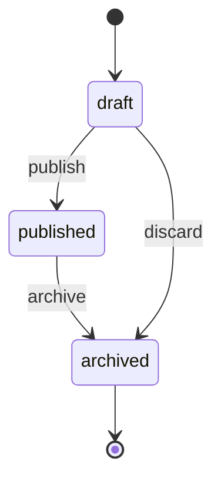
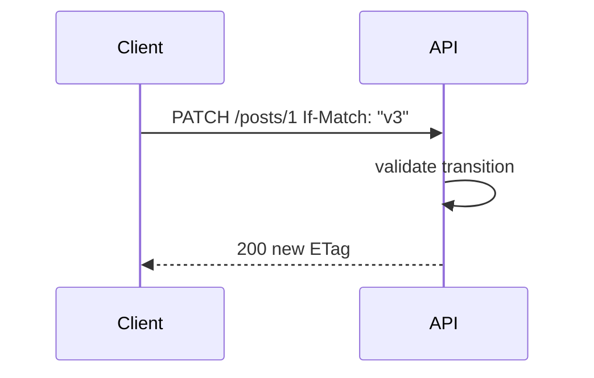

# Partial Updates and Resource Lifecycles

## 1. Metadata and prerequisites

- Topic IDs: D04-T19, D04-T20
- Domain: 4, REST API Endpoint Design
- Difficulty: Intermediate
- Prerequisites: D03-T03, D02-T14
- Learning objectives:
  - Specify PATCH semantics and concurrency control.
  - Model state machines with HTTP methods and action resources.
- Related topic IDs: D03-T18, D03-T20
- Estimated complexity: medium
- Completion status: DRAFT
- Verification: RFC 9110 PATCH; examples unverified.

## 2. Introduction and fundamentals

### D04-T19 Partial resource updates

**Formal definition.** Clients send only changed fields via PATCH (or JSON Merge Patch / JSON Patch) without replacing the entire resource.

**Problem solved.** Race conditions and bandwidth waste from full PUT.

**Mechanism.** Server merges per documented rules; rejects unknown fields if policy requires.

**Misconception.** "PATCH without format is obvious." Clients need media type and null semantics.

**Production rule.** Document whether `null` clears a field; use If-Match for contested resources.

### D04-T20 Resource lifecycle and state transitions

**Formal definition.** Resources move through states (draft → published → archived) governed by allowed transitions, often enforced server-side.

**Problem solved.** Clients setting arbitrary status strings bypassing business rules.

**Mechanism.** PATCH on `status` with validation; or POST to transition resources (`/publications`) returning new state representation.

**Misconception.** "Let clients PATCH any field." State fields may be server-controlled only.

**Production rule.** Publish state diagram; return 409 on illegal transitions; audit log transitions.

## 3. Internal workings



## 4. Architecture diagrams



## 5. Code and implementation

Unverified:

```python
from fastapi import HTTPException, status

ALLOWED = {"draft": {"published"}, "published": {"archived"}}

def apply_status(current: str, new: str) -> str:
    if new not in ALLOWED.get(current, set()):
        raise HTTPException(status.HTTP_409_CONFLICT, "illegal transition")
    return new
```

## 6. API contracts

- PATCH `application/merge-patch+json`
- 409 conflict on illegal state
- 412 on stale If-Match

```bash
curl -sS -X PATCH "https://api.example.com/v1/posts/1" \
  -H "Content-Type: application/merge-patch+json" \
  -H 'If-Match: "v3"' \
  -d '{"status":"published"}'
```

## 7. Production considerations

- PATCH is not idempotent in general—document exceptions.
- PUT remains full replacement for import/sync use cases.
- Side effects (notifications) on transitions should be async 202 when slow.

## 8. Comparison and tradeoffs

| Approach | Clarity | Flexibility |
| --- | --- | --- |
| PATCH status field | Simple | Easy to misuse |
| POST transition resource | Auditable | More routes |
| PUT full replace | Idempotent | Wipes fields |

## 9. Debugging and troubleshooting

**Symptom.** Status stuck after PATCH 200.

**Cause.** PATCH merged fields but transition validator rejected silently—should be 409.

**Fix.** Validate before save; atomic transaction.

**Prevention.** State machine unit tests.

## 10. Interview preparation

**Beginner.** PUT vs PATCH lifecycle?

- **Model answer.** PUT replaces entire resource; PATCH partial with format contract.
- **Common incorrect answer.** "PATCH is always idempotent."

**Intermediate.** How enforce transitions?

- **Model answer.** Server-side state machine; 409 on illegal moves; optional action endpoints.
- **Common incorrect answer.** "Client disables buttons only."

**Scenario.** Two editors PATCH concurrently.

- **Model answer.** Optimistic locking with ETag/If-Match → 412; client refresh merge.
- **Common incorrect answer.** "Last write wins always."

## 11. Exercises and mastery assessment

**Mastery checklist.**

- [ ] Patch media type published.
- [ ] Null semantics defined.
- [ ] State diagram documented.
- [ ] 409 on illegal transitions.
- [ ] ETag on contested resources.

**Revision summary.** Partial updates and lifecycles need explicit PATCH contracts and server-enforced state machines—not ad hoc field writes.
