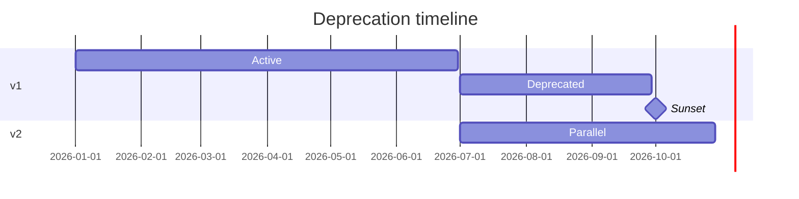
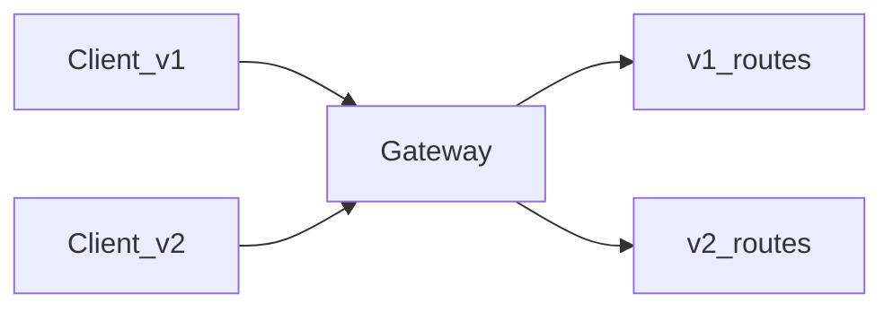

# Versioning, Compatibility, and Deprecation

## 1. Metadata and prerequisites

- Topic IDs: D04-T21, D04-T22, D04-T23
- Domain: 4, REST API Endpoint Design
- Difficulty: Advanced
- Prerequisites: D03-T12, D11-T16
- Learning objectives:
  - Choose URI, header, or content negotiation versioning with tradeoffs.
  - Ship additive changes safely; plan breaking changes.
  - Operate deprecation with sunsets and metrics.
- Related topic IDs: D02-T15, D05-T18
- Estimated complexity: high
- Completion status: DRAFT
- Verification: Examples unverified.

## 2. Introduction and fundamentals

### D04-T21 API versioning

**Formal definition.** A policy for identifying which contract revision applies to a request (`/v1/...`, `Accept-Version`, or `X-API-Version` header).

**Problem solved.** Silent breaking changes destroying integrators.

**Mechanism.** Major version bump for breaking changes; minors additive only.

**Misconception.** "Version every deploy." Version the contract, not each commit.

**Production rule.** One visible versioning strategy per public API; document default version when optional.

### D04-T22 Backward compatibility

**Formal definition.** New server versions accept old clients: additive fields, optional params, preserved behavior for existing calls.

**Problem solved.** Forced big-bang client upgrades.

**Mechanism.** Expand-contract: add fields, never rename in place; use feature flags inside server for behavior toggles.

**Misconception.** "Removing unused fields is safe." Clients may still parse them; removals are breaking.

**Production rule.** Compatibility tests in CI (D11-T16); OpenAPI diff gates.

### D04-T23 Deprecation policies

**Formal definition.** Communicate retiring endpoints/fields via `Deprecation`, `Sunset` (RFC 8594), changelog, and metrics on usage.

**Problem solved.** Zombie endpoints nobody maintains.

**Mechanism.** 308 to successors; maintain parallel run period; 410 when removed.

**Misconception.** "Stop documenting old version immediately." Integrators need timeline.

**Production rule.** Minimum notice period contractual; track calls to deprecated routes.

## 3. Internal workings



## 4. Architecture diagrams



## 5. Code and implementation

Unverified versioned routers:

```python
from fastapi import APIRouter

v1 = APIRouter(prefix="/v1")
v2 = APIRouter(prefix="/v2")

@v1.get("/items/{id}")
def get_item_v1(id: str) -> dict:
    return {"id": id, "name": "legacy"}

@v2.get("/items/{id}")
def get_item_v2(id: str) -> dict:
    return {"id": id, "title": "new field name"}
```

## 6. API contracts

Response headers on deprecated route:

```
Deprecation: true
Sunset: Sat, 01 Nov 2026 00:00:00 GMT
Link: </v2/items/1>; rel="successor-version"
```

## 7. Production considerations

- Do not break JSON key names without major version.
- Mobile apps lag—longer sunsets.
- Metrics on `Deprecation` routes drive communication.

## 8. Comparison and tradeoffs

| Strategy | Pros | Cons |
| --- | --- | --- |
| URI `/v1` | Obvious | Multiple route trees |
| Header | Clean URLs | Harder to test in browser |
| Content-Type profile | Granular | Complex |

## 9. Debugging and troubleshooting

**Symptom.** Clients break after "additive" release.

**Cause.** Changed enum meaning or default behavior.

**Diagnosis.** Compare OpenAPI diff; replay integration tests.

**Fix.** Roll forward with compatibility shim or revert behavior flag.

**Prevention.** Regression suite on golden requests.

## 10. Interview preparation

**Beginner.** Breaking vs non-breaking change?

- **Model answer.** Adding optional field non-breaking; removing/renaming breaking.
- **Common incorrect answer.** "Any change needs v2."

**Intermediate.** URI vs header versioning?

- **Model answer.** URI simplest for public docs; headers work with gateways; pick one consistently.
- **Common incorrect answer.** "Use both interchangeably without default."

**Scenario.** Zero traffic on deprecated route but not removed.

- **Model answer.** Verify metrics scope; confirm clients updated; then 410 with comms.
- **Common incorrect answer.** "Delete immediately."

## 11. Exercises and mastery assessment

**Mastery checklist.**

- [ ] Versioning strategy documented.
- [ ] OpenAPI diff in CI.
- [ ] Sunset headers on deprecated routes.
- [ ] Compatibility tests exist.
- [ ] Breaking change playbook.

**Revision summary.** Versioning and deprecation are operational commitments—additive evolution within majors, explicit sunsets, and measured migration paths.
