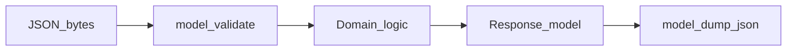
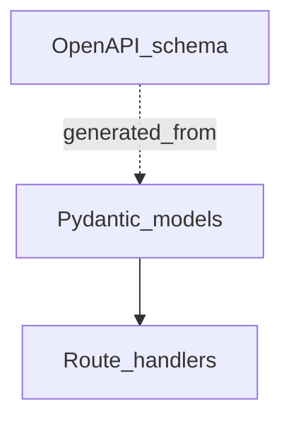

# JSON, Serialization, and Field Design

## 1. Metadata and prerequisites

- Topic IDs: D05-T01, D05-T02, D05-T03, D05-T04, D05-T05, D05-T06, D05-T07, D05-T08
- Domain: 5, Request and Response Design
- Difficulty: Intermediate
- Prerequisites: D04-T15, D14-T01
- Learning objectives:
  - Design JSON schemas with explicit presence, nullability, and defaults.
  - Validate requests and responses at the boundary with Pydantic v2.
  - Apply field constraints that match business rules.
- Related topic IDs: D19-T02, D05-T18
- Estimated complexity: high
- Completion status: DRAFT
- Verification: Examples unverified.

## 2. Introduction and fundamentals

### D05-T01 JSON request and response formats

**Formal definition.** JSON (RFC 8259) as the typical representation encoding for HTTP APIs, carried with `Content-Type: application/json`.

**Problem solved.** Ad hoc text formats and ambiguous parsing.

**Mechanism.** UTF-8 encoding; objects for resources; arrays for collections.

**Misconception.** "JSON numbers are exact for money." Use strings/decimals (D05-T11).

**Production rule.** Reject non-UTF-8; set charset in Content-Type when needed.

### D05-T02 Serialization and deserialization

**Formal definition.** Deserialization maps bytes to in-memory models; serialization maps models to bytes for responses.

**Problem solved.** Type confusion and silent coercion bugs.

**Mechanism.** Pydantic `model_validate` / `model_validate_json` inbound; `model_dump` outbound with mode `json`.

**Misconception.** "Manual `dict` is fine." Loses validation and documentation sync.

**Production rule.** Single source of truth models feeding OpenAPI.

### D05-T03 Request validation

**Formal definition.** Reject invalid inbound representations before domain logic with 422 (or 400) and structured errors.

**Problem solved.** SQL errors and 500s from bad input.

**Mechanism.** FastAPI dependency on Pydantic body models.

**Misconception.** "Validate in DB only." Late failure, poor client UX.

**Production rule.** Validate at edge; domain validates invariants DB cannot express.

### D05-T04 Response validation

**Formal definition.** Ensure outbound data matches published contract (`response_model`).

**Problem solved.** Accidental leakage of internal fields.

**Mechanism.** Filter fields, apply serializers, enforce types on output.

**Misconception.** "Responses don't need validation." Bugs ship to clients.

**Production rule.** response_model on public routes; tests on golden JSON.

### D05-T05 Required versus optional fields

**Formal definition.** Required fields must be present on create; optional may be omitted with defined semantics.

**Problem solved.** Ambiguity between missing and default.

**Mechanism.** Pydantic required vs `Optional` with no default vs default factory.

**Misconception.** "Optional means nullable." Optional is presence; nullable is JSON `null`.

**Production rule.** Document create vs update required sets separately.

### D05-T06 Nullable fields

**Formal definition.** Field may be JSON `null` to clear or indicate absence of value.

**Problem solved.** Clients cannot unset fields.

**Mechanism.** `str | None` with explicit null in schema.

**Misconception.** "Omit and null are always equivalent." Define per field.

**Production rule.** OpenAPI `nullable` accurate; PATCH null rules documented (D04-T19).

### D05-T07 Default values

**Formal definition.** Server applies value when field omitted on input; defaults differ from nullable.

**Problem solved.** Clients sending boilerplate defaults incorrectly.

**Mechanism.** Pydantic `Field(default=...)`; beware mutable defaults—use `default_factory`.

**Misconception.** "Default zero for unknown." Hides missing data.

**Production rule.** Defaults only for safe server-chosen values; not for business-critical inputs.

### D05-T08 Field constraints

**Formal definition.** Bounds on strings, numbers, arrays (`min_length`, `ge`, `max_items`).

**Problem solved.** Oversized payloads and invalid enums reaching database.

**Mechanism.** Pydantic `Field` constraints; custom validators for cross-field rules.

**Misconception.** "DB constraint is enough." Wastes round trips.

**Production rule.** Mirror DB constraints in API layer; return field paths in errors.

## 3. Internal workings



## 4. Architecture diagrams



## 5. Code and implementation

Unverified Pydantic v2:

```python
from pydantic import BaseModel, ConfigDict, Field, field_validator

class CreateItem(BaseModel):
    model_config = ConfigDict(extra="forbid")
    name: str = Field(min_length=1, max_length=120)
    qty: int = Field(ge=1, le=10_000)
    note: str | None = None

    @field_validator("name")
    @classmethod
    def strip_name(cls, v: str) -> str:
        return v.strip()
```

## 6. API contracts

```bash
curl -sS -X POST "https://api.example.com/v1/items" \
  -H "Content-Type: application/json" \
  -d '{"name":" widget ","qty":2}'
```

422 returns validation problem details.

## 7. Production considerations

- Forbid unknown fields on writes for public APIs.
- Consistent error envelope (RFC 9457).
- No secrets in examples—use `change-me`.

## 8. Comparison and tradeoffs

| Choice | Benefit | Cost |
| --- | --- | --- |
| Strict models | Safety | Migration care |
| Loose models | Speed early | Mass assignment risk |
| Server defaults | Smaller requests | Hidden behavior |

## 9. Debugging and troubleshooting

**Symptom.** 422 on valid-looking payload.

**Cause.** Extra unknown field with `extra=forbid`.

**Diagnosis.** Compare request to OpenAPI schema.

**Fix.** Client removes field or server adds optional field in new version.

**Prevention.** Contract tests.

## 10. Interview preparation

**Beginner.** Required vs optional in Pydantic?

- **Model answer.** No default and not Optional → required; Optional or default → not required on input.
- **Common incorrect answer.** "Optional always means null allowed."

**Intermediate.** Why response_model?

- **Model answer.** Output validation/filtering matching published schema.
- **Common incorrect answer.** "Documentation only."

**Scenario.** Client sends `qty: "2"` string.

- **Model answer.** Pydantic coercion if enabled; strict mode may 422—document strictness.
- **Common incorrect answer.** "Always accept strings silently."

## 11. Exercises and mastery assessment

**Mastery checklist.**

- [ ] extra=forbid on public writes.
- [ ] Nullable documented per field.
- [ ] Defaults use default_factory for mutables.
- [ ] Constraints align with DB.
- [ ] 422 errors include paths.

**Revision summary.** JSON APIs need rigorous field presence, validation at the boundary, and symmetric request/response models tied to OpenAPI.
