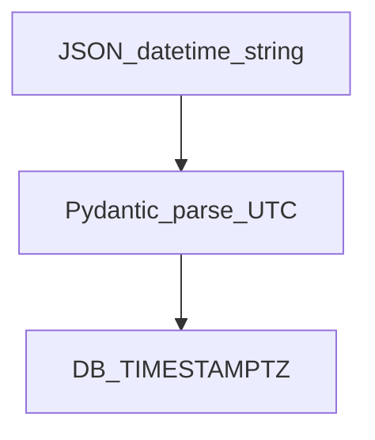
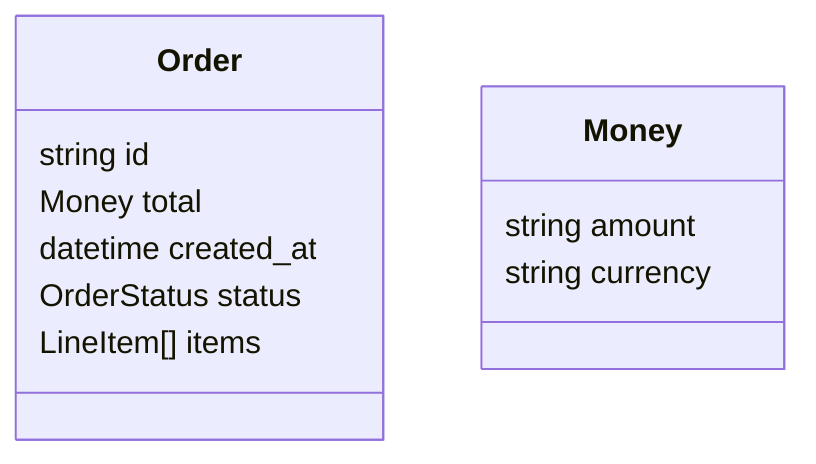

# Time, Money, Enums, and Nested Values

## 1. Metadata and prerequisites

- Topic IDs: D05-T09, D05-T10, D05-T11, D05-T12, D05-T13
- Domain: 5, Request and Response Design
- Difficulty: Intermediate
- Prerequisites: D05-T01, D05-T08
- Learning objectives:
  - Standardize datetime and timezone handling in APIs.
  - Represent money safely; model enums and nested structures.
- Related topic IDs: D22-T01, D14-T12
- Estimated complexity: medium-high
- Completion status: DRAFT
- Verification: ISO 8601; examples unverified.

## 2. Introduction and fundamentals

### D05-T09 Date and time formats

**Formal definition.** Use ISO 8601 strings in JSON (`2026-10-14T12:00:00Z`) for instants; date-only where appropriate (`2026-10-14`).

**Problem solved.** Locale-dependent date parsing bugs.

**Mechanism.** Pydantic `datetime` parsing; serialize UTC with `Z`.

**Misconception.** "Unix timestamps are always better." Strings are human-debuggable; document timezone.

**Production rule.** API accepts and returns UTC unless field is explicitly local with offset.

### D05-T10 Time zones and UTC

**Formal definition.** Store and exchange instants in UTC; convert to local only in presentation layers.

**Problem solved.** DST ambiguities and off-by-one-day reports.

**Mechanism.** `datetime.timezone.utc`; never rely on server local TZ.

**Misconception.** "Store user timezone in every instant field." Store instant UTC + optional `timezone` preference separately.

**Production rule.** Document that all instants are UTC; reject offsets if policy is Z-only.

### D05-T11 Decimal and monetary values

**Formal definition.** Money as decimal string or integer minor units (cents); avoid binary floats.

**Problem solved.** `0.1 + 0.2` billing errors.

**Mechanism.** `Decimal` in Python; JSON string `"10.99"` or `amount_cents: 1099`.

**Misconception.** "JSON number is fine for currency." Float rounding breaks accounting.

**Production rule.** Pick one representation org-wide; include `currency` code (ISO 4217).

### D05-T12 Enum fields

**Formal definition.** Closed set of string values (`status: pending | paid`).

**Problem solved.** Typos in free-text status fields.

**Mechanism.** Python `enum.StrEnum` or Pydantic `Literal`; OpenAPI enum list.

**Misconception.** "Enums never change." Add new values compatibly; never repurpose values.

**Production rule.** Unknown enum values on input → 422; tolerate unknown on read if forward compatibility needed.

### D05-T13 Nested objects and arrays

**Formal definition.** Complex structures via nested models and typed arrays.

**Problem solved.** Untyped `dict` blobs.

**Mechanism.** Nested `BaseModel`; `list[Child]` with max length constraints.

**Misconception.** "Deep nesting unlimited." Cap depth/size for DoS protection.

**Production rule.** Limit array lengths; validate nested objects recursively.

## 3. Internal workings



## 4. Architecture diagrams



## 5. Code and implementation

Unverified:

```python
from datetime import datetime, timezone
from enum import StrEnum
from pydantic import BaseModel, Field

class OrderStatus(StrEnum):
    pending = "pending"
    paid = "paid"

class Money(BaseModel):
    amount: str
    currency: str = Field(pattern=r"^[A-Z]{3}$")

class OrderOut(BaseModel):
    id: str
    status: OrderStatus
    created_at: datetime
    total: Money
```

## 6. API contracts

```json
{
  "id": "o1",
  "status": "paid",
  "created_at": "2026-10-14T06:30:00Z",
  "total": {"amount": "10.99", "currency": "USD"}
}
```

## 7. Production considerations

- DB `TIMESTAMPTZ` with UTC app layer.
- Never log full PAN; money audit trails immutable.

## 8. Comparison and tradeoffs

| Money format | Pros | Cons |
| --- | --- | --- |
| String decimal | Exact | Parsing needed |
| Minor units int | Fast math | Scale per currency |

## 9. Debugging and troubleshooting

**Symptom.** Orders off by one hour twice a year.

**Cause.** Local TZ conversion on UTC instants.

**Fix.** Store UTC; convert in UI only.

**Prevention.** Datetime unit tests around DST boundaries.

## 10. Interview preparation

**Beginner.** Why not float money?

- **Model answer.** Binary floating point cannot represent decimals exactly; use decimal string or cents int.
- **Common incorrect answer.** "Float is fine with rounding."

**Intermediate.** Enum breaking change?

- **Model answer.** Adding value non-breaking; renaming/removing breaking—new API version.
- **Common incorrect answer.** "Rename enum in place."

**Scenario.** Nested items array huge.

- **Model answer.** Max items validation; 413 or 422; paginate line items collection separately.
- **Common incorrect answer.** "Accept any size."

## 11. Exercises and mastery assessment

**Mastery checklist.**

- [ ] UTC documented.
- [ ] Money type chosen.
- [ ] Enums in OpenAPI.
- [ ] Nested limits set.
- [ ] ISO 8601 in examples.

**Revision summary.** Temporal, monetary, enum, and nested types need explicit API contracts—UTC instants, non-float money, closed enums, bounded nesting.
