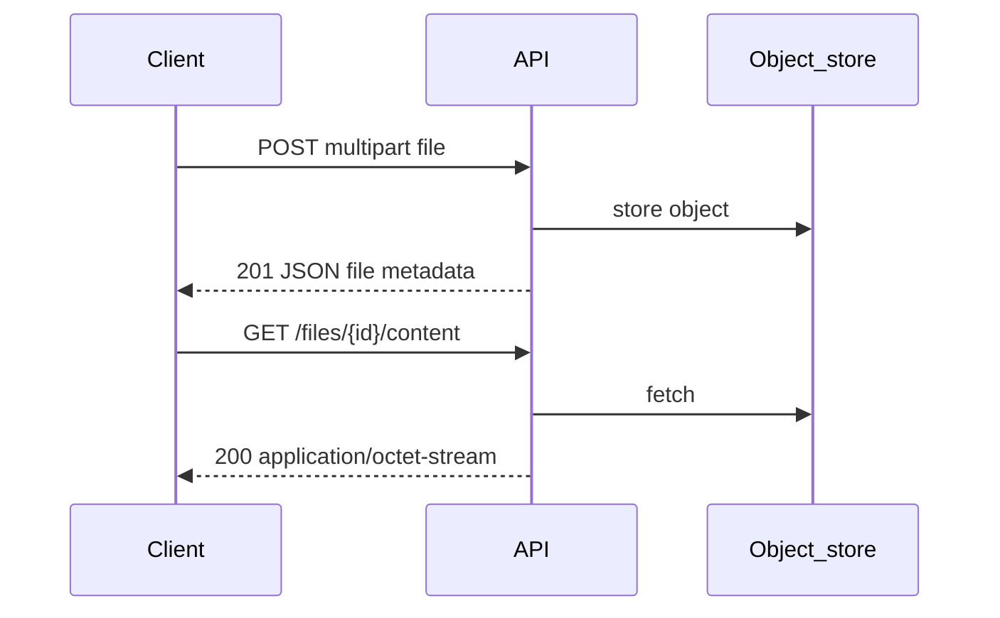

# File Upload and Download Representations

## 1. Metadata and prerequisites

- Topic IDs: D05-T14
- Domain: 5, Request and Response Design
- Difficulty: Intermediate
- Prerequisites: D05-T01, D23-T01
- Learning objectives:
  - Represent file metadata in JSON alongside binary transports.
  - Design download responses with correct Content-Type and disposition.
- Related topic IDs: D23-T12, D10-T14
- Estimated complexity: medium
- Completion status: DRAFT
- Verification: RFC 9110 content coding; examples unverified.

## 2. Introduction and fundamentals

### D05-T14 File upload and download responses

**Formal definition.** Uploads use `multipart/form-data` or streaming bodies; downloads return bytes with appropriate `Content-Type`, `Content-Disposition`, and optionally `Content-Length` or chunked encoding.

**Problem solved.** Base64-in-JSON bloat and wrong MIME types in clients.

**Mechanism.** JSON resources reference files (`avatar_url`, `file_id`); binary served via dedicated GET or presigned URLs (D23-T16).

**Misconception.** "Store files inside JSON." Use object storage with metadata in DB.

**Production rule.** Validate size, MIME, and magic bytes; never trust client extension alone.

## 3. Internal workings



## 4. Architecture diagrams


## 5. Code and implementation

Unverified metadata model:

```python
from pydantic import BaseModel

class FileMeta(BaseModel):
    id: str
    filename: str
    content_type: str
    size_bytes: int
    sha256: str
```

Download headers (conceptual):

```
Content-Type: image/png
Content-Disposition: attachment; filename="report.png"
```

## 6. API contracts

- POST `multipart/form-data` → 201 + JSON metadata + optional Location
- GET content → 200 stream; 404 missing
- Large files: 302 to presigned URL or 206 range requests if supported

```bash
curl -sS -X POST "https://api.example.com/v1/files" \
  -F "file=@./doc.pdf"
```

## 7. Production considerations

- Virus scan async after upload (202 job).
- Path traversal prevention on filenames (D23-T11).
- Rate limit uploads separately.

## 8. Comparison and tradeoffs

| Approach | Pros | Cons |
| --- | --- | --- |
| Inline JSON base64 | Simple | Huge payloads |
| Multipart upload | Standard | Parsing cost |
| Presigned URL | Offloads bandwidth | Extra round trip |

## 9. Debugging and troubleshooting

**Symptom.** Corrupt downloads.

**Cause.** Text mode read or wrong Content-Type.

**Diagnosis.** Hash compare to source; check Content-Encoding.

**Fix.** Stream binary; set Content-Type from sniffed magic.

**Prevention.** Integration test with binary fixture.

## 10. Interview preparation

**Beginner.** Where store large files?

- **Model answer.** Object storage; API holds metadata and authorization.
- **Common incorrect answer.** "In PostgreSQL BYTEA always."

**Intermediate.** Content-Disposition inline vs attachment?

- **Model answer.** Inline for browser display; attachment for forced download.
- **Common incorrect answer.** "No difference."

**Scenario.** Mobile upload timeout.

- **Model answer.** Presigned direct-to-storage upload; callback to register metadata.
- **Common incorrect answer.** "Increase JSON limit."

## 11. Exercises and mastery assessment

**Mastery checklist.**

- [ ] Metadata JSON separate from bytes.
- [ ] MIME validated.
- [ ] Size limits enforced.
- [ ] Secure filenames.
- [ ] Download auth checked.

**Revision summary.** Files are binary HTTP representations with JSON metadata—multipart or presigned upload, typed download responses, validation before trust.
