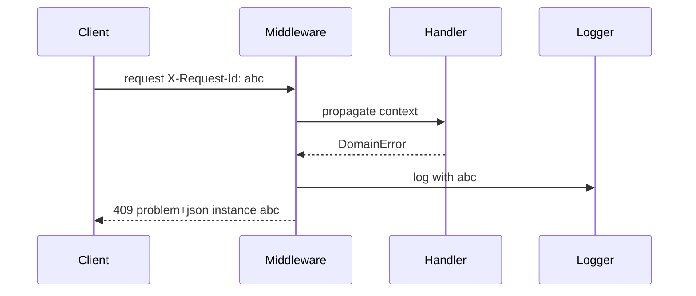
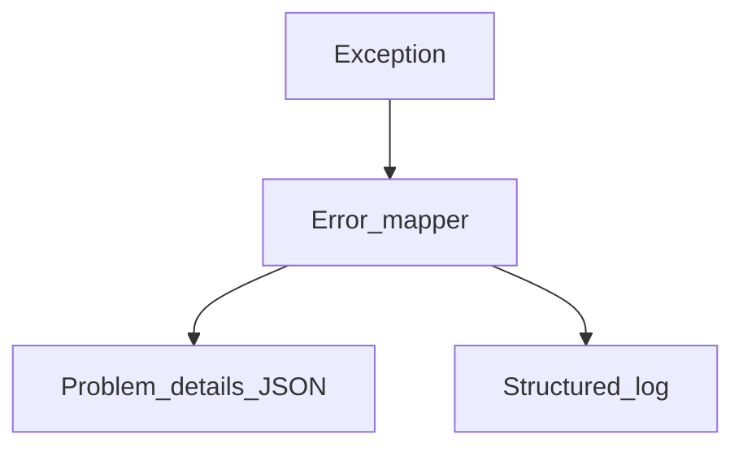

# Error Schemas, Identifiers, and RFC 9457

## 1. Metadata and prerequisites

- Topic IDs: D05-T15, D05-T16, D05-T17, D05-T18, D05-T19
- Domain: 5, Request and Response Design
- Difficulty: Intermediate
- Prerequisites: D03-T14, D19-T08
- Learning objectives:
  - Design consistent error bodies across services.
  - Implement RFC 9457 Problem Details for HTTP APIs.
  - Propagate correlation IDs without leaking secrets or stack traces.
- Related topic IDs: D29-T05, D17-T06
- Estimated complexity: high
- Completion status: DRAFT
- Verification: RFC 9457; examples unverified.

## 2. Introduction and fundamentals

### D05-T15 Consistent error response schemas

**Formal definition.** All error responses share structure: machine `type`, human `title`, HTTP `status`, optional `detail`, `instance`, and extensions.

**Problem solved.** Clients parsing ad hoc `{error: "something"}` per endpoint.

**Mechanism.** Central exception handlers map domain errors to problem+json.

**Misconception.** "Errors can be plain text." JSON clients need structured errors.

**Production rule.** One error schema per API major version; document in OpenAPI components.

### D05-T16 Error codes and error messages

**Formal definition.** Stable machine codes (`inventory_insufficient`) separate from localized human messages.

**Problem solved.** Brittle clients matching English substrings.

**Mechanism.** `type` URI or dotted code; `detail` for humans; optional `errors[]` with `pointer`.

**Misconception.** "Change message text freely." Clients may depend on codes, not prose.

**Production rule.** Treat `type`/code as contract; message changes are non-breaking if codes stable.

### D05-T17 Correlation IDs and request IDs

**Formal definition.** Unique id per request (`X-Request-Id`, `traceparent`) linking logs, traces, and support tickets.

**Problem solved.** Cannot debug "it failed yesterday" reports.

**Mechanism.** Middleware generates or forwards id; include in error `instance` or extension field.

**Misconception.** "Use user id as correlation." Privacy and collision issues.

**Production rule.** Accept client-provided id if valid UUID; always echo in response header.

### D05-T18 RFC 9457 Problem Details for HTTP APIs

**Formal definition.** Standard media type `application/problem+json` (and `application/problem+xml`) for error bodies with registered members `type`, `title`, `status`, `detail`, `instance`.

**Problem solved.** Incompatible error JSON across microservices.

**Mechanism.** Content-Type problem+json; `type` defaults to `about:blank` if generic.

**Misconception.** "Problem details required for 404 only." Use for any error with body.

**Production rule.** Register problem `type` URIs under your domain for each error class.

### D05-T19 Avoiding sensitive information in responses

**Formal definition.** Error and success payloads must not expose stack traces, SQL, secrets, or PII beyond what the client already owns.

**Problem solved.** Credential leakage via verbose 500 pages.

**Mechanism.** Log details server-side with correlation id; return generic 500 detail publicly.

**Misconception.** "Developers need stack traces in prod API." Use internal logging tools.

**Production rule.** Redact tokens and passwords in logs; scan error responses in security review.

## 3. Internal workings



## 4. Architecture diagrams



## 5. Code and implementation

Unverified FastAPI handler:

```python
from fastapi import Request
from fastapi.exceptions import RequestValidationError
from fastapi.responses import JSONResponse

async def validation_handler(request: Request, exc: RequestValidationError) -> JSONResponse:
    trace = request.headers.get("X-Request-Id", "unknown")
    return JSONResponse(
        status_code=422,
        media_type="application/problem+json",
        content={
            "type": "https://api.example.com/problems/validation-error",
            "title": "Validation failed",
            "status": 422,
            "detail": "One or more fields are invalid.",
            "instance": trace,
            "errors": exc.errors(),
        },
    )
```

## 6. API contracts

| Field | Required | Purpose |
| --- | --- | --- |
| type | yes | Machine identity |
| title | yes | Short summary |
| status | yes | HTTP code echo |
| detail | no | Human explanation |
| instance | no | Occurrence id |

```bash
curl -sS -i "https://api.example.com/v1/items" \
  -H "Content-Type: application/json" \
  -d '{"qty":-1}'
```

## 7. Production considerations

- 401 unauthenticated vs 403 refused authorization—distinct problem types.
- 204 responses have no problem body.
- Worker processes do not share in-memory trace context—use headers/context vars per request.

## 8. Comparison and tradeoffs

| Format | Interop | Tooling |
| --- | --- | --- |
| RFC 9457 | High | Growing |
| Legacy `{code,message}` | Medium | Custom |
| Plain text | Low | curl only |

## 9. Debugging and troubleshooting

**Symptom.** Support cannot find logs for user report.

**Cause.** Client did not send/echo request id; load balancer stripped header.

**Fix.** Document required header; gateway allowlist `X-Request-Id`.

**Prevention.** E2E test asserts header echo on errors.

## 10. Interview preparation

**Beginner.** Purpose of problem `type` URI?

- **Model answer.** Stable machine identifier for client branching; may resolve to human docs.
- **Common incorrect answer.** "URL must always be fetched."

**Intermediate.** correlation id vs trace id?

- **Model answer.** Request id ties one HTTP exchange; distributed trace links multiple services via trace context.
- **Common incorrect answer.** "Same thing always."

**Scenario.** 500 returns SQL fragment.

- **Model answer.** Remove from response; log internally; map DB errors to generic problem.
- **Common incorrect answer.** "Helpful for API consumers."

## 11. Exercises and mastery assessment

**Mastery checklist.**

- [ ] application/problem+json used.
- [ ] Stable error codes.
- [ ] Request id echoed.
- [ ] No stack traces publicly.
- [ ] OpenAPI documents error schema.

**Revision summary.** Errors are part of the contract—RFC 9457 problem details, stable codes, correlation identifiers, and strict redaction of sensitive internals.
