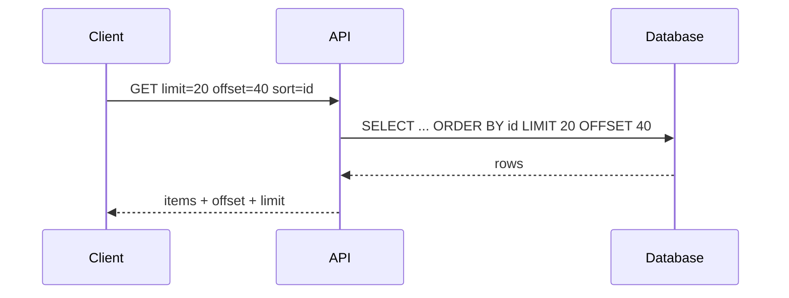
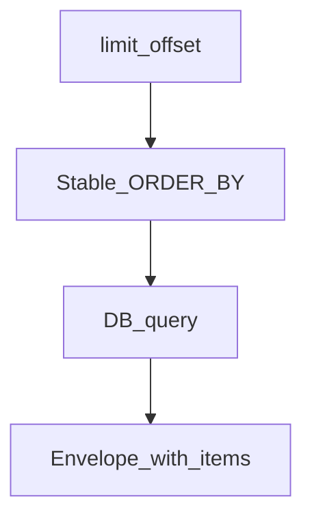

# Offset and Page Pagination

## 1. Metadata and prerequisites

- Topic IDs: D06-T01, D06-T02, D06-T03
- Domain: 6, Pagination, Filtering, and Search
- Difficulty: Intermediate
- Prerequisites: D04-T09, D04-T08
- Learning objectives:
  - Implement offset, page-number, and limit/offset pagination safely.
  - Explain consistency limits under concurrent writes.
- Related topic IDs: D06-T04, D06-T07
- Estimated complexity: medium
- Completion status: DRAFT
- Verification: Examples unverified.

## 2. Introduction and fundamentals

### D06-T01 Offset-based pagination

**Formal definition.** Skip the first N rows with `OFFSET` (or ORM equivalent) after ordering, returning `LIMIT` rows.

**Problem solved.** Returning millions of rows in one response.

**Mechanism.** `GET /items?limit=20&offset=40` returns rows 41–60 in the current sort order.

**Misconception.** "Offset is free." Large offsets scan/discards many rows—expensive (D06-T15).

**Production rule.** Cap offset maximum; prefer cursor for deep pages.

### D06-T02 Page-number pagination

**Formal definition.** Client requests page index and page size; server computes offset as `(page-1)*page_size`.

**Problem solved.** Human-friendly UIs showing "Page 3 of 10."

**Mechanism.** `page` and `page_size` query params; response may include `total_pages` if count available.

**Misconception.** "Page numbers stay stable while user browses." Inserts/deletes shift pages without stable sort.

**Production rule.** Document that page mode still requires stable ordering (D06-T06).

### D06-T03 Limit and offset

**Formal definition.** `limit` bounds response size; `offset` skips records—paired parameters for offset pagination.

**Problem solved.** Unbounded `limit` causing OOM.

**Mechanism.** Default limit (e.g., 20), max limit (e.g., 100), validate `offset >= 0`.

**Misconception.** "Client chooses any limit." Server must enforce max.

**Production rule.** Return `400` when limit exceeds cap; include applied limit in response metadata.

## 3. Internal workings



## 4. Architecture diagrams



## 5. Code and implementation

Unverified:

```python
from fastapi import HTTPException, Query

MAX_LIMIT = 100

def paginate(limit: int = Query(20, ge=1, le=MAX_LIMIT), offset: int = Query(0, ge=0)) -> tuple[int, int]:
    return limit, offset
```

SQL illustrative (unverified):

```sql
SELECT id, name FROM items ORDER BY id ASC LIMIT :limit OFFSET :offset;
```

## 6. API contracts

```bash
curl -sS "https://api.example.com/v1/items?limit=20&offset=0&sort=id"
curl -sS "https://api.example.com/v1/items?page=3&page_size=20&sort=id"
```

Response envelope example:

```json
{"items": [], "limit": 20, "offset": 40, "total": null}
```

## 7. Production considerations

- Offset pagination under concurrent updates causes duplicates/skips (D06-T07).
- Total count optional—expensive (D06-T08).
- Index columns used in ORDER BY (D06-T14).

## 8. Comparison and tradeoffs

| Style | UX | Deep page cost |
| --- | --- | --- |
| limit/offset | Simple | High offset cost |
| page/page_size | UI friendly | Same as offset |
| cursor | Harder jump | Lower for large sets |

## 9. Debugging and troubleshooting

**Symptom.** User sees duplicate rows across pages while scrolling.

**Cause.** Rows inserted mid-pagination without stable sort tie-breaker.

**Diagnosis.** Log sort keys; reproduce with concurrent inserts in test.

**Fix.** Add monotonic id to ORDER BY; migrate to cursor pagination.

**Prevention.** Document instability; integration tests with concurrent writers.

## 10. Interview preparation

**Beginner.** Why cap limit?

- **Model answer.** Protect database and memory; predictable latency SLOs.
- **Common incorrect answer.** "Unlimited is fine for trusted clients."

**Intermediate.** Offset vs cursor?

- **Model answer.** Offset simple but costly and inconsistent under writes; cursor uses stable ordering token for better consistency and performance at depth.
- **Common incorrect answer.** "Offset is always good enough."

**Scenario.** Page 1000 slow.

- **Model answer.** Large offset scans; switch to keyset/cursor; or restrict max offset.
- **Common incorrect answer.** "Add more RAM."

## 11. Exercises and mastery assessment

**Mastery checklist.**

- [ ] Max limit enforced.
- [ ] Stable sort documented.
- [ ] Envelope includes limit/offset.
- [ ] Max offset policy defined.
- [ ] Tests for concurrent insert behavior.

**Revision summary.** Limit/offset and page-number pagination are easy to integrate but need caps, stable ordering awareness, and a plan for deep or concurrent-data pages.
