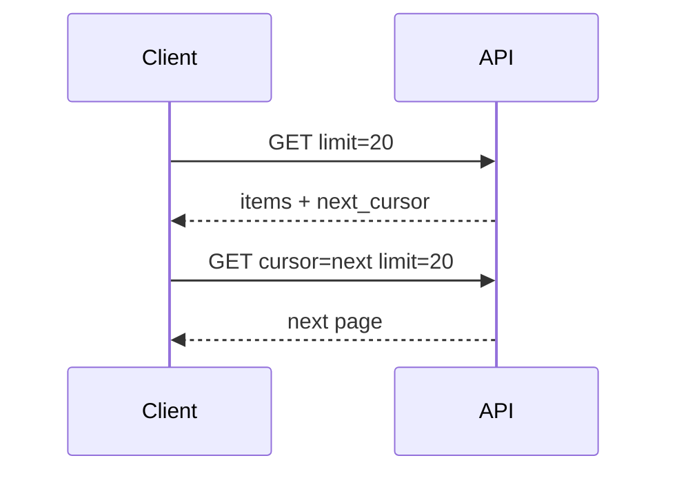

# Cursor and Keyset Pagination

## 1. Metadata and prerequisites

- Topic IDs: D06-T04, D06-T05, D06-T06, D06-T07, D06-T08
- Domain: 6, Pagination, Filtering, and Search
- Difficulty: Advanced
- Prerequisites: D06-T01, D04-T08
- Learning objectives:
  - Implement opaque cursor and keyset pagination with stable ordering.
  - Reason about concurrency, total counts, and performance tradeoffs.
- Related topic IDs: D06-T15, D22-T16
- Estimated complexity: high
- Completion status: DRAFT
- Verification: Examples unverified.

## 2. Introduction and fundamentals

### D06-T04 Cursor-based pagination

**Formal definition.** Client passes an opaque cursor token referencing a position in an ordered result set; server returns next page relative to that position.

**Problem solved.** Deep offset cost and page drift under writes.

**Mechanism.** Encode last-seen sort key(s) in signed/opaque token; `GET ?cursor=...&limit=20`.

**Misconception.** "Cursor is just base64 offset." True cursors encode keyset position, not row count skip.

**Production rule.** Sign cursors (HMAC) to prevent tampering; include version if sort changes.

### D06-T05 Keyset pagination

**Formal definition.** SQL pattern `WHERE (sort_col, id) > (:last_sort, :last_id) ORDER BY sort_col, id LIMIT n`—also called seek method.

**Problem solved.** OFFSET scans millions of rows.

**Mechanism.** Uses index on sort columns; no large skip.

**Misconception.** "Any ORDER BY works." Needs index-aligned sort keys.

**Production rule.** Match keyset columns to composite index order.

### D06-T06 Stable ordering

**Formal definition.** Total order deterministic: primary sort field plus unique tie-breaker (typically primary key). Cursor pagination needs a stable order.

**Problem solved.** Duplicate/missing rows when sort keys collide without tie-breaker.

**Mechanism.** `ORDER BY created_at DESC, id DESC` always.

**Misconception.** "Sort by name only is enough." Names duplicate.

**Production rule.** Document canonical sort; reject unsupported sort fields (D06-T13).

### D06-T07 Pagination under concurrent updates

**Formal definition.** Behavior when rows are inserted/deleted/reordered while client pages.

**Problem solved.** Users missing new items or seeing duplicates when using offset.

**Mechanism.** Keyset may skip newly inserted rows above cursor or show deleted holes—document semantics.

**Misconception.** "Pagination must be a perfect snapshot." Unless using snapshot isolation, accept eventual consistency or use time-bound cursors.

**Production rule.** State whether cursor is forward-only; offer refresh from start for admin audits.

### D06-T08 Total-count tradeoffs

**Formal definition.** Whether to include `total` or `total_pages` in list responses.

**Problem solved.** UI needing "total results" vs COUNT(*) cost on huge tables.

**Mechanism.** Exact count, approximate count, or omit entirely for cursor APIs.

**Misconception.** "Always include total." COUNT(*) can dominate latency.

**Production rule.** Make total optional via `include_total=true` with timeout; default off for large collections.

## 3. Internal workings



## 4. Architecture diagrams


## 5. Code and implementation

Unverified keyset query pattern:

```python
def fetch_page(last_created_at, last_id, limit: int):
    # Pseudocode: WHERE (created_at, id) < (last_created_at, last_id)
    return []
```

Cursor token pseudocode: `base64url(hmac(sort_values))` — unverified.

## 6. API contracts

```bash
curl -sS "https://api.example.com/v1/events?limit=50&sort=-created_at,id"
curl -sS "https://api.example.com/v1/events?cursor=eyJjIjoiLi4uIn0&limit=50"
```

Response:

```json
{"items": [], "next_cursor": "opaque", "prev_cursor": null}
```

## 7. Production considerations

- Cursor pagination needs stable order—non-negotiable.
- Changing default sort breaks old cursors—version tokens.
- Do not expose raw internal offsets in signed cursors without purpose.

## 8. Comparison and tradeoffs

| Feature | Offset | Keyset/cursor |
| --- | --- | --- |
| Jump to page N | Yes | No |
| Write concurrency | Poor | Better |
| COUNT total | Common | Often omitted |
| Index use | Poor at depth | Good |

## 9. Debugging and troubleshooting

**Symptom.** Infinite loop fetching same cursor.

**Cause.** Bad encoder includes rows not advancing keyset.

**Diagnosis.** Log decoded cursor keys vs last row.

**Fix.** Ensure strict inequality direction matches sort order.

**Prevention.** Unit tests on multi-page fixtures.

## 10. Interview preparation

**Beginner.** Why tie-breaker id in sort?

- **Model answer.** Stable total order when primary sort columns duplicate.
- **Common incorrect answer.** "Id looks nice."

**Intermediate.** Include total count with cursor API?

- **Model answer.** Optional; COUNT expensive; document approximation or omit.
- **Common incorrect answer.** "Always exact total."

**Scenario.** Sort parameter changes mid-pagination.

- **Model answer.** Invalidate cursors; version sort in token; return 400 on mismatch.
- **Common incorrect answer.** "Apply new sort to old cursor silently."

## 11. Exercises and mastery assessment

**Mastery checklist.**

- [ ] Keyset matches index.
- [ ] Stable ORDER BY documented.
- [ ] Cursors signed/opaque.
- [ ] Total count policy defined.
- [ ] Concurrent update semantics documented.

**Revision summary.** Cursor and keyset pagination trade jump-to-page for performance and consistency—stable ordering is mandatory, totals are optional and costly.
