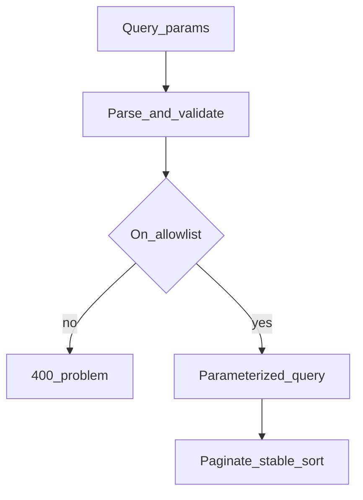
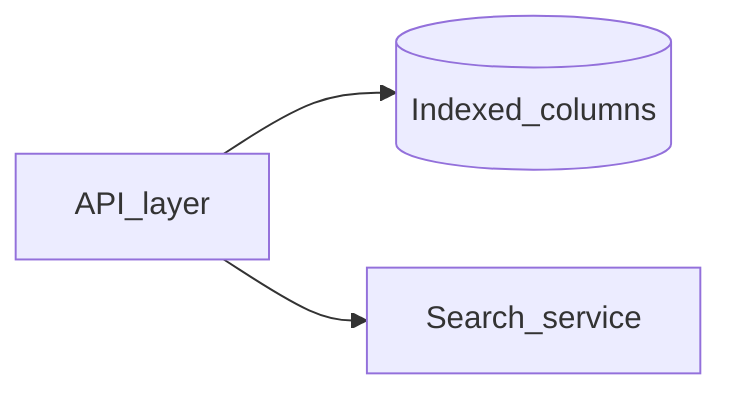

# Filtering, Sorting, and Search Contracts

## 1. Metadata and prerequisites

- Topic IDs: D06-T09, D06-T10, D06-T11, D06-T12, D06-T13
- Domain: 6, Pagination, Filtering, and Search
- Difficulty: Intermediate
- Prerequisites: D04-T07, D04-T10, D06-T06
- Learning objectives:
  - Design multi-field filters, ranges, and multi-column sorts.
  - Validate filter/sort parameters against allowlists.
  - Define search query contracts with limits.
- Related topic IDs: D06-T14, D06-T16
- Estimated complexity: high
- Completion status: DRAFT
- Verification: Examples unverified.

## 2. Introduction and fundamentals

### D06-T09 Filtering by multiple fields

**Formal definition.** Combine predicates (`status=open&assignee_id=u1`) with AND semantics unless documented otherwise.

**Problem solved.** Clients over-fetching collections.

**Mechanism.** Map query params to indexed columns; reject unknown filters.

**Misconception.** "Pass arbitrary SQL WHERE in query." Injection risk.

**Production rule.** Allowlist filter fields in OpenAPI; 400 on unknown keys.

### D06-T10 Range filters

**Formal definition.** Bounds on ordered fields: `created_after`, `created_before`, `price_min`, `price_max`.

**Problem solved.** Off-by-one timezone errors on date-only filters.

**Mechanism.** Inclusive/exclusive bounds documented; instants in UTC (D05-T10).

**Misconception.** "Client sends local midnight strings without offset." Ambiguous.

**Production rule.** Require ISO 8601 with offset or Z; validate `min <= max`.

### D06-T11 Sorting by multiple columns

**Formal definition.** `sort=field1,-field2` where `-` means descending.

**Problem solved.** Unstable single-column sorts.

**Mechanism.** Parse into ORDER BY list; append tie-breaker id.

**Misconception.** "Allow sort by any column." Leaks data via sort on secret columns.

**Production rule.** Whitelist sortable fields; default sort documented.

### D06-T12 Search queries

**Formal definition.** Full-text or fuzzy search via `q` or structured search body.

**Problem solved.** Clients downloading entire dataset to filter locally.

**Mechanism.** DB `ILIKE`, trigram, or external search engine; POST for heavy DSL.

**Misconception.** "Leading wildcard LIKE is fine at scale." Cannot use indexes efficiently.

**Production rule.** Min/max length on `q`; rate limit; explain ranking if non-obvious.

### D06-T13 Validation of filter and sort fields

**Formal definition.** Server rejects unsupported filter/sort names with 400 and problem details listing allowed fields.

**Problem solved.** Silent ignore of bad params causing "buggy API" reports.

**Mechanism.** Pydantic query models or explicit parsers.

**Misconception.** "Ignore unknown filters." Clients think filter applied.

**Production rule.** Strict mode for public APIs; log rejected params at debug level.

## 3. Internal workings



## 4. Architecture diagrams



## 5. Code and implementation

Unverified Pydantic query model:

```python
from datetime import datetime
from pydantic import BaseModel, Field, field_validator

class ItemFilters(BaseModel):
    status: str | None = None
    created_after: datetime | None = None
    created_before: datetime | None = None
    q: str | None = Field(default=None, max_length=200)

    @field_validator("q")
    @classmethod
    def q_not_empty(cls, v: str | None) -> str | None:
        if v is not None and not v.strip():
            raise ValueError("q must not be blank")
        return v
```

## 6. API contracts

```bash
curl -sS "https://api.example.com/v1/items?status=open&created_after=2026-01-01T00:00:00Z&sort=-updated_at,id&q=widget"
```

| Param | Validation |
| --- | --- |
| status | enum allowlist |
| created_* | UTC instant |
| sort | whitelist |
| q | max length |

## 7. Production considerations

- Combine filters with tenant scoping in authorization layer.
- Search endpoints need stricter rate limits (D06-T16).
- Document whether filters are AND or OR.

## 8. Comparison and tradeoffs

| Search backend | Pros | Cons |
| --- | --- | --- |
| SQL LIKE | Simple | Slow at scale |
| Dedicated search | Relevance | Sync lag |
| POST body DSL | Expressive | Not cacheable |

## 9. Debugging and troubleshooting

**Symptom.** Filter appears ignored.

**Cause.** Unknown param silently dropped in loose parser.

**Fix.** Strict validation; return 400.

**Prevention.** Contract tests for each documented filter.

## 10. Interview preparation

**Beginner.** Why allowlist sort fields?

- **Model answer.** Prevent SQL injection, unindexed sorts, and sorting on sensitive columns.
- **Common incorrect answer.** "Security is not an issue for sort."

**Intermediate.** AND vs OR filters?

- **Model answer.** Document default; explicit `filter_op=or` if supported.
- **Common incorrect answer.** "Clients figure it out."

**Scenario.** `q=%` returns entire table.

- **Model answer.** Treat very broad patterns; minimum token length; index-backed search.
- **Common incorrect answer.** "Disable search."

## 11. Exercises and mastery assessment

**Mastery checklist.**

- [ ] Filter allowlist in OpenAPI.
- [ ] Range bounds validated.
- [ ] Multi-sort with tie-breaker.
- [ ] Search length limits.
- [ ] Unknown params return 400.

**Revision summary.** Filtering, sorting, and search need strict contracts—allowlists, UTC ranges, stable multi-column sort, and bounded search queries.
