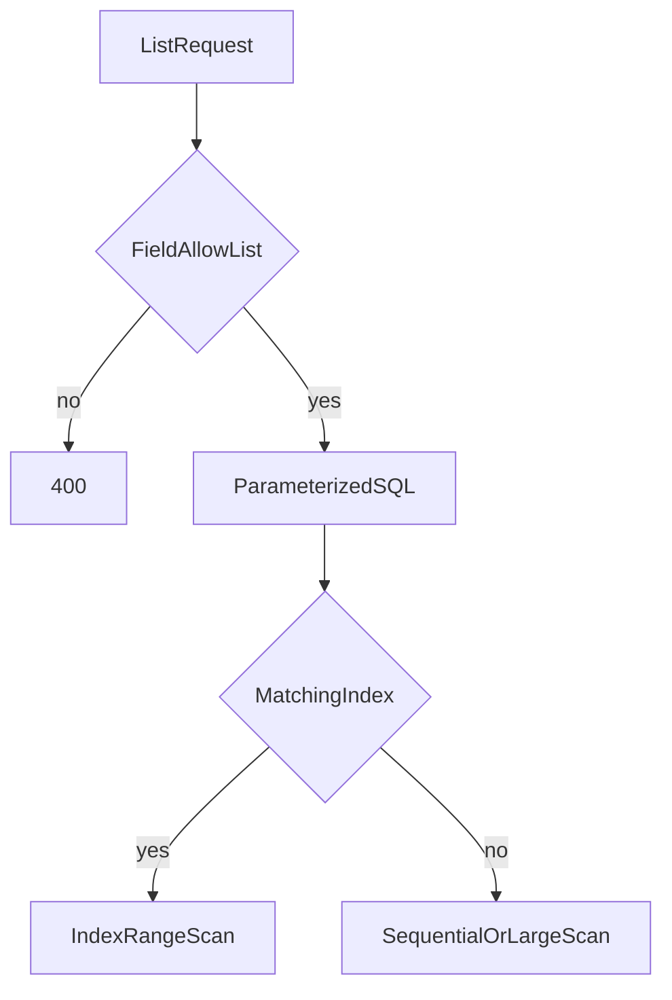

# Index Design, Pagination Cost, and Query Security

## 1. Metadata and prerequisites

- Topic IDs: D06-T14, D06-T15, D06-T16
- Domain: 6, Pagination, Filtering, and Search
- Difficulty: Advanced
- Prerequisites: D06-T04, D06-T05, D06-T09, D22-T13
- Learning objectives:
  - Choose indexes that match filter, sort, and keyset predicates.
  - Explain why offset pagination gets slower on deep pages.
  - Stop filter and search parameters from becoming injection or data leaks.
- Related topic IDs: D06-T01, D10-T12, D22-T15
- Estimated complexity: high
- Completion status: TECHNICALLY_REVIEWED
- Verification: PostgreSQL index and `EXPLAIN` concepts reviewed 2026-10-13. SQL is illustrative and was not executed in this workspace.

## 2. Introduction and fundamentals

### D06-T14 Database indexing for API queries

An index is a structure that lets the database find rows without reading the whole table. An API filter is only cheap if some index matches the predicate and the sort.

For `WHERE tenant_id = $1 AND created_at < $2 ORDER BY created_at DESC, id DESC`, a useful index is `(tenant_id, created_at DESC, id DESC)`. The tenant column comes first because every query scopes a tenant. The sort columns follow in the same order and direction the `ORDER BY` uses.

A separate index on `created_at` alone does not save a multi-tenant table. The planner may scan a large range and then throw away other tenants.

### D06-T15 Pagination performance

Offset pagination (`LIMIT 20 OFFSET 100000`) still identifies the skipped rows. The database walks 100020 index entries and returns 20. Cost grows with the page number. Keyset pagination starts at the last seen key and reads about one page, so the cost stays flat if the index matches the order.

`COUNT(*)` on a large filtered table is a second expensive query. Do it only when the product needs a true total. Approximate counts and "next page exists" flags are the usual alternative.

### D06-T16 Search and filtering security

Filter fields must be an allow-list. Interpolating a client string into `ORDER BY` or `WHERE` is SQL injection. A client who can choose any column can also sort by a secret column or filter on another tenant if you forget the tenant predicate.

Free-text search has the same rule: bind the user string as a parameter. Escape `%` and `_` before `LIKE`. Do not log the raw query if it can contain personal data. Rate-limit search. A leading-wildcard `LIKE '%foo'` will not use a normal btree index; that is a denial-of-service vector as well as a slow query.

Return only rows the caller may see. A correct index does not replace the `tenant_id` predicate.

## 3. Internal workings



PostgreSQL `EXPLAIN (ANALYZE, BUFFERS)` shows whether the plan is an index scan or a sequential scan and how many buffers it read. Run it on a realistic data volume. A plan that is fine on 100 rows can collapse on 10 million.

Keyset shape:

```sql
SELECT id, created_at
FROM orders
WHERE tenant_id = $1
  AND (created_at, id) < ($2, $3)
ORDER BY created_at DESC, id DESC
LIMIT 21;
```

Ask for `limit + 1` rows. If you get the extra row, there is a next page. Do not return that extra row to the client.

## 4. Architecture diagrams

The API process does not "have" the index. The migration owns it. A new filter that is not in an index becomes a production incident after launch, not at code review time, unless you look at the plan.

## 5. Code and implementation

Illustrative SQL. Unverified.

```sql
CREATE INDEX orders_tenant_created_id_idx
  ON orders (tenant_id, created_at DESC, id DESC);
```

Application code builds the `ORDER BY` from a map, never from the raw query string:

```python
SORTS = {
    "created_at": Order.created_at.desc(),
    "id": Order.id.desc(),
}

def resolve_sort(name: str):
    try:
        return SORTS[name]
    except KeyError as exc:
        raise ValueError("unsupported sort") from exc
```

Unverified. The point is the allow-list.

## 6. API contracts

| Parameter | Rule |
| --- | --- |
| `sort` | One of the documented fields. Anything else is `400`. |
| `limit` | 1..100. |
| Cursor | Opaque. Invalid cursor is `400`. |
| `q` | Bounded length. Treated as data, not SQL. |

Document that totals are omitted or approximate. Document the stable order.

## 7. Production considerations

Mandatory: tenant predicate on every query, allow-listed sorts and filters, bound parameters, a limit cap, and an index that matches the default list endpoint.

Optional: `pg_trgm` or a search engine for substring search, statement timeouts so one query cannot hold a connection forever, and a slow-query log.

## 8. Comparison and tradeoffs

| Approach | Read cost | Write cost | Use when |
| --- | --- | --- | --- |
| Offset | Grows with page | Low | Small tables or admin tools |
| Keyset + matching index | Flat per page | Extra index maintenance | User-facing lists |
| `COUNT(*)` | Often a large scan | None | You truly need an exact total |
| External search index | Fast text search | Sync lag | Full text, not primary key lookups |

## 9. Debugging and troubleshooting

**Symptom:** page 1 is fast and page 500 times out.  
**Cause:** large `OFFSET` or a sort that does not match an index.  
**Diagnose:** `EXPLAIN ANALYZE` the exact SQL with the production parameters.  
**Fix:** keyset pagination and a matching index.  
**Prevent:** a test that the list query uses an index scan on a seeded large table, or a review checklist that names the index.  
**Test:** unit-test the allow-list. An integration test can assert a deep keyset page returns the same number of queries as the first page.

## 10. Interview preparation

**Beginner.** Why is `ORDER BY` from a query parameter dangerous?  
**Model answer.** If you concatenate it into SQL, the caller can inject SQL. Even a quoted identifier can expose a column you did not intend to sort by.  
**Incorrect answer.** "It is fine if you URL-decode it."

**Intermediate.** Why does offset page 500 get slower?  
**Model answer.** The database still walks the skipped rows. Keyset pagination seeks the next key in the index.  
**Follow-up.** What index matches `(tenant_id, created_at DESC, id DESC)`? The column order must start with the equality column and then the sort keys in order.

**Scenario.** Search latency spikes when someone sends `q=%`.  
**Model answer.** The pattern becomes a match-all `LIKE` and bypasses the index. Escape wildcards, cap length, and rate-limit.

## 11. Exercises and mastery assessment

1. Write the index for tenant-scoped keyset order `created_at DESC, id DESC`.
2. Why do you fetch `limit + 1`?
3. A client sends `sort=password_hash`. What do you return?
4. Name one case where `COUNT(*)` is the wrong default.

**Solutions.**

1. `(tenant_id, created_at DESC, id DESC)`.
2. The extra row tells you whether `next` exists without a count.
3. `400`. The field is not on the allow-list.
4. A large unfiltered table, or any list where an exact total is not shown in the UI.

**Mastery checklist.**

- Match an index to a keyset query.
- Explain offset cost.
- Allow-list every client-chosen column.

**Revision summary.** List endpoints are database access patterns. Indexes, keyset bounds, and allow-lists are part of the API contract.

## Flashcards

- Q: Why cap `limit`? | A: One request must not be able to scan and serialize the whole table.
- Q: What is wrong with `LIKE '%x'`? | A: A btree index on the column cannot serve a leading wildcard.
