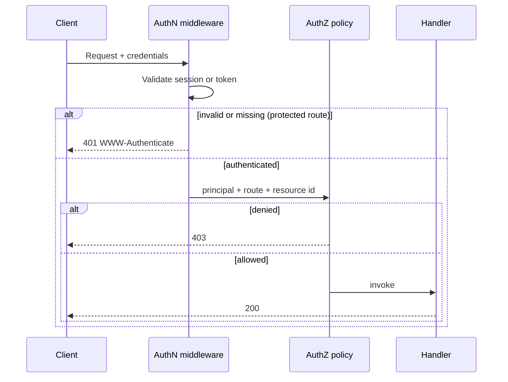
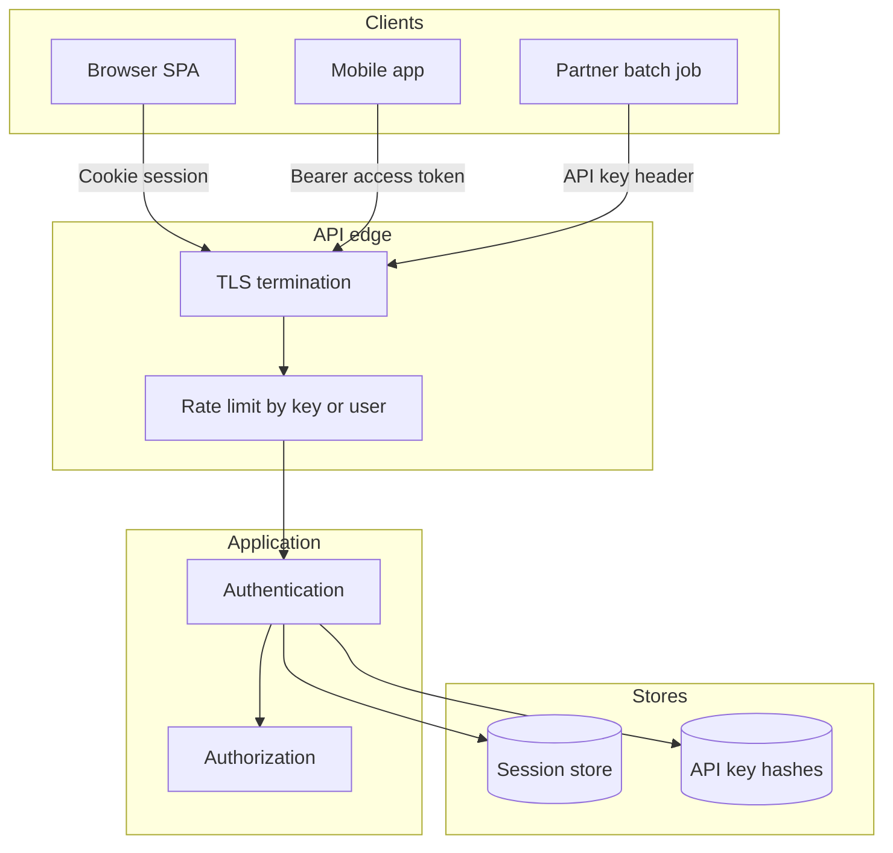

# Authentication Mechanisms

## 1. Metadata and prerequisites

- Topic IDs: D07-T01, D07-T02, D07-T03, D07-T04, D07-T05, D07-T06
- Domain: 7, Authentication and Authorization
- Difficulty: Intermediate
- Prerequisites: D01-T15, D01-T16, D03-T15, D05-T19
- Learning objectives:
  - Separate authentication (who you are) from authorization (what you may do).
  - Compare sessions, bearer tokens, API keys, and Basic auth for REST APIs.
  - Choose credential transport that matches client type and threat model.
- Related topic IDs: D07-T07, D07-T11, D07-T19, D20-T01, D27-T02
- Estimated complexity: medium
- Completion status: DRAFT
- Verification: RFC 9110 (HTTP semantics), RFC 7617 (Basic). Examples marked unverified; no live API calls were executed.

## 2. Introduction and fundamentals

### D07-T01 Authentication versus authorization

**Definition.** Authentication establishes identity: the server decides which principal (user, service account, device) is making the request. Authorization decides whether that principal may perform the specific action on the specific resource.

**Problem.** Teams merge the two checks into one middleware that only verifies a token exists. Attackers who steal a valid token pass authentication but must still be blocked from other users' invoices. Conversely, returning `403 Forbidden` when no credentials were sent confuses clients that should start a login or token refresh flow (`401` with `WWW-Authenticate` per RFC 9110).

**Mechanism.** Run authentication first: parse `Authorization`, session cookie, or API key header; validate format and signature or lookup session; attach `principal_id` to request context. Run authorization per route and per object: role checks, ownership checks, tenant boundaries. A public health endpoint may skip authentication but still enforce authorization on `/admin/*`.

**Misconception.** "If the JWT is valid, the user is allowed." Validity only proves the token was issued by your issuer and is not expired; it does not prove the caller may delete `/users/42` unless claims and server-side policy say so.

**Production rule.** Every mutating handler performs an explicit authorization decision after authentication. Log authentication failures and authorization denials with different event types for alerting.

### D07-T02 Cookie-based sessions

**Definition.** The browser stores an opaque session identifier in an `HttpOnly` cookie; the server maps that id to session state in a database or cache.

**Problem.** Without `HttpOnly` and `Secure`, XSS or network interception yields session hijacking. Storing the entire user profile in the cookie without signing lets the client forge `role=admin`.

**Mechanism.** On login, create a random session id, persist server-side metadata (user id, expiry, CSRF token if used), respond with `Set-Cookie`. Each request sends `Cookie`; middleware loads session, refreshes sliding expiry, attaches user to context. Logout deletes server session and clears the cookie.

**Misconception.** "Sessions violate REST statelessness." REST statelessness means the server does not rely on *client-side* hidden state without the request carrying enough context. A session id in a cookie is explicit request context; the tradeoff is centralized session storage and revocation ease versus horizontal scaling (worker processes do not share in-memory sessions).

**Production rule.** Use `HttpOnly`, `Secure`, `SameSite=Lax` or `Strict` for first-party apps; pair with CSRF protection for cookie-authenticated browser POSTs (D07-T19).

### D07-T03 Token-based authentication

**Definition.** The client presents a self-contained or opaque access token (often in `Authorization: Bearer`) instead of a server-looked-up session cookie.

**Problem.** Tokens in `localStorage` are readable by any script on the page; one XSS exfiltrates long-lived credentials. Opaque tokens require introspection or database lookup on every request.

**Mechanism.** Issue a short-lived access token after primary authentication; client sends it on each API call. Validate signature, `exp`, `aud`, `iss` for JWTs (D07-T07). Refresh tokens rotate access tokens without re-entering passwords.

**Misconception.** "Bearer tokens are stateless, so we need no server storage." Revocation lists, refresh token families, and device binding still need durable stores.

**Production rule.** Prefer short access-token TTL; never log bearer tokens; use memory-only or secure storage on mobile native clients.

### D07-T04 API keys

**Definition.** A long-lived secret string identifies an integration or tenant, usually sent in a header (`X-API-Key`) or query parameter (discouraged).

**Problem.** Keys in URLs appear in access logs, referrer headers, and browser history. Shared keys across environments blur blast radius when one key leaks.

**Mechanism.** Generate high-entropy keys; store only a hash server-side; associate key with scopes, tenant id, and rate limits. Rotate on compromise; support multiple active keys per integration during migration.

**Misconception.** "API keys are authentication for humans." They authenticate *programs*; pair with separate user identity when a human acts through a partner system.

**Production rule.** Header transport only; per-key quotas (D07-T23); never commit keys to repositories; scan CI for accidental leaks.

### D07-T05 Basic authentication and its limitations

**Definition.** RFC 7617 encodes `username:password` in Base64 in the `Authorization: Basic` header.

**Problem.** Base64 is not encryption; anyone on the path reads credentials unless TLS protects the connection. Browsers cache Basic credentials aggressively. No scoped expiry without changing the password.

**Mechanism.** Client sends `Authorization: Basic dXNlcjpwYXNz`. Server decodes and verifies against a password hash store (D07-T16). Suitable only for machine-to-machine over TLS with dedicated service accounts, or as a stepping stone to token exchange.

**Misconception.** "Basic is fine because we use HTTPS." TLS protects on the wire; logs, proxies, and client storage still leak the header if echoed.

**Production rule.** Disallow Basic on public internet without TLS 1.2+; prefer OAuth 2.0 client credentials or mutual TLS for service auth; rate-limit and lock out brute force.

### D07-T06 Bearer tokens

**Definition.** RFC 6750 defines the `Bearer` scheme: any party in possession of the token may use it (bearer = whoever bears it).

**Problem.** Token theft equals full account access until expiry or revocation. Sending bearer tokens in WebSocket query strings exposes them in logs.

**Mechanism.** `Authorization: Bearer <token>`. Server validates token type (JWT, opaque, macaroon). OpenAPI documents `bearerFormat: JWT` when applicable.

**Misconception.** "Bearer and session cookies are interchangeable for SPAs." Cookies can be `HttpOnly`; bearer in JS cannot.

**Production rule.** Use `Authorization` header only; combine with TLS; scope tokens narrowly; monitor for anomalous use by `sub` or `jti`.

## 3. Internal workings



Authentication produces a principal; authorization consumes principal plus resource attributes. Cookie sessions hit a session store; bearer JWTs verify cryptography locally then may still load roles from DB.

## 4. Architecture diagrams



Worker processes do not share in-memory session tables; use Redis or the database for session lookup when running multiple Uvicorn workers.

## 5. Code and implementation

Unverified.

```python
from fastapi import Depends, HTTPException, status
from fastapi.security import HTTPAuthorizationCredentials, HTTPBearer

bearer = HTTPBearer(auto_error=False)

async def authenticate(
    creds: HTTPAuthorizationCredentials | None = Depends(bearer),
) -> str:
    if creds is None or creds.scheme.lower() != "bearer":
        raise HTTPException(
            status_code=status.HTTP_401_UNAUTHORIZED,
            detail="Not authenticated",
            headers={"WWW-Authenticate": "Bearer"},
        )
    user_id = verify_access_token(creds.credentials)  # validates alg, exp, aud, iss
    return user_id

async def authorize_order_read(user_id: str, order_id: str) -> None:
    if not user_owns_order(user_id, order_id):
        raise HTTPException(status_code=status.HTTP_403_FORBIDDEN, detail="Forbidden")
```

```bash
curl -sS -H "Authorization: Bearer change-me" "https://api.example.com/v1/me"
curl -sS -u "service:change-me" "https://api.example.com/v1/internal/health"
```

## 6. API contracts

| Method | Path | Auth | Success | Auth failure |
| --- | --- | --- | --- | --- |
| POST | `/v1/auth/login` | None (credentials in body) | `200` + Set-Cookie or tokens | `401` |
| GET | `/v1/orders/{id}` | Bearer or session | `200` | `401` missing/invalid; `403` wrong owner |
| GET | `/v1/partner/export` | API key header | `200` | `401` invalid key |

Idempotency: login POST is not idempotent (new session). GET with bearer is safe but not cacheable with `Authorization` unless explicitly designed.

## 7. Production considerations

**Mandatory:** TLS; separate AuthN and AuthZ; `401` vs `403` discipline; hashed API keys; no credentials in URLs; structured audit of auth failures.

**Optional:** Step-up authentication for sensitive actions; device binding; mutual TLS for high-trust partners.

## 8. Comparison and tradeoffs

| Mechanism | Strength | Weakness | Typical client |
| --- | --- | --- | --- |
| Session cookie | `HttpOnly` reduces XSS token theft | CSRF; session store | First-party web |
| Bearer JWT | No session lookup on every request | Revocation; size; alg misuse | Mobile, SPA with BFF |
| API key | Simple M2M | Long-lived secret | Cron, ETL |
| Basic | Universal clients | Password every request | Legacy internal only |

## 9. Debugging and troubleshooting

**Symptom:** Mobile works; browser gets `401` on every call. **Cause:** Cookie `Path`/`Domain` mismatch or `Secure` on HTTP dev origin. **Fix:** Align cookie scope; use HTTPS in dev or separate token flow for SPA.

**Symptom:** Partner sees `403` on all routes after key rotation. **Cause:** Old key revoked but job still uses it. **Fix:** Dual-key grace period; monitor `401` rate per key id.

**Symptom:** Logs contain `Authorization: Basic ...`. **Cause:** Reverse proxy access log format. **Fix:** Redact auth headers at log pipeline; never echo credentials in error messages.

## 10. Interview preparation

**Q (Beginner).** What is the difference between authentication and authorization?  
**Model answer.** Authentication identifies the caller; authorization decides if that identity may perform the action on the resource.  
**Incorrect.** "They are the same middleware check."

**Q (Intermediate).** When do you return `401` versus `403`?  
**Model answer.** `401` when credentials are missing or invalid (with `WWW-Authenticate` where appropriate). `403` when the caller is known but not permitted.  
**Incorrect.** "Use `403` for bad passwords" (that is failed authentication → `401`).

**Q (Advanced).** Why are API keys poor for end-user browser apps?  
**Model answer.** Any secret embedded in front-end code or URLs is extractable; keys are long-lived and hard to scope per user session.  
**Follow-up.** Use OAuth 2.0 authorization code with PKCE for users; API keys for server integrations.

## 11. Exercises and mastery assessment

1. **Conceptual:** List two authorization checks that still fail if only JWT signature is verified.
2. **Design:** Choose session cookie vs bearer for a first-party SPA with its own API domain.
3. **Debugging:** curl with Bearer succeeds; browser fetch fails with `401`. Hypothesize three causes.
4. **Production:** Write a rotation plan for API keys without downtime.
5. **Coding:** Sketch middleware order: rate limit, authentication, authorization.

**Solutions.**

1. Object ownership (order belongs to another user); function-level permission (billing role required).
2. Cookie with `HttpOnly` + SameSite if same-site; if cross-site SPA on CDN origin, BFF with cookie or authorization code flow instead of long-lived bearer in JS.
3. Cookie not sent (CORS credentials false); wrong scheme; preflight stripped custom header.
4. Issue key B; allow both A and B for 7 days; migrate clients; revoke A; alert on A usage.
5. Rate limit → AuthN → AuthZ → handler; rate limit by key before expensive crypto.

**Mastery checklist.**

- [ ] State AuthN vs AuthZ in one sentence each.
- [ ] Name three bearer-token risks.
- [ ] Explain why Basic over TLS is still limited.
- [ ] Describe API key hashing at rest.
- [ ] Map HTTP status codes to auth vs authz failures.

**Revision summary.** Identify the caller first, then decide permission on each resource. Match mechanism to client: cookies for same-site browsers, bearer for native, keys for automation—all over TLS with logging discipline.
