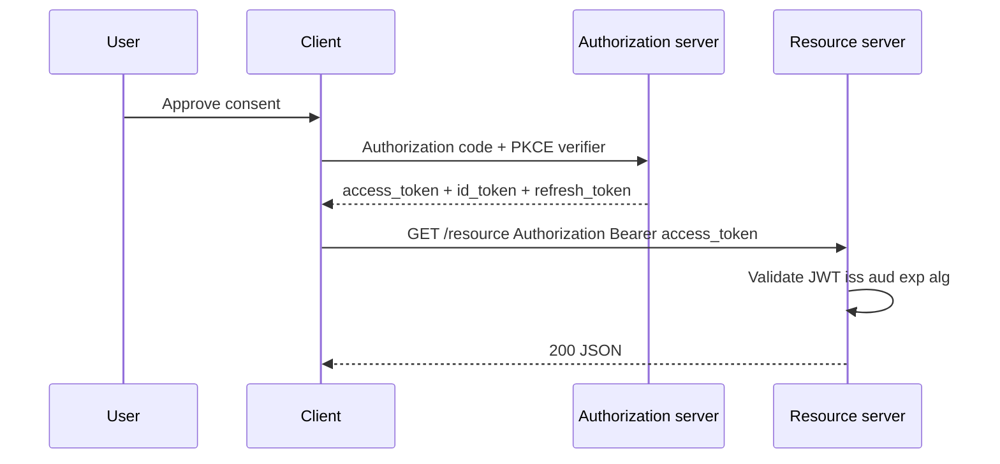

# JWT, OAuth 2.0, and OpenID Connect

## 1. Metadata and prerequisites

- Topic IDs: D07-T07, D07-T08, D07-T09, D07-T10
- Domain: 7, Authentication and Authorization
- Difficulty: Advanced
- Prerequisites: D07-T01, D07-T03, D07-T06
- Learning objectives:
  - Validate JWTs with explicit algorithm allow-lists and standard claims.
  - Distinguish OAuth 2.0 (delegated authorization) from OpenID Connect (identity layer).
  - Design access and refresh token lifetimes and storage.
- Related topic IDs: D20-T06, D20-T16, D20-T17, D10-T02
- Estimated complexity: high
- Completion status: DRAFT
- Verification: RFC 7519 (JWT), RFC 6749 (OAuth 2.0), OpenID Connect Core 1.0. Code unverified.

## 2. Introduction and fundamentals

### D07-T07 JWT structure and validation

**Definition.** A JSON Web Token is `base64url(header).base64url(payload).signature` where the header declares `alg` and optionally `typ`, and the payload holds claims.

**Problem.** Libraries that accept `alg: none` or switch algorithms based on attacker-controlled headers enable forgery. Skipping `aud` validation lets tokens minted for another API work on yours.

**Mechanism.** Parse header; reject `none` and any algorithm not on your allow-list (typically RS256/ES256 from your IdP, or HS256 only with constant-time secret comparison in controlled setups). Verify signature with pinned keys (JWKS `kid`). Enforce `exp` with clock skew window, `iss` against expected issuer URL, `aud` against your API identifier. Use `sub` as stable user id; treat other claims as hints unless signed by trusted issuer.

**Misconception.** "JWTs are encrypted." They are usually only signed (JWS); anyone with the token reads the payload—do not put PII or secrets in claims.

**Production rule.** Validate `alg`, `exp`, `aud`, `iss` on every request; reject `alg=none`; pin JWKS; short access-token TTL.

### D07-T08 Access tokens and refresh tokens

**Definition.** Access tokens authorize API calls for a short period. Refresh tokens are longer-lived credentials used only at the token endpoint to obtain new access tokens.

**Problem.** Storing refresh tokens in browser `localStorage` survives XSS. Reusing refresh tokens without rotation lets a stolen refresh work until manual revoke.

**Mechanism.** Login returns access (minutes) + refresh (days). API calls send access only. On `401` with expired access, client calls `/token` with refresh; server issues new pair and invalidates old refresh if rotation enabled. Store refresh server-side or as encrypted cookie on BFF.

**Misconception.** "Refresh tokens never need expiry." Compromised refresh is full account access until revoked.

**Production rule.** Rotate refresh tokens; bind to client id; detect reuse (invalidate family); separate signing keys for access vs refresh if both are JWTs.

### D07-T09 OAuth 2.0

**Definition.** RFC 6749 is a framework for *delegated authorization*: a resource owner authorizes a client to access resources on a resource server, often without sharing the password with the client.

**Problem.** Teams implement a custom "login with password returns JWT" and call it OAuth. That skips client registration, redirect URI validation, and scope semantics.

**Mechanism.** Roles: resource owner, client, authorization server, resource server. Flows: authorization code (with PKCE for public clients), client credentials (M2M), device code. Client exchanges code at token endpoint for access token (and optionally refresh). Scopes limit what the token may do—not who the user is.

**Misconception.** "OAuth 2.0 is authentication." It authorizes access; identity is optional unless you use OIDC or custom claims.

**Production rule.** Use authorization code + PKCE for user-facing apps; validate `redirect_uri` exactly; register clients; scope tokens minimally.

### D07-T10 OpenID Connect

**Definition.** OpenID Connect adds an identity layer on OAuth 2.0: an `id_token` (JWT) attests authentication event and user identity (`sub`, `email` with verification flags).

**Problem.** Using access token payload as identity without `id_token` or UserInfo conflates API scopes with login proof.

**Mechanism.** OIDC adds `openid` scope, `nonce` for replay binding, `id_token` with `auth_time`, `acr`, `amr`. UserInfo endpoint returns claims. Validate `id_token` like any JWT with OIDC-specific checks (`nonce`, `at_hash` when applicable).

**Misconception.** "Google sign-in button means we are OIDC-compliant." You must validate issuer, audience, nonce, and map `sub` to your user table.

**Production rule.** Treat IdP `sub` + `iss` as external key; verify `email_verified` before trusting email; do not trust unverified IdP claims for authorization.

## 3. Internal workings



OAuth issues tokens; your API is the resource server validating access tokens. OIDC's `id_token` is for the client to learn who logged in; APIs still rely on access token scopes and local authorization.

## 4. Architecture diagrams

```mermaid
flowchart LR
  subgraph idp [Identity provider]
    authorize[/authorize]
    token[/token]
    jwks[/jwks.json]
  end
  subgraph api [Your API]
    gw[Token validation]
    authz[Authorization policies]
  end
  client[Client app] --> authorize
  client --> token
  gw --> jwks
  client -->|Bearer access| gw --> authz
```

Cache JWKS with TTL; handle key rotation via `kid`. Worker processes do not share in-memory JWKS caches unless using a shared cache—each worker may fetch JWKS on cold start.

## 5. Code and implementation

Unverified.

```python
import jwt
from jwt import PyJWKClient

ALLOWED_ALGS = {"RS256"}
ISSUER = "https://idp.example.com/"
AUDIENCE = "api://orders"

jwks_client = PyJWKClient("https://idp.example.com/.well-known/jwks.json")

def verify_access_token(token: str) -> dict:
    header = jwt.get_unverified_header(token)
    if header.get("alg") in (None, "none"):
        raise ValueError("rejected alg")
    if header["alg"] not in ALLOWED_ALGS:
        raise ValueError("alg not allowed")
    signing_key = jwks_client.get_signing_key_from_jwt(token).key
    return jwt.decode(
        token,
        signing_key,
        algorithms=list(ALLOWED_ALGS),
        audience=AUDIENCE,
        issuer=ISSUER,
        options={"require": ["exp", "sub"]},
    )
```

```bash
curl -sS -X POST "https://idp.example.com/token" \
  -d "grant_type=authorization_code&code=change-me&redirect_uri=https://app.example/cb&client_id=change-me"
```

## 6. API contracts

| Endpoint | Purpose | Auth |
| --- | --- | --- |
| GET `/authorize` | User consent (browser redirect) | Session at IdP |
| POST `/token` | Exchange code or refresh | Client auth |
| GET `/v1/*` | Business API | `Authorization: Bearer` access token |

Problem details (RFC 9457) for invalid token: `401` with `WWW-Authenticate: Bearer error="invalid_token"`.

## 7. Production considerations

**Mandatory:** PKCE for public clients; redirect URI allow-list; JWT validation checklist; separate refresh handling; no tokens in URLs.

**Optional:** PAR/JAR for advanced clients; mTLS for confidential clients; continuous access evaluation for high-risk APIs.

## 8. Comparison and tradeoffs

| Approach | Pros | Cons |
| --- | --- | --- |
| Local JWT (HS256) | Simple | Shared secret rotation pain; no asymmetric federation |
| IdP JWT (RS256) | Central login; JWKS rotation | Latency on first JWKS fetch; claim drift |
| Opaque access token | Easy revoke via introspection | Extra hop to authorization server |
| OIDC | Standard identity claims | More moving parts than raw OAuth |

## 9. Debugging and troubleshooting

**Symptom:** Valid user, random `401 invalid signature`. **Cause:** IdP rotated keys; stale JWKS cache. **Fix:** Respect HTTP cache headers on JWKS; backoff refetch on verify failure.

**Symptom:** Token works on staging, fails on prod. **Cause:** `aud` mismatch (`api-staging` vs `api-prod`). **Fix:** Separate audiences per environment.

**Symptom:** Algorithm confusion CVE pattern. **Cause:** Library trusted header `alg`. **Fix:** Fixed allow-list before verify.

## 10. Interview preparation

**Q.** Is OAuth 2.0 authentication?  
**Model answer.** No—it is delegated authorization. OIDC adds authentication via `id_token`.  
**Incorrect.** "OAuth logs the user in, so it is authentication."

**Q.** Which JWT claims must you validate at the API?  
**Model answer.** Signature with allowed `alg`, `exp`, `iss`, `aud`, plus `sub` for identity mapping.  
**Incorrect.** "Only `exp` matters if the signature parses."

**Q.** Why PKCE?  
**Model answer.** Public clients cannot keep a secret; PKCE binds the authorization code to the original request via code challenge.  
**Follow-up.** Authorization code intercept on mobile/custom URI schemes.

## 11. Exercises and mastery assessment

1. Explain why `alg=none` must be rejected.
2. Map OAuth roles to your FastAPI deployment components.
3. Design token lifetimes for a mobile banking app vs internal admin tool.
4. Write validation steps for an OIDC `id_token` after social login.
5. **Debugging:** Intermittent `401` after exactly one hour.

**Solutions.**

1. Without signature verification, attacker forges any payload.
2. Resource owner = user; client = SPA; authorization server = Auth0/Keycloak; resource server = FastAPI API.
3. Banking: access 5–15 min, refresh rotation, step-up; admin: shorter access, IP allow-list, maybe no refresh in browser.
4. Verify iss, aud, exp, nonce matches authorize request, signature via JWKS, map sub to local user.
5. Access `exp` reached; client must refresh; if refresh fails, re-login.

**Mastery checklist.**

- [ ] OAuth 2.0 vs OIDC in one sentence each.
- [ ] JWT validation checklist memorized.
- [ ] PKCE purpose stated.
- [ ] Access vs refresh threat model.

**Revision summary.** OAuth delegates permission; OIDC adds identity proofs. JWTs are credentials—validate algorithms and claims, keep them short-lived, and never confuse token validity with object authorization.
