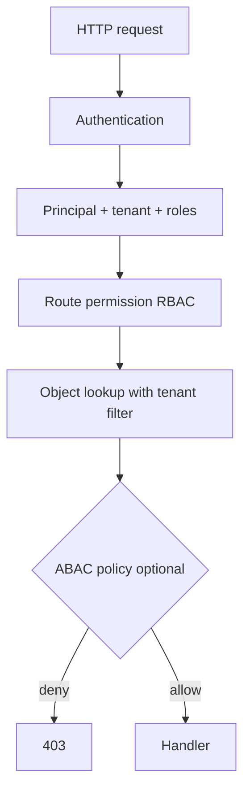
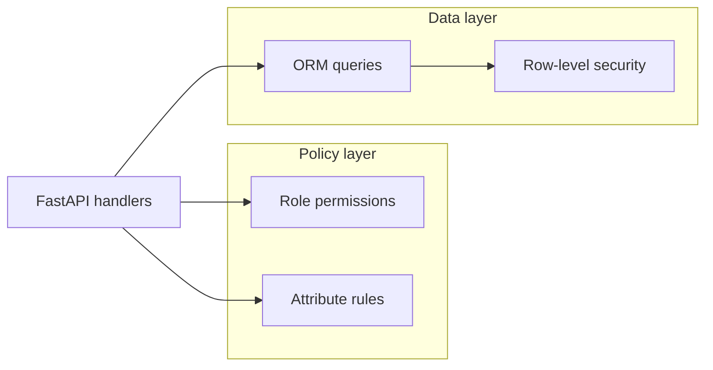

# RBAC, ABAC, Object Authorization, and Tenancy

## 1. Metadata and prerequisites

- Topic IDs: D07-T11, D07-T12, D07-T13, D07-T14, D07-T15
- Domain: 7, Authentication and Authorization
- Difficulty: Advanced
- Prerequisites: D07-T01, D04-T03, D10-T01
- Learning objectives:
  - Apply RBAC and ABAC where each fits.
  - Enforce resource- and object-level checks on every handler.
  - Design tenant isolation for multi-tenant SaaS APIs.
- Related topic IDs: D10-T02, D10-T05, D20-T11, D31-T24
- Estimated complexity: high
- Completion status: DRAFT
- Verification: NIST RBAC model references; examples unverified.

## 2. Introduction and fundamentals

### D07-T11 Role-Based Access Control (RBAC)

**Definition.** RBAC assigns permissions to roles; users receive roles. Authorization checks whether the principal's roles include the permission required for the operation (e.g., `orders:read`).

**Problem.** Role explosion when every customer needs a custom role; coarse roles enable horizontal privilege escalation (`support` reads all tenants).

**Mechanism.** Store `user_roles` and `role_permissions`. At request time, load roles for `sub`, evaluate route-required permission set intersection. Cache role matrix per request scope, not globally across tenants without tenant key.

**Misconception.** "Admin role bypasses all checks." Break-glass admin must still be audited and time-bound.

**Production rule.** Default deny; least privilege roles; separate `platform_admin` from `tenant_admin`.

### D07-T12 Attribute-Based Access Control (ABAC)

**Definition.** ABAC decides using attributes of subject, resource, action, and environment (time, IP, data classification).

**Problem.** Hard to reason about without policy language; performance cost if every decision evaluates a large policy graph.

**Mechanism.** Policy engine (OPA, Cedar, custom) inputs: `subject.department`, `resource.owner_id`, `action=delete`, `env.hour`. Returns permit/deny/obligations. Combine with RBAC: RBAC for coarse gates, ABAC for fine rules.

**Misconception.** "ABAC replaces RBAC entirely." Most teams use hybrid models.

**Production rule.** Version policies; test policies in CI; log decision id for audits.

### D07-T13 Resource-level authorization

**Definition.** Permissions attach to resource types or collections (`invoices:*` on tenant) rather than individual rows.

**Problem.** User with `invoices:read` on tenant A must not list tenant B's invoices because the route only checked role.

**Mechanism.** After authentication, inject `tenant_id` from token claim or session. Every query filters `WHERE tenant_id = :ctx`. List endpoints scope collections; create endpoints stamp tenant on insert.

**Misconception.** "Hiding menu items in UI is enough." Direct API calls bypass UI.

**Production rule.** Tenant (or org) id in every SQL query and cache key; integration tests that cross tenants must fail.

### D07-T14 Object-level authorization

**Definition.** Each request verifies the principal may access the specific object id in the path (`GET /orders/99`).

**Problem.** BOLA/IDOR: increment id and read others' data (OWASP API1). This is authorization, not authentication.

**Mechanism.** Load object by id *and* ownership keys (`user_id`, `tenant_id`). Return `404` or `403` consistently per your policy (avoid revealing existence across tenants). Never authorize from client-supplied `user_id` in body alone.

**Misconception.** "UUIDs prevent IDOR." UUIDs reduce guessing; authorization still required.

**Production rule.** One centralized `assert_can_access(resource, principal)` per domain; code review checklist for new routes.

### D07-T15 Multi-tenant access control

**Definition.** Multiple customers share one deployment; data and configuration must remain isolated per tenant.

**Problem.** Missing tenant filter in one repository method leaks cross-tenant data at scale.

**Mechanism.** Tenant resolution from subdomain, header (`X-Tenant-Id`), or JWT claim; reject ambiguous or spoofed tenant when token already encodes tenant. Row-level security in PostgreSQL optional backstop. Per-tenant rate limits and encryption keys for regulated data.

**Misconception.** "Separate databases per tenant is always required." Pool efficiency vs isolation tradeoff; schema-per-tenant or RLS may suffice.

**Production rule.** Tenant in context from trusted source only; chaos tests that attempt cross-tenant reads; no global admin queries without explicit break-glass.

## 3. Internal workings



Authorization runs after identity is known and before business logic mutates state.

## 4. Architecture diagrams



## 5. Code and implementation

Unverified.

```python
from fastapi import Depends, HTTPException, status

def require_permission(permission: str):
    async def _dep(user: User = Depends(get_current_user)) -> User:
        if permission not in user.permissions:
            raise HTTPException(status_code=status.HTTP_403_FORBIDDEN)
        return user
    return _dep

async def get_order(order_id: int, user: User = Depends(require_permission("orders:read"))):
    order = await repo.get_order(order_id, tenant_id=user.tenant_id)
    if order is None:
        raise HTTPException(status_code=status.HTTP_404_NOT_FOUND)
    if order.owner_id != user.id and "orders:read_all" not in user.permissions:
        raise HTTPException(status_code=status.HTTP_403_FORBIDDEN)
    return order
```

## 6. API contracts

| Operation | AuthZ check |
| --- | --- |
| `GET /v1/tenants/{tid}/users` | Caller `tenant_id == tid` or platform role |
| `DELETE /v1/documents/{id}` | Object tenant + `documents:delete` |
| `POST /v1/admin/impersonate` | Platform role + MFA + audit |

Use `403` when identity known but forbidden; `404` when hiding cross-tenant existence is policy.

## 7. Production considerations

**Mandatory:** Object-level checks on every id-based route; tenant scoping in persistence; audit sensitive denies.

**Optional:** Policy-as-code repo; ABAC for export/download rules; field-level authorization (D10-T03).

## 8. Comparison and tradeoffs

| Model | Fit | Risk if misapplied |
| --- | --- | --- |
| RBAC | CRUD admin panels | Over-broad roles |
| ABAC | Compliance, dynamic rules | Opaque failures |
| Resource-level | Tenant dashboards | Skips per-row checks |
| Object-level | User-owned records | Duplicated logic without helpers |
| Multi-tenant RLS | DB backstop | Migration complexity |

## 9. Debugging and troubleshooting

**Symptom:** Support can see wrong customer's data. **Cause:** Search endpoint without tenant filter. **Fix:** Add `tenant_id` to all list queries; regression test.

**Symptom:** `403` for legitimate owner. **Cause:** Role cache stale after promotion. **Fix:** Invalidate on role change; short TTL.

## 10. Interview preparation

**Q.** Difference between RBAC and ABAC?  
**Model answer.** RBAC uses role membership; ABAC evaluates attributes and policies on subject, resource, action, environment.  
**Incorrect.** "ABAC is just many roles."

**Q.** What is BOLA?  
**Model answer.** Broken Object Level Authorization—accessing another user's object by id manipulation. Fixed by server-side ownership checks, not obscurity.

## 11. Exercises and mastery assessment

1. Design roles for a SaaS with `member`, `admin`, `billing`.
2. Write object-level check pseudocode for nested `/teams/{t}/projects/{p}`.
3. When return `404` vs `403` for cross-tenant id?
4. List three tenant isolation layers (app, DB, cache).
5. **Design:** ABAC rule "delete only own draft during business hours."

**Solutions.**

1. `member`: read/write own; `admin`: tenant-wide read/write; `billing`: invoices only.
2. Verify user in team `t`, project `p` belongs to `t`, user has project permission.
3. `404` to avoid leaking ids across tenants; `403` when same tenant but insufficient role (team choice).
4. Query filters, RLS, cache key prefix with tenant id.
5. Policy inputs: `subject.id == resource.owner_id`, `resource.status == draft`, `env.hour in 9-17`.

**Mastery checklist.**

- [ ] RBAC vs ABAC tradeoff articulated.
- [ ] BOLA mitigation named.
- [ ] Tenant id source of truth identified.

**Revision summary.** Authentication names the caller; authorization models decide access by role, attributes, resource type, and specific object—with tenant boundaries on every data path.
