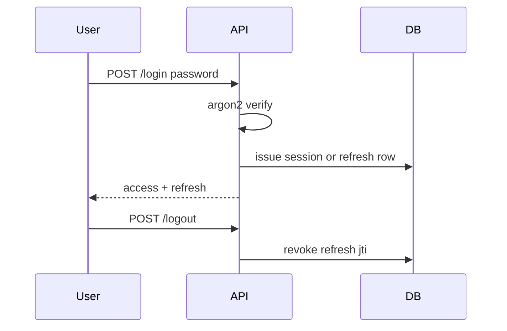
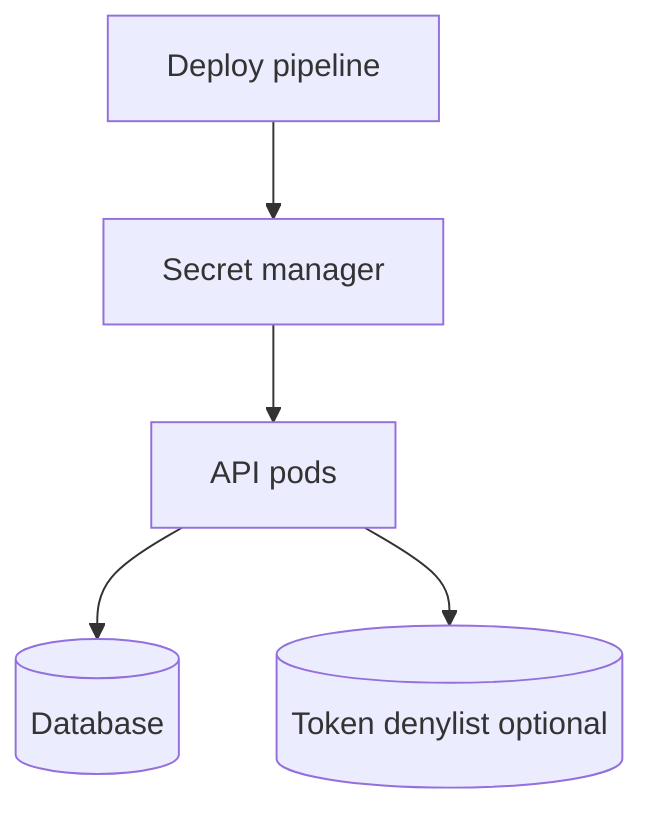

# Password Hashing, Token Lifecycle, and Secrets

## 1. Metadata and prerequisites

- Topic IDs: D07-T16, D07-T17, D07-T18
- Domain: 7, Authentication and Authorization
- Difficulty: Advanced
- Prerequisites: D07-T05, D07-T07, D07-T08
- Learning objectives:
  - Hash passwords with slow, salted algorithms (argon2 or bcrypt).
  - Design token expiry, rotation, and revocation.
  - Manage API secrets without embedding them in images or repos.
- Related topic IDs: D10-T18, D29-T03, D30-T06
- Estimated complexity: high
- Completion status: DRAFT
- Verification: OWASP Password Storage Cheat Sheet; examples unverified.

## 2. Introduction and fundamentals

### D07-T16 Password hashing

**Definition.** Password hashing is a one-way transform that maps a password to a fixed-length string using a slow algorithm and unique salt per user.

**Problem.** Fast hashes (MD5, SHA-256 alone) allow offline cracking at billions of guesses per second after database leak.

**Mechanism.** On registration, generate random salt; run argon2id (preferred) or bcrypt with work factor tuned to your hardware budget (e.g., target <500 ms on login path). Store `algorithm$params$salt$hash`. On login, constant-time compare after rehashing candidate. Upgrade weak hashes on successful login.

**Misconception.** "Encrypt passwords with AES so we can recover them." Reversible storage is wrong; use password reset flows instead.

**Production rule.** Never log passwords; use argon2id or bcrypt; pepper optional secret in KMS for extra defense in depth.

### D07-T17 Token expiry and revocation

**Definition.** Tokens carry time bounds (`exp`) and may be revocable before expiry via denylists, session deletion, or refresh-token family invalidation.

**Problem.** Long-lived JWT access tokens cannot be revoked without extra infrastructure; stolen token works until `exp`.

**Mechanism.** Short access TTL (minutes). Refresh tokens stored server-side with `jti`, `user_id`, `revoked_at`. On logout, revoke refresh and optionally publish access `jti` to Redis denylist until `exp`. For session cookies, delete session row.

**Misconception.** "Logout is client-side only (delete local token)." Server must invalidate refresh/session.

**Production rule.** Document maximum exposure window; monitor concurrent sessions; force re-auth on password change.

### D07-T18 Secret management

**Definition.** Secrets (DB passwords, HMAC keys, API client secrets, signing keys) are loaded from environment or secret managers at runtime, not baked into source control.

**Problem.** `.env` committed to Git; Kubernetes manifests with plaintext; same secret in dev and prod.

**Mechanism.** Inject via Vault, AWS Secrets Manager, or platform secrets at deploy time. Rotate with dual-write period. Separate signing keys per environment. Applications read once at startup or on rotation webhook.

**Misconception.** "Base64 encoding secrets protects them." Encoding is not encryption.

**Production rule.** Scan repos for leaks; least-privilege IAM to read secrets; never print secrets in startup logs.

## 3. Internal workings



Password verification is CPU-intensive by design—rate limit login endpoints separately from read traffic.

## 4. Architecture diagrams



Worker processes do not share in-memory pepper values unless each loads from the same secret source at boot.

## 5. Code and implementation

Unverified.

```python
from argon2 import PasswordHasher
from argon2.exceptions import VerifyMismatchError

ph = PasswordHasher()

def hash_password(password: str) -> str:
    return ph.hash(password)

def verify_password(password: str, stored: str) -> bool:
    try:
        ph.verify(stored, password)
        if ph.check_needs_rehash(stored):
            return True  # caller should persist ph.hash(password)
        return True
    except VerifyMismatchError:
        return False
```

```python
# Token revocation sketch — unverified
async def revoke_refresh(jti: str) -> None:
    await redis.setex(f"revoked:refresh:{jti}", ttl_seconds, "1")
```

## 6. API contracts

| Endpoint | Behavior |
| --- | --- |
| POST `/v1/auth/login` | Rate limited; generic error on bad password |
| POST `/v1/auth/logout` | Revokes server-side refresh |
| POST `/v1/auth/refresh` | Fails with `401` if refresh revoked |

Never return "user not found" vs "bad password" differently if that enables enumeration—product decision documented.

## 7. Production considerations

**Mandatory:** Slow password hashing; secret manager; token TTL policy; logout server revocation; login rate limits.

**Optional:** Hardware security module for signing keys; breach detection on password hashes.

## 8. Comparison and tradeoffs

| Topic | Shorter TTL | Longer TTL |
| --- | --- | --- |
| Access token | Smaller theft window | More refresh traffic |
| Refresh token | Frequent re-login | Better UX, higher theft impact |
| bcrypt cost | Slower brute force | Higher CPU on login spikes |

| Secret store | Pros | Cons |
| --- | --- | --- |
| Env vars | Simple | Rotation manual |
| Managed secrets | Rotation, audit | Vendor lock-in |

## 9. Debugging and troubleshooting

**Symptom:** Login slow after security upgrade. **Cause:** Argon2 memory cost too high for small pods. **Fix:** Tune parameters; dedicated auth service pool.

**Symptom:** Logout but token still works. **Cause:** Only client deleted JWT; access not denylisted. **Fix:** Short access TTL + refresh revoke.

**Symptom:** Prod cannot start locally. **Cause:** Missing secret mount. **Fix:** `.env.example` without values; document required keys.

## 10. Interview preparation

**Q.** Why slow password hashes?  
**Model answer.** They increase cost per guess offline after DB compromise.  
**Incorrect.** "SHA-256 is fine with salt."

**Q.** How revoke JWT access tokens?  
**Model answer.** Short TTL plus denylist of `jti` until expiry, or use opaque tokens with introspection.  
**Incorrect.** "Delete JWT on client."

## 11. Exercises and mastery assessment

1. Parameters you tune in argon2id.
2. Flow after password change for existing sessions.
3. Design secret rotation without redeploying all pods simultaneously.
4. **Debugging:** Users logged out globally at midnight UTC.
5. Threat model: DB leak with bcrypt hashes.

**Solutions.**

1. Memory, iterations, parallelism—balance with login latency SLO.
2. Invalidate all refresh tokens for user; optional access denylist; force re-login.
3. Dual secrets in manager; apps accept old + new during window; retire old.
4. Likely `exp` on JWT or cron revoking sessions—investigate batch job.
5. Attacker cracks weak passwords still; enforce strong passwords + MFA; rotate if pepper leaked.

**Mastery checklist.**

- [ ] argon2/bcrypt named; fast hash rejected.
- [ ] Refresh revocation on logout.
- [ ] Secrets not in git.

**Revision summary.** Passwords are hashed slow and salted; tokens expire and revoke through server state; secrets live in managers and rotate on schedule.
