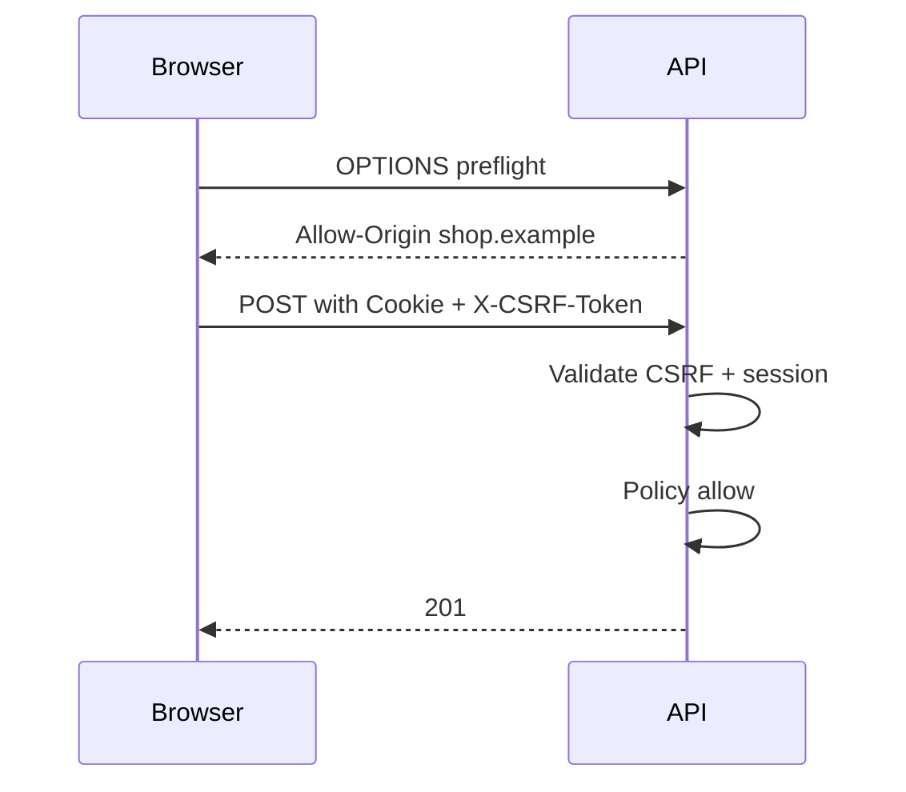
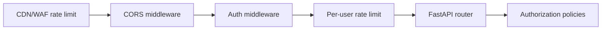

# CSRF, CORS, Policies, and Per-Caller Limits

## 1. Metadata and prerequisites

- Topic IDs: D07-T19, D07-T20, D07-T21, D07-T22, D07-T23
- Domain: 7, Authentication and Authorization
- Difficulty: Advanced
- Prerequisites: D01-T20, D07-T02, D07-T01
- Learning objectives:
  - Protect cookie-authenticated browsers from CSRF.
  - Configure CORS without treating it as authorization.
  - Implement auth middleware, authorization policies, and per-user or per-key rate limits.
- Related topic IDs: D17-T09, D08-T09, D27-T03
- Estimated complexity: high
- Completion status: DRAFT
- Verification: Fetch CORS model; OWASP CSRF guidance; examples unverified.

## 2. Introduction and fundamentals

### D07-T19 CSRF protection

**Definition.** Cross-Site Request Forgery tricks a victim's browser into sending authenticated requests (usually cookies) to your API from a malicious site.

**Problem.** `SameSite=Lax` blocks many CSRF POSTs but not all flows; cross-site cookies with `SameSite=None` need explicit CSRF tokens.

**Mechanism.** Double-submit cookie, synchronizer token in form/header (`X-CSRF-Token`), or require custom header on mutations (`Authorization` bearer from JS). For SPA + cookie session, issue CSRF token at login; validate on state-changing methods. Safe methods (GET) still need authorization for sensitive reads.

**Misconception.** "CORS blocks CSRF." CORS limits *reading* responses; simple POST may still execute without reading body.

**Production rule.** CSRF defenses for cookie session browsers; not needed for pure bearer-from-header mobile clients.

### D07-T20 CORS security

**Definition.** Cross-Origin Resource Sharing lets browsers relax same-origin policy when the server sends explicit `Access-Control-*` headers.

**Problem.** `Access-Control-Allow-Origin: *` with `Access-Control-Allow-Credentials: true` is invalid and misconfigured mirrors reflect any `Origin` while allowing cookies—attacker sites trigger authenticated calls.

**Mechanism.** Allow-list exact origins; `Vary: Origin`; handle OPTIONS preflight for non-simple requests (JSON + Authorization). Return 204 with allowed methods/headers. CORS applies to browser scripts only.

**Misconception.** "Lock down CORS and we are secure." curl and servers ignore CORS; authorization still required.

**Production rule.** Explicit origin list per environment; never reflect untrusted Origin with credentials.

### D07-T21 Authentication middleware

**Definition.** Middleware or dependencies that run before route handlers to parse credentials and populate request state (`request.state.user`).

**Problem.** Order bugs: logging middleware logs PII before auth strips it; CORS after auth returns wrong headers on 401.

**Mechanism.** ASGI stack: outermost error handling → CORS → request id → authentication → routing. Dependencies can duplicate auth for test overrides (`Depends(get_current_user)`). Fail closed on protected routers via router-level dependencies.

**Misconception.** "Global middleware is enough for object auth." Middleware knows route template, not always resource id from DB.

**Production rule.** Authentication in middleware or router dependency; object checks in service layer with resource id.

### D07-T22 Authorization policies

**Definition.** Named rules mapping principals, actions, and resources to allow/deny—implemented as functions, classes, or external policy engines.

**Problem.** Ad-hoc `if user.is_admin` scattered in handlers diverges over time.

**Mechanism.** Central `Policy` registry: `can(user, "delete", invoice)`. Handlers call one line. OpenAPI documents required scopes/roles where possible. Deny by default.

**Misconception.** "Policies belong only in GraphQL gateways." REST handlers need the same discipline.

**Production rule.** One module per domain for policies; unit test matrix of role × endpoint.

### D07-T23 Rate limiting by user or API key

**Definition.** Throttle request rate per authenticated principal or API key to limit abuse and credential stuffing.

**Problem.** IP-only limits punish NAT users; unlimited per-user keys enable data exfiltration.

**Mechanism.** Token bucket or sliding window keyed by `sub` or `api_key_id` in Redis. Return `429 Too Many Requests` with `Retry-After`. Stricter limits on `/login` and password reset. Combine with global edge limits.

**Misconception.** "Rate limiting is only for public endpoints." Authenticated abuse is common (scraping, bulk export).

**Production rule.** Separate buckets for auth endpoints; log 429 spikes; document limits in API docs.

## 3. Internal workings



## 4. Architecture diagrams



## 5. Code and implementation

Unverified.

```python
from fastapi.middleware.cors import CORSMiddleware

app.add_middleware(
    CORSMiddleware,
    allow_origins=["https://app.example.com"],
    allow_credentials=True,
    allow_methods=["GET", "POST", "PATCH", "DELETE"],
    allow_headers=["Authorization", "Content-Type", "X-CSRF-Token"],
)
```

```python
async def rate_limit_user(user_id: str) -> None:
    key = f"rl:user:{user_id}"
    if not await bucket.consume(key, limit=100, window=60):
        raise HTTPException(status_code=429, headers={"Retry-After": "30"})
```

## 6. API contracts

| Concern | Header / behavior |
| --- | --- |
| CORS | `Access-Control-Allow-Origin` exact match |
| CSRF | `X-CSRF-Token` matches cookie on POST/PATCH/DELETE |
| Rate limit | `429` + `Retry-After` |
| Auth failure | `401` before rate limit on anonymous brute force paths |

## 7. Production considerations

**Mandatory:** CORS allow-list; CSRF for cookie apps; auth middleware order documented; per-key limits; login throttling.

**Optional:** WAF bot scores; geo fences for admin routes.

## 8. Comparison and tradeoffs

| Control | Stops | Does not stop |
| --- | --- | --- |
| CORS | Browser reading cross-origin responses | Non-browser clients |
| CSRF | Cookie-forged mutations | Stolen bearer tokens |
| Rate limit | Abuse volume | Single high-impact call |
| Policy layer | Inconsistent authz | Authentication bypass |

## 9. Debugging and troubleshooting

**Symptom:** SPA works in dev, CORS error in prod. **Cause:** Origin `http://localhost:3000` not in prod allow-list. **Fix:** Environment-specific origins.

**Symptom:** POST 403 with valid session. **Cause:** Missing CSRF header. **Fix:** Document header for front-end; SameSite audit.

**Symptom:** All users share one rate limit bucket. **Cause:** Keyed by IP only behind corporate proxy. **Fix:** Key by user id after auth.

## 10. Interview preparation

**Q.** Does CORS replace authentication?  
**Model answer.** No—browsers enforce it for scripts; APIs must authorize every request regardless of Origin.  
**Incorrect.** "CORS blocks hackers."

**Q.** When is CSRF relevant?  
**Model answer.** Cookie-based sessions where browser auto-sends cookies; less relevant for Authorization header-only APIs.

## 11. Exercises and mastery assessment

1. Why simple GET CSRF is still dangerous for sensitive pages?
2. Configure CORS for credentialed SPA at `https://app.example`.
3. Middleware order: CORS vs exception handler—why?
4. Design rate limits for login vs catalog GET.
5. **Debugging:** OPTIONS 200 but POST blocked in browser only.

**Solutions.**

1. State-changing GET anti-pattern; sensitive data in response body readable by attacker page if CORS misconfigured.
2. `allow_origins=[that URL]`, `allow_credentials=True`, explicit headers/methods.
3. CORS must wrap responses including errors so 401 still has ACAO headers.
4. Login: 5/min/IP+user; catalog: higher per API key tier.
5. Preflight missing `Authorization` in Allow-Headers.

**Mastery checklist.**

- [ ] CSRF vs CORS distinction.
- [ ] AuthN middleware vs object policy.
- [ ] Per-user rate limit rationale.

**Revision summary.** Browsers need CORS and CSRF for cookie apps; servers need policies and rate limits for every caller type—none of these replace authentication or authorization.
