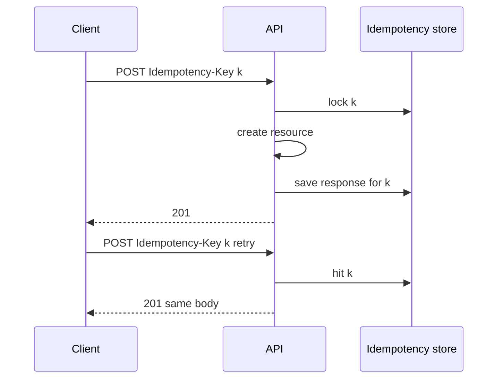
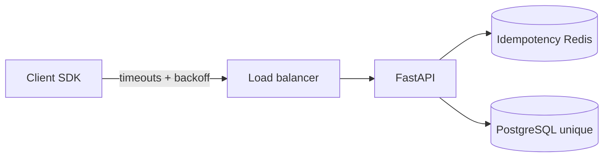

# Timeouts, Retries, and Idempotency Keys

## 1. Metadata and prerequisites

- Topic IDs: D08-T01, D08-T02, D08-T03, D08-T04, D08-T05, D08-T06
- Domain: 8, API Reliability and Resilience
- Difficulty: Intermediate
- Prerequisites: D03-T01, D03-T06, D05-T17
- Learning objectives:
  - Set request and connection timeouts at every hop.
  - Design retry policies with exponential backoff and jitter.
  - Use idempotency keys to make POST safe under retries.
- Related topic IDs: D21-T13, D24-T10, D28-T07
- Estimated complexity: medium-high
- Completion status: DRAFT
- Verification: RFC 9110 timeout semantics; examples unverified.

## 2. Introduction and fundamentals

### D08-T01 Request timeouts

**Definition.** A request timeout bounds how long a caller waits for a complete HTTP response from the server or upstream.

**Problem.** Clients hang forever; connection pools fill; cascading slowness when one dependency stalls.

**Mechanism.** Server: ASGI/uvicorn timeouts, handler-level `asyncio.wait_for`, reverse proxy `proxy_read_timeout`. Client: `httpx.Timeout(connect=5, read=30, write=30, pool=5)`. Return `504 Gateway Timeout` when upstream exceeds budget; `408 Request Timeout` is rare for APIs.

**Misconception.** "No timeout means more requests succeed." Hung requests consume workers and hide failures.

**Production rule.** End-to-end deadline propagated via `timeout` budget header or context; always shorter than client-facing SLA.

### D08-T02 Connection timeouts

**Definition.** Connection timeout limits TCP/TLS handshake duration before giving up.

**Problem.** DNS or SYN blackholes tie up threads for minutes with default OS timeouts.

**Mechanism.** Separate connect timeout from read timeout. Connection pools reuse warm connections; failed connect triggers retry to another backend only for idempotent reads.

**Misconception.** "One timeout value fits all." Connect failures need fast fail; large uploads need long write timeout.

**Production rule.** Log connect vs read timeout separately in metrics.

### D08-T03 Retry policies

**Definition.** A retry policy decides which failures are retried, how many times, and under what conditions.

**Problem.** Blind retries on POST double-charge; retries on `500` amplify outages (retry storm).

**Mechanism.** Retry only idempotent methods or requests with idempotency keys; retry `429` with `Retry-After`, transient `502/503/504`, connect errors; do not retry `400/401/403/404/409` unless documented. Cap max attempts.

**Misconception.** "Always retry three times." Context-dependent; payment POST without idempotency must not retry blindly.

**Production rule.** Document client retry contract; server honors `Idempotency-Key`.

### D08-T04 Exponential backoff and jitter

**Definition.** Backoff increases delay between retries (~2^n); jitter randomizes delay to desynchronize clients.

**Problem.** Synchronized retries create traffic spikes that keep the system down (thundering herd).

**Mechanism.** `delay = min(cap, base * 2**attempt) * random(0.5, 1.5)`. Full jitter: `random(0, cap)`.

**Misconception.** "Fixed 1s delay is simpler and fine at scale." It is not under many clients.

**Production rule.** Jitter on all client SDK retries; server-side rate limit coordinates with `Retry-After`.

### D08-T05 Idempotency keys

**Definition.** Client sends `Idempotency-Key: <uuid>` on mutating requests; server stores outcome for key window and returns same response on replay.

**Problem.** Network blip causes client retry; user charged twice.

**Mechanism.** On first sight of key, lock row in store (Redis/DB), process request, persist status + response body hash. Duplicates return stored `201`/`200` without re-executing side effects. Keys scoped per tenant and route.

**Misconception.** "PUT is always enough." Business POST create actions need explicit keys.

**Production rule.** 24-hour key retention minimum for payments; return `409` if key reused with different body.

### D08-T06 Duplicate request prevention

**Definition.** Broader than idempotency keys: dedupe via message ids, unique constraints, or outbox patterns.

**Problem.** At-least-once delivery from queues duplicates work.

**Mechanism.** Natural keys (`order_id` unique), dedupe table, or compare-and-swap on state machine transitions.

**Misconception.** "Exactly-once is free." Aim for idempotent effects with at-least-once transport.

**Production rule.** Database unique constraints as final backstop for financial records.

## 3. Internal workings



## 4. Architecture diagrams



## 5. Code and implementation

Unverified.

```python
import httpx

timeout = httpx.Timeout(5.0, read=30.0)
async with httpx.AsyncClient(timeout=timeout) as client:
    response = await client.post(url, json=payload, headers={"Idempotency-Key": key})
```

```python
async def with_idempotency(key: str, handler):
    existing = await store.get(key)
    if existing:
        return existing
    async with store.lock(key):
        return await handler()
```

## 6. API contracts

| Header | Required on | Behavior |
| --- | --- | --- |
| `Idempotency-Key` | POST `/payments` | Replay → same status/body |
| `Retry-After` | `429`, some `503` | Client waits seconds |

| Status | Retry? |
| --- | --- |
| 503 | Yes with backoff |
| 409 | No—fix conflict |
| 504 | Maybe if idempotent |

## 7. Production considerations

**Mandatory:** Client and server timeouts; idempotency for money paths; jittered retries; unique DB constraints.

**Optional:** Adaptive concurrency; hedged requests for read-only tail latency.

## 8. Comparison and tradeoffs

| Strategy | Benefit | Cost |
| --- | --- | --- |
| Aggressive retry | Masks blips | Overload |
| No retry | Simple | Poor UX on transient faults |
| Idempotency store | Safe POST retry | Storage + locking |
| Long timeout | Fewer false timeouts | Pool exhaustion |

## 9. Debugging and troubleshooting

**Symptom:** Duplicate orders same second. **Cause:** Client retry without idempotency key. **Fix:** Require key; return same response.

**Symptom:** Retry storm during outage. **Cause:** No jitter; many clients retry together. **Fix:** Full jitter + circuit breaker (D08-T07).

## 10. Interview preparation

**Q.** When retry POST?  
**Model answer.** Only with idempotency key or known-safe server semantics; otherwise do not.  
**Incorrect.** "Retry all 5xx three times."

**Q.** Why jitter?  
**Model answer.** Desynchronizes retries to avoid thundering herd on recovering service.

## 11. Exercises and mastery assessment

1. Split timeout budget across three microservice hops.
2. Design idempotency key scope for multi-tenant API.
3. Client receives `504` on POST payment—retry?
4. **Debugging:** Idempotency returns wrong body for different payload same key.

**Solutions.**

1. If client budget 30s: 5s connect each hop, 8s read per service, reserve margin.
2. Key unique per `(tenant_id, route, client_key)`; reject body mismatch with `409`.
3. Only if idempotency key sent and policy allows; else surface error to user.
4. Expected—return `409 Conflict` on body hash mismatch.

**Mastery checklist.**

- [ ] Connect vs read timeout.
- [ ] Backoff + jitter rationale.
- [ ] Idempotency vs duplicate prevention.

**Revision summary.** Bound time at every layer, retry only when safe, and use idempotency keys so at-least-once networks do not create at-least-twice side effects.
