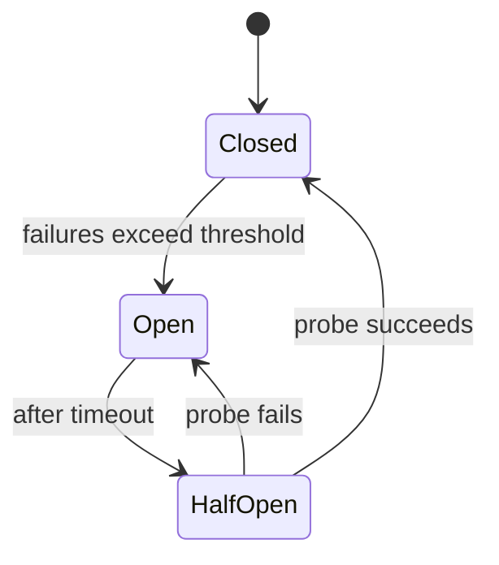
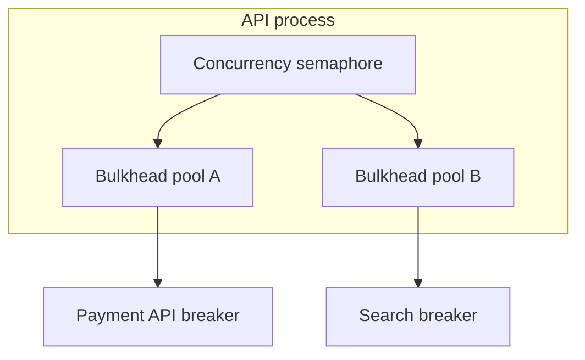

# Circuit Breakers, Bulkheads, and Admission Control

## 1. Metadata and prerequisites

- Topic IDs: D08-T07, D08-T08, D08-T09, D08-T10, D08-T11, D08-T12
- Domain: 8, API Reliability and Resilience
- Difficulty: Advanced
- Prerequisites: D08-T01, D08-T03, D07-T23
- Learning objectives:
  - Operate circuit breakers (closed = flow, open = short-circuit).
  - Isolate failure domains with bulkheads and concurrency caps.
  - Apply rate limiting, throttling, quotas, and payload limits.
- Related topic IDs: D28-T10, D27-T12, D10-T04
- Estimated complexity: high
- Completion status: DRAFT
- Verification: Michael Nygard *Release It!* patterns; examples unverified.

## 2. Introduction and fundamentals

### D08-T07 Circuit breakers

**Definition.** A circuit breaker wraps calls to a dependency; when failures exceed a threshold, the breaker **opens** and fails fast without calling the sick dependency. **Closed** means traffic flows normally. **Half-open** probes recovery.

**Problem.** Without breakers, threads block on timeouts while downstream is down, exhausting worker pools.

**Mechanism.** Count failures in sliding window; open → immediate `503` or fallback; after cooldown, allow trial requests; success closes breaker. Per-dependency breakers (payment gateway vs email).

**Misconception.** "Open circuit means the API is down." Only that dependency path is short-circuited; core reads may continue.

**Production rule.** Monitor breaker state transitions; alert on sustained open; never share one global breaker for unrelated services.

### D08-T08 Bulkheads

**Definition.** Bulkheads partition resources (thread pools, connection pools, semaphores) so one slow tenant or feature cannot exhaust all capacity.

**Problem.** One heavy report job blocks checkout for all users.

**Mechanism.** Separate pools for admin exports vs user API; limit concurrent calls to external LLM provider; queue long tasks to workers (D24).

**Misconception.** "Async means no bulkheads needed." Event loop still starves if unlimited concurrent awaits to slow IO.

**Production rule.** Cap in-flight requests per route class; offload CPU work to thread pool with limit.

### D08-T09 Rate limiting

**Definition.** Limit requests per time window per key (IP, user, API key).

**Problem.** Abuse, accidental loops, credential stuffing.

**Mechanism.** Token bucket in Redis; edge WAF + app-level limits; `429` with `Retry-After`. Different tiers per plan.

**Misconception.** "Rate limit once at CDN only." App-level enforces authenticated identity.

**Production rule.** Stricter limits on expensive endpoints; coordinate with D07-T23.

### D08-T10 Throttling and quotas

**Definition.** Throttling slows excess traffic; quotas cap usage over longer periods (daily API calls, storage).

**Problem.** Burst within limit still overloads DB; monthly quota exceeded mid-batch.

**Mechanism.** Leaky bucket smoothing; quota counters with billing period reset; return `429` or `402`-style business error per product policy.

**Misconception.** "Throttling and rate limiting are identical." Throttling shapes traffic; quotas are capacity contracts.

**Production rule.** Expose quota headers (`X-RateLimit-Remaining`) where clients plan backoff.

### D08-T11 Request size limits

**Definition.** Maximum bytes for request body and headers to prevent memory exhaustion.

**Problem.** Multi-gigabyte JSON POST OOMs worker; decompression bombs.

**Mechanism.** Reverse proxy `client_max_body_size`; Starlette limits; reject `413 Content Too Large` early. Stream uploads with caps (D23).

**Misconception.** "FastAPI validates JSON size automatically." Configure limits explicitly.

**Production rule.** Limit at edge and app; log oversize client id.

### D08-T12 Concurrency limits

**Definition.** Maximum simultaneous in-flight requests per process, route, or tenant.

**Problem.** Traffic spike creates unbounded tasks; DB connection pool exhausted.

**Mechanism.** Semaphore middleware; Uvicorn worker count × per-worker concurrency; DB pool size aligned (`pool_size + max_overflow` < DB max connections / replicas).

**Misconception.** "More async tasks always increase throughput." Saturation point exists.

**Production rule.** Worker processes do not share in-memory semaphores—use Redis or edge limits for global caps.

## 3. Internal workings



Closed: calls pass through. Open: immediate failure without downstream call.

## 4. Architecture diagrams



## 5. Code and implementation

Unverified.

```python
from circuitbreaker import circuit

@circuit(failure_threshold=5, recovery_timeout=30)
async def charge_card(...):
    ...
```

```python
import asyncio
_heavy = asyncio.Semaphore(10)

async def heavy_endpoint():
    async with _heavy:
        ...
```

## 6. API contracts

| Response | Meaning |
| --- | --- |
| 429 | Rate limit / throttle |
| 413 | Body too large |
| 503 | Breaker open or overload shed |

Document limits in OpenAPI description fields.

## 7. Production considerations

**Mandatory:** Body size limits; pool sizing; breaker per dependency; 429 semantics.

**Optional:** Adaptive limiting; priority queues for paying tenants.

## 8. Comparison and tradeoffs

| Control | Protects | User impact |
| --- | --- | --- |
| Breaker open | Dependency meltdown | Feature unavailable fast |
| Bulkhead | Cross-feature starvation | Queuing delay |
| Rate limit | Abuse | Legit burst throttled |
| Concurrency cap | OOM | 503 under spike |

## 9. Debugging and troubleshooting

**Symptom:** Sudden all `503` from one integration. **Cause:** Breaker stuck open; dependency still unhealthy. **Fix:** Fix root cause; half-open probe; manual reset only with ops runbook.

**Symptom:** `429` for all users. **Cause:** Shared Redis limit key bug (`global` instead of per user). **Fix:** Key namespace audit.

## 10. Interview preparation

**Q.** Circuit breaker closed vs open?  
**Model answer.** Closed passes traffic; open short-circuits calls to failing dependency for fast fail.  
**Incorrect.** "Open means security gate open."

**Q.** Bulkhead example?  
**Model answer.** Separate connection pool for batch jobs vs online API so batch cannot exhaust online pool.

## 11. Exercises and mastery assessment

1. Choose breaker thresholds for email vs payments.
2. Size DB pool with 4 workers, 20 concurrent each.
3. **Debugging:** Breaker flaps every 30s.
4. Design quota headers for SaaS API.
5. Map `413` vs `429` client handling.

**Solutions.**

1. Payments: low failure threshold, no fallback charge; email: higher threshold, queue fallback.
2. Max DB connections per pod ≤ pool_size; total pods × pool < DB limit with headroom.
3. Recovery timeout equals probe interval while dependency still failing—increase timeout or fix dependency.
4. `X-RateLimit-Limit`, `Remaining`, `Reset`.
5. `413` do not retry same payload; `429` backoff per Retry-After.

**Mastery checklist.**

- [ ] Closed vs open breaker.
- [ ] Bulkhead purpose.
- [ ] Global vs per-user rate limits.

**Revision summary.** Breakers fail fast when dependencies sick; bulkheads and limits prevent one workload from consuming the whole API; rate limits and size caps stop abuse and exhaustion.
