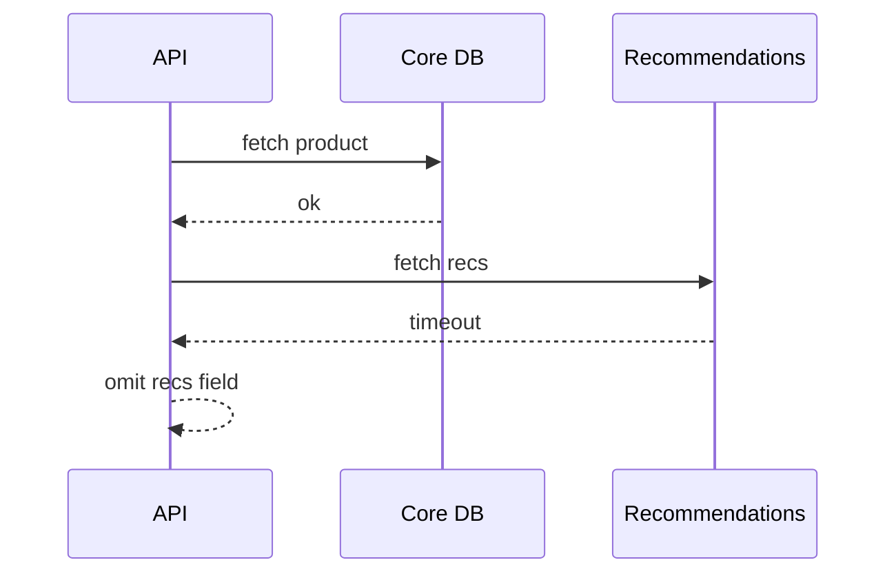
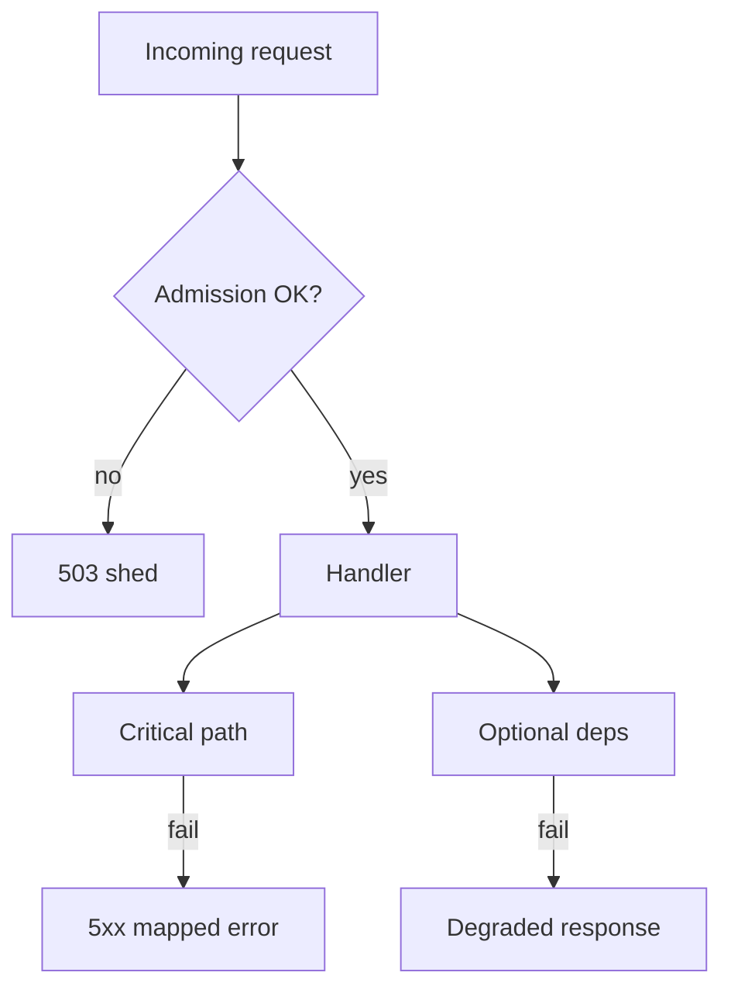

# Degradation, Shedding, and Distributed Failures

## 1. Metadata and prerequisites

- Topic IDs: D08-T13, D08-T14, D08-T15, D08-T16, D08-T17
- Domain: 8, API Reliability and Resilience
- Difficulty: Advanced
- Prerequisites: D08-T07, D08-T12, D22-T10
- Learning objectives:
  - Degrade non-critical features under pressure.
  - Shed load before catastrophic failure.
  - Bound transactions and handle partial distributed failures.
- Related topic IDs: D28-T14, D29-T16, D24-T04
- Estimated complexity: high
- Completion status: DRAFT
- Verification: Examples unverified.

## 2. Introduction and fundamentals

### D08-T13 Graceful degradation

**Definition.** Graceful degradation returns reduced functionality or cached/stale data when dependencies fail, instead of total outage.

**Problem.** Recommendation service down blocks entire product page if coded synchronously.

**Mechanism.** Feature flags; optional sections omitted from JSON; serve cached catalog with `stale` indicator; async refresh in background. Critical path (pay, auth) stays strict.

**Misconception.** "Degrade means return 200 with empty errors hidden." Users need honest partial responses or explicit `degraded: true`.

**Production rule.** Define degradation tiers in runbooks; test dependency failure in chaos drills.

### D08-T14 Load shedding

**Definition.** Load shedding rejects new work when the system is overloaded to protect surviving requests.

**Problem.** Accepting all requests increases latency until everything times out—metastable failure.

**Mechanism.** When queue depth or CPU exceeds threshold, return `503` with `Retry-After` for low-priority routes first; keep health checks and auth. SYN cookies at load balancer optional layer.

**Misconception.** "Shedding is same as rate limiting." Shedding reacts to server health, not just client identity.

**Production rule.** Shed before OOM; prioritize tier-1 endpoints in admission control.

### D08-T15 Error propagation

**Definition.** How errors from internal services surface to API clients without leaking internals.

**Problem.** Raw stack traces in JSON; chained `502` without correlation id for support.

**Mechanism.** Map dependency timeout to `504`; breaker open to `503`; validation stays `422`. Wrap internal codes in RFC 9457 problem details with `trace_id`. Log full exception server-side only.

**Misconception.** "Always pass through downstream status code." Hide internal microservice `500` details.

**Production rule.** Consistent error schema (D05-T15); never expose SQL in responses.

### D08-T16 Transaction boundaries

**Definition.** A transaction groups database operations that commit or roll back atomically.

**Problem.** API commits order then fails payment capture—orphan records.

**Mechanism.** Keep transactions short; outbox pattern for events after commit; saga for multi-service flows with compensating actions. Do not hold HTTP request open across two-phase commit.

**Misconception.** "One REST call equals one DB transaction always." Long calls should split with idempotent steps.

**Production rule.** Transaction scope in service layer; avoid remote HTTP inside DB transaction.

### D08-T17 Distributed request failures

**Definition.** A single user request fans out to multiple services; any may fail partially.

**Problem.** User sees success while email notification never sent; inconsistent read after write across services.

**Mechanism.** Correlation id across calls; parallel calls with `asyncio.gather(return_exceptions=True)`; aggregate partial failures into multi-status response or fail entire operation based on criticality. Eventual consistency documented.

**Misconception.** "Distributed transactions (2PC) fix everything." Operational cost high; prefer sagas.

**Production rule.** Idempotent consumers; dead-letter queues for failed side effects.

## 3. Internal workings



## 4. Architecture diagrams



## 5. Code and implementation

Unverified.

```python
async def product_detail(pid: str):
    product = await repo.get(pid)
    try:
        recs = await rec_client.get(pid, timeout=0.5)
    except TimeoutError:
        recs = None
    return {"product": product, "recommendations": recs, "degraded": recs is None}
```

## 6. API contracts

| Field | When |
| --- | --- |
| `degraded: true` | Optional data missing |
| `503` + `Retry-After` | Shed load |
| `problem.type` | RFC 9457 for errors |

## 7. Production considerations

**Mandatory:** Error mapping table; short transactions; correlation ids; shed policies tested.

**Optional:** Chaos engineering; synthetic monitoring per dependency.

## 8. Comparison and tradeoffs

| Approach | UX | Complexity |
| --- | --- | --- |
| Hard fail on optional dep | Worse availability | Simpler |
| Degrade | Better perceived uptime | Stale/partial data |
| Shed | Protects core | Angry throttled users |
| Saga | Cross-service consistency | Compensation logic |

## 9. Debugging and troubleshooting

**Symptom:** Metastable failure after traffic spike. **Cause:** No shedding; retries amplify load. **Fix:** Jitter + breaker + shed; reduce retry budget.

**Symptom:** Orphan payments. **Cause:** Commit before external confirm. **Fix:** Outbox or state machine `pending_capture`.

## 10. Interview preparation

**Q.** Degradation vs load shedding?  
**Model answer.** Degradation reduces response richness; shedding rejects requests to protect capacity.  
**Incorrect.** "Same thing."

## 11. Exercises and mastery assessment

1. Classify endpoints for shed order.
2. Saga steps for order + inventory + payment.
3. **Debugging:** Partial 200 with missing fields confuses clients.
4. Map internal timeout to external status.
5. Why HTTP inside DB transaction is bad.

**Solutions.**

1. Shed analytics first, checkout last.
2. Reserve inventory → charge → confirm; compensate release stock on payment fail.
3. Document `degraded` contract in OpenAPI.
4. Upstream read timeout → `504`.
5. Locks held, pool exhaustion, unpredictable latency.

**Mastery checklist.**

- [ ] Degradation tier defined.
- [ ] Shed vs rate limit.
- [ ] Transaction boundary placement.

**Revision summary.** Protect the critical path with shedding and breakers; degrade optional features honestly; keep transactions short and errors mapped for clients.
