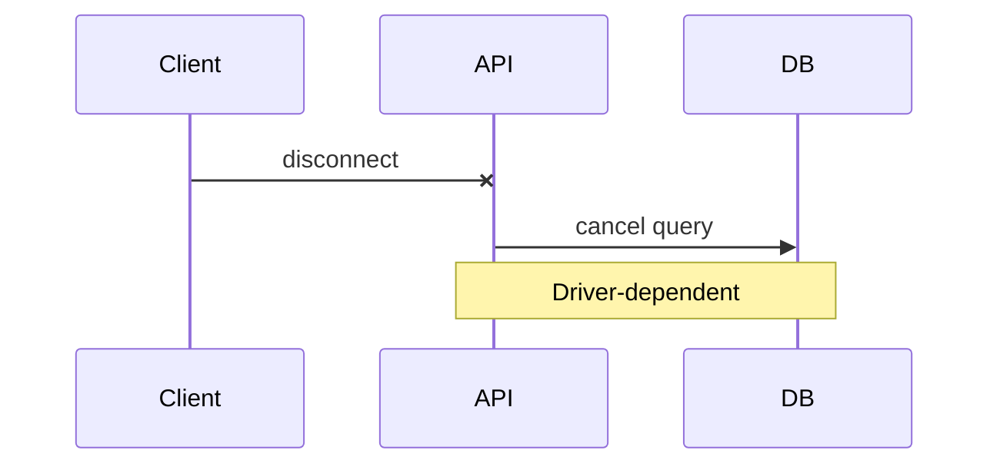
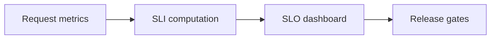

# Retry Safety, Cancellation, and SLIs/SLOs

## 1. Metadata and prerequisites

- Topic IDs: D08-T18, D08-T19, D08-T20
- Domain: 8, API Reliability and Resilience
- Difficulty: Advanced
- Prerequisites: D08-T03, D08-T05, D21-T13
- Learning objectives:
  - Classify operations as retry-safe.
  - Propagate request cancellation to downstream work.
  - Define availability SLIs and SLOs for APIs.
- Related topic IDs: D29-T16, D09-T18, D31-T07
- Estimated complexity: medium-high
- Completion status: DRAFT
- Verification: Google SRE workbook concepts; examples unverified.

## 2. Introduction and fundamentals

### D08-T18 Retry-safe operations

**Definition.** An operation is retry-safe if executing it more than once does not change system state beyond one successful application (idempotent effect).

**Problem.** Retrying `POST /transfer` or increment counter without guard duplicates money or counts.

**Mechanism.** Classify endpoints: safe (GET, HEAD), idempotent by method (PUT, DELETE with stable id), idempotent by key (POST + Idempotency-Key), non-retryable (side-effect POST). Document in API guide. Server implements keys and unique constraints.

**Misconception.** "DELETE is always safe to retry." DELETE twice may be fine logically but audit logs duplicate; still idempotent on resource state.

**Production rule.** SDK defaults retry only safe/idempotent unless key provided.

### D08-T19 Request cancellation

**Definition.** When the client disconnects or times out, the server should stop unnecessary work and release resources.

**Problem.** User navigates away; server still runs expensive query burning CPU.

**Mechanism.** ASGI disconnect messages; `asyncio.CancelledError` in handlers; propagate cancellation to `httpx` and DB calls where drivers support it. Background tasks started without tracking may continue—use job queue for long work.

**Misconception.** "Cancellation always rolls back DB." Partial commits may remain; design idempotent cleanup.

**Production rule.** Check disconnect on long streams; bound work with deadlines tied to client timeout.

### D08-T20 API availability and SLIs/SLOs

**Definition.** SLI (indicator) measures behavior like successful request ratio or latency; SLO sets target (e.g., 99.9% success over 30 days).

**Problem.** Teams alert on CPU without user-visible availability; no error budget for releases.

**Mechanism.** SLI: `(2xx + 4xx client fault excluded?) / total`—define whether `429` counts against SLO. Measure at load balancer. SLO error budget gates risky deploys. SLIs: availability, latency p95, correctness (payment success rate).

**Misconception.** "100% uptime SLO is realistic." Budget maintenance and dependencies.

**Production rule.** Publish internal SLOs; tie on-call pages to SLO burn rate; exclude planned maintenance in policy document.

## 3. Internal workings



## 4. Architecture diagrams



## 5. Code and implementation

Unverified.

```python
import asyncio
from fastapi import Request

async def long_task(request: Request):
    try:
        await asyncio.wait_for(work(), timeout=25.0)
    except asyncio.CancelledError:
        await cleanup_partial()
        raise
```

## 6. API contracts

Document per endpoint:

| Endpoint | Retry-safe | Idempotency |
| --- | --- | --- |
| GET `/items` | Yes | N/A |
| POST `/orders` | With key | Required header |

## 7. Production considerations

**Mandatory:** Retry matrix documented; cancellation on long IO; SLO-defined status classes.

**Optional:** Error budget policy; synthetic probes for SLI.

## 8. Comparison and tradeoffs

| SLI choice | Pro | Con |
| --- | --- | --- |
| Include 4xx in denominator | Simple | Client bugs burn budget |
| Exclude 4xx | Fair to server | Hides bad API design |
| Latency SLO p99 | Tail UX | Noisy |

## 9. Debugging and troubleshooting

**Symptom:** SLO breach without obvious outage. **Cause:** Dependency slow, not failing—latency SLO violated. **Fix:** Separate latency SLI; trace p95.

**Symptom:** Work continues after client gone. **Cause:** Detached background task. **Fix:** Queue with cancel tokens.

## 10. Interview preparation

**Q.** What makes POST retry-safe?  
**Model answer.** Idempotency key or natural uniqueness so duplicate execution has no extra effect.  
**Incorrect.** "POST is never retry-safe."

**Q.** Closed breaker and SLO?  
**Model answer.** Breaker may improve availability SLI for API by failing fast, while dependency SLI shows outage—both matter.

## 11. Exercises and mastery assessment

1. Build retry matrix for 10 endpoints.
2. Define 30-day SLO for checkout API.
3. **Debugging:** CancelledError logged as 500.
4. Should `429` count against availability SLO?
5. Client timeout 30s, server 60s—issue?

**Solutions.**

1. Table with method, key, notes.
2. 99.9% success excluding 4xx validation; p95 < 800ms.
3. Map CancelledError to client disconnect, not 500.
4. Team decision—often excluded as client/backpressure.
5. Server wastes resources; align server < client.

**Mastery checklist.**

- [ ] Retry-safe definition.
- [ ] Cancellation propagation.
- [ ] SLI vs SLO vocabulary.

**Revision summary.** Only retry what cannot double-charge; cancel work when clients leave; measure availability and latency with SLOs that guide releases.
