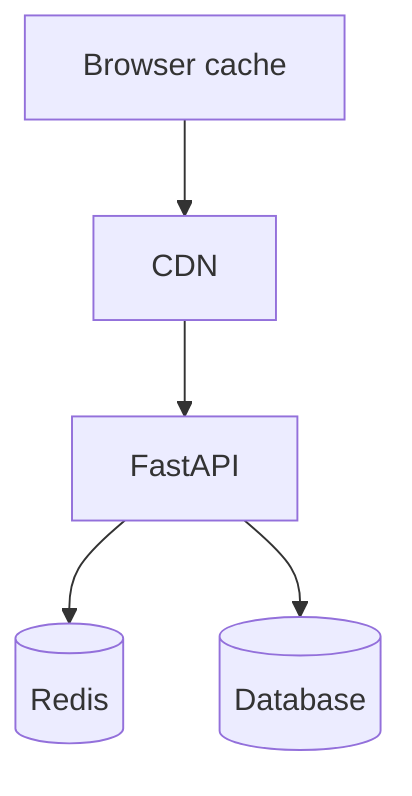
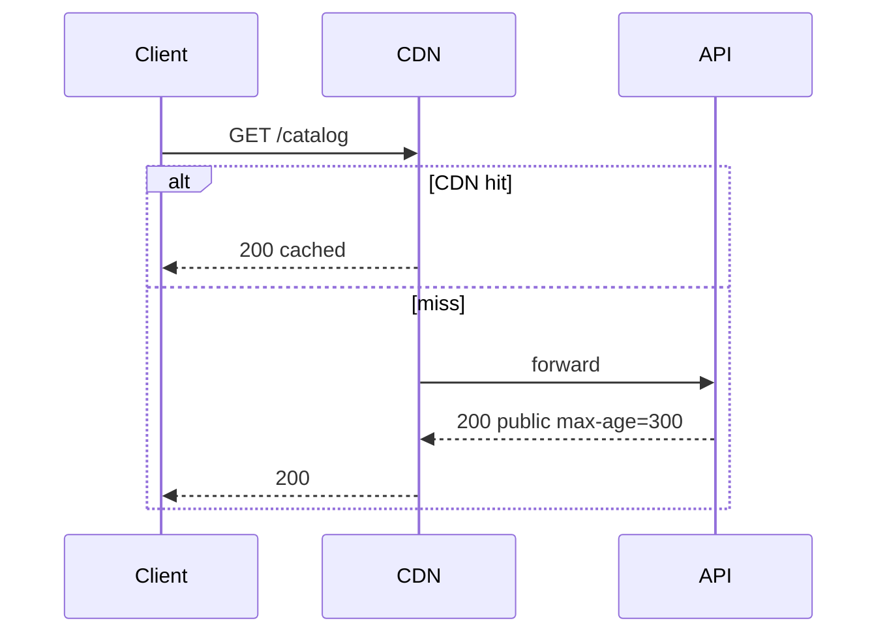

# Browser, Proxy, Server, and Redis Caches

## 1. Metadata and prerequisites

- Topic IDs: D09-T01, D09-T02, D09-T03, D09-T04
- Domain: 9, Caching and Performance
- Difficulty: Intermediate
- Prerequisites: D01-T17, D02-T05, D07-T01
- Learning objectives:
  - Place caches at browser, CDN, application, and Redis layers appropriately.
  - Avoid caching authenticated private responses incorrectly.
- Related topic IDs: D09-T05, D28-T07, D01-T20
- Estimated complexity: medium
- Completion status: DRAFT
- Verification: RFC 9111; examples unverified.

## 2. Introduction and fundamentals

### D09-T01 Browser and client-side caching

**Definition.** Browsers and HTTP clients store responses per `Cache-Control` and validators, reusing them until stale.

**Problem.** Private JSON cached on disk; back button shows another user's data on shared PC.

**Mechanism.** `Cache-Control: private, no-store` for user-specific resources; `max-age` for public assets. Service workers add another cache layer—same rules apply.

**Misconception.** "GET is always cacheable." Authorization and `Cache-Control` determine cacheability (RFC 9111).

**Production rule.** Default `no-store` for authenticated APIs unless threat-modeled.

### D09-T02 Proxy and CDN caching

**Definition.** Shared caches (CDN, corporate proxy) serve responses to many clients.

**Problem.** CDN caches `GET /profile` without `Vary: Authorization` serves user A's profile to user B.

**Mechanism.** `public, max-age` only for anonymous resources; `private` forbids shared cache storage; cache keys include URL and relevant headers when using `Vary`. Purge CDN on deploy for static assets.

**Misconception.** "CDN is only for images." API GET catalog can CDN-cache with correct headers.

**Production rule.** Never cache personalized JSON at CDN without edge auth (signed URLs) or cache key isolation.

### D09-T03 Server-side caching

**Definition.** Application memory or process-local cache of computed objects (Python `lru_cache`, dict) to avoid repeated DB hits.

**Problem.** Worker A caches tenant config; worker B stale; in-memory cache ignores other instances' updates.

**Mechanism.** Short TTL local cache for hot read-only config; prefer Redis for shared cache across workers. Invalidate on write.

**Misconception.** "In-memory cache is enough in production." Worker processes do not share in-memory caches—each Uvicorn worker has its own.

**Production rule.** Treat local cache as optimization with TTL; authoritative data in DB/Redis.

### D09-T04 Redis-backed caching

**Definition.** Central key-value store holds serialized representations with TTL for cross-process consistency.

**Problem.** Cache stampede when hot key expires; thundering herd hits DB.

**Mechanism.** Key naming `tenant:resource:id`; TTL jitter; single-flight lock on miss; optional write-through or cache-aside. Tenant isolation in every key (D09-T09).

**Misconception.** "Redis is the database." Cache is ephemeral; source of truth remains primary store.

**Production rule.** Monitor memory eviction; encrypt sensitive values or do not cache secrets.

## 3. Internal workings



## 4. Architecture diagrams



## 5. Code and implementation

Unverified.

```python
import redis.asyncio as redis

cache = redis.from_url("redis://localhost:6379/0")

async def get_product(pid: str):
    key = f"product:{pid}"
    raw = await cache.get(key)
    if raw:
        return json.loads(raw)
    product = await db.fetch(pid)
    await cache.setex(key, 300, json.dumps(product))
    return product
```

## 6. API contracts

Public catalog GET: `Cache-Control: public, max-age=60`. Private: `private, no-store`.

## 7. Production considerations

**Mandatory:** Header policy per route class; Redis HA; no cross-tenant keys.

**Optional:** CDN purge hooks; stale-while-revalidate at edge.

## 8. Comparison and tradeoffs

| Layer | Latency | Consistency |
| --- | --- | --- |
| Browser | Lowest | Poor for private |
| CDN | Low global | Needs purge |
| Redis | Low | TTL-based |
| Local memory | Lowest per worker | Inconsistent across workers |

## 9. Debugging and troubleshooting

**Symptom:** Stale catalog after price change. **Cause:** CDN TTL too long. **Fix:** Shorter max-age or active purge.

**Symptom:** Different workers different config. **Cause:** Local cache only. **Fix:** Redis or push invalidation.

## 10. Interview preparation

**Q.** Why workers don't share local cache?  
**Model answer.** Separate processes; use Redis for shared state.  
**Incorrect.** "Python GIL prevents sharing" (wrong reason—process isolation).

## 11. Exercises and mastery assessment

1. Headers for public vs private GET.
2. Redis key design for multi-tenant list.
3. **Debugging:** User sees old avatar after upload.

**Solutions.**

1. Public: `public, max-age`; private: `private, no-store`.
2. `t:{tenant}:users:list:v3`.
3. Invalidate avatar URL cache; CDN purge; ETag bump.

**Mastery checklist.**

- [ ] Four cache layers named.
- [ ] Worker local cache limitation.
- [ ] CDN + auth risk.

**Revision summary.** Cache at the right layer with explicit HTTP semantics; shared state belongs in Redis, not per-worker memory, for consistent APIs.
