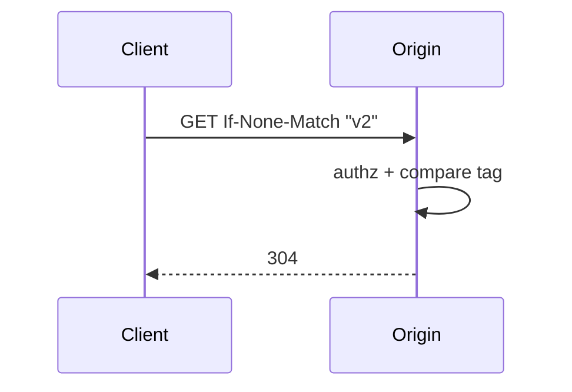
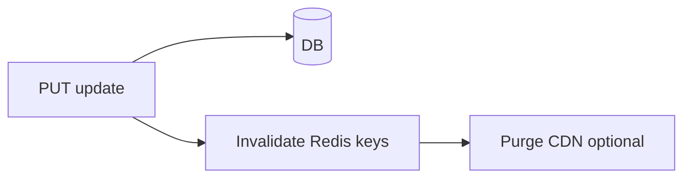

# Cache Validators, Invalidation, and Compression

## 1. Metadata and prerequisites

- Topic IDs: D09-T05, D09-T06, D09-T07, D09-T08, D09-T09, D09-T10
- Domain: 9, Caching and Performance
- Difficulty: Intermediate
- Prerequisites: D01-T17, D01-T18, D09-T01
- Learning objectives:
  - Apply `Cache-Control` correctly (`no-cache` is not `no-store`).
  - Use ETags and conditional GET; invalidate caches safely.
  - Compress responses and isolate tenant cache keys.
- Related topic IDs: D03-T13, D28-T09
- Estimated complexity: medium-high
- Completion status: DRAFT
- Verification: RFC 9111; examples unverified.

## 2. Introduction and fundamentals

### D09-T05 Cache-Control directives

**Definition.** `Cache-Control` communicates caching policy to clients and intermediaries (RFC 9111).

**Problem.** Developers set `no-cache` thinking data will not be stored; intermediaries may still store but must revalidate.

**Mechanism.** `no-store`: do not persist. `no-cache`: may store but must revalidate before reuse. `max-age`: fresh lifetime. `private` vs `public`: shared cache eligibility. `must-revalidate`: no stale use without check.

**Misconception.** "`no-cache` means do not cache." It means validate with origin before using stored copy.

**Production rule.** PII responses use `no-store`; large public docs may use `no-cache` + ETag for bandwidth savings.

### D09-T06 ETags

**Definition.** Entity tag is an opaque validator for a representation version.

**Problem.** Weak vs strong ETag misuse breaks conditional logic.

**Mechanism.** Strong ETag changes when bytes change; send in `ETag` response header. Client sends `If-None-Match` on repeat GET; server returns `304` without body when match.

**Misconception.** "ETag = hash of id." Must change when representation changes.

**Production rule.** Generate from content hash or version column; authorize before returning `304`.

### D09-T07 Conditional GET requests

**Definition.** Client sends validators (`If-None-Match`, `If-Modified-Since`); server skips body when unchanged.

**Problem.** `304` returned to unauthorized user leaks that resource exists if not gated.

**Mechanism.** Run authentication and authorization before conditional check. `304` includes same cache headers as `200` would.

**Misconception.** "304 saves server work only." Saves bandwidth too.

**Production rule.** Combine ETags with short `max-age` for public resources.

### D09-T08 Cache invalidation

**Definition.** Removing or bumping cached entries when source data changes.

**Problem.** Hard problem—stale Redis and CDN entries after update.

**Mechanism.** Write-through updates cache; cache-aside deletes key on write; version prefix in key (`v{n}`); CDN purge API; TTL upper bound even with invalidation bugs.

**Misconception.** "TTL alone is sufficient invalidation." TTL is eventual; active invalidation needed for fast consistency.

**Production rule.** Document invalidation owner per resource type; test update→read path.

### D09-T09 Cache keys and tenant isolation

**Definition.** Cache keys must include all dimensions that affect response bytes (tenant, locale, role slice).

**Problem.** Key `user:5` without tenant serves wrong org's user.

**Mechanism.** `f"t:{tenant_id}:user:{user_id}"`; never trust client tenant header without auth binding.

**Misconception.** "UUID user ids are globally unique across tenants." Your schema may reuse internal ids per tenant.

**Production rule.** Code review cache key helpers; fuzz tests cross-tenant.

### D09-T10 Compression

**Definition.** `Content-Encoding: gzip` or `br` reduces payload size.

**Problem.** Compressing small JSON costs CPU; BREACH on secret data in same page as attacker-controlled input (mostly HTML concern).

**Mechanism.** Reverse proxy or Starlette `GZipMiddleware` with minimum size threshold; clients send `Accept-Encoding`.

**Misconception.** "Always compress." Skip tiny responses; watch CPU on high RPS.

**Production rule.** Compress responses above ~1KB; monitor p95 CPU after enabling.

## 3. Internal workings



## 4. Architecture diagrams



## 5. Code and implementation

Unverified.

```python
from starlette.responses import Response

def with_etag(body: bytes, etag: str) -> Response:
    return Response(
        content=body,
        headers={"ETag": etag, "Cache-Control": "private, max-age=0, must-revalidate"},
    )
```

## 6. API contracts

| Response | Headers |
| --- | --- |
| 200 | `ETag`, `Cache-Control` |
| 304 | `ETag`, no body |

## 7. Production considerations

**Mandatory:** `no-store` for private; tenant in keys; auth before 304.

**Optional:** `stale-while-revalidate` for public CDNs.

## 8. Comparison and tradeoffs

| Directive | Stores? | Use before reuse? |
| --- | --- | --- |
| no-store | No | N/A |
| no-cache | Maybe | Must revalidate |
| max-age=60 | Yes | If fresh |

## 9. Debugging and troubleshooting

**Symptom:** Clients never get 304. **Cause:** `ETag` changes every request (random). **Fix:** Stable validator.

**Symptom:** Cross-tenant data in cache. **Cause:** Missing tenant in key. **Fix:** Key schema migration.

## 10. Interview preparation

**Q.** `no-cache` vs `no-store`?  
**Model answer.** `no-store` forbids storage; `no-cache` allows storage but requires revalidation before use (RFC 9111).  
**Incorrect.** "They are the same."

## 11. Exercises and mastery assessment

1. Choose headers for user dashboard JSON.
2. Invalidation flow for product price update.
3. **Debugging:** 304 but body still downloaded in DevTools.

**Solutions.**

1. `private, no-store` or no caching.
2. Delete Redis keys matching product; bump version; CDN purge.
3. Client may show from cache; check disable cache in devtools.

**Mastery checklist.**

- [ ] no-cache vs no-store.
- [ ] ETag + 304 flow.
- [ ] Tenant in cache keys.

**Revision summary.** HTTP cache directives are precise; validators save bandwidth when authorization still runs; invalidate on write and namespace keys by tenant.
