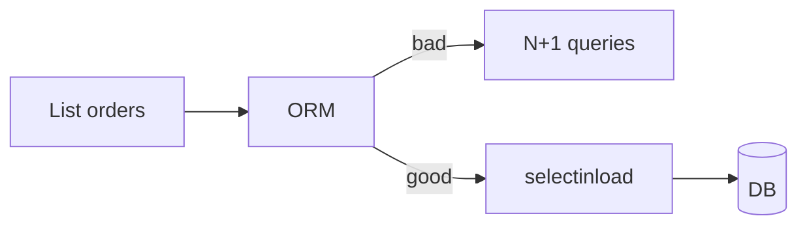
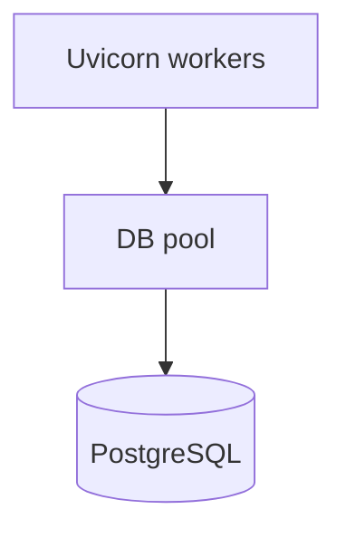

# Pools, Queries, N+1, Payload Size, and Streaming

## 1. Metadata and prerequisites

- Topic IDs: D09-T11, D09-T12, D09-T13, D09-T14, D09-T15
- Domain: 9, Caching and Performance
- Difficulty: Advanced
- Prerequisites: D06-T14, D22-T07, D22-T15
- Learning objectives:
  - Tune connection pools and database queries for API latency.
  - Eliminate N+1 patterns; shrink and stream large responses.
- Related topic IDs: D22-T08, D18-T19, D28-T05
- Estimated complexity: high
- Completion status: DRAFT
- Verification: Examples unverified; no benchmark numbers invented.

## 2. Introduction and fundamentals

### D09-T11 Connection pooling

**Definition.** A pool reuses open TCP connections to the database instead of connecting per request.

**Problem.** Too few connections queue requests; too many exhaust PostgreSQL `max_connections`.

**Mechanism.** SQLAlchemy `pool_size`, `max_overflow`, `pool_pre_ping`. Size ≈ `(workers × expected concurrent DB ops per request)` with headroom. Async pools still bounded.

**Misconception.** "One connection per request always." Pool multiplexes across await points.

**Production rule.** Align pool with worker count; monitor pool checkout wait time.

### D09-T12 Database query optimization

**Definition.** Queries return only needed columns/rows with index support.

**Problem.** `SELECT *` on wide tables; missing index on filter columns used by API.

**Mechanism.** Explain analyze slow endpoints; composite indexes matching `WHERE tenant_id AND created_at`; avoid functions on indexed columns in predicates.

**Misconception.** "ORM is always slow." Bad queries are slow.

**Production rule.** Log queries exceeding threshold in staging; index review for new filters (D06-T14).

### D09-T13 N+1 query problems

**Definition.** Loading N parent rows triggers N additional queries for related objects.

**Problem.** List 100 orders each lazy-loads lines → 101 queries.

**Mechanism.** `selectinload`, `joinedload` in SQLAlchemy; batch `WHERE id IN (...)`; DataLoader pattern in GraphQL contexts.

**Misconception.** "Async fixes N+1." It parallelizes pain, not eliminates it.

**Production rule.** Integration test asserting query count on list endpoints.

### D09-T14 Response size optimization

**Definition.** Reduce bytes on the wire via field selection, pagination, and sparse representations.

**Problem.** Mobile clients download megabyte JSON with unused nested graphs.

**Mechanism.** Pagination (D06); `fields` sparse fieldsets; omit nulls if contract allows; compress (D09-T10).

**Misconception.** "Smaller JSON always faster." CPU for serialization matters too.

**Production rule.** Cap default page size; document max `limit`.

### D09-T15 Streaming responses

**Definition.** Send body incrementally with `StreamingResponse` instead of buffering entire payload.

**Problem.** Export 1M rows loads RAM; timeouts on single buffer build.

**Mechanism.** Async generator yielding CSV/NDJSON chunks; backpressure via async iteration; set `Content-Type` appropriately.

**Misconception.** "Streaming removes need for pagination." Clients may still need bounded chunks.

**Production rule.** Stream exports; keep transactional consistency defined (snapshot cursor).

## 3. Internal workings



## 4. Architecture diagrams



Worker processes hold separate pools per process—total connections = workers × pool_size (approx).

## 5. Code and implementation

Unverified.

```python
from fastapi.responses import StreamingResponse

async def export_rows():
    async def gen():
        yield "id,name\n"
        async for row in repo.iter_users():
            yield f"{row.id},{row.name}\n"
    return StreamingResponse(gen(), media_type="text/csv")
```

## 6. API contracts

| Endpoint | Pattern |
| --- | --- |
| GET list | `limit` max 100 |
| GET export | `text/csv` stream |

## 7. Production considerations

**Mandatory:** Pool limits; pagination; N+1 tests; export streaming.

**Optional:** Read replicas for reports.

## 8. Comparison and tradeoffs

| Approach | RAM | Latency to first byte |
| --- | --- | --- |
| Buffer full JSON | High | High |
| Stream | Low | Low |
| Heavy join | DB cost | Lower round trips |

## 9. Debugging and troubleshooting

**Symptom:** DB CPU high, simple list slow. **Cause:** N+1. **Fix:** Eager load.

**Symptom:** `too many connections`. **Cause:** Workers × pool > PG limit. **Fix:** PgBouncer; reduce pool.

## 10. Interview preparation

**Q.** What is N+1?  
**Model answer.** One query for collection plus one per item for relations; fix with eager/batch loading.  
**Incorrect.** "Network is slow."

## 11. Exercises and mastery assessment

1. Size pool for 8 workers, 5 concurrent DB ops max.
2. Spot N+1 in pseudocode loop.
3. When stream vs paginate JSON?

**Solutions.**

1. Start ~40 connections max to DB across fleet—divide by replicas; use PgBouncer.
2. `for o in orders: o.lines` inside loop.
3. Stream huge exports; paginate interactive APIs.

**Mastery checklist.**

- [ ] Pool sizing factors.
- [ ] N+1 detection.
- [ ] Streaming use case.

**Revision summary.** Pools and indexed queries underpin API speed; kill N+1; paginate and stream when payloads grow.
