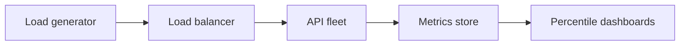
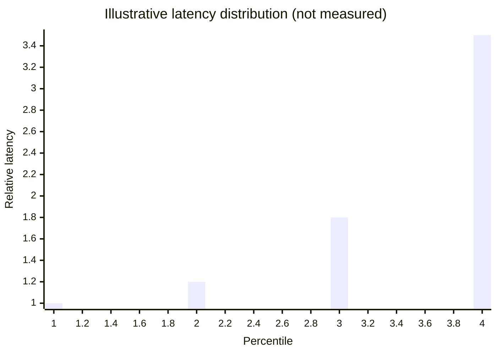

# Latency, Throughput, and Load Testing

## 1. Metadata and prerequisites

- Topic IDs: D09-T16, D09-T17, D09-T18
- Domain: 9, Caching and Performance
- Difficulty: Advanced
- Prerequisites: D08-T20, D28-T18
- Learning objectives:
  - Interpret p50, p95, p99 latency percentiles.
  - Relate throughput, concurrency, and saturation.
  - Plan load and stress tests without fake metrics.
- Related topic IDs: D26-T19, D11-T15
- Estimated complexity: medium
- Completion status: DRAFT
- Verification: Concepts only; no invented throughput numbers.

## 2. Introduction and fundamentals

### D09-T16 Latency percentiles: p50, p95, p99

**Definition.** p95 latency is the value below which 95% of requests complete; tail percentiles expose outliers.

**Problem.** Mean latency hides slow 1% that dominate user perception and SLO breaches.

**Mechanism.** Histogram metrics in Prometheus/OpenTelemetry; report per endpoint; compare canary vs baseline. p50 = median; p99 = worst typical user experience excluding extreme outliers.

**Misconception.** "Average 100ms means everyone gets 100ms." Long tail matters.

**Production rule.** SLO on p95 or p99, not mean; segment by tenant tier if needed.

### D09-T17 Throughput and concurrency

**Definition.** Throughput is successful requests per second; concurrency is in-flight requests at once (Little's Law: `L = λ × W`).

**Problem.** Raising concurrency without throughput gain signals saturation (CPU, pool, lock).

**Mechanism.** Load test ramp RPS until error rate or latency SLO breaks; note knee of curve. Async increases concurrency but not CPU-bound throughput.

**Misconception.** "More workers always linearly scale." Shared DB becomes bottleneck.

**Production rule.** Measure saturation point before production marketing events.

### D09-T18 Load testing and stress testing

**Definition.** Load test validates expected traffic; stress test pushes beyond limits to find breaking mode.

**Problem.** Testing only on laptop with SQLite misrepresents production PostgreSQL latency.

**Mechanism.** Tools: k6, Locust, hey—script realistic mixes (read-heavy), warm caches, seed data volume. Stress until `503` or pool exhaustion; observe recovery. Do not publish fabricated RPS claims.

**Misconception.** "Hello-world `/health` RPS equals API RPS." Business endpoints differ.

**Production rule.** Test in staging with anonymized prod-like data size; include auth and DB.

## 3. Internal workings



## 4. Architecture diagrams



Diagram is conceptual only—not measured data from any system.

## 5. Code and implementation

Unverified.

```bash
# Example k6 script invocation — adjust targets in your environment
k6 run --vus 50 --duration 5m script.js
```

## 6. API contracts

Document expected latency class per endpoint tier in internal runbooks—not as marketing SLAs unless measured.

## 7. Production considerations

**Mandatory:** Histogram metrics; load test before major launches; avoid sharing unverified benchmarks.

**Optional:** Continuous load in CI smoke (low VU).

## 8. Comparison and tradeoffs

| Test type | Goal | Risk |
| --- | --- | --- |
| Load | Validate SLO | Misses rare paths |
| Stress | Find limits | May affect staging |
| Soak | Memory leaks | Long runtime |

## 9. Debugging and troubleshooting

**Symptom:** p99 spike hourly. **Cause:** Cron job colliding. **Fix:** Schedule isolation.

**Symptom:** Throughput flat as VUs rise. **Cause:** DB saturation. **Fix:** Query/index; scale DB.

## 10. Interview preparation

**Q.** p95 vs average?  
**Model answer.** p95 captures tail; average is dominated by outliers unevenly.  
**Incorrect.** "p95 is max."

## 11. Exercises and mastery assessment

1. Little's Law given λ and W.
2. Choose SLO percentile for checkout.
3. Load test checklist items.
4. **Debugging:** p50 good, p99 bad—hypotheses?
5. Why not cite hello-world RPS in handbook?

**Solutions.**

1. L = λ × W.
2. p99 or p95 on payment path.
3. Realistic data, auth, warm-up, monitor DB, define abort criteria.
4. GC pauses, slow queries, lock contention, noisy neighbor.
5. Unrepresentative; misleads capacity planning.

**Mastery checklist.**

- [ ] Define p95.
- [ ] Throughput vs concurrency.
- [ ] Load vs stress.

**Revision summary.** Watch tail latencies; relate load to concurrency with Little's Law; load-test realistic paths and report only measured results.
