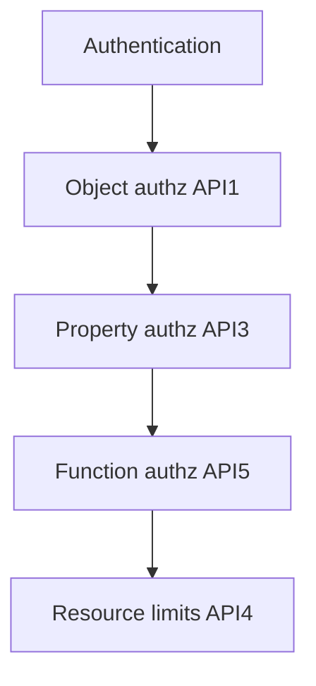
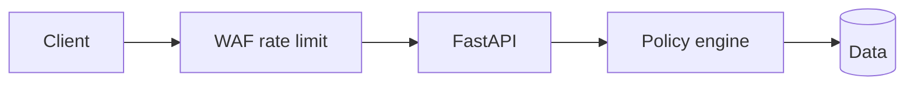

# OWASP API Security Top 10: Access and Consumption

## 1. Metadata and prerequisites

- Topic IDs: D10-T01, D10-T02, D10-T03, D10-T04, D10-T05, D10-T06
- Domain: 10, API Security
- Difficulty: Advanced
- Prerequisites: D07-T01, D07-T14, D08-T09
- Learning objectives:
  - Map OWASP API Security Top 10 (2023) to concrete API controls.
  - Mitigate BOLA, broken authentication, property-level auth gaps, resource consumption, function-level auth gaps, and sensitive business-flow abuse.
- Related topic IDs: D27-T01, D07-T11, D08-T11
- Estimated complexity: high
- Completion status: DRAFT
- Verification: [OWASP API Security Top 10 2023](https://owasp.org/API-Security/editions/2023/en/); examples unverified.

## 2. Introduction and fundamentals

### D10-T01 OWASP API Security Top 10

**Definition.** OWASP's 2023 list ranks prevalent API risk categories with guidance for detection and prevention.

**Problem.** Teams treat a WAF checklist as complete security while missing authorization on object ids.

**Mechanism.** Honest mapping of all ten (2023 edition):

| ID | Risk | Handbook focus |
| --- | --- | --- |
| API1:2023 | Broken Object Level Authorization | D10-T02, D07-T14 |
| API2:2023 | Broken Authentication | D10-T03, D07-T16 |
| API3:2023 | Broken Object Property Level Authorization | D10-T04 |
| API4:2023 | Unrestricted Resource Consumption | D10-T05, D08-T09 |
| API5:2023 | Broken Function Level Authorization | D10-T06 |
| API6:2023 | Unrestricted Access to Sensitive Business Flows | D10-T06 (flows) |
| API7:2023 | Server Side Request Forgery (SSRF) | D10-T07 (next chapter) |
| API8:2023 | Security Misconfiguration | D10-T16, headers chapter |
| API9:2023 | Improper Inventory Management | Shadow APIs, versioning |
| API10:2023 | Unsafe Consumption of APIs | Validate third-party responses |

**Misconception.** "Top 10 is exhaustive." It prioritizes; threat modeling still required.

**Production rule.** Annual control review mapped to each API1–API10 item with test evidence.

### D10-T02 Broken Object Level Authorization (BOLA)

**Definition.** API fails to verify that the authenticated subject may access the specific object identified in the request (IDOR).

**Problem.** `GET /users/123` with attacker token for user 456 changes id to 123.

**Mechanism.** Server-side lookup with `owner_id` and `tenant_id`; deny by default; consistent `404`/`403` policy.

**Misconception.** "Authentication prevents BOLA." Valid token for user A does not block access to user B's objects.

**Production rule.** Automated tests that swap ids across users must fail.

### D10-T03 Broken Authentication

**Definition.** Weak credential recovery, missing rate limits, JWT `alg=none`, or session fixation let attackers impersonate users.

**Problem.** Login without lockout; long-lived tokens; passwords logged.

**Mechanism.** Slow password hashes; MFA for sensitive accounts; validate JWT `alg`, `exp`, `aud`, `iss`; reject `alg=none`; short sessions; generic login errors.

**Misconception.** "OAuth means auth is solved." Misconfigured clients and tokens still break authentication.

**Production rule.** Authentication is not authorization—both required.

### D10-T04 Broken Object Property Level Authorization

**Definition.** Caller can read or write object fields they should not (`role`, `balance`, `is_admin`) via mass assignment or over-exposed GET.

**Problem.** PATCH accepts `{"is_admin": true}`; response includes internal `cost_price`.

**Mechanism.** Separate DTOs for read vs write; allow-list patchable fields; response models strip internal columns (Pydantic `response_model`).

**Misconception.** "Hide field in docs." Attackers send fields anyway.

**Production rule.** Schema allow-lists server-side; never trust client field filtering.

### D10-T05 Unrestricted Resource Consumption

**Definition.** Attackers trigger expensive work—large payloads, unbounded queries, regex DoS, file generation—without limits.

**Problem.** `limit=999999` on list; zip bomb upload; report endpoint without quota.

**Mechanism.** Rate limits, body size caps, pagination max, query timeouts, per-tenant quotas (D08-T09–T12).

**Misconception.** "Cloud auto-scales so cost is fine." Bills and outages still happen.

**Production rule.** Expensive endpoints require stricter limits and auth.

### D10-T06 Broken Function Level Authorization

**Definition.** User accesses admin or privileged functions (`DELETE /admin/users`, internal debug routes) without proper role checks.

**Problem.** Hidden routes discovered via OpenAPI leak or guess `/v1/internal/reset`.

**Mechanism.** RBAC on every route; deny by default; separate admin router with network policy; block function-level gaps even when object checks pass.

**Misconception.** "Security through obscurity on URL." Scanners find routes.

**Production rule.** Authorization policy tests per role matrix.

**Sensitive business flows (API6:2023):** Flows like password reset, checkout, gift-card redemption need step-up, velocity limits, and bot detection—not just CRUD authz.

## 3. Internal workings



## 4. Architecture diagrams



## 5. Code and implementation

Unverified.

```python
class UserUpdate(BaseModel):
    display_name: str | None = None
    # is_admin intentionally absent

class UserPublic(BaseModel):
    id: int
    display_name: str
```

## 6. API contracts

Admin routes require `admin` scope; return `403` not `404` if policy exposes existence to admins only—document choice.

## 7. Production considerations

**Mandatory:** BOLA tests; auth rate limits; response model filtering; function-level RBAC; consumption limits.

**Optional:** Bot management on sensitive flows.

## 8. Comparison and tradeoffs

| Risk | Primary control | Testing |
| --- | --- | --- |
| BOLA | Ownership filter | Horizontal id swap |
| Broken auth | Token validation | Negative login tests |
| Property | Write allow-list | PATCH fuzz |
| Consumption | Quotas | Load test |
| Function | RBAC | Role matrix |

## 9. Debugging and troubleshooting

**Symptom:** Researcher reports IDOR. **Cause:** Missing tenant filter on one endpoint. **Fix:** Central repository helper; add regression test.

## 10. Interview preparation

**Q.** Authentication vs authorization in BOLA context?  
**Model answer.** Auth proves identity; BOLA is authorization failure on object id.  
**Incorrect.** "BOLA is broken login."

**Q.** API3 vs API1?  
**Model answer.** API1 is access to object; API3 is access to specific properties on object user can partially access.

## 11. Exercises and mastery assessment

1. Map your API routes to API1–API6 controls.
2. Write BOLA test case.
3. PATCH attack payload for privilege escalation.
4. **Debugging:** OpenAPI shows admin route publicly.
5. List API7–API10 one-line each.

**Solutions.**

1. Table per route with mitigations.
2. User A token GET user B resource → expect 403/404.
3. `{"is_admin": true}` must be ignored/rejected.
4. Restrict `/openapi.json` in prod or filter routes.
5. SSRF; misconfig; inventory; unsafe third-party API use.

**Mastery checklist.**

- [ ] All ten 2023 items named.
- [ ] Authn ≠ authz.
- [ ] BOLA vs property-level.

**Revision summary.** OWASP API Top 10 frames recurring failures—object and function authorization, auth weaknesses, property exposure, and resource abuse—addressed with server-side checks and tests, not documentation alone.
