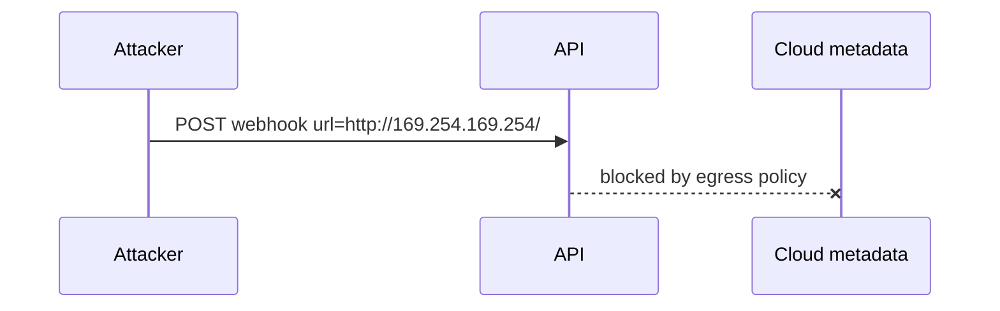
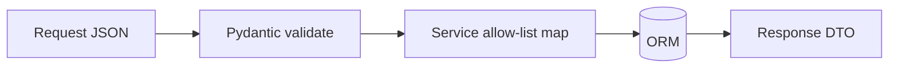

# SSRF, Injection, Mass Assignment, and Data Exposure

## 1. Metadata and prerequisites

- Topic IDs: D10-T07, D10-T08, D10-T09, D10-T10, D10-T11
- Domain: 10, API Security
- Difficulty: Advanced
- Prerequisites: D05-T04, D10-T01, D14-T21
- Learning objectives:
  - Block SSRF in URL-fetching features.
  - Prevent injection and mass assignment.
  - Limit excessive data exposure via schemas and queries.
- Related topic IDs: D27-T09, D23-T11, D05-T19
- Estimated complexity: high
- Completion status: DRAFT
- Verification: OWASP API7; examples unverified.

## 2. Introduction and fundamentals

### D10-T07 Server-Side Request Forgery (SSRF)

**Definition.** Attacker induces server to request internal or arbitrary URLs (`http://169.254.169.254/`, `file://`).

**Problem.** Webhook tester, PDF renderer, import-from-URL features become port scanners.

**Mechanism.** Allow-list destinations; block private IP ranges and link-local; resolve DNS and re-check IP; no redirects to internal hosts; separate network segment for fetchers.

**Misconception.** "Only POST bodies matter." Query param `url=` is classic vector.

**Production rule.** Deny by default URL fetch; use signed pull from known object storage instead.

### D10-T08 Injection attacks

**Definition.** Untrusted input interpreted as code or query language (SQL, OS command, LDAP, template).

**Problem.** `filter=name'; DROP TABLE--` in raw SQL string.

**Mechanism.** Parameterized queries; ORM binding; no `os.system` with user input; escape only as last resort per context.

**Misconception.** "NoSQL means no injection." JSON operators can inject logic.

**Production rule.** Static analysis for string concatenation in queries; linters in CI.

### D10-T09 Mass assignment

**Definition.** Binding request JSON directly to domain models exposes writable fields like `role` or `account_balance`.

**Problem.** Framework `**kwargs` update on ORM entity from client dict.

**Mechanism.** Pydantic input models with explicit fields; `model_config` extra forbid; map to ORM in service layer field-by-field.

**Misconception.** "PATCH merges safely." Merge must be allow-listed.

**Production rule.** Never `User(**request.json())` from untrusted body.

### D10-T10 Excessive data exposure

**Definition.** API returns more fields than clients need—internal ids, hashes, other users' emails in aggregates.

**Problem.** Mobile app ignores fields but attacker harvests them.

**Mechanism.** `response_model` filtering; separate admin vs public schemas; GraphQL depth limits if used.

**Misconception.** "Clients won't look at extra JSON keys." They will.

**Production rule.** Default minimal representation; expand with `?fields=` only if authorized.

### D10-T11 Input validation and sanitization

**Definition.** Validation enforces type, range, and format; sanitization transforms dangerous content (HTML) when storage/display requires it.

**Problem.** Rejecting nothing; or confusing validation with escaping SQL (use parameters instead).

**Mechanism.** Pydantic validators at boundary; business rules in services; encode output per context (HTML, URL). Validate early; fail with RFC 9457 `422`.

**Misconception.** "Sanitize SQL input strings." Parameterization is the fix.

**Production rule.** Validate all inputs; log validation failures without storing raw secrets.

## 3. Internal workings



## 4. Architecture diagrams



## 5. Code and implementation

Unverified.

```python
from pydantic import BaseModel, ConfigDict, HttpUrl

class WebhookCreate(BaseModel):
    model_config = ConfigDict(extra="forbid")
    target: HttpUrl  # still need SSRF guard beyond type
```

## 6. API contracts

422 for validation; 400 for semantic business rejection; never return stack traces.

## 7. Production considerations

**Mandatory:** Parameterized SQL; SSRF guards; forbid extra fields; response models.

**Optional:** WAF SQLi signatures as belt not suspenders.

## 8. Comparison and tradeoffs

| Defense | Stops | Weakness |
| --- | --- | --- |
| Allow-list URLs | SSRF | Maintenance |
| ORM params | SQLi | Raw SQL bypass |
| response_model | Exposure | Drift if bypassed |

## 9. Debugging and troubleshooting

**Symptom:** Researcher escalated to admin via PATCH. **Cause:** Mass assignment. **Fix:** DTO allow-list.

## 10. Interview preparation

**Q.** SSRF vs XSS?  
**Model answer.** SSRF server requests attacker-chosen URLs; XSS runs script in victim browser.  
**Incorrect.** "Same thing."

## 11. Exercises and mastery assessment

1. SSRF mitigations for import-URL feature.
2. Safe vs unsafe SQL pattern.
3. Design public vs admin user schema.
4. **Debugging:** 500 with SQL in body.
5. extra=forbid vs ignore?

**Solutions.**

1. Allow-list hosts, block RFC1918, no redirects, egress firewall.
2. `WHERE id = %s` with tuple vs f-string.
3. Public: id, name; admin adds flags.
4. Map DB errors to generic 500; log server-side.
5. forbid rejects unknown keys—better for APIs.

**Mastery checklist.**

- [ ] SSRF blocks listed.
- [ ] Mass assignment fix.
- [ ] Parameterized queries.

**Revision summary.** Validate and allow-list at the boundary; never let servers fetch arbitrary URLs; expose minimal fields in responses.
