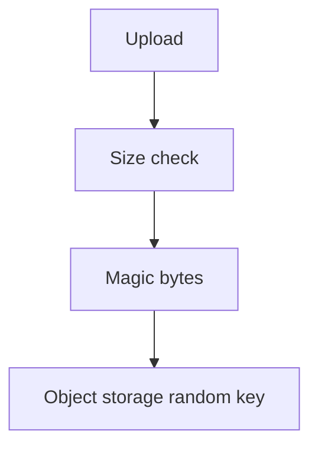
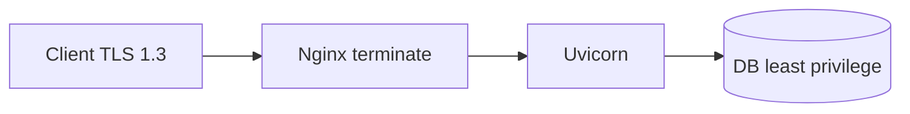

# SQL Injection, Path Traversal, Uploads, Smuggling, and TLS

## 1. Metadata and prerequisites

- Topic IDs: D10-T12, D10-T13, D10-T14, D10-T15, D10-T16
- Domain: 10, API Security
- Difficulty: Advanced
- Prerequisites: D10-T08, D23-T01, D01-T03
- Learning objectives:
  - Prevent SQL injection and path traversal.
  - Validate uploads; understand request smuggling basics.
  - Configure TLS for APIs.
- Related topic IDs: D23-T10, D27-T05, D30-T09
- Estimated complexity: high
- Completion status: DRAFT
- Verification: OWASP guides; RFC 9112 smuggling context; examples unverified.

## 2. Introduction and fundamentals

### D10-T12 SQL injection prevention

**Definition.** SQL injection inserts attacker SQL via unsanitized input concatenated into queries.

**Problem.** Raw f-strings in repository methods bypass ORM safety.

**Mechanism.** SQLAlchemy `text()` with bound parameters; never interpolate user strings into SQL; least-privilege DB user (no `DROP`); ORM query APIs.

**Misconception.** "ORM makes SQLi impossible." `session.execute(f"SELECT ... {x}")` still vulnerable.

**Production rule.** Code review + SAST for SQL string concat; read-only role for reporting queries.

### D10-T13 Path traversal

**Definition.** Attacker uses `../` sequences to read or write files outside intended directory (`GET /files?name=../../etc/passwd`).

**Problem.** Download endpoint joins user filename with base path naively.

**Mechanism.** `pathlib.Path.resolve()` and verify `resolved.is_relative_to(base)`; generate server-side ids; store files outside web root; object storage keys not user-chosen paths.

**Misconception.** "URL encoding blocks traversal." Decode then validate.

**Production rule.** Never pass user input directly to `open()`.

### D10-T14 File upload validation

**Definition.** Uploads checked for size, type, and content—not just `Content-Type` header.

**Problem.** `.exe` renamed `.png`; polyglot files; virus payloads.

**Mechanism.** Max size limits; magic-byte sniffing; virus scan async; store in quarantine bucket; random object keys; disable executable serving.

**Misconception.** "Frontend file input accept=image is enough." Bypass trivial.

**Production rule.** Process uploads in isolated worker; no execution permissions on upload dir.

### D10-T15 Request smuggling fundamentals

**Definition.** HTTP/1.1 ambiguity in `Content-Length` vs `Transfer-Encoding` lets attacker desynchronize front proxy and backend (CL.TE, TE.TE).

**Problem.** Shared infrastructure with legacy proxies vulnerable to cache poisoning or bypassing ACLs.

**Mechanism.** Terminate HTTP/2 at edge; disable backend HTTP/1.1 keep-alive quirks; patch proxies; prefer HTTP/2 end-to-end where possible; reject ambiguous messages.

**Misconception.** "Application framework fixes smuggling alone." Primarily reverse proxy and server config.

**Production rule.** Keep proxies updated; follow vendor hardening guides; monitor for anomalous dual-length requests.

### D10-T16 TLS configuration

**Definition.** TLS encrypts transport; modern configs disable weak ciphers and enforce certificate validation.

**Problem.** TLS 1.0, self-signed without pinning in mobile apps, mixed HTTP content.

**Mechanism.** TLS 1.2+ (prefer 1.3); strong cipher suites; HSTS after HTTPS verified; cert rotation automation; mTLS for high-trust internal APIs.

**Misconception.** "TLS on API is optional behind VPN." Defense in depth still required.

**Production rule.** Scan with ssl labs or testssl in staging; redirect HTTP to HTTPS for public APIs.

## 3. Internal workings



## 4. Architecture diagrams



## 5. Code and implementation

Unverified.

```python
from pathlib import Path

def safe_path(base: Path, name: str) -> Path:
    target = (base / name).resolve()
    if not target.is_relative_to(base.resolve()):
        raise ValueError("path traversal")
    return target
```

## 6. API contracts

Upload: `413` too large; `415` unsupported type; downloads use opaque ids not raw filenames.

## 7. Production considerations

**Mandatory:** TLS 1.2+; parameterized SQL; path checks; upload limits.

**Optional:** WAF; HSTS preload only when ready.

## 8. Comparison and tradeoffs

| Control | Layer | Limit |
| --- | --- | --- |
| TLS | Transport | Does not fix authz |
| ORM params | App | Raw SQL bypass |
| Proxy HTTP/2 | Edge | Smuggling mitigation |

## 9. Debugging and troubleshooting

**Symptom:** Arbitrary file read report. **Cause:** Path join bug. **Fix:** resolve + relative check.

**Symptom:** Smuggling POC in pen test. **Cause:** Old nginx + uvicorn CL mismatch. **Fix:** Upgrade proxy; normalize requests.

## 10. Interview preparation

**Q.** SQLi fix primary?  
**Model answer.** Parameterized queries / ORM binding, not escaping strings.  
**Incorrect.** "Blacklist keywords."

## 11. Exercises and mastery assessment

1. Safe download by id design.
2. Upload validation checklist.
3. TLS minimums for public API.
4. **Debugging:** `Content-Length` mismatch 400 from proxy.
5. DB role permissions for app user.

**Solutions.**

1. Map id → storage key server-side.
2. Size, magic bytes, scan, random key, no exec.
3. TLS 1.2+, strong ciphers, valid public cert.
4. Investigate smuggling; fix proxy config.
5. SELECT/INSERT/UPDATE on app tables only, no superuser.

**Mastery checklist.**

- [ ] Path traversal fix.
- [ ] SQL parameterization.
- [ ] Smuggling is proxy-layer.

**Revision summary.** Transport security and input handling at file and SQL layers close high-impact holes—complement application authz, not replace it.
