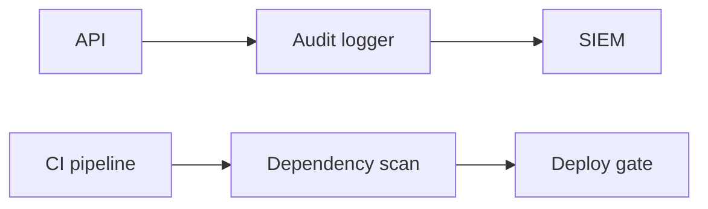
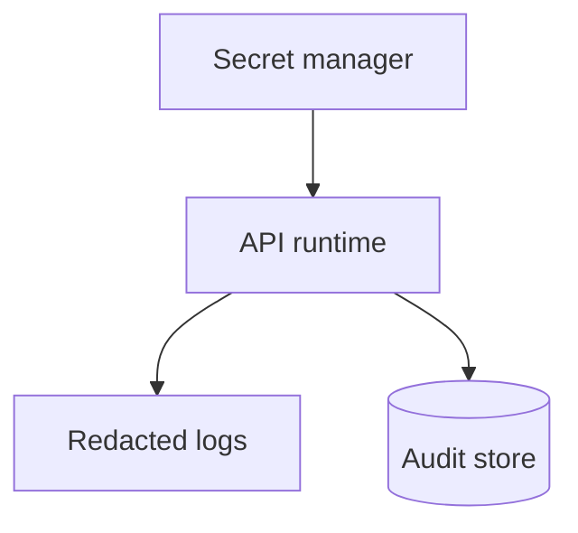

# Headers, Secrets, Audit Logs, and Dependency Scanning

## 1. Metadata and prerequisites

- Topic IDs: D10-T17, D10-T18, D10-T19, D10-T20
- Domain: 10, API Security
- Difficulty: Advanced
- Prerequisites: D07-T18, D05-T19, D29-T04
- Learning objectives:
  - Deploy security headers and TLS-related policies.
  - Protect secrets and PII; maintain audit logs.
  - Scan dependencies for known vulnerabilities (API8/API10 alignment).
- Related topic IDs: D27-T15, D30-T15, D10-T01
- Estimated complexity: medium-high
- Completion status: DRAFT
- Verification: OWASP Secure Headers; examples unverified.

## 2. Introduction and fundamentals

### D10-T17 Security headers

**Definition.** HTTP response headers instruct browsers to enforce policies (CSP, frame denial, MIME sniffing protection).

**Problem.** JSON APIs ignore many browser headers, but hybrid HTML admin panels and OpenAPI UIs need them; misconfigured `Access-Control-*` still matters for browser clients.

**Mechanism.** `Strict-Transport-Security` after HTTPS stable; `X-Content-Type-Options: nosniff`; `Content-Security-Policy` for docs UI; `X-Frame-Options: DENY` or CSP `frame-ancestors`; `Referrer-Policy`. APIs returning JSON still benefit from HSTS at edge.

**Misconception.** "Security headers replace auth." They harden browser context only.

**Production rule.** Set headers at reverse proxy; test with securityheaders.com on public doc sites.

### D10-T18 Secrets and PII protection

**Definition.** Secrets never in repos; PII minimized, encrypted at rest, redacted in logs.

**Problem.** API keys in Git history; logs contain email + password reset token.

**Mechanism.** Secret manager injection; field-level encryption for regulated data; log redaction middleware; data retention policies; GDPR/CCPA processes for export/delete APIs.

**Misconception.** "Encrypt entire DB so we are compliant." Access control and audit still required.

**Production rule.** Classify data; tokenize PAN; never return full SSN in API.

### D10-T19 Audit logging

**Definition.** Append-only records of security-relevant events (login, permission change, data export, admin actions) with who, what, when, source IP.

**Problem.** Logs mutable by attacker with server access; no correlation to incident.

**Mechanism.** Structured JSON to centralized SIEM; WORM storage or cloud audit trails; include `trace_id`; separate security log from debug log; clock sync (NTP).

**Misconception.** "Debug logs are enough." They lack integrity and retention for compliance.

**Production rule.** Log authorization denials at info; never log passwords or bearer tokens.

### D10-T20 Dependency vulnerability scanning

**Definition.** Automated tools (pip-audit, OSV, Dependabot, Trivy on images) flag known CVEs in libraries and base images.

**Problem.** Shipping FastAPI app with vulnerable `openssl` in base image or `requests` CVE.

**Mechanism.** CI gate on critical CVEs; pin versions; SBOM export; patch SLAs; map to OWASP API8 misconfiguration and API10 unsafe consumption of vulnerable SDKs calling third parties.

**Misconception.** "No dependencies means secure." Custom code has bugs too.

**Production rule.** Weekly scan + block deploy on critical unmitigated issues.

## 3. Internal workings



## 4. Architecture diagrams



## 5. Code and implementation

Unverified.

```python
# Middleware sketch — redact Authorization header in logs
SAFE_HEADERS = {"authorization", "cookie", "x-api-key"}
```

```bash
pip-audit -r requirements.txt
```

## 6. API contracts

Audit events: internal schema with `actor`, `action`, `resource`, `outcome`, `trace_id`.

## 7. Production considerations

**Mandatory:** Secret manager; log redaction; audit for admin; CI dependency scan.

**Optional:** CSP report-uri; image signing.

## 8. Comparison and tradeoffs

| Practice | Cost | Benefit |
| --- | --- | --- |
| Verbose audit | Storage | Forensics |
| Strict CVE gate | Dev friction | Fewer known exploits |
| PII minimization | Product work | Lower breach impact |

## 9. Debugging and troubleshooting

**Symptom:** Compliance audit missing admin trail. **Cause:** Admin routes not instrumented. **Fix:** Middleware hook on admin router.

**Symptom:** CVE false positive blocks release. **Cause:** Scanner matches unused module. **Fix:** Document exception with expiry; remove dep.

## 10. Interview preparation

**Q.** What not to log?  
**Model answer.** Passwords, tokens, API keys, full PAN, health data beyond policy.  
**Incorrect.** "Log everything for debug."

## 11. Exercises and mastery assessment

1. Security headers for `/docs` HTML.
2. Audit event fields for role change.
3. PII handling for email in error messages.
4. **Debugging:** Token in access log.
5. Map API8/API9/API10 to controls in this chapter.

**Solutions.**

1. CSP, HSTS, nosniff, frame deny.
2. actor_id, target_user, old_roles, new_roles, timestamp, ip, trace_id.
3. Generic "invalid credentials"; no email enumeration if policy requires.
4. Redact at proxy; rotate token; fix log format.
5. API8 misconfig headers/TLS; API9 inventory OpenAPI; API10 scan third-party SDKs.

**Mastery checklist.**

- [ ] HSTS caveat.
- [ ] Audit vs debug logs.
- [ ] pip-audit in CI.

**Revision summary.** Harden edges with headers and TLS; protect secrets and PII in storage and logs; prove control with audit trails and dependency scanning.
