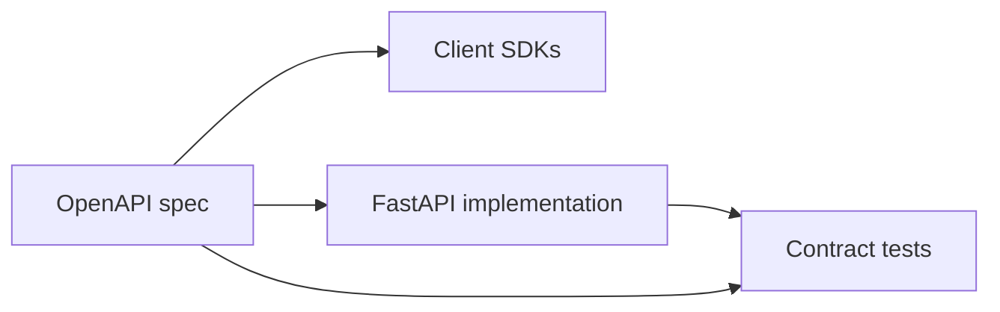
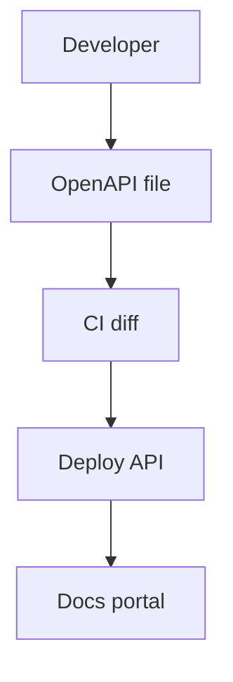

# OpenAPI, Docs UIs, and Contract-First Design

## 1. Metadata and prerequisites

- Topic IDs: D11-T01, D11-T02, D11-T03, D11-T04
- Domain: 11, API Documentation and Testing
- Difficulty: Intermediate
- Prerequisites: D04-T18, D05-T01, D12-T13
- Learning objectives:
  - Author and consume OpenAPI 3.x specifications.
  - Use Swagger UI and ReDoc responsibly in each environment.
  - Treat API contracts as testable agreements; practice contract-first where teams align.
- Related topic IDs: D12-T11, D20-T18, D26-T17
- Estimated complexity: medium
- Completion status: DRAFT
- Verification: OpenAPI 3.1 spec; FastAPI docs; examples unverified.

## 2. Introduction and fundamentals

### D11-T01 OpenAPI Specification

**Definition.** OpenAPI (OAS) is a machine-readable description of HTTP APIs: paths, methods, parameters, request/response schemas, security schemes.

**Problem.** PDF docs drift from production; clients guess field types.

**Mechanism.** YAML/JSON document with `openapi: 3.1.0`, `paths`, `components/schemas`, `securitySchemes`. FastAPI generates from route signatures and Pydantic models. Single source of truth either generated (code-first) or hand-written (contract-first) with CI diff checks.

**Misconception.** "OpenAPI is only for Swagger UI." It powers SDK generation, contract tests, and gateway validation.

**Production rule.** Version OpenAPI artifact in CI; breaking change detection on PR.

### D11-T02 Swagger UI and ReDoc

**Definition.** Swagger UI (`/docs`) and ReDoc (`/redoc`) render interactive documentation from OpenAPI.

**Problem.** Public `/docs` on production exposes attack surface and internal route names.

**Mechanism.** FastAPI `docs_url` and `redoc_url`; disable or protect in production; use separate internal portal. Try-it-out sends real requests—care with prod data.

**Misconception.** "Hide docs means API is secret." Scanners still probe routes.

**Production rule.** Disable or auth-gate docs in prod; never embed production secrets in examples.

### D11-T03 API contracts

**Definition.** A contract is the agreed request/response shape, status codes, error format, auth, and idempotency behavior between provider and consumers.

**Problem.** Undocumented `null` vs missing field breaks mobile clients on upgrade.

**Mechanism.** Document required fields, enums, pagination, RFC 9457 errors, rate limits. Semantic versioning or URL versioning (D04-T21). Consumer-driven contract tests in CI.

**Misconception.** "OpenAPI equals full contract." Behavioral rules (ordering, eventual consistency) live in prose and tests.

**Production rule.** Publish changelog; deprecation headers (`Sunset`, `Deprecation`).

### D11-T04 Contract-first API design

**Definition.** Team writes OpenAPI before implementation; server and clients generate stubs from spec.

**Problem.** Code-first without review lets inconsistent naming ship (`userId` vs `user_id`).

**Mechanism.** Design review on OpenAPI PR; implement FastAPI routes to match or use code generation; validators ensure responses match schema (response validation optional). Hybrid: prototype code-first, freeze OpenAPI at beta.

**Misconception.** "Contract-first slows startups forever." Use proportionally—critical public APIs benefit most.

**Production rule.** Breaking changes require major version bump and consumer notification.

## 3. Internal workings



## 4. Architecture diagrams



## 5. Code and implementation

Unverified.

```python
from fastapi import FastAPI

app = FastAPI(
    title="Orders API",
    version="1.2.0",
    docs_url="/docs" if settings.enable_docs else None,
    redoc_url=None,
)
```

Export schema:

```bash
# Unverified — run in project with app module
python -c "import json; from app.main import app; print(json.dumps(app.openapi()))"
```

## 6. API contracts

Example fragment (illustrative):

```yaml
paths:
  /v1/orders:
    post:
      security: [{ bearerAuth: [] }]
      responses:
        "201":
          description: Created
        "422":
          description: Validation error
components:
  securitySchemes:
    bearerAuth:
      type: http
      scheme: bearer
      bearerFormat: JWT
```

## 7. Production considerations

**Mandatory:** Accurate error schemas; security schemes documented; prod docs policy.

**Optional:** Lint OpenAPI with Spectral rules.

## 8. Comparison and tradeoffs

| Approach | Pros | Cons |
| --- | --- | --- |
| Code-first (FastAPI) | Fast iteration | Drift if not exported to CI |
| Contract-first | Parallel client/server | Upfront design cost |
| Swagger UI | Try requests | Risk on prod |
| ReDoc | Readable reference | Less interactive |

## 9. Debugging and troubleshooting

**Symptom:** Client codegen missing field. **Cause:** `response_model` excludes field. **Fix:** Align OpenAPI export with actual responses.

**Symptom:** `/docs` 404 in prod. **Cause:** Intentionally disabled—use internal env.

## 10. Interview preparation

**Q.** OpenAPI vs implementation source of truth?  
**Model answer.** Team chooses; CI must detect drift either way.  
**Incorrect.** "OpenAPI is always secondary."

## 11. Exercises and mastery assessment

1. List `components` sections you need for JWT API.
2. When disable `/docs`?
3. Breaking vs non-breaking OpenAPI change examples.
4. **Debugging:** Spectral fails `operationId` duplicate.
5. Map contract to RFC 9457 error.

**Solutions.**

1. `securitySchemes`, `schemas`, `responses`.
2. Public production or expose behind VPN auth.
3. Breaking: remove field; non-breaking: add optional field.
4. Rename duplicate operationIds per route.
5. Document `application/problem+json` schema in components.

**Mastery checklist.**

- [ ] OpenAPI generates from FastAPI.
- [ ] Swagger vs ReDoc use case.
- [ ] Contract-first benefit.

**Revision summary.** OpenAPI anchors documentation and automation; protect doc UIs in production; contracts include behavior tests, not just schemas.
