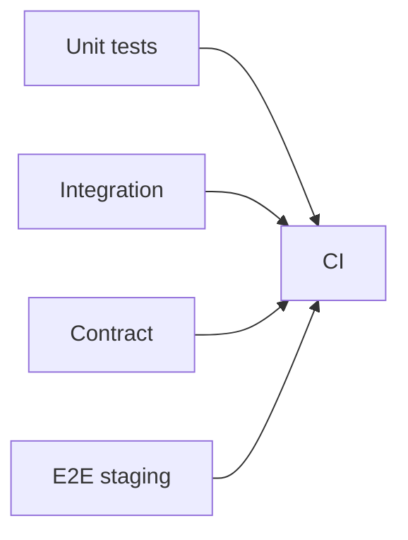

# Unit, Integration, Contract Tests, and API Clients

## 1. Metadata and prerequisites

- Topic IDs: D11-T05, D11-T06, D11-T07, D11-T08, D11-T09, D11-T10, D11-T11
- Domain: 11, API Documentation and Testing
- Difficulty: Intermediate
- Prerequisites: D11-T03, D26-T01
- Learning objectives:
  - Layer unit, integration, E2E, and contract tests appropriately.
  - Use mock servers and API clients (Postman, curl) effectively.
- Related topic IDs: D26-T02, D26-T10, D07-T21
- Estimated complexity: medium-high
- Completion status: DRAFT
- Verification: Examples unverified.

## 2. Introduction and fundamentals

### D11-T05 Unit testing

**Definition.** Unit tests exercise isolated functions or classes with dependencies replaced by fakes.

**Problem.** Testing only happy-path serializers misses authorization math in policy functions.

**Mechanism.** pytest; test `can_delete(user, order)` without HTTP; fast, no network. Mock DB only at repository boundary when testing services.

**Misconception.** "Unit tests replace API tests." They complement.

**Production rule.** High coverage on policy and pricing logic; keep tests deterministic.

### D11-T06 Integration testing

**Definition.** Integration tests run application stack with real ASGI app, database (often test DB), and HTTP via `TestClient` or `httpx.ASGITransport`.

**Problem.** Tests share DB state causing flakes.

**Mechanism.** Transaction rollback fixtures; separate test database; `dependency_overrides` for auth. Hit `/v1/orders` and assert status + JSON.

**Misconception.** "Integration means full production k8s." Scope varies—DB + app is common middle ground.

**Production rule.** Run integration suite in CI on every PR.

### D11-T07 End-to-end testing

**Definition.** E2E tests traverse multiple deployed services as users would (browser or mobile + API + workers).

**Problem.** Slow, flaky, expensive—teams skip until late.

**Mechanism.** Staging environment; seed data; smoke critical journeys (signup, purchase). Fewer tests, high value paths.

**Misconception.** "E2E covers all edge cases." Use pyramid—many unit, fewer E2E.

**Production rule.** Nightly E2E; block release on smoke failure.

### D11-T08 Contract testing

**Definition.** Consumer and provider verify responses match agreed schema (Pact, OpenAPI response validation, schemathesis).

**Problem.** Server adds required field without notice breaks mobile app v1.

**Mechanism.** Provider publishes OpenAPI; consumer tests against mock from spec; CI validates live responses against schema (optional in staging). Breaking change fails build.

**Misconception.** "Contract test is same as unit test." Contract is cross-team boundary.

**Production rule.** Store OpenAPI in artifact registry per release tag.

### D11-T09 Mock servers

**Definition.** Stub HTTP servers return canned responses from OpenAPI examples for parallel client development.

**Problem.** Mocks drift from real API behavior.

**Mechanism.** Prism, WireMock, or `pytest-httpx` fixtures; regenerate from same OpenAPI as server. Mark unverified behaviors clearly.

**Misconception.** "Mocks eliminate integration tests." They front-load only.

**Production rule.** Regenerate mocks when OpenAPI version bumps.

### D11-T10 Postman or equivalent API clients

**Definition.** GUI/CLI collections document requests, environments, and shared tests for manual and Newman CI runs.

**Problem.** Collections rot without version control.

**Mechanism.** Export collection JSON to git; variables for `base_url` and `token`; pre-request scripts for OAuth token fetch (no real secrets in repo—use env).

**Misconception.** "Postman is only for QA manual clicks." Newman automates collections.

**Production rule.** Separate collections per environment; never commit production tokens.

### D11-T11 curl for request testing

**Definition.** `curl` reproduces HTTP requests in terminals and scripts for quick debugging.

**Problem.** Missing headers (`Authorization`, `Content-Type`) cause false negatives.

**Mechanism.** `curl -v -H "Authorization: Bearer change-me" -H "Content-Type: application/json" -d '{}' https://api.example/v1/items`. Use `-i` for headers, `--http2` when testing H2.

**Misconception.** "curl success means browser works." CORS and cookies differ.

**Production rule.** Redact tokens when sharing command transcripts.

## 3. Internal workings

```mermaid
pyramid
  title Test pyramid (conceptual)
  "E2E" : 1
  "Integration" : 3
  "Unit" : 9
```

## 4. Architecture diagrams



## 5. Code and implementation

Unverified.

```python
from fastapi.testclient import TestClient
from app.main import app

client = TestClient(app)

def test_create_order(auth_headers):
    r = client.post("/v1/orders", json={"sku": "A1"}, headers=auth_headers)
    assert r.status_code == 201
```

```bash
curl -sS -X POST "https://api.example/v1/orders" \
  -H "Authorization: Bearer change-me" \
  -H "Content-Type: application/json" \
  -d "{\"sku\":\"A1\"}"
```

## 6. API contracts

Tests assert status, schema, and headers (`Location` on 201, `Retry-After` on 429).

## 7. Production considerations

**Mandatory:** CI integration tests; contract check on OpenAPI; secrets via CI vars.

**Optional:** Pact broker; schemathesis fuzz in staging.

## 8. Comparison and tradeoffs

| Layer | Speed | Confidence |
| --- | --- | --- |
| Unit | Fast | Local logic |
| Integration | Medium | Handler + DB |
| Contract | Medium | Cross-team |
| E2E | Slow | Full path |

## 9. Debugging and troubleshooting

**Symptom:** Passes locally, fails CI. **Cause:** SQLite vs PostgreSQL difference. **Fix:** CI uses same DB engine as prod.

**Symptom:** Contract test false positive. **Cause:** Optional field marked required in spec. **Fix:** Fix OpenAPI.

## 10. Interview preparation

**Q.** Integration vs E2E?  
**Model answer.** Integration tests one service with real dependencies; E2E crosses multiple deployed systems.  
**Incorrect.** "Same thing."

## 11. Exercises and mastery assessment

1. Choose test layer for password hash function.
2. Design TestClient fixture with DB rollback.
3. Newman run in CI outline.
4. **Debugging:** Flaky 409 on parallel tests.
5. curl to test conditional GET with ETag.

**Solutions.**

1. Unit only.
2. `yield` session; rollback in teardown.
3. `newman run collection.json --env-var base_url=...`.
4. Shared idempotency keys—isolate data per test.
5. First GET `-D -`, second `-H 'If-None-Match: "tag"'`.

**Mastery checklist.**

- [ ] Pyramid layers.
- [ ] Contract vs integration.
- [ ] curl vs browser limits.

**Revision summary.** Unit tests secure logic; integration and contract tests secure HTTP boundaries; E2E validates journeys; clients and curl accelerate debugging when collections stay versioned.
