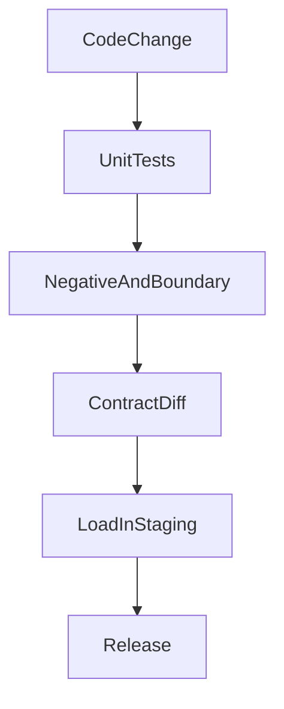

# Negative, Boundary, Load, Compatibility, and Regression Tests

## 1. Metadata and prerequisites

- Topic IDs: D11-T12, D11-T13, D11-T14, D11-T15, D11-T16, D11-T17
- Domain: 11, API Documentation and Testing
- Difficulty: Advanced
- Prerequisites: D11-T05, D11-T06, D03-T14, D08-T20
- Learning objectives:
  - Design tests that prove rejection, edges, and compatibility, not only the happy path.
  - Describe load tests without inventing numbers.
  - Keep a regression test when a bug fixes a contract.
- Related topic IDs: D26-T04, D28-T18, D04-T22
- Estimated complexity: medium
- Completion status: TECHNICALLY_REVIEWED
- Verification: testing concepts only. No load tool was executed for this chapter.

## 2. Introduction and fundamentals

### D11-T12 Authentication testing

Authentication tests cover missing credentials (`401`), a bad token (`401`), an expired token (`401`), and a valid token. They do not stop there. A second suite uses a valid token for the wrong object and expects `404` or `403` according to the contract. That second suite is authorization. A test named "auth" that only checks login is incomplete.

Use dependency overrides or a real token minted with the test secret. Do not point tests at a production identity provider.

### D11-T13 Negative testing

A negative test sends a request that must fail: wrong type, unknown field if you reject extras, missing required field, wrong method, unsupported media type. Assert the status code and the error schema. Assert that the database did not change. A handler that returns `200` after a failed insert is a product bug the negative test should catch.

### D11-T14 Boundary testing

Boundaries are the edges of documented limits: string length equal to the max, one past the max, `limit=1`, `limit=100`, `limit=101`, quantity `0` and `1`, empty lists, Unicode, and the maximum body size. Off-by-one errors live here. Include the monetary or decimal edge your schema allows, such as the smallest positive price.

### D11-T15 Load testing

A load test applies a stated concurrency and a stated scenario (read list, create order) against a stated environment. Record p50, p95, p99, error rate, and saturation (CPU, pool wait, database). Do not publish a number from a laptop as the production capacity. A stress test keeps increasing load until errors or latency collapse. A soak test runs a moderate load for a long time to find leaks.

This handbook does not include a measured result. Add one only after you run the tool and store the report.

### D11-T16 Backward compatibility tests

Consumer-driven checks freeze a response from the previous version and replay it against the new build, or they diff the OpenAPI document. Compatible changes add optional fields. Incompatible changes remove fields, change types, or change status codes. The test fails the build on an incompatible diff unless the version was intentionally bumped and the old contract is still served.

### D11-T17 API regression testing

A regression test is a permanent test for a bug that escaped. It names the incident in a comment or the test name and asserts the corrected behavior. Delete it only when the feature itself is removed. Snapshot tests of entire payloads are brittle. Assert the field that broke.

## 3. Internal workings



Load tests usually do not run on every commit. They run on a schedule or before a capacity-sensitive release. Negative tests run on every commit.

## 4. Architecture diagrams

Keep production data out of the path. Load tests use a staging dataset or synthetic rows. A test that "cleans up production" is not a test. It is an incident.

## 5. Code and implementation

Illustrative pytest. Unverified.

```python
import pytest

@pytest.mark.parametrize("quantity", [0, 101])
def test_quantity_bounds(client, quantity):
    response = client.post("/orders", json={"items": [{"product_id": 1, "quantity": quantity}]})
    assert response.status_code == 422
```

A compatibility check can be a committed OpenAPI file compared to the generated one. Fail if a required property disappears.

## 6. API contracts

The contract under test is the status code plus the schema. A negative test that only checks `status_code != 200` is weak. `500` would pass that assertion and still be wrong.

## 7. Production considerations

Mandatory: auth failure tests, one authorization test per sensitive read, boundary tests for public limits, and a regression test for each escaped bug you fix.

Optional: scheduled load tests, OpenAPI diff in CI, fuzzing of query parsers.

## 8. Comparison and tradeoffs

| Test | Finds | Does not find |
| --- | --- | --- |
| Negative | Wrong status and dirty writes | Capacity |
| Boundary | Off-by-one limits | Auth logic by itself |
| Load | Saturation and timeouts | Wrong JSON field names |
| Contract diff | Accidental breaking changes | Runtime bugs with the same schema |
| Regression | That specific bug | New bugs in other code |

## 9. Debugging and troubleshooting

**Symptom:** load test reports success while users see timeouts.  
**Cause:** the test hit a mock, a warm cache, or a tiny dataset.  
**Diagnose:** confirm the target URL, cache headers, and row counts.  
**Fix:** point at staging with production-like data and a cold cache for the scenario you care about.  
**Prevent:** write the scenario and the data size in the test report.

## 10. Interview preparation

**Beginner.** What is a negative test?  
**Model answer.** A request that the API must reject, with assertions on the status, the error body, and the absence of a side effect.  
**Incorrect answer.** "Any test that expects an exception in a unit test," which misses the HTTP contract.

**Intermediate.** Why is `401` coverage not BOLA coverage?  
**Model answer.** `401` checks identity. BOLA checks whether identity A can read identity B's object. You need a second user and a real id.  
**Follow-up.** What do you assert for a removed field in a compatible API? The old client still works because the field was optional, or the version changed.

**Scenario.** p99 doubled and the average did not. Which test tells you?  
**Model answer.** A load test that records percentiles, not only the mean. Then a trace of a slow request.

## 11. Exercises and mastery assessment

1. Write three cases for a `limit` parameter documented as 1..100.
2. Why must an order-create negative test check the row count?
3. What belongs in a regression test name?
4. Why is a single latency number from a laptop not a capacity plan?

**Solutions.**

1. `limit=1` succeeds, `limit=100` succeeds, `limit=0` and `limit=101` fail validation.
2. A `422` that still inserts a row is a partial failure. The test must prove the count did not change.
3. The bug or the contract rule, so nobody deletes it as redundant.
4. Hardware, data volume, and concurrency are different. Publish the method with the number or do not publish the number.

**Mastery checklist.**

- Separate authentication tests from authorization tests.
- Cover both sides of each numeric limit.
- Treat load results as measurements with a method, not as slogans.

**Revision summary.** Happy-path tests show the API can work. Negative, boundary, compatibility, and regression tests show it fails in the way the contract promises.

## Flashcards

- Q: What does a boundary test hit? | A: The documented minimum and maximum, and one step past them.
- Q: What makes a load number believable? | A: The scenario, data size, concurrency, environment, and percentile.
