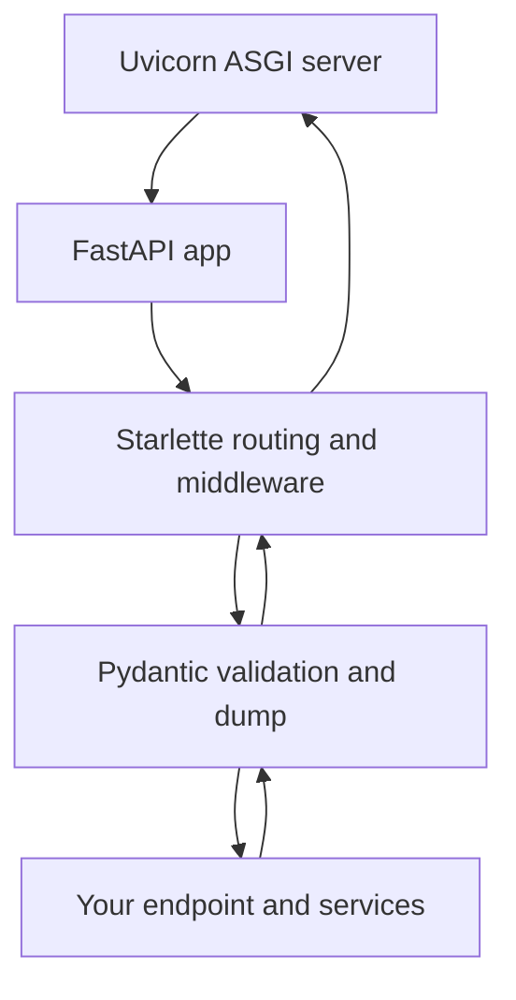
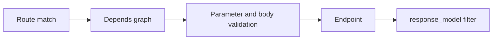

# FastAPI, ASGI, Starlette, and Pydantic

## 1. Metadata and prerequisites

- Topic IDs: D12-T01, D12-T02, D12-T03, D12-T04
- Domain: 12, FastAPI Fundamentals
- Difficulty: Beginner
- Prerequisites: D01-T02, D03-T15, D05-T01
- Learning objectives:
  - State what FastAPI composes and which protocol it speaks.
  - Choose FastAPI versus other Python API stacks for a given constraint.
  - Explain how Starlette routing and Pydantic validation cooperate on one request.
- Related topic IDs: D12-T07, D14-T01, D17-T01, D21-T01
- Estimated complexity: low
- Completion status: DRAFT
- Verification: FastAPI architecture described against public docs mindset as of 2026-10-13. Code snippets are **UNVERIFIED** in this workspace.

## 2. Introduction and fundamentals

### D12-T01 What FastAPI is and when to use it

**Definition.** FastAPI is a Python framework for building HTTP APIs on the ASGI stack. It combines Starlette for HTTP routing, middleware, and WebSocket support with Pydantic for data validation and serialization, and it generates an OpenAPI schema from your type hints and models.

**Mechanism.** You declare routes, parameters, and bodies with Python types. At import time and on first schema build, FastAPI inspects signatures, builds dependency graphs, registers routes on the underlying Starlette application, and attaches validation and response filtering around your endpoint callable.

**Misconception.** FastAPI is not a separate web server. It is application code that an ASGI server (commonly Uvicorn) runs. You still need a process supervisor, reverse proxy, and observability in production.

**Production rule.** Use FastAPI when you want typed contracts, automatic OpenAPI, and async I/O with minimal boilerplate. Prefer a fuller framework when you need batteries-included admin, ORM-centric CRUD scaffolding, or a synchronous-only deployment model you cannot change.

### D12-T02 FastAPI versus Flask versus Django REST Framework

**Definition.** Flask is a WSGI-oriented microframework; Django REST Framework (DRF) is an API layer on Django’s synchronous request cycle. FastAPI targets ASGI and async-first I/O while staying lightweight compared to Django.

**Mechanism.** Flask and classic DRF paths are typically served by WSGI workers (Gunicorn sync/gevent). FastAPI is served by ASGI servers and can run `async def` endpoints that await non-blocking drivers. DRF brings serializers, permissions, and viewsets integrated with Django models; FastAPI leaves persistence and auth patterns to you, with Pydantic as the schema layer.

**Misconception.** “FastAPI is always faster.” Throughput depends on workload, blocking code, database design, and worker count—not the framework logo.

**Production rule.** Pick DRF when the product is already Django-centric. Pick Flask when the team standard is minimal WSGI and you accept more manual validation. Pick FastAPI for greenfield ASGI services where OpenAPI and Pydantic v2 are first-class requirements.

### D12-T03 ASGI versus WSGI

**Definition.** WSGI (PEP 3333) is a synchronous callable interface between a server and a Python web application. ASGI is an async-capable protocol interface that supports HTTP, WebSockets, and lifespan events with `async`/`await`.

**Mechanism.** A WSGI server calls `app(environ, start_response)` per request. An ASGI server drives `await app(scope, receive, send)` where `scope` describes the connection, `receive` yields events, and `send` emits response events. FastAPI’s application object is ASGI-compatible.

**Misconception.** ASGI means “everything is parallel.” One event loop still runs your coroutines; blocking the loop in `async def` stalls all requests on that worker.

**Production rule.** Run FastAPI behind an ASGI server (Uvicorn, Hypercorn, or Uvicorn workers behind Gunicorn). Do not deploy FastAPI as a bare WSGI app without an explicit ASGI-to-WSGI bridge—you lose async semantics and lifespan handling.

### D12-T04 Starlette and Pydantic roles

**Definition.** Starlette provides routing, requests/responses, middleware, background tasks, and test clients. Pydantic provides model validation (`model_validate`), serialization (`model_dump`), and settings. FastAPI wires them: Starlette moves bytes; Pydantic shapes data.

**Mechanism.** Incoming bytes become a Starlette `Request`. FastAPI extracts path, query, header, cookie, and body parameters, runs Pydantic validation, executes dependencies, calls your endpoint, then serializes the return value—often through a `response_model`—back to JSON.

**Misconception.** “Pydantic validates only request bodies.” FastAPI uses Pydantic for query models, response filtering, and settings as well.

**Production rule.** Treat Starlette as the HTTP engine and Pydantic as the contract layer. Keep business rules out of Pydantic models when they belong in a service layer (Domain 15).

## 3. Internal workings

One HTTP `POST` with a JSON body traverses:

1. ASGI server accepts the connection and builds `scope`.
2. Outermost middleware runs (Domain 17), then routing matches a path.
3. FastAPI resolves dependencies (`Depends`), validating nested parameters.
4. Body is parsed; Pydantic `model_validate` runs for the body model.
5. Endpoint runs (`async def` awaited or sync `def` in a thread pool—confirm thread-pool behavior in current FastAPI docs).
6. Return value is filtered/serialized; Starlette sends the response.

Blocking work inside `async def` (CPU-heavy loops, synchronous database drivers) blocks the event loop unless offloaded (Domain 21).

## 4. Architecture diagrams



Dependency ordering for a single request (simplified):



## 5. Code and implementation

Minimal application (**UNVERIFIED**):

```python
from fastapi import FastAPI
from pydantic import BaseModel, ConfigDict

app = FastAPI(title="Handbook API", version="0.1.0")


class ItemCreate(BaseModel):
    model_config = ConfigDict(str_strip_whitespace=True)
    name: str
    price: float


class ItemRead(BaseModel):
    id: int
    name: str
    price: float


@app.post("/items", response_model=ItemRead, status_code=201)
async def create_item(payload: ItemCreate) -> ItemRead:
    # Persistence omitted
    return ItemRead(id=1, name=payload.name, price=payload.price)
```

Run with Uvicorn (**UNVERIFIED** command):

```bash
uvicorn main:app --host 0.0.0.0 --port 8000
```

## 6. API contracts

| Method | Path | Body | Success | Notes |
| --- | --- | --- | --- | --- |
| POST | `/items` | `ItemCreate` JSON | `201` + `ItemRead` | `response_model` drops undeclared fields |

Illustrative curl (**UNVERIFIED**):

```bash
curl -sS -X POST "http://127.0.0.1:8000/items" \
  -H "Content-Type: application/json" \
  -d "{\"name\":\"widget\",\"price\":9.99}"
```

## 7. Production considerations

Mandatory:

- ASGI server with multiple workers for CPU-bound processes; remember workers do not share in-memory state.
- Separate authentication checks from authorization checks (Domain 20).
- Never return ORM internal fields without `response_model` filtering (Domain 18).

Optional:

- Custom OpenAPI metadata and tags for large teams.
- Structured logging at the Starlette middleware layer.

## 8. Comparison and tradeoffs

| Stack | Protocol | Schema story | Best fit |
| --- | --- | --- | --- |
| FastAPI | ASGI | Pydantic + OpenAPI | Typed microservices |
| Flask | WSGI | Manual / extensions | Minimal sync APIs |
| DRF | WSGI (async experimental) | Serializers | Django monolith APIs |

## 9. Debugging and troubleshooting

**Symptom:** app works with `uvicorn main:app` but not behind an old WSGI-only host.  
**Cause:** ASGI mismatch.  
**Fix:** Use an ASGI-capable process model or terminate TLS at a proxy that speaks HTTP/1.1 to Uvicorn.

**Symptom:** validation errors differ between local and CI.  
**Cause:** Pydantic v1 versus v2 or different dependency pins.  
**Fix:** Pin `pydantic>=2` and use `model_validate` / `field_validator` only.

## 10. Interview preparation

**Beginner.** What three libraries does FastAPI build on conceptually?  
**Model answer.** Starlette for ASGI HTTP, Pydantic for validation and serialization, and OpenAPI generation from types and routes. The server (e.g., Uvicorn) is separate.  
**Incorrect answer.** “FastAPI includes its own web server and ORM.”

**Intermediate.** Why is blocking code inside `async def` dangerous?  
**Model answer.** It blocks the event loop for that worker, increasing latency for all concurrent requests on that loop. Sync `def` endpoints may be run in a thread pool, but blocking inside `async def` is not automatically offloaded.  
**Follow-up.** How would you call a synchronous database driver from an async route safely? Offload to a thread pool or use an async driver (Domain 21).

## 11. Exercises and mastery assessment

1. **Conceptual.** Draw the difference between WSGI and ASGI call shapes in one sentence each.
2. **Coding.** Add a `GET /items/{item_id}` that returns `ItemRead` or `404` using `HTTPException` (preview Domain 19).
3. **Design.** Your team knows Django well but needs SSE and async HTTP clients. Argue for or against FastAPI.

**Solutions (sketch).** (1) WSGI: sync callable per request; ASGI: async event stream with scope/receive/send. (2) Use path param `item_id: int` and validate with Pydantic response model. (3) Consider FastAPI if async and OpenAPI are core; consider Django async views if the monolith must stay unified—no universal winner.

**Mastery checklist.**

- [ ] Can explain FastAPI = Starlette + Pydantic + OpenAPI.
- [ ] Can state ASGI versus WSGI deployment consequences.
- [ ] Can name when blocking in `async def` hurts throughput.

**Revision summary.** FastAPI is an ASGI application framework, not a server. Starlette handles HTTP mechanics; Pydantic enforces contracts; Uvicorn (or similar) runs the app. Choose the stack based on deployment protocol and team ecosystem, not slogans.
