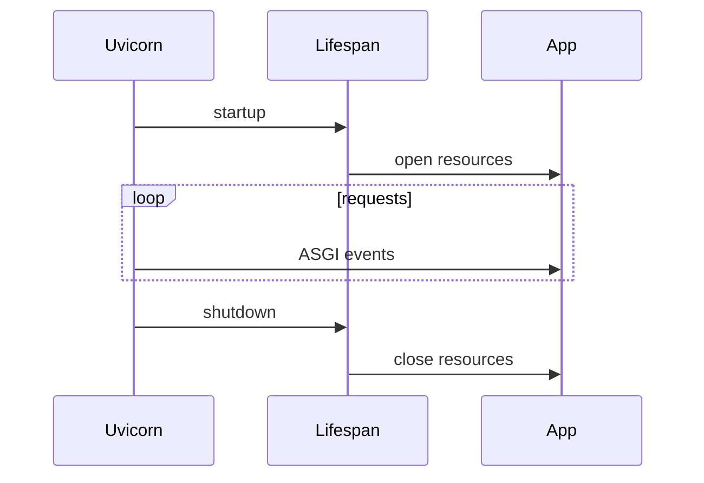

# Creating, Running, and Lifecycling an Application

## 1. Metadata and prerequisites

- Topic IDs: D12-T05, D12-T06, D12-T07, D12-T08, D12-T09, D12-T10
- Domain: 12, FastAPI Fundamentals
- Difficulty: Beginner
- Prerequisites: D12-T01, D12-T03
- Learning objectives:
  - Instantiate a `FastAPI` app and choose an importable entry point.
  - Run Uvicorn in development versus production-shaped commands.
  - Register startup and shutdown hooks without leaking resources.
- Related topic IDs: D25-T01, D29-T01, D30-T10
- Estimated complexity: low
- Completion status: DRAFT
- Verification: Lifespan APIs evolve; confirm against FastAPI docs as of 2026-10-13. Snippets **UNVERIFIED**.

## 2. Introduction and fundamentals

### D12-T05 Creating a FastAPI application

**Definition.** A FastAPI application is an instance of `FastAPI` that holds routes, middleware, exception handlers, and metadata used for OpenAPI.

**Mechanism.** `app = FastAPI()` constructs a Starlette-based ASGI callable. Routers and routes attach via decorators or `include_router`. The object is what Uvicorn imports by module:attribute (e.g., `main:app`).

**Misconception.** You need multiple `FastAPI()` instances for versioning. Often one app with routers and prefixes is enough; multiple apps are for mounts (Domain 25).

**Production rule.** One canonical `app` per deployable service unless you deliberately mount sub-apps. Keep factory functions pure for tests (Domain 15).

### D12-T06 Application entry points

**Definition.** An entry point is the import string the ASGI server uses to load the application callable.

**Mechanism.** Uvicorn loads `package.module:app`, where `app` is the `FastAPI` instance. Packaging tools may expose `__main__.py` that calls `uvicorn.run` for local convenience.

**Misconception.** `if __name__ == "__main__"` blocks belong in production containers. Prefer the server CLI invoking the module path.

**Production rule.** Document the entry point in the Dockerfile `CMD` and keep it stable across environments.

### D12-T07 Uvicorn and ASGI servers

**Definition.** Uvicorn is an ASGI server that runs the FastAPI application, managing sockets, HTTP parsing, and worker processes.

**Mechanism.** Uvicorn binds a port, accepts connections, and forwards ASGI events to `app(scope, receive, send)`. Multi-worker mode forks processes; each worker has its own memory—no shared in-process cache.

**Misconception.** “Uvicorn is part of FastAPI.” It is a separate dependency you install and operate.

**Production rule.** Use Uvicorn (or Hypercorn) behind a reverse proxy for TLS termination. Tune worker count to CPU and blocking profile; confirm flags in current Uvicorn docs.

### D12-T08 Development mode and reload

**Definition.** Reload mode restarts the worker when source files change, accelerating local feedback.

**Mechanism.** Uvicorn watches files and respawns the process. Import side effects rerun; open connections may drop.

**Misconception.** Reload is safe in production. It is not—racey restarts and file watchers belong only on developer machines.

**Production rule.** Never enable `--reload` in production images. Use rolling deploys instead.

### D12-T09 Application startup and shutdown

**Definition.** Startup and shutdown are hooks that run when the ASGI server begins serving and when it stops, used to open pools, clients, and background schedulers.

**Mechanism.** Modern FastAPI favors a lifespan context manager yielding control while the app is live; legacy `@app.on_event` may still appear in older code—verify your pinned FastAPI version.

**Misconception.** Startup runs per request. It runs once per worker process at boot.

**Production rule.** Acquire shared resources in lifespan startup; close them in shutdown. Do not open a new database pool per request.

### D12-T10 Running the application

**Definition.** Running the application means starting an ASGI server process whose sole job is to serve the `FastAPI` callable on a host and port.

**Mechanism.** CLI: `uvicorn main:app --host 0.0.0.0 --port 8000`. Programmatic: `uvicorn.run("main:app", host="0.0.0.0", port=8000)` for scripts only.

**Misconception.** Binding `0.0.0.0` in development is the same as production security posture. It exposes the service on all interfaces—fine in Docker, risky on untrusted networks without a firewall.

**Production rule.** Bind behind the proxy network namespace; enforce TLS and auth at the edge.

## 3. Internal workings

Worker boot sequence:

1. Parent Uvicorn loads settings and forks workers (if configured).
2. Each worker imports `main:app`, executing module-level code.
3. Lifespan startup runs: connect pools, warm caches (per worker only).
4. Server accepts traffic; each request follows Domain 12 chapter 1 path.
5. On SIGTERM, graceful shutdown stops accepting, drains in-flight requests, runs lifespan shutdown.

## 4. Architecture diagrams



## 5. Code and implementation

Factory with lifespan (**UNVERIFIED**):

```python
from contextlib import asynccontextmanager
from collections.abc import AsyncIterator

from fastapi import FastAPI


@asynccontextmanager
async def lifespan(app: FastAPI) -> AsyncIterator[None]:
    app.state.http_client = "placeholder-client"
    yield
    app.state.http_client = None


def create_app() -> FastAPI:
    app = FastAPI(lifespan=lifespan)
    return app


app = create_app()
```

Entry module pattern (**UNVERIFIED**):

```python
# main.py — import string main:app
from myservice.factory import create_app

app = create_app()
```

## 6. API contracts

This chapter is operational, not a public HTTP contract. Document internally:

| Concern | Contract |
| --- | --- |
| Health | `GET /health` returns `200` when process is up (Domain 25) |
| Readiness | Includes dependency checks when you add them |

## 7. Production considerations

Mandatory:

- Graceful shutdown on SIGTERM with proxy drain timeouts aligned.
- Configuration via environment variables (D12-T16), not hard-coded secrets.
- One worker’s in-memory cache is invisible to other workers—use Redis for shared state.

Optional:

- `gunicorn -k uvicorn.workers.UvicornWorker` for mature process management.

## 8. Comparison and tradeoffs

| Mode | Pros | Cons |
| --- | --- | --- |
| Single worker | Simple debugging | No parallelism across cores |
| Multi-worker Uvicorn | Uses multiple CPUs | Per-worker memory; sticky sessions not automatic |
| Reload | Fast local iteration | Unsafe in prod |

## 9. Debugging and troubleshooting

**Symptom:** changes not reflected locally.  
**Cause:** reload off or wrong module path.  
**Fix:** `uvicorn main:app --reload` and verify you edit the imported module.

**Symptom:** database “too many connections” after deploys.  
**Cause:** pool per worker without limit math.  
**Fix:** `pool_size * workers <= database max_connections`.

## 10. Interview preparation

**Beginner.** What does `uvicorn main:app` mean?  
**Model answer.** Run Uvicorn with the ASGI app object named `app` inside module `main`.  
**Incorrect answer.** “It starts Flask.”

**Intermediate.** Why can’t you rely on a global dict cache across workers?  
**Model answer.** Each worker is a separate process with separate memory. Use an external store or accept per-worker caching with inconsistency.

## 11. Exercises and mastery assessment

1. **Coding.** Add lifespan hooks that set and clear a fake connection counter on `app.state`.
2. **Operations.** Write a Dockerfile `CMD` that runs Uvicorn without reload on port 8000.
3. **Debugging.** After scale-out to four workers, rate limiting in memory breaks. Explain why.

**Solutions.** (3) Each worker maintains its own counter; clients hit different workers. Move limits to Redis or the edge proxy.

**Mastery checklist.**

- [ ] Know entry point `module:app`.
- [ ] Lifespan opens/closes shared clients once per worker.
- [ ] Reload never in production.

**Revision summary.** Create one importable `FastAPI` app, run it with an ASGI server like Uvicorn, and use lifespan for boot/shutdown. Workers duplicate memory—plan shared state externally.
